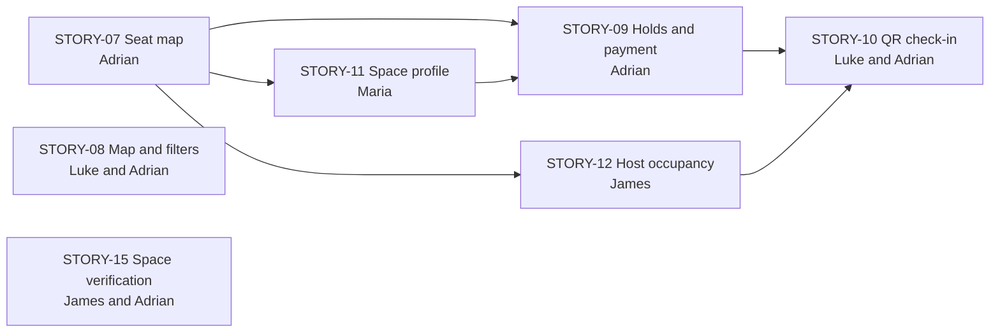

# Sprint 2 brief

**Sprint 2 · Saturday 10 to Friday 23 October 2026 · Read all of it before you start.**

This page tells each of us what to do in Sprint 2, in plain English:

- what we are building;
- what your part is;
- who you are waiting for;
- how to test your work;
- when to ask for help.

Read the whole page, not only your own section. This sprint, every story leans on another
one.

The official course version, with points and task lists, is the
[Sprint 2 plan](course/StudyHub_Sprint_2_Plan.md). If this page disagrees with your story
issue or with [`AGENTS.md`](../AGENTS.md), ask Adrian, and one of them gets fixed.

## The short version

1. **Update your machine:** `git switch main && git pull`, then `npm install`.
2. **Read your part** (section 4) and who waits for whom (section 3).
3. **Flows first, then your design doc, then code.** If you draw a shared flow, draw it
   first (section 4 says which are yours). Write your story's design doc once the flows
   it uses are merged (D-044), and write no code until Adrian merges the design (D-016).
4. **Build in small pull requests, with tests.** Run `npm run check` before every push.
5. **Own your code.** Your AI tool helps, but the Final phase checks that each of us can
   explain our own work.
6. **Stuck or unsure? Ask Adrian, or Maria about anything users see.** Don't guess.

## What we are building this sprint

Sprint 1 was the walking skeleton. Sprint 2 builds the **booking journey**, the heart of
Worq, from start to finish (D-036). By Friday 23 October, anyone watching our Prefinal demo
should see this:

1. A Host lays out their Space on a snap grid: zones, seats, standing desks and whole
   rooms.
2. An Administrator approves the Space, so Seekers can find it.
3. A Seeker finds it on a map, filters by amenities, and opens its profile: photos, tags,
   and which units are open, with when the Host last updated them.
4. The Seeker picks an open seat, pays a sandbox fee (test mode: no real money moves), and
   gets a QR code.
5. The Host scans the QR code, and the seat turns Occupied. A seat nobody claims frees
   itself when its wait window ends.
6. Through it all, the Host changes any seat's state with one tap, walk-ins included.

That's every Must Have in the SRS: 55 points, more than Sprint 1's 44. There is no cut
line. If we fall behind, the Sprint 2 review decides what carries over to Sprint 3, which
keeps reviews and the rest of the administration console.

Sprint 1's two open bugs came first, and both are fixed: #145 by #164, and #146 by #165.

## 1. Plan first, then build

The path is the same as in Sprint 1 (section 2 of the [Sprint 1 brief](SPRINT-1.md)),
with one step in front: the shared flows, then the design doc, Adrian merges it, tasks on
the board, one small pull request per task with its tests, review, and Adrian merges.
Tell your AI tool **"Start my Sprint 2 story."** It follows
[the story loop](../AGENTS.md#the-story-loop).

Three things are new this sprint:

- **Shared flows come first** (D-044). Sprint 2's stories change the same seats from
  several sides: a hold, a payment, a check-in, a Host's tap, a timer running out. So the
  flows they share are drawn once, in [`docs/flows/`](flows/README.md), and merged before
  the story designs that use them. Your design links them and draws only your story's
  part. The reservation lifecycle comes first, because five designs wait for it.
- **Adrian writes every database change**, as in Sprint 1: migrations, policies and pgTAP
  tests (D-036). If your story needs a table, a column or a policy, say exactly what in
  your design doc, and Adrian builds it in its own pull request. Don't write migrations
  yourself.
- **Maria decides what users see, do and are told**, in every story (D-042). If your
  story has screens, ask Maria to review your design doc too: Adrian merges it once Maria
  approves its user steps and UI. What the system allows and stores stays with Adrian,
  and security with Luke.

The [flows index](flows/README.md) says who draws and approves each flow, what it covers,
what it waits for, which designs wait for it, and how far it has got (D-044). Section 4
says which flows are yours.

## 2. When to ask Adrian

Ask early. A question now costs minutes; a wrong guess costs days. Ask when:

- you don't understand what your story is asking for;
- your story needs a table, a column or a policy that isn't in a merged migration yet;
- your story needs a shared flow that has no doc in [`docs/flows/`](flows/README.md) yet;
- your work would change another person's files, or a decision in
  [`DECISIONS.md`](DECISIONS.md);
- your plan needs to change after it was approved;
- you're waiting on someone and have nothing else useful to do;
- you've been stuck for about an hour;
- anything involves keys, passwords, the shared database, or the payment gateway.

Questions about what users see, do or are told go to Maria instead (D-042).

Ask in the group chat, or comment on your story's issue so the answer stays with the story.

## 3. Who waits for whom

Each story's design waits for the shared flows it uses, which the
[flows index](flows/README.md#which-story-designs-wait-for-which-flows) lists (D-044). The
diagram and the table below show what each story waits for after that, once its design is
merged.

STORY-07, the seat map, comes first, because STORY-09, STORY-11 and STORY-12 read its
tables. The longest chain is the **critical path**: the two flows STORY-07's design waits
for, the reservation lifecycle and the Host setup journey, then STORY-07's design and
tables, then STORY-09's hold and payment, then STORY-10's check-in. A delay anywhere on it
delays the demo, so its pull requests are reviewed and merged first.

| Story                                    | Owner                                      | After its design, waits for                                                    |
| ---------------------------------------- | ------------------------------------------ | ------------------------------------------------------------------------------ |
| STORY-07 Seat map builder (#56)          | Adrian                                     | No other story; it goes first                                                  |
| STORY-08 Map and filters (#57)           | Luke; Adrian writes its tag tables         | No other story for the map; Adrian's tag tables for the filters                |
| STORY-15 Space verification (#166)       | James; Adrian writes its policy            | No other story for the page; Adrian's policy for saving                        |
| STORY-11 Space profile (#76)             | Maria                                      | STORY-07's tables and photo bucket                                             |
| STORY-12 Host occupancy (#77)            | James                                      | STORY-07's tables and Server Actions                                           |
| STORY-09 Holds and sandbox payment (#58) | Adrian                                     | STORY-07's tables; STORY-11's seat map, where a Seeker picks a unit            |
| STORY-10 QR check-in and release (#59)   | Luke; Adrian writes its database functions | STORY-09's reservations; STORY-12's seat map view, for the Host's wait windows |

**While you wait,** don't sit idle: review the flows your story waits for, write your
design doc once they're merged, build what doesn't need the missing piece (page layouts,
form rules, components with sample data, tests), or review someone's pull request.

### What runs when

Each step starts as soon as what it needs is merged. In step 1, each of us also reviews
the flows our stories wait for, and approves the ones the flows index names.

| Step                    | Adrian                                                                                        | Luke                                                   | Maria                                                 | James                                                              |
| ----------------------- | --------------------------------------------------------------------------------------------- | ------------------------------------------------------ | ----------------------------------------------------- | ------------------------------------------------------------------ |
| **1. Flows**            | The reservation lifecycle first, then Space verification and the sandbox payment confirmation | The check-in, once the reservation lifecycle is merged | The Host setup journey first, then the Seeker journey | Review the flows STORY-12 and STORY-15 wait for, and both journeys |
| **2. Designs**          | STORY-07's design first, then STORY-09's; review the others                                   | STORY-08's and STORY-10's designs                      | STORY-11's design                                     | STORY-12's and STORY-15's designs                                  |
| **3. Tables first**     | STORY-07's tables and RLS; then STORY-08's tag tables and STORY-15's policy                   | STORY-08's map and search                              | STORY-11's layout and photo gallery                   | STORY-15's `/admin` page; STORY-12's layout                        |
| **4. Build**            | STORY-07's builder; STORY-09's hold and payment; then STORY-10's database functions           | STORY-08's filters; STORY-10's QR code and scan page   | STORY-11's availability view and seat map             | STORY-12's one-tap states and walk-ins                             |
| **5. Wire it together** | Wire it together; review and merge                                                            | STORY-10 on STORY-09's reservations                    | Responsive and keyboard checks                        | The Playwright journeys; walk-through as each role                 |
| **Fri 23 Oct**          | Sprint 2 review and Prefinal demo                                                             | Same, together                                         | Same, together                                        | Same, together                                                     |

## 4. Your part

Words used below (the [glossary](GLOSSARY.md) has them all):

- **Zone, unit, seat map:** a Space is split into zones, say "Quiet desks". Each zone has
  units, the smallest thing a Seeker can hold: a seat, a standing desk, or a whole room.
  The seat map is the Host's snap-grid layout of them.
- **Seat state:** Available, Pending Payment, Reserved or Occupied, and nothing else
  (D-004).
- **Hold, payment window, wait window:** a hold starts as Pending Payment. If the Seeker
  doesn't pay within the payment window, the unit goes back to Available. Once they pay,
  it's Reserved for the wait window they chose, while they travel. If they don't check in
  before it ends, that's a no-show, and the unit is released.
- **Sandbox:** the payment gateway's test mode. No real money moves, and card details
  never touch Worq (D-005).

### Adrian: STORY-07, STORY-09, and every database change

**Your flows, first (D-044).** The reservation lifecycle, which five designs wait for;
then the Space verification status, and the sandbox payment confirmation, which Luke
and Maria approve. You also approve Maria's two journeys and Luke's check-in.

**STORY-07, the seat map builder (#56).** The `zones` and `units` tables with their RLS,
the Host's snap-grid builder with an accessible list view, and the bucket for venue
photos.

**Done when:** a saved seat map persists and looks the same to a Host and a Seeker; every
unit has a type and a label, and a room has a capacity; another Host gets zero rows and
can't change them; every builder action works from the list view, by keyboard.

**STORY-09, holds and sandbox payment (#58).** A Seeker picks an Available unit, from the
seat map or the list view, chooses a wait window, and pays a sandbox fee through the
gateway's hosted checkout. The unit becomes Reserved, with a booking token.

**Done when:** only an Available unit can be held; a Seeker holds one unit at a time; a
unit in Pending Payment isn't offered to anyone else, and comes back when the payment
window lapses; a confirmed payment gives exactly one Reserved unit and one token; two
Seekers holding the same unit at the same moment get exactly one success.

**First thing:** choose the gateway (PayMongo or Stripe, D-005) and set up its test
account and keys, because that takes time. The design also settles the two timers, the
fee, and whether a whole room takes one hold, except where other stories build on the
answer: the reservation lifecycle settles those parts first (D-044).

**The database half of the others' stories:** STORY-08's tag tables, STORY-15's
verification policy, and STORY-10's check-in, check-out and release functions. Each goes
in its own pull request with its pgTAP tests, as early as you can, because the others
wait for them.

**How to test:** pgTAP for every table and policy (`npm run db:test`): the right user can,
the wrong user gets zero rows, and the owner can't make a forbidden change. For STORY-09,
a real concurrency test: two holds at the same moment.

### Luke: STORY-08 and STORY-10

**Your flow, first (D-044).** The check-in: what the QR code holds, why it works only
once, and what happens at the wrong Space. Draw it once the reservation lifecycle is
merged; Adrian and Maria approve it. You also approve the sandbox payment confirmation,
and the signed-out part of Maria's Seeker journey.

**STORY-08, map discovery and filters (#57).** A Leaflet map of OpenStreetMap tiles with
Space pins and a list beside it. Search by a typed place or campus name, or by the
device's location. A filter panel for the seven curated criteria (Wi-Fi, outlets, noise,
air-conditioning, hours, price tier, unit type), where two filters show only Spaces that
match both. Also the Host's form for tagging their Space.

**Done when:** a search shows matching pins and list entries; a pin shows the Space's
name, price tier and distance, and links to its profile; filters combine with AND; a
Space that isn't Verified never shows up; custom tags are never offered as filters.

**Waits for:** no other story for the map and the search. The filters need Adrian's tag
tables, so say in your design exactly what you need.

**STORY-10, QR check-in and release (#59).** The Seeker's dashboard shows their booking
token as a QR code. The Host scans it, or types it, and the unit becomes Occupied.
Check-out frees the unit; a no-show releases it and forfeits the fee; closing time frees
whatever is left. The Host sees each reservation's remaining wait window.

**Done when:** a valid token checks in once, and only at its own Space; a no-show
releases the unit and records the fee as forfeited; check-out and closing time return
units to Available; the Host sees the remaining wait windows.

**Waits for:** STORY-09's reservations, and Adrian's database functions for check-in.
Build the QR code, the scan page and the token rules first, against sample data.

**How to test:** Vitest for the filter query and the token rules. By hand, on the local
stack: search and filter as a Seeker, then check in a test reservation as a Host.

### Maria: STORY-11, and every story's user experience

**Your flows, first (D-044).** Two journeys, drawn as swimlanes: a Host setting up a
Space, from its details to an Administrator's approval; and a Seeker going from search to
a hold, including what a signed-out visitor gets when they try to hold a unit. Adrian
approves both, and Luke the signed-out part. James turns them into Playwright tests.

**STORY-11, the Space profile (#76).** The page a Seeker opens from the map: the Space's photos, its
curated tags and its Host's custom tags (shown differently, and never as filters), its
hours, and which units are open right now, as the seat map and as an accessible list.
Wherever availability appears, a label says "Host-updated · X min ago", never "real-time"
or "live" (D-002). Also the Host's photo upload.

**Done when:** the availability view shows the open units in each zone and when they were
last updated; custom tags look different from curated ones; the list view shows every
unit's state and works by keyboard alone; the page fits 360, 768 and 1024 px without
scrolling sideways.

**Waits for:** STORY-07's tables and photo bucket. Start with the layout and the
components, with sample data.

**Others need from you:** STORY-09 adds a "hold this unit" action to your seat map and
list view, so agree its shape with Adrian: the Seeker journey settles the steps, and your
design doc the control.

**Every story's user experience (D-042).** You decide what users see, do and are told in
every Sprint 2 story, not only yours. Review the user steps and the UI in each design doc
with screens before Adrian merges it, STORY-07's included (D-043). Where a screen shows a
rule someone else owns, such as how long a Seeker has to pay, you propose it and the
rule's owner confirms it. You also approve what the reservation lifecycle, the Space
verification flow, the sandbox payment confirmation and the check-in say users see and
are told (D-044).

**How to test:** `npm run check`; by hand at 360, 768 and 1024 px, and with the keyboard
only.

### James: STORY-12, STORY-15, and Sprint 2 QA

**STORY-12, Host occupancy (#77).** On their seat map, the Host taps a unit to set it
Available, Reserved or Occupied, walk-ins included, and confirms before overriding a unit
a Seeker has reserved. Each change stamps the time, so the Seekers' "Host-updated" label
stays honest.

**Done when:** a Host's change shows on the Seeker's side within one refresh; a walk-in
can be marked Occupied with no reservation; another Host can't change your units.

**Waits for:** STORY-07's tables and actions. Build the view with sample data first.

**STORY-15, Space verification (#166).** The `/admin` page: every Pending Space, with
Approve and Reject buttons. Approving makes it public; rejecting keeps it hidden (D-037).
Adrian writes the policy that lets only an Administrator change a Space's status.

**Done when:** an Administrator approves or rejects a Pending Space; only Verified Spaces
reach Seekers; only an Administrator can open `/admin`.

**Waits for:** Adrian's policy, for saving. The page and its layout don't wait for it.

**Sprint 2 QA.** Turn Maria's two journeys into Playwright tests (D-044), and grow them as
the stories land: a Host sets up a Space and an Administrator approves it, then a Seeker
finds it, opens it, and picks a seat. Review both journeys before they merge, so that
every path in them can be tested, and the flows your stories wait for: the reservation
lifecycle (STORY-12) and the Space verification flow (STORY-15). Before Friday's review,
check every merged story against the Definition of Done.

**How to test:** `npm run test:e2e` against the local stack. By hand, locally, as
`host@example.test` and `admin@example.test`.

## 5. Sprint calendar

These are targets. If you're going to miss one, say so as soon as you know, not on the
day.

| Date       | Target                                                                     |
| ---------- | -------------------------------------------------------------------------- |
| Tue 13 Oct | Sprint 2 plan merged                                                       |
| Tue 20 Oct | Story designs start again (D-043), after the shared flows they use (D-044) |
| Fri 23 Oct | Sprint 2 review and Prefinal demo                                          |

In between, the work runs in the order of the steps in section 3: flows, designs, tables
first, the build, then wiring it together, ending with a full walk-through as each role.

## 6. Rules we never break

- Never push to `main`, and never force-push. Only Adrian merges.
- Branches are named `feature/STORY-xx-short-desc`.
- Invented test data only: invented names and `@example.test` emails (D-013).
- Keys go only in your own `.env.local`: never in chat, commits or screenshots. That
  includes the payment gateway's test keys.
- Payments stay in sandbox mode: test keys only, and no real card numbers (D-005).
- If an AI helped, say so in the pull request's "AI assistance" section and add its
  `Co-Authored-By:` line. You own the work, and you must be able to explain every line.

Something here unclear or wrong? Tell Adrian. This page gets fixed in a pull request like
everything else.
