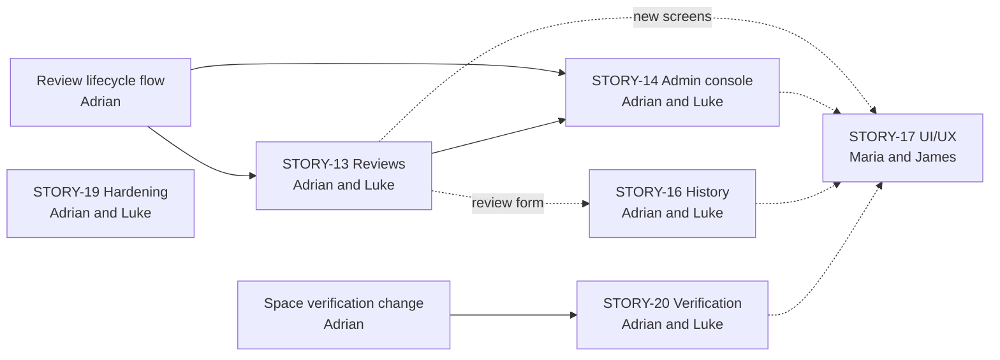

# Sprint 3 brief

**Sprint 3 · Tuesday 17 November to Sunday 6 December 2026 (D-075) · Read all of it
before you start.**

This page tells each of us what to do in Sprint 3, in plain English:

- what we are building;
- what your part is;
- who you are waiting for;
- how to test your work;
- when to ask for help.

The official course version, with points and task lists, is the
[Sprint 3 plan](course/StudyHub_Sprint_3_Plan.md). If this page disagrees with your story
issue or with [`AGENTS.md`](../AGENTS.md), ask Adrian, and one of them gets fixed.

## The short version

1. **Update your machine:** `git switch main && git pull`, then `npm install`.
2. **Read your part** (section 4) and who waits for whom (section 3).
3. **Flows first, then the design doc, then code**, as in Sprint 2 (D-016, D-044).
4. **Build in small pull requests, with tests.** Run `npm run check` before every push.
5. **Own your code.** Your AI tool helps, but the Final checks that each of us can explain
   our own work.
6. **The last merge is Saturday 5 December.** The Final is Monday 7 December. There are
   no other dates: everything is done before then.

## What we are building this sprint

Sprint 2 built the whole booking journey. Sprint 3 makes it feel finished, and adds what
the SRS still asks for:

1. **A better UI/UX.** Most of our screens were generated, and it shows. Maria and James
   audit every screen, pick a visual direction, and restyle the app.
2. **Reviews.** A Seeker who checked in rates the Space on noise, Wi-Fi, cleanliness and
   comfort. Everyone, signed out included, sees the averages, and a user can report a
   bad review.
3. **Administration.** An Administrator hides or removes reported reviews, reads the
   sandbox payment records, and refunds a hold a Host couldn't honour.
4. **Reservation history.** A Seeker sees their past visits, can hold the same seat
   again, and gets an email when a hold is confirmed.
5. **Verification, finished.** A rejected Host sees why and can resubmit, and a Verified
   Space whose name or location changes goes back for approval.
6. **Ready for the Final.** A production database, the concurrency test in CI, tests for
   every role, and accessibility and speed checks.

That's 39 points in 20 days, faster than Sprint 2. If we fall behind, the plan's cut
order (§6) says what goes first, from the email up to the UI fixes, which go last.

## 1. What's new this sprint

The path is the same as in Sprint 2 ([section 1 of its brief](SPRINT-2.md)): the shared
flows, then the design doc, Adrian merges it, tasks on the board, one small pull request
per task with its tests, review, and Adrian merges. Tell your AI tool **"Start my Sprint
3 story."** It follows [the story loop](../AGENTS.md#the-story-loop).

Four things are new:

- **The work splits by layer, not by story** (D-075). Maria and James own the UI/UX.
  Adrian builds the backend of every feature story, and Luke builds its app side, so
  each feature story has two people. Section 4 says where the line is.
- **The feature screens get their UI review after they're built** (D-073). Adrian and
  Luke build STORY-13, STORY-14, STORY-16 and STORY-20 end to end, screens included,
  and their design docs don't wait for Maria's approval. Maria and James then review
  those screens and restyle what doesn't fit, in STORY-17.
- **The built UI wins** (D-074). Once Maria or James merge a change to a screen, what
  they built is the reference for what users see, over any older flow or design doc.
  After that, a change to that screen's look needs Maria's or James's approval. The SRS
  still binds them: WCAG 2.1 AA, and 48 × 48 px controls.
- **A fix or a design change** (D-075). A change that makes a screen match its merged
  design is a **fix**: a bug issue, and a `fix(STORY-xx)` pull request under the story
  that built the screen, with no design doc. A change to what the design says is a
  **design change**, and belongs to STORY-17.

## 2. When to ask Adrian

Ask early. A question now costs minutes; a wrong guess costs days. Ask when:

- you don't understand what your story is asking for;
- your story needs a table, a column or a policy that isn't in its design or a merged
  migration yet;
- your work would change another person's files, or a decision in
  [`DECISIONS.md`](DECISIONS.md);
- your plan needs to change after it was approved;
- you're waiting on someone and have nothing else useful to do;
- you've been stuck for about an hour;
- anything involves keys, passwords, the shared database, or the payment gateway.

Questions about what users see, do or are told go to Maria or James (D-042, D-074).

## 3. Who waits for whom

The two new shared flows come first, because three designs wait for them. The review
lifecycle (#339) is the start of the **critical path**: STORY-13's design and tables, then
STORY-13's and STORY-14's screens, then Maria and James's review of them, then the last
merge. Adrian's database pull requests are reviewed and merged first, because Luke's
pages wait for them.

| Story                                   | Owners                                  | After its design, waits for                                     |
| --------------------------------------- | --------------------------------------- | --------------------------------------------------------------- |
| STORY-17 UI/UX refresh (#336)           | Maria and James                         | Nothing to start; each new feature screen, to review it         |
| STORY-13 Reviews (#78)                  | Adrian (database), Luke (app)           | The review lifecycle flow, before its design                    |
| STORY-14 Administration console (#79)   | Adrian (database, refund), Luke (pages) | The review lifecycle flow, and STORY-13's tables                |
| STORY-16 History and Hold again (#335)  | Adrian (database, email), Luke (pages)  | Nothing; its "Leave a review" link waits for STORY-13's form    |
| STORY-20 Verification follow-ups (#338) | Adrian (status rules), Luke (pages)     | The Space verification flow's change, before its design         |
| STORY-19 Final hardening (#337)         | Adrian, Luke                            | Nothing for the production project; the rest, the other stories |

**While you wait,** don't sit idle: review the flows and designs your work waits for,
build what doesn't need the missing piece (page layouts, form rules, components with
sample data, tests), or review someone's pull request.

### What runs when

Each step starts as soon as what it needs is merged.

| Step                   | Adrian                                                                            | Luke                                                        | Maria and James                             |
| ---------------------- | --------------------------------------------------------------------------------- | ----------------------------------------------------------- | ------------------------------------------- |
| **1. Flows and audit** | The review lifecycle, then the Space verification change                          | Review both flows                                           | The audit of every screen                   |
| **2. Designs**         | STORY-13's, STORY-14's, STORY-16's, STORY-20's and STORY-19's designs             | The screens section of each; approve Adrian's pull requests | STORY-17's design: the visual direction     |
| **3. Tables first**    | STORY-13's tables, then STORY-14's, STORY-16's and STORY-20's; production project | Pages and forms against sample data                         | The restyle, one group of screens at a time |
| **4. Build**           | The refund, the email, `db:race` in CI, #218                                      | Wire the pages to Adrian's functions; tests                 | Fixes filed during the audit; the restyle   |
| **5. Finish**          | The Definition of Done check; merge everything by Sat 5 Dec                       | The journeys for every role, accessibility and speed checks | Review and restyle the new feature screens  |
| **Mon 7 Dec**          | The Final                                                                         | Same, together                                              | Same, together                              |

## 4. Your part

Words used below (the [glossary](GLOSSARY.md) has them all):

- **Visit:** a reservation with a check-in. Each one allows one review (D-009).
- **Reported review:** a review a user reported to an Administrator. Hiding or removing
  it takes it off the profile and out of the averages.
- **Hold again:** from a past reservation, opening its Space's profile with the same
  unit picked (D-077). It never holds anything by itself, and never for later (D-001).
- **Fix, design change:** see section 1.

### Adrian: the backend, both flows, and hardening

**Your flows, first (D-044).** The review lifecycle (#339): a review from posted to
reported, hidden or removed, and edited or deleted by its author. Then the change to the
Space verification flow (#340): rejection reasons, resubmitting, a name or location edit
going back to Pending, taking a Space down, and what happens to its holds. Luke and Maria
approve both.

**Your designs.** STORY-13's, STORY-14's, STORY-16's, STORY-19's and STORY-20's. Luke adds
the screens section of each as his own commits on your branch, and approves the pull
request.

**Your backend.** Everything in `supabase/` for STORY-13, STORY-14, STORY-16 and
STORY-20: tables, policies, database functions, pgTAP tests and seed data. Also the
Stripe sandbox refund (STORY-14), the confirmation email through Resend (STORY-16), and
for STORY-19 the production project, `npm run db:race` in CI, #218, and the Definition
of Done check.

**Done when:** each story's database half passes its pgTAP negatives (the wrong user gets
zero rows, the owner can't make a forbidden change); the Final deployment runs on the
production project; the last merge is in by Saturday 5 December.

**How to test:** `npm run db:test` and `npm run db:race`; Stripe in test mode; the email
without calling Resend from tests (D-078).

### Luke: the app side of the feature stories, and the end-to-end checks

**Your part of each design.** The screens section of STORY-13's, STORY-14's, STORY-16's
and STORY-20's designs, on Adrian's branch. You also approve Adrian's pull requests
(D-014).

**Your app.** For the same four stories: `lib/data/`, `lib/validation/`, Server Actions,
pages and components, and their tests:

- STORY-13: the review form, the reviews and averages on the profile and the Space card,
  edit, delete and report.
- STORY-14: the moderation and payments pages on `/admin`, and the Refund action.
- STORY-16: the history page, Hold again, and "Leave a review".
- STORY-20: the reason on Reject, the "Edited" mark, Take down, and the Host's reason,
  Resubmit and edit warning.

For STORY-19: the Playwright journeys for every role, the accessibility sweep, and the
performance measures against SRS §3.4.

**Done when:** every feature story's acceptance criteria pass; every role's journey is a
Playwright test; every route passes the accessibility sweep.

**Waits for:** Adrian's functions, for wiring. Build the pages against sample data first.

**How to test:** `npm run check` and `npm run test:e2e` against the local stack.

### Maria and James: STORY-17, the UI/UX

**First, the audit.** Every route at 360, 768 and 1024 px, with text at 200% and with the
keyboard only. Sort each finding: a fix becomes a bug issue under the story that built
the screen; a design change goes into STORY-17's design.

**Then, the direction.** You decide the look (D-042), and write it down in STORY-17's
design doc: layout, type, spacing, components and wording. Try it on one key screen
first. If the audit finds more than 10 points of work, STORY-17 splits, and the second
half is STORY-18.

**Then, the restyle.** One group of screens at a time: public pages and discovery, the
Seeker's pages, the Host portal, the Administrator portal. Once a feature screen from
STORY-13, STORY-14, STORY-16 or STORY-20 is built, review it and restyle it where it
doesn't fit (D-073).

**What binds you.** The SRS: WCAG 2.1 AA contrast and 48 × 48 px controls (SRS §3.2.2).
Colours and fonts stay design tokens (D-031). What the system allows and stores stays
with Adrian and Luke (D-042).

**Done when:** every route is audited; the direction is written down before the restyle;
every restyled screen meets WCAG 2.1 AA; the new feature screens are reviewed.

**How to test:** `npm run check` and `npm run test:e2e`, updating the tests your restyle
breaks in the same pull request; by hand at 360, 768 and 1024 px, and with the keyboard
only.

## 5. Sprint calendar

| Date       | What            |
| ---------- | --------------- |
| Tue 17 Nov | Sprint 3 starts |
| Sat 5 Dec  | The last merge  |
| Mon 7 Dec  | The Final       |

There are no other targets (D-075). The work runs in the order of the steps in section
3, and each piece starts as soon as what it needs is merged.

## 6. Rules we never break

- Never push to `main`, and never force-push. Only Adrian merges.
- Branches are named `feature/STORY-xx-short-desc`.
- Invented test data only: invented names and `@example.test` emails (D-013).
- Keys go only in your own `.env.local`: never in chat, commits or screenshots. That
  includes the payment gateway's and Resend's keys.
- Payments stay in sandbox mode: test keys only, and no real card numbers (D-005).
- If an AI helped, say so in the pull request's "AI assistance" section and add its
  `Co-Authored-By:` line. You own the work, and you must be able to explain every line.

Something here unclear or wrong? Tell Adrian. This page gets fixed in a pull request like
everything else.
