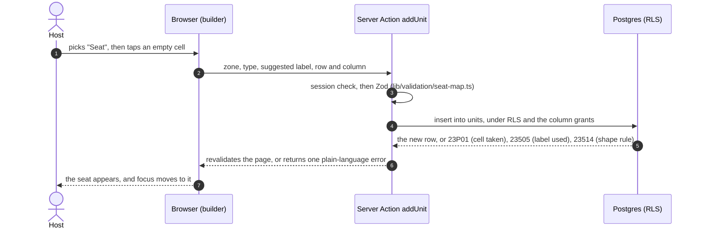

# STORY-07: Snap-grid seat map builder

**Status:** draft · **Owner:** @dreeyanzz · **Story:** #56 · **FR:** FR-3.1, SRS §3.2.2 ·
**Depends on:** STORY-01 and STORY-05 · **Decisions:** D-002, D-003, D-004, D-006, D-007,
D-010, D-013, D-039 and D-040

## 0. Scope

**In:**

- The `zones` and `units` tables, with their Row-Level Security, column grants and pgTAP
  tests (FR-3.1, D-003).
- The seat map's grid (D-039): each zone is a band 6 cells wide, with as many rows as it
  needs. A seat or a standing desk takes one cell, and a whole room takes 2 or 3 cells in
  one row.
- The Host's builder at `/host/spaces/[spaceId]/seat-map`. It adds, renames, reorders and
  deletes zones, and adds, edits, moves and removes units. Every change saves at once
  through its own Server Action (D-010, D-039).
- A list view with every builder action, usable by keyboard alone (SRS §3.2.2).
- One renderer for the seat map, in `components/seat-map/`, which STORY-11 and STORY-12
  reuse, so a saved map renders the same for Hosts and Seekers (FR-3.1).
- The `space-photos` Storage bucket and its policies, for STORY-11's uploads (D-040).
- Seeded seat maps for the local stack and CI, the first one modelled on SRS Figure 3.

**Out:**

- Changing a unit's seat state, walk-ins included: STORY-12 (#77). This story creates every
  unit as Available and gives Hosts no way to change it.
- Holds, and what deleting a held unit does: STORY-09 (#58).
- Showing the seat map to Seekers, the "Host-updated" label, and uploading photos:
  STORY-11 (#76).
- Tags on units (D-006): STORY-08 (#57).
- Seat maps on the cloud dev project. A Host builds them there through the app, and the
  seed stays local (D-013, D-028).

## 1. Flow

A Host places a seat on the grid. The list view's "Add a unit" form calls the same action.



Moving and editing work the same way. The Host selects a unit, then taps an empty cell or
saves the unit's form. Each change is one row and one round trip, so a closed tab loses at
most the change in flight.

## 2. Data and state

**Enums.** This PR adds both to the glossary.

- `unit_type`: `seat`, `standing_desk`, `room`. The UI says "Seat", "Standing desk" and
  "Whole room".
- `seat_state`: `available`, `pending_payment`, `reserved`, `occupied` (D-004). There is
  no Maintenance state.

**`zones`**, the named bands of a Space's seat map:

| Column                     | Type          | Rules                                                                                          |
| -------------------------- | ------------- | ---------------------------------------------------------------------------------------------- |
| `id`                       | `uuid` PK     | Default `gen_random_uuid()`                                                                    |
| `space_id`                 | `uuid`        | Not null; references `spaces(id)`, on delete cascade                                           |
| `name`                     | `text`        | Not null, 1–60 characters, no spaces at either end; unique in its Space, ignoring case         |
| `position`                 | `smallint`    | Not null, 0 or more. Zones show in this order, top to bottom; a tie falls back to `created_at` |
| `created_at`, `updated_at` | `timestamptz` | As in `spaces`                                                                                 |

`(id, space_id)` is unique too, so `units` can reference both.

**`units`**, the things a Seeker can hold (D-003):

| Column                     | Type          | Rules                                                                                                                                                         |
| -------------------------- | ------------- | ------------------------------------------------------------------------------------------------------------------------------------------------------------- |
| `id`                       | `uuid` PK     | Default `gen_random_uuid()`                                                                                                                                   |
| `space_id`                 | `uuid`        | Not null; references `spaces(id)`, on delete cascade. It repeats the zone's Space, so policies and queries need one hop, and a label can be unique in a Space |
| `zone_id`                  | `uuid`        | Not null. `(zone_id, space_id)` references `zones(id, space_id)`, on delete cascade, so a unit's zone is always in the unit's own Space                       |
| `unit_type`                | `unit_type`   | Not null                                                                                                                                                      |
| `label`                    | `text`        | Not null, 1–12 characters, no spaces at either end; unique in its Space, ignoring case                                                                        |
| `capacity`                 | `smallint`    | 1–50 for a whole room; null for a seat or a standing desk (FR-3.1)                                                                                            |
| `grid_row`                 | `smallint`    | Not null, 0–49                                                                                                                                                |
| `grid_col`                 | `smallint`    | Not null, 0–5                                                                                                                                                 |
| `col_span`                 | `smallint`    | Not null, default 1. 1 for a seat or a standing desk, 2 or 3 for a whole room; `grid_col + col_span` is at most 6                                             |
| `seat_state`               | `seat_state`  | Not null, default `available`. Never granted to Hosts in this story (STORY-12)                                                                                |
| `state_updated_at`         | `timestamptz` | Not null, default `now()`. A trigger sets it whenever `seat_state` changes, and STORY-11's "Host-updated" label reads it (D-002)                              |
| `created_at`, `updated_at` | `timestamptz` | As in `spaces`. `updated_at` changes with any edit, a move included                                                                                           |

**No overlaps.** An exclusion constraint rejects two units in the same zone and row whose
columns overlap:
`exclude using gist (zone_id with =, grid_row with =, int4range(grid_col, grid_col + col_span) with &&)`.
It needs the `btree_gist` extension, which the migration creates in `extensions`. Of two
requests racing for the same cell, exactly one succeeds and the other gets `23P01`. The
builder looks for a free cell first, but the database is the backstop.

**Functions, in schema `private`:**

- `private.set_updated_at()` (STORY-01), on both tables.
- `private.set_state_updated_at()`, new: before an update that changes `seat_state`, it sets
  `state_updated_at` to `now()`. It stamps every state change, whoever makes it (STORY-09,
  STORY-10, STORY-12).

**Seat state.** This story only creates units. STORY-09, STORY-10 and STORY-12 add the
other transitions of D-004.

| From   | Event                | To          | Precondition            | Who  |
| ------ | -------------------- | ----------- | ----------------------- | ---- |
| (none) | The Host adds a unit | `available` | The Host owns the Space | Host |

**Zod schemas**, in `lib/validation/seat-map.ts`, shared by the builder and the actions:

- `zoneNameSchema`: trimmed, 1–60 characters.
- `unitSchema`: `unitType`; `label` trimmed, 1–12 characters; `capacity` required for a
  whole room (1–50) and absent otherwise; `colSpan` 1 for a seat or a standing desk, 2 or 3
  for a whole room.
- `cellSchema`: `row` 0–49, `col` 0–5, and `col + colSpan` at most 6.
- `zoneIdSchema` and `unitIdSchema`: UUIDs, so a malformed id never reaches Postgres
  (STORY-05 §2.4).

**Grants and RLS.** The migration revokes everything from `anon` and `authenticated`, then
grants back only these lines. Both tables follow their Space: a policy that reads `spaces`
gets only the Spaces the caller may see (STORY-01), so a zone or a unit is visible exactly
when its Space is.

| Table   | Verb   | Who                 | Columns granted                                                                             | Policy                                                                                      |
| ------- | ------ | ------------------- | ------------------------------------------------------------------------------------------- | ------------------------------------------------------------------------------------------- |
| `zones` | select | anon, authenticated | all                                                                                         | The zone's Space is visible to the caller: Verified, their own, or any for an Administrator |
| `zones` | insert | authenticated       | `space_id`, `name`, `position`                                                              | The caller owns the Space                                                                   |
| `zones` | update | authenticated       | `name`, `position`                                                                          | The caller owns the Space                                                                   |
| `zones` | delete | authenticated       | —                                                                                           | The caller owns the Space. Its units go with it                                             |
| `units` | select | anon, authenticated | all                                                                                         | As for `zones`                                                                              |
| `units` | insert | authenticated       | `space_id`, `zone_id`, `unit_type`, `label`, `capacity`, `grid_row`, `grid_col`, `col_span` | The caller owns the Space                                                                   |
| `units` | update | authenticated       | the same, without `space_id`                                                                | The caller owns the Space                                                                   |
| `units` | delete | authenticated       | —                                                                                           | The caller owns the Space                                                                   |

`id`, `seat_state`, `state_updated_at` and the timestamps are never granted, and `space_id`
only on insert, so setting them is refused with `42501` whatever the policies say. An
Administrator reads every seat map, as STORY-15's review needs, and changes none.

**The `space-photos` bucket** (D-040), created in a migration:

- Public, so a photo loads by its URL. Each file is at most 5 MB, and JPEG, PNG or WebP.
- A photo's path starts with its Space's id: `<space_id>/<file name>`.
- Policies on `storage.objects`, for this bucket only: insert, update and delete when the
  first folder is a Space the caller owns; select (listing) when that Space is visible to
  the caller. A public URL needs no policy.
- Whether photos also need a table, for their order and alt text, is STORY-11's call. If
  they do, Adrian adds it with STORY-11's database task.

**Seed** (`supabase/seed.sql`, local and CI only). Every unit starts Available.

- Kapihan Study Hall (Verified, host@): Figure 3's map. "Quiet desks" holds S1–S8,
  "Standing desks" holds D1–D4, and "Private rooms" holds Room A (capacity 6, 3 cells) and
  Room B (capacity 4, 2 cells).
- Kapihan Night Desk (Pending, host@): one zone with two seats, for the "0 rows" tests.
- Sulok Co-working (Verified, host2@): one zone with three seats, for host2's own tests.

**What other stories build on:**

| Story    | Uses                                                                                                                                                                   |
| -------- | ---------------------------------------------------------------------------------------------------------------------------------------------------------------------- |
| STORY-08 | `units.unit_type`, for the "unit type" filter. Anyone may read the units of a Verified Space                                                                           |
| STORY-09 | `units.id`, for `reservations`, and `seat_state`. Its design decides what happens when a Host deletes a unit with a hold, and whether a whole room takes one hold      |
| STORY-11 | `getSeatMap()` and the shared renderer, on the Space profile; `state_updated_at`, for the "Host-updated" label; the `space-photos` bucket                              |
| STORY-12 | The shared renderer, for the Host's occupancy view. Adrian adds the way a Host changes `seat_state` with STORY-12's database task; the trigger already stamps the time |
| STORY-15 | An Administrator can read a Pending Space's seat map before approving it                                                                                               |

## 3. UI and files

**Routes and components:**

- `/host/spaces/[spaceId]/seat-map` (Server Component). It loads the Space owner-scoped, as
  the edit page does, so another Host or an Administrator gets the not-found page
  (STORY-05 §1.3). It shows the Space's name, a link back to `/host`, and two views behind
  links: **Grid**, the default, and **List** (`?view=list`).
- The Space list on `/host` gains a "Seat map" link on each card, next to Edit and Delete.
- `components/seat-map/seat-map-grid.tsx`: the shared renderer. It has no `'use client'`,
  so Server and Client Components can both use it. Each zone is a heading and a 6-column
  CSS grid. The optional `renderUnit` and `renderEmptyCell` let the builder, and later
  STORY-09 and STORY-12, add controls without changing how the map looks.
- `components/seat-map/unit-tile.tsx`: a unit's tile. It shows the label, the seat state
  in words (never color alone), and a whole room's capacity; a small icon tells a seat from
  a standing desk. A label too long for its tile is cut off with an ellipsis, but its
  accessible name never is.
- `_components/seat-map-builder.tsx` (Client Component): the grid view.
  - A toolbar adds a seat, a standing desk, a whole room or a zone.
  - After the Host picks a type, the empty cells become "Place here" buttons. The new unit
    gets the next free label (S9, D5, Room C), which the Host can change.
  - Selecting a unit opens its panel: label, type, a whole room's capacity and width, Move
    (then tap an empty cell), and Remove, with a confirmation.
- `_components/seat-map-list.tsx`: the list view. For each zone:
  - a heading, and the zone's actions: Rename, Move up, Move down and Delete. Delete asks
    first, and says how many units go with the zone;
  - a table of its units (label, type, capacity, row and column, width), each with Edit and
    Remove;
  - an "Add a unit" form whose row and column default to the first free cell.

  These are plain forms, so they work by keyboard alone and before JavaScript loads.

- `_components/unit-form.tsx` and `_components/zone-form.tsx` (Client Components): shared
  by both views, with `useActionState`, as in STORY-05.
- `actions.ts`: `createZone`, `renameZone`, `moveZone`, `deleteZone`, `addUnit`,
  `updateUnit`, `moveUnit` and `removeUnit`. Each one:
  - checks the session, and sends an expired one to `/login`, as since #137;
  - validates its input with Zod;
  - writes one row (`moveZone` writes two), and asks for it back, so 0 rows is an error
    (STORY-05 §2.6);
  - revalidates the page.

  Errors map to plain words: `23P01` is "That spot is taken"; `23505` is "Another unit in
  this Space is already called S4" or "This Space already has a zone called Rooms"; `23514`
  is the field's own rule; anything else is "We could not save this change".

- `lib/data/seat-map.ts`: `getSeatMap(supabase, spaceId)`, a server query helper that
  returns the zones in order, each with its units by row and column. STORY-11 and STORY-12
  call it too.
- `lib/seat-map/grid.ts`: pure rules, with no database and no React: the column count (6),
  whether a unit fits at a cell, the first free cell, how many rows to draw, and the next
  free label.

**Where the files go:**

```
app/(dashboard)/host/spaces/[spaceId]/seat-map/
  page.tsx  actions.ts
  _components/  seat-map-builder.tsx  seat-map-list.tsx  unit-form.tsx  zone-form.tsx
app/(dashboard)/host/_components/space-list.tsx   the "Seat map" link
components/seat-map/   seat-map-grid.tsx  unit-tile.tsx
lib/seat-map/          grid.ts  grid.test.ts
lib/validation/        seat-map.ts  seat-map.test.ts
lib/data/              seat-map.ts
supabase/migrations/   <timestamp>_seat_map.sql  <timestamp>_space_photos.sql
supabase/tests/        03-seat-map.sql  04-space-photos.sql
supabase/seed.sql      the seeded seat maps
lib/supabase/database.types.ts   regenerated
```

The build PRs update the layout note in `AGENTS.md` as `components/seat-map/`,
`lib/seat-map/` and `lib/data/` arrive.

**Accessibility (SRS §3.2.2):**

- 6 cells of at least 48 × 48 px, with 4 px gaps, fit the Host portal's 328 px at a
  360 px screen, so the grid never scrolls sideways. That holds only if the grid sits
  directly on the page, not inside a padded Card. On larger screens it is at most 576 px
  wide.
- Empty cells are buttons only while the Host is placing or moving a unit, so otherwise the
  grid holds few tab stops. Each one has a name, such as "Place at row 2, column 3 in Quiet
  desks".
- After a change, focus moves to the new or moved unit, or to its zone after a removal. An
  `aria-live` region announces the result or the error.
- The list view is the keyboard path, and it offers every action the grid does.
- Native `select` and radio inputs, styled like STORY-02's Input, until the design system
  has a Select.

## 4. Security and test matrix

pgTAP runs in `03-seat-map.sql` and `04-space-photos.sql`, against the seeded accounts.

| Layer  | Case                                                                                                        | Expected                                  |
| ------ | ----------------------------------------------------------------------------------------------------------- | ----------------------------------------- |
| pgTAP  | An anonymous visitor or a Seeker lists zones and units                                                      | Only those of Verified Spaces             |
| pgTAP  | A Seeker inserts a zone or a unit; updates or deletes one                                                   | `42501`; 0 rows                           |
| pgTAP  | host creates a zone, then adds, moves, relabels and removes units, in their own Pending Space               | Succeeds                                  |
| pgTAP  | host2 reads the zones and units of host's Pending Space                                                     | 0 rows                                    |
| pgTAP  | host2 inserts a zone into host's Space, or a unit into host's zone                                          | `42501`                                   |
| pgTAP  | host2 updates or deletes host's zones or units                                                              | 0 rows                                    |
| pgTAP  | An Administrator reads a Pending Space's seat map; tries to insert, update or delete                        | The rows; `42501` or 0 rows               |
| pgTAP  | host sets `seat_state`, `state_updated_at` or `space_id` on their own unit                                  | `42501`                                   |
| pgTAP  | host places a unit on a taken cell, or a room over one                                                      | `23P01`                                   |
| pgTAP  | host reuses a label in the same Space, in another case                                                      | `23505`                                   |
| pgTAP  | host saves a seat with a capacity, a room without one, a seat 2 cells wide, or a room past the sixth column | `23514`                                   |
| pgTAP  | host moves a unit into a zone of another Space                                                              | `23503`                                   |
| pgTAP  | `seat_state` changes; a label changes                                                                       | `state_updated_at` moves; it doesn't      |
| pgTAP  | host uploads a photo to their own Space's folder; to host2's; a Seeker or an anonymous visitor uploads      | Succeeds; rejected; rejected              |
| pgTAP  | host2 deletes host's photo                                                                                  | 0 rows                                    |
| Vitest | `grid.ts`: spans, bounds, the first free cell, the next label                                               | Pure                                      |
| Vitest | `seat-map.ts` schemas: trimming, lengths, a room's capacity, widths, bounds                                 | Pure                                      |
| Manual | As host@, build a map in both views at 360, 768 and 1024 px, then use the list view by keyboard only        | No sideways scrolling; every action works |
| Manual | Reload after each change                                                                                    | The map is unchanged                      |
| Manual | host2@ and admin@ open host@'s builder URL                                                                  | Not found                                 |

**Acceptance criteria (#56),** and where each is checked:

- "A saved seat map persists and renders the same for a Host and a Seeker": in two halves.
  TSK-07.5's review shows a saved map unchanged after a reload, through the shared
  renderer. STORY-11's review shows the Seeker's profile rendering the same rows through
  the same renderer.
- "Every unit has a type and a label, and a whole room has a capacity": the `23514` cases
  above, and the Zod tests.
- "Another Host gets 0 rows for a Space's zones and units, and cannot change them": the
  host2 cases above.
- "An accessible list view offers every action the snap grid offers, by keyboard alone":
  the manual check in TSK-07.6's review.

## 5. Tasks and estimates

All of them are Adrian's (D-036).

| Task     | What                                                                                                                                        | Owner      | Points (1–10) | Days | Depends on         |
| -------- | ------------------------------------------------------------------------------------------------------------------------------------------- | ---------- | ------------- | ---- | ------------------ |
| TSK-07.1 | The `zones` and `units` migration: enums, tables, constraints, trigger, grants and RLS; `03-seat-map.sql`; the seeded seat maps; `db:types` | @dreeyanzz | 3             | 1    | This design merged |
| TSK-07.2 | The `space-photos` bucket and its policies; `04-space-photos.sql`                                                                           | @dreeyanzz | 1             | 0.5  | This design merged |
| TSK-07.3 | `lib/seat-map/grid.ts` and `lib/validation/seat-map.ts`, with their Vitest tests                                                            | @dreeyanzz | 1             | 0.5  | This design merged |
| TSK-07.4 | `getSeatMap()` and the Server Actions, with their error messages                                                                            | @dreeyanzz | 2             | 1    | TSK-07.1, TSK-07.3 |
| TSK-07.5 | The shared renderer, the builder page and its grid view, and the "Seat map" link                                                            | @dreeyanzz | 2             | 1    | TSK-07.4           |
| TSK-07.6 | The list view, with every action                                                                                                            | @dreeyanzz | 1             | 0.5  | TSK-07.4           |

That is 10 points over 4.5 days. The last half day of the story's 5 is for review fixes.

## 6. Build order

One PR per row, and every PR targets `main`. Rows 1 and 2 go first, because STORY-09,
STORY-11 and STORY-12 wait for them (Sprint 2 brief, section 3).

| #   | Branch                              | PR title                                               | Contains |
| --- | ----------------------------------- | ------------------------------------------------------ | -------- |
| 1   | `feature/STORY-07-seat-map-tables`  | `feat(STORY-07): add the zones and units tables`       | TSK-07.1 |
| 2   | `feature/STORY-07-photo-bucket`     | `feat(STORY-07): add the space photos bucket`          | TSK-07.2 |
| 3   | `feature/STORY-07-seat-map-rules`   | `feat(STORY-07): add the seat map grid and form rules` | TSK-07.3 |
| 4   | `feature/STORY-07-seat-map-actions` | `feat(STORY-07): add the seat map server actions`      | TSK-07.4 |
| 5   | `feature/STORY-07-seat-map-builder` | `feat(STORY-07): add the seat map builder`             | TSK-07.5 |
| 6   | `feature/STORY-07-seat-map-list`    | `feat(STORY-07): add the seat map list view`           | TSK-07.6 |

## 7. Rejected alternatives

D-039 and D-040 record the layout, saving and photo choices, and what they rejected. Within
this design:

- **Checking overlaps only in the app:** two requests could still race. The exclusion
  constraint is the backstop.
- **Rooms that span rows too:** two-dimensional spans complicate the overlap rule and the
  list view, and Figure 3's rooms take one row.
- **Drag and drop:** tapping to place and tapping to move work the same with a mouse or a
  finger, and the list view covers the keyboard, without a drag library.
- **Letting Hosts set `seat_state` now:** a Host's change has to meet STORY-09's holds and
  STORY-12's override warning (FR-3.2), so it is designed with them.
- **Labels unique per zone, not per Space:** a Seeker's booking names the unit, so "S4"
  must mean one unit in the Space.

## 8. Open questions

None blocking. Two belong to other stories' designs, and §2's "What other stories build
on" names them: what deleting a held unit does (STORY-09), and whether photos need a
table (STORY-11).

## 9. After the build

Fill this in when the story is done.
