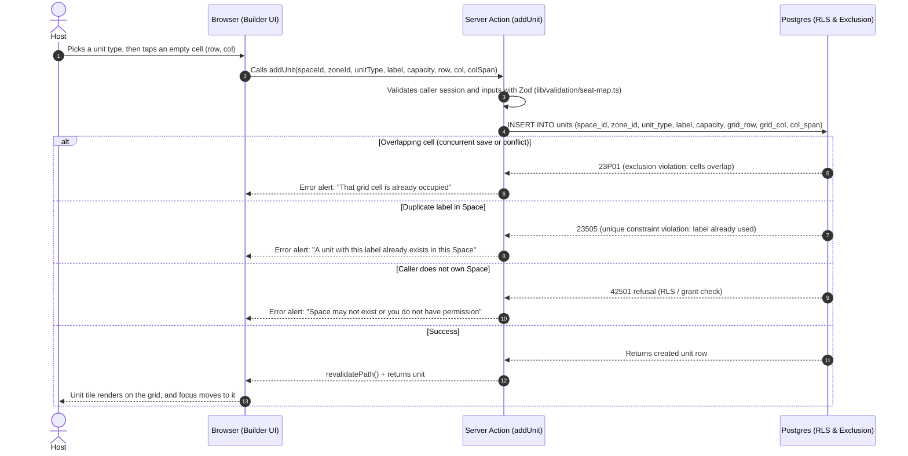

# STORY-07: Snap-grid seat map builder

**Status:** approved 2026-11-02 · **Owner:** @dreeyanzz · **Story:** #56 · **FR:** FR-3.1, SRS §3.2.2 ·
**Depends on:** STORY-01, STORY-05 · **Flows:** [Reservation lifecycle](../flows/reservation-lifecycle.md), [Host setup journey](../flows/host-setup-journey.md) ·
**Decisions:** D-002, D-003, D-004, D-006, D-007, D-010, D-011, D-013, D-027, D-031, D-032, D-042, D-044, D-046, D-047, D-051, D-052, D-055, D-057, D-062, D-063

## 0. Scope

**In:**

- **The `zones` and `units` tables**, with their Row-Level Security, column grants, check constraints, and pgTAP tests (FR-3.1, D-003).
- **The snap-grid layout model (D-062):** each zone is a band 6 cells wide, with as many rows as needed. A seat or a standing desk occupies 1 cell, and a whole room occupies 2 or 3 cells in a single row. An exclusion constraint prevents overlapping units on the grid.
- **The Host seat map builder** at `/host/spaces/[spaceId]/seat-map`: adds, renames, reorders, and deletes zones; adds, edits, moves, and removes units. Each builder change saves immediately through its own Server Action (D-010, D-062).
- **Accessible list view (SRS §3.2.2):** provides an alternative view offering every builder action, operable by keyboard alone and functioning before JavaScript loads.
- **Shared seat map renderer** in `components/seat-map/`: a unified renderer that displays the snap-grid layout and legend consistently for Hosts and Seekers (FR-3.1), with an early task (TSK-07.4) so Maria (STORY-11) and James (STORY-12) can build upon it. [§3](#the-shared-renderer-tsk-074) names its exports and its container layout.
- **`public.unit_states(space_id)` database function:** created by this story to provide the canonical read interface for unit seat states and Host freshness timestamps (D-044, D-046, D-047). In STORY-07, it evaluates Space visibility and returns each unit's `host_state` as its seat state, `host_updated_at`, and `null` for hold-specific columns (which STORY-09 and STORY-10 populate later).
- **Venue photos Storage bucket (`space-photos`, D-063):** creates the public bucket and storage RLS policies for host uploads, and updates `deleteSpace` to clean up photos before deleting the Space.
- **Local and CI seed data (`supabase/seed.sql`):** seeded seat maps for the test Spaces (§2), including the reference layout from SRS Figure 3.

**Out:**

- **Host occupancy control and walk-ins:** setting unit states by hand belongs to James in STORY-12 (#77). Units are initialized with `host_state = 'available'`.
- **Online holds and payments:** online reservations and payment transactions belong to Adrian in STORY-09 (#58). STORY-09 also introduces the `before delete` and `before update` triggers that check for active holds (D-052).
- **Seeker public profile and photo gallery:** displaying the verified public seat map and photo carousel, and the Host's photo upload form, belong to Maria in STORY-11 (#76).
- **Tag assignments on units:** curated and custom tag associations belong to Luke in STORY-08 (#57).
- **QR check-in and wait windows:** remaining wait window countdowns and check-ins belong to Luke in STORY-10 (#59).
- **Cloud dev seat map seeding:** seed data remains local and in CI only (D-013, D-028); cloud dev seat maps are created by Hosts through the app UI.

## 1. Flow

### Shared flows (D-044)

- **[Host setup journey](../flows/host-setup-journey.md):** implements step H7 (`host-setup-seat-map`). After creating a Space (STORY-05), the Host can build Zones and Units on the snap grid while the Space is Pending verification, with all changes saved without altering verification status (W4, D-027). The accessible list view offers all map actions.
- **[Reservation lifecycle](../flows/reservation-lifecycle.md):**
  - **Move H1:** When a Host adds a unit, it enters with `host_state = 'available'` and `host_updated_at = now()` (D-046, D-051).
  - **Reading a state:** establishes `public.unit_states(space_id)`. It checks Space visibility: returns 0 rows for Pending or Rejected Spaces unless called by the Space's Host or an Administrator (D-055, N19). Returns `host_state` as `seat_state` and `host_updated_at`.
  - **Moves nobody may make:** enforces N15 (no direct grants on `units.host_state` or `units.host_updated_at`) and respects D-052 (held units cannot be deleted or relocated once holds arrive in STORY-09).

### This story's own part

A Host places a unit on the grid:



Moving a unit, editing details, or managing zones (create, rename, reorder, delete) follow the same round-trip pattern. Every mutation writes immediately through its dedicated Server Action (D-062). Deleting a zone or unit goes through a confirmation step (§3) before calling the deletion action.

## 2. Data and state

### Enums

```sql
create type public.unit_type as enum ('seat', 'standing_desk', 'room');
```

Note: No `seat_state` column or enum is stored on `units` (D-046). Seat state is computed dynamically on read from active reservations or `units.host_state`.

### Tables and columns

**`zones`**: bands grouping units within a Space's seat map (D-003).

| Column       | Type          | Constraints & Rules                                                                     |
| ------------ | ------------- | --------------------------------------------------------------------------------------- |
| `id`         | `uuid` PK     | Default `gen_random_uuid()`                                                             |
| `space_id`   | `uuid`        | Not null; references `spaces(id)` on delete cascade                                     |
| `name`       | `text`        | Not null, 1–60 chars, trimmed; case-insensitive unique per Space (`lower(name)`)        |
| `position`   | `smallint`    | Not null, >= 0. Zones display top-to-bottom in this order; ties resolve by `created_at` |
| `created_at` | `timestamptz` | Not null, default `now()`                                                               |
| `updated_at` | `timestamptz` | Not null, default `now()`; maintained by `private.set_updated_at()` trigger             |

Unique constraint on `(id, space_id)` allows composite foreign key enforcement from `units`.

**`units`**: individual reservable entities within a Space (D-003, D-046, D-051).

| Column            | Type               | Constraints & Rules                                                                                  |
| ----------------- | ------------------ | ---------------------------------------------------------------------------------------------------- |
| `id`              | `uuid` PK          | Default `gen_random_uuid()`                                                                          |
| `space_id`        | `uuid`             | Not null; references `spaces(id)` on delete cascade                                                  |
| `zone_id`         | `uuid`             | Not null; `(zone_id, space_id)` references `zones(id, space_id)` on delete cascade                   |
| `unit_type`       | `public.unit_type` | Not null: `seat`, `standing_desk`, or `room`                                                         |
| `label`           | `text`             | Not null, 1–12 chars, trimmed; unique per Space ignoring case (`lower(label)`)                       |
| `capacity`        | `smallint`         | Null for `seat` and `standing_desk`; 1–50 for `room` (FR-3.1, D-049)                                 |
| `grid_row`        | `smallint`         | Not null, check `(grid_row >= 0 and grid_row < 50)`                                                  |
| `grid_col`        | `smallint`         | Not null, check `(grid_col >= 0 and grid_col <= 5)`                                                  |
| `col_span`        | `smallint`         | Not null, default 1; 1 for `seat`/`standing_desk`, 2 or 3 for `room`; `grid_col + col_span <= 6`     |
| `host_state`      | `text`             | Not null, default `'available'`; check `host_state in ('available', 'reserved', 'occupied')` (D-046) |
| `host_updated_at` | `timestamptz`      | Not null, default `now()`; records when Host last touched state (D-051). Initial insert sets now().  |
| `created_at`      | `timestamptz`      | Not null, default `now()`                                                                            |
| `updated_at`      | `timestamptz`      | Not null, default `now()`; maintained by `private.set_updated_at()` trigger                          |

### Constraints and grid overlap protection

- **Exclusion constraint (D-062):** prevents overlapping cells within the same zone and row:
  ```sql
  create extension if not exists btree_gist schema extensions;
  alter table public.units add constraint units_no_cell_overlap
    exclude using gist (
      zone_id with =,
      grid_row with =,
      int4range(grid_col, grid_col + col_span) with &&
    );
  ```
- **Unique indexes:**
  - `zones_space_id_lower_name_idx`: `create unique index zones_space_id_lower_name_idx on public.zones (space_id, lower(name));` enforces case-insensitive uniqueness per Space.
  - `units_space_id_lower_label_idx`: `create unique index units_space_id_lower_label_idx on public.units (space_id, lower(label));` enforces case-insensitive uniqueness per Space.
- **Check constraints:**
  - `capacity_matches_type`: `((unit_type = 'room' and capacity is not null and capacity between 1 and 50) or (unit_type in ('seat', 'standing_desk') and capacity is null))`. The `is not null` matters: a check passes when its expression is NULL, so without it a whole room with no capacity would be accepted.
  - `col_span_matches_type`: `((unit_type in ('seat', 'standing_desk') and col_span = 1) or (unit_type = 'room' and col_span in (2, 3)))`
  - `col_bounds`: `(grid_col + col_span <= 6)`
- **Composite foreign key:** `foreign key (zone_id, space_id) references public.zones(id, space_id) on delete cascade` guarantees that a unit and its zone cannot point to different Spaces.

### Database function: `public.unit_states`

Defined in schema `public` as `security definer` with `set search_path = ''` (D-044, D-047):

```sql
create or replace function public.unit_states(p_space_id uuid)
returns table (
  unit_id uuid,
  seat_state text,
  host_updated_at timestamptz,
  wait_window_ends_at timestamptz,
  reservation_id uuid
)
language plpgsql
stable
security definer
set search_path = ''
as $$
declare
  v_space_status public.space_status;
  v_host_id uuid;
begin
  select status, host_id into v_space_status, v_host_id
  from public.spaces
  where id = p_space_id;

  if not found then
    return;
  end if;

  -- Pending or Rejected Spaces are visible only to their Host and Administrators (D-055, N19)
  if v_space_status in ('pending', 'rejected') then
    if (select auth.uid()) is distinct from v_host_id and not (select private.has_role('admin')) then
      return;
    end if;
  end if;

  -- In STORY-07, no holds exist yet; seat_state is host_state
  return query
  select
    u.id as unit_id,
    u.host_state as seat_state,
    u.host_updated_at,
    null::timestamptz as wait_window_ends_at,
    null::uuid as reservation_id
  from public.units u
  where u.space_id = p_space_id
  order by u.zone_id, u.grid_row, u.grid_col;
end;
$$;
```

Grants on `public.unit_states`:

- `revoke all on function public.unit_states(uuid) from public;`
- `grant execute on function public.unit_states(uuid) to anon, authenticated;`

### Storage bucket: `space-photos` (D-063)

- Public, so a photo loads by its URL. Each file is at most 5 MB, and JPEG, PNG or WebP.
- A photo's path is its Space's id, then its file name, one folder deep: `<space_id>/<file name>`.
- Policies on `storage.objects`, for this bucket only: `insert`, `update` and `delete` when the first folder is a Space the caller owns; `select` (listing) when that Space is visible to the caller. A public URL needs no policy.
- `insert` and `update` also refuse a path more than one folder deep: `array_length(storage.foldername(objects.name), 1) = 1`. `deleteSpace` lists only the Space's own folder, and a listing shows a deeper path as a folder, which it can't remove, so one such photo would keep the Space from ever being deleted.
- Each policy compares the folder with the Space's id as text: `s.id::text = (storage.foldername(objects.name))[1]`. Inside the `spaces` subquery, a bare `name` would be the Space's name, and the policy would refuse every upload. A cast to `uuid` would make every listing fail once one object's folder isn't an id.
- Deleting a Space removes its photos first: `deleteSpace` (`app/(dashboard)/host/actions.ts`) empties the Space's folder through the Storage API, then deletes the row. Once the row is gone, no policy matches its photos, so only the secret key could remove them, and the bucket is public. If the photos can't be removed, the Space stays, and the Host gets the usual "We could not delete this Space" message.
- Whether photos also need a table, for their order and alt text, is STORY-11's call.

### Grants and Row-Level Security

All direct privileges revoked from `anon` and `authenticated` first, then granted selectively:

| Table   | Verb   | Role                | Granted columns                                                                                           | Policy Check                                         |
| ------- | ------ | ------------------- | --------------------------------------------------------------------------------------------------------- | ---------------------------------------------------- |
| `zones` | select | anon, authenticated | all                                                                                                       | Space is visible (Verified, or caller is Host/Admin) |
| `zones` | insert | authenticated       | `space_id, name, position`                                                                                | Caller owns Space (`host_id = auth.uid()`)           |
| `zones` | update | authenticated       | `name, position`                                                                                          | Caller owns Space (`host_id = auth.uid()`)           |
| `zones` | delete | authenticated       | —                                                                                                         | Caller owns Space (`host_id = auth.uid()`)           |
| `units` | select | anon, authenticated | `id, space_id, zone_id, unit_type, label, capacity, grid_row, grid_col, col_span, created_at, updated_at` | Space is visible (Verified, or caller is Host/Admin) |
| `units` | insert | authenticated       | `space_id, zone_id, unit_type, label, capacity, grid_row, grid_col, col_span`                             | Caller owns Space (`host_id = auth.uid()`)           |
| `units` | update | authenticated       | `zone_id, unit_type, label, capacity, grid_row, grid_col, col_span`                                       | Caller owns Space (`host_id = auth.uid()`)           |
| `units` | delete | authenticated       | —                                                                                                         | Caller owns Space (`host_id = auth.uid()`)           |

Crucial security invariant (N15): No `select` or `update` grant is given on `units.host_state` or `units.host_updated_at`. State and freshness are read exclusively through `public.unit_states(space_id)` (D-047), and mutated only through dedicated functions (`set_unit_state` in STORY-12). Direct writes to those columns fail with Postgres error `42501`. So does `select *` on `units`, which is what supabase-js sends for `.select()` with no arguments, so `getSeatMap()` and the Server Actions name their columns.

### Zod validation schemas (`lib/validation/seat-map.ts`)

Shared between client and Server Actions:

- `zoneNameSchema`: string trimmed, min 1, max 60 characters.
- `zonePositionSchema`: integer >= 0.
- `unitTypeSchema`: `z.enum(['seat', 'standing_desk', 'room'])`.
- `unitLabelSchema`: string trimmed, min 1, max 12 characters.
- `unitCapacitySchema`: integer between 1 and 50, required if `unit_type === 'room'`, omitted/null otherwise.
- `cellCoordinateSchema`: `grid_row` (0–49), `grid_col` (0–5), `col_span` (1–3), refined so `grid_col + col_span <= 6`.
- `addUnitSchema`, `updateUnitSchema`, `moveUnitSchema`, `deleteUnitSchema`, `reorderZonesSchema`.

### Seed (`supabase/seed.sql`, local and CI only)

Every unit starts Available.

- Kapihan Study Hall (Verified, host@): SRS Figure 3's map. "Quiet desks" holds S1–S8, "Standing desks" holds D1–D4, and "Private rooms" holds Room A (capacity 6, 3 cells) and Room B (capacity 4, 2 cells).
- Kapihan Night Desk (Pending, host@): one zone with two seats, for the "0 rows" tests.
- Sulok Co-working (Verified, host2@): one zone with three seats, for host2's own tests.

### What other stories build on

| Story    | Uses                                                                                                                                                                                                                                                   |
| -------- | ------------------------------------------------------------------------------------------------------------------------------------------------------------------------------------------------------------------------------------------------------ |
| STORY-08 | `units.unit_type`, for the "unit type" filter. Anyone may read the units of a Verified Space.                                                                                                                                                          |
| STORY-09 | `units.id`, for `reservations`. Adds holds and `reservation_id` to `unit_states`. When it adds N17's refusal, `deleteSpace` must check for an active hold before it empties the photo folder, or a refused delete would still lose the Space's photos. |
| STORY-10 | Adds wait windows to `unit_states`.                                                                                                                                                                                                                    |
| STORY-11 | `getSeatMap()` and `SeatMapGrid`, on the Space profile, and the `space-photos` bucket.                                                                                                                                                                 |
| STORY-12 | `getSeatMap()` and `SeatMapGrid`, for the occupancy view.                                                                                                                                                                                              |
| STORY-15 | An Administrator can read a Pending Space's seat map before approving it.                                                                                                                                                                              |

## 3. UI and files

Maria owns the user experience (D-042). Maria reviews and approves the builder screens and accessible list view.

### User experience & screens

- **Route:** `/host/spaces/[spaceId]/seat-map` (Server Component). It loads the Space owner-scoped, as the edit page does, so another Host or an Administrator gets the not-found page (STORY-05 §1.3). The Space list on `/host` gains a "Seat map" link on each card, next to Edit and Delete.
- **Header:** Space title, verification badge (Pending / Verified / Rejected), a link back to the Host's Spaces at `/host` (STORY-05 has no page at `/host/spaces/[spaceId]`), and two links that switch views: **Grid**, the default, and **List** (`?view=list`), so the list view opens before JavaScript loads.
- **Zones overview:**
  - Displays each zone in `position` order.
  - In-place zone header with zone name, unit count, and actions: "Move up", "Move down", "Rename", "Delete zone".
- **Snap-grid builder view (D-062):**
  - Renders a 6-column grid per zone through the [shared renderer](#the-shared-renderer-tsk-074). Each cell is minimum 48×48 px to meet touch target accessibility (SRS §3.2.2).
  - A toolbar adds a seat, a standing desk, a whole room or a zone. After the Host picks a type, the empty cells become "Place here" buttons, each with a name such as "Place at row 2, column 3 in Quiet desks". Otherwise they stay plain gaps, so the grid holds few tab stops. The new unit gets the next free label (S9, D5, Room C), which the Host can change.
  - Whole rooms spanning 2 or 3 columns render across adjacent cells with capacity indicator (e.g., "Room A (6)").
  - **Selecting & moving:** tapping an existing unit selects it (ring highlight) and opens its panel: label, type, a whole room's capacity and width, Move (then tap an empty cell), and Remove.
- **Accessible list view alternative (SRS §3.2.2):** offers every action the grid does, by keyboard alone and before JavaScript loads, because each one is a plain form (`<form action={...}>`) or a link.
  - The page ends with an "Add a zone" form.
  - Each zone has a heading, its unit count, Rename, Move up, Move down, Delete, and an "Add a unit" form whose row and column default to the first free cell.
  - Each unit, in row and column order, is one responsive card (fitting 320–360 px viewports without horizontal scrolling): its label, type, capacity, row and column, and width, then Edit and Remove. Edit's form includes the row and the column, so it also moves the unit.
- **Confirmation step:** Remove (a unit) and Delete (a zone) are links to the same page with `?remove=<unit id>` or `?delete-zone=<zone id>`, in either view. The page then shows a panel, `#confirm`, in place of that unit or zone. It names what goes ("Remove S4?", "Delete Quiet desks and its 8 units?"), with a button that posts the action and a Cancel link back. It is a server round trip, like STORY-05's delete page, so it works by keyboard and before JavaScript loads, and it needs no dialog. An id that isn't in this Space, or no longer exists, is ignored.
- **Rows and columns** count from 1 on the page ("row 2, column 3"), and from 0 in the forms' values, the Zod schemas and the database. The list view's row and column are native selects whose options read from 1 and submit from 0.
- **Empty & error states:**
  - Space with no zones: friendly prompt to create the first zone.
  - Zone with no units: prompt indicating "This zone has no units. Tap an empty cell on the grid or use the form below."
  - Server action errors (e.g. overlap or duplicate label) display in an accessible error banner with specific field guidance.

### The shared renderer (TSK-07.4)

STORY-11 and STORY-12 build on these exports:

```tsx
// components/seat-map/seat-map-grid.tsx
export function SeatMapGrid(props: {
  zones: SeatMapZone[]
  renderUnit?: (unit: SeatMapUnit) => ReactNode // default: <SeatMapTile unit={unit} />
  renderEmptyCell?: (cell: { zoneId: string; row: number; col: number }) => ReactNode // default: a plain gap
}): ReactNode

// components/seat-map/seat-map-tile.tsx
export function SeatMapTile(props: { unit: SeatMapUnit }): ReactNode

// components/seat-map/seat-map-legend.tsx
export function SeatMapLegend(): ReactNode

// lib/data/seat-map.ts (server only)
export async function getSeatMap(
  supabase: SupabaseClient<Database>,
  spaceId: string,
): Promise<SeatMapZone[]>

// lib/seat-map/grid.ts
export type SeatMapZone = { id: string; name: string; units: SeatMapUnit[] }
export type SeatMapUnit = {
  id: string
  unitType: 'seat' | 'standing_desk' | 'room'
  label: string
  capacity: number | null
  row: number // counted from 0, like the database
  col: number
  colSpan: number
  seatState: 'available' | 'pending_payment' | 'reserved' | 'occupied'
  hostUpdatedAt: string
  waitWindowEndsAt: string | null // the Space's Host only; null until STORY-10
  reservationId: string | null // the Space's Host only; null until STORY-09 (D-057)
}
```

- **Client or server:** none of the three components has `'use client'`, so Server and Client Components can both render them. A Client Component passes `renderUnit` and `renderEmptyCell` when it needs controls. A read-only map passes neither.
- **What `getSeatMap` reads:** the zones in `position` order, each with its units by row and column, joined with `public.unit_states`, the only read of a seat state (D-047). A Space the caller may not see returns no zones.
- **Container layout:** `SeatMapGrid` fills its parent up to 576 px (`max-w-xl`) and renders `SeatMapLegend` once, above the zones, naming every icon in words. Each zone is a heading and a CSS grid of `repeat(6, minmax(48px, 1fr))` with 4 px gaps, whose rows grow with their tallest tile. The parent puts it directly on the page, not inside a padded Card: at a 360 px screen the portal's content is 328 px wide, and the grid needs at least 308 px.
- **Controls:** the grid places what `renderUnit` returns across the unit's cells, and changes nothing else about how the map looks. A cell is about 51 px wide at 360 px, so a control that needs more room, such as STORY-12's three 48 px state pills, goes outside the grid, in a panel for the selected unit. The tile itself can sit inside a button that selects it.
- **`SeatMapTile`:** shows the label, a whole room's capacity, and two Lucide icons: one for the type (`Armchair`, `PersonStanding`, `DoorClosed`) and one for the seat state (`CheckCircle` for Available, `Hourglass` for Pending Payment, `Clock` for Reserved, `User` for Occupied). Each state has its own shape, so it never rests on color alone, and the colors are the token pairs Maria picks (STORY-12 §8). The tile's accessible name says it all in words: "S4, Seat, Available". A long label wraps and the tile grows taller, so nothing is cut off.

### Component hierarchy and file layout

```
app/(dashboard)/host/spaces/[spaceId]/seat-map/
├── page.tsx                     # Server Component: loads the Space owner-scoped, then the seat map
├── actions.ts                   # Server Actions: addUnit, updateUnit, moveUnit, deleteUnit, createZone, renameZone, reorderZones, deleteZone
└── _components/
    ├── seat-map-builder.tsx     # Client Component: the grid view: toolbar, placing, selecting & moving
    ├── seat-map-list-view.tsx   # Server Component: the list view, in plain forms and links
    ├── unit-form.tsx            # Client Component: add or edit a unit, in both views, with useActionState
    ├── zone-form.tsx            # Client Component: add or rename a zone, in both views, with useActionState
    └── confirm-removal.tsx      # Client Component: the confirmation step's form, with useActionState

app/(dashboard)/host/_components/space-list.tsx   # The "Seat map" link
app/(dashboard)/host/actions.ts                   # deleteSpace removes the photos first

components/seat-map/             # Shared seat map renderer (TSK-07.4)
├── seat-map-grid.tsx            # SeatMapGrid: the 6-column zone grids, with the legend
├── seat-map-tile.tsx            # SeatMapTile: a unit's tile
└── seat-map-legend.tsx          # SeatMapLegend: every icon, in words

lib/data/
└── seat-map.ts                  # Server query helper getSeatMap(supabase, spaceId)

lib/seat-map/
├── grid.ts                      # Pure logic and types: bounds, overlaps, first free cell, rows to draw, next label, a cell in words
└── grid.test.ts                 # Vitest tests for the grid rules

lib/validation/
├── seat-map.ts                  # Zod validation schemas
└── seat-map.test.ts             # Vitest tests for schemas and bounds

supabase/migrations/             # <timestamp>_seat_map.sql, <timestamp>_space_photos.sql
supabase/tests/                  # 03-seat-map.sql, 04-space-photos.sql
supabase/seed.sql                # The seeded seat maps
lib/supabase/database.types.ts   # Regenerated
```

### Accessibility

- **Touch targets:** 6 cells of at least 48×48 px, with 4 px gaps, fit a 360 px screen with no sideways scrolling, as the [container layout](#the-shared-renderer-tsk-074) explains.
- **Text at 200%:** tiles grow taller and their labels wrap. Nothing is cut off, and the icons keep their size.
- **Focus:** after a change, focus moves to the new or moved unit, or to its zone after a removal. An `aria-live` region announces the result or the error. On the confirmation step, the page opens at `#confirm`, and focus goes to the panel's heading. Focus is visible and contrast is at least 4.5:1, as the design system sets (D-031).
- **Keyboard path:** the list view offers every action the grid does.
- **Inputs:** native `select` and radio inputs, styled like STORY-02's Input, until the design system has a Select.

## 4. Security and test matrix

### pgTAP tests (`supabase/tests/03-seat-map.sql`)

Named tests are the ones the [reservation lifecycle](../flows/reservation-lifecycle.md#every-move-and-its-test) names for this file.

| Case                                                                                          | Expected                                                        |
| --------------------------------------------------------------------------------------------- | --------------------------------------------------------------- |
| Host selects zones and units for their own Space                                              | Returns all rows                                                |
| Seeker or visitor selects zones and units for a Verified Space                                | Returns all rows                                                |
| Seeker or visitor selects zones and units for a Pending Space                                 | 0 rows (D-055, N19)                                             |
| Another Host selects zones and units for a Pending Space                                      | 0 rows (D-055, N19)                                             |
| Administrator selects zones and units for a Pending Space                                     | Returns all rows (STORY-15)                                     |
| Anyone selects `units.host_state` or `units.host_updated_at` directly, or `*` from `units`    | 42501 refusal (no column grant, N15)                            |
| Host inserts zone or unit in their own Space                                                  | Succeeds                                                        |
| Host inserts zone or unit targeting another Host's Space                                      | 42501 refusal                                                   |
| Seeker or visitor inserts a zone or a unit                                                    | 42501 refusal                                                   |
| Administrator inserts a zone or a unit                                                        | 42501 refusal                                                   |
| Another Host, a Seeker or an Administrator updates or deletes a Host's zones or units         | 0 rows                                                          |
| Visitor updates or deletes zones or units                                                     | 42501 refusal                                                   |
| Host updates unit label, capacity, or grid coordinates                                        | Succeeds                                                        |
| "a new unit reads Available, Host-updated when it was added" (H1)                             | `unit_states` gives `available` and `host_updated_at`           |
| A Host's label edit or move leaves the Host-updated time alone (D-051)                        | `host_updated_at` unchanged                                     |
| "a Host cannot write a unit's state or Host-updated time directly" (N15)                      | 42501 refusal (no column grant)                                 |
| Host attempts direct update of `space_id`, on a unit or a zone                                | 42501 refusal (no update grant)                                 |
| Overlapping unit insertion in same zone and row, a room over a taken cell included            | 23P01 exclusion violation                                       |
| Duplicate unit label within the same Space, in another case                                   | 23505 unique constraint violation                               |
| Whole room with null capacity, seat with non-null capacity, or seat 2 cells wide              | 23514 check constraint violation                                |
| Unit with `grid_col + col_span > 6`                                                           | 23514 check constraint violation                                |
| Unit referencing a zone belonging to a different Space, on a free cell                        | 23503 foreign key violation                                     |
| `public.unit_states` called by anyone on a Verified Space                                     | Unit rows, with `wait_window_ends_at` and `reservation_id` null |
| "unit_states returns 0 rows for a Pending Space, except to its Host and Administrators" (N19) | 0 rows for everyone else, Rejected Spaces too                   |

### pgTAP tests (`supabase/tests/04-space-photos.sql`)

| Case                                                                       | Expected              |
| -------------------------------------------------------------------------- | --------------------- |
| Host uploads, replaces and deletes a photo in their own Space's folder     | Succeeds              |
| Another Host, a Seeker or a visitor uploads to that folder                 | Denied by storage RLS |
| Another Host deletes a Host's photo                                        | 0 rows                |
| Host moves their own photo into another Host's Space's folder              | Denied by storage RLS |
| Host uploads or moves a photo into a subfolder of their own Space's folder | Denied by storage RLS |
| Another Host, a Seeker or a visitor lists a Pending Space's photos         | 0 rows                |
| Anyone lists a Verified Space's photos                                     | Returns them          |

**Notes for the pgTAP files:**

- A plain `delete from storage.objects` fails with `42501` from Supabase's `storage.protect_delete()` trigger, whatever the policies say. The delete cases set `storage.allow_delete_query` to `true` first, so they test the policy.
- The case that moves a unit into another Space's zone aims at a free cell. On a taken one, the overlap rule answers `23P01` before the foreign key answers `23503`.

### Vitest unit tests

- `lib/validation/seat-map.test.ts`:
  - Validates zone name trimming, length bounds (1–60), and empty rejection.
  - Validates unit label trimming and length (1–12 chars).
  - Validates room capacity bounds (1–50) and rejects non-null capacity on seats/standing desks.
  - Validates grid coordinate limits (`grid_row` 0–49, `grid_col` 0–5) and rejects `col + col_span > 6`.
- `lib/seat-map/grid.test.ts`:
  - Pure collision detection helper matches PostgreSQL exclusion logic.
  - Finds next available cell in zone, the next free label, and how many rows to draw.
  - Puts a cell in words, counted from 1.

### Manual verification checklist

- Sign in as `host@example.test`: open an owned Space, navigate to Seat Map, add "Quiet desks" zone. Place seats S1–S8, standing desks D1–D4, and rooms Room A (3 cells) and Room B (2 cells), matching SRS Figure 3.
- Verify exclusion: attempt placing a seat over an existing room tile; verify inline error message displays without losing form state.
- Switch to List view: use every action (add, rename, reorder and delete a zone; add, edit, move and remove a unit) with the keyboard alone (Tab, Enter, Space).
- With JavaScript off, remove a unit and delete a zone from the list view: each asks first, then saves.
- Reload after each change: the map is unchanged.
- Responsive check: verify 360 px, 768 px, and 1024 px viewport widths, at 100% and 200% text, without horizontal scrolling or a cut-off label.
- Sign in as `host2@example.test`, then as `admin@example.test`: open `host@`'s builder URL: each gets the not-found page.
- As `host@example.test`, put a photo in a Space's folder through the Storage API, then delete the Space: its folder is empty afterwards.

### Acceptance criteria (#56), and where each is checked

- "A saved seat map persists and renders the same for a Host and a Seeker": in two halves. TSK-07.6's review shows a saved map unchanged after a reload, through the shared renderer (TSK-07.4). STORY-11's review shows the Seeker's profile rendering the same rows through the same renderer.
- "Every unit has a type and a label, and a whole room has a capacity": the `23514` cases above, and the Zod tests.
- "Another Host gets 0 rows for a Space's zones and units, and cannot change them": the other-Host cases above.
- "An accessible list view offers every action the snap grid offers, by keyboard alone": the manual checks in TSK-07.7's review.

## 5. Tasks and estimates

All tasks are owned by Adrian (@dreeyanzz) (D-036).

| Task     | What                                                                                                                                                | Owner      | Points | Days | Depends on         |
| -------- | --------------------------------------------------------------------------------------------------------------------------------------------------- | ---------- | ------ | ---- | ------------------ |
| TSK-07.1 | The `zones` and `units` migration: enums, tables, exclusion constraints, grants, RLS, `public.unit_states`, and seed; `03-seat-map.sql`; `db:types` | @dreeyanzz | 3      | 1.0  | This design merged |
| TSK-07.2 | The `space-photos` bucket and storage RLS policies; `04-space-photos.sql`; `deleteSpace` photo cleanup                                              | @dreeyanzz | 1      | 0.5  | This design merged |
| TSK-07.3 | `lib/seat-map/grid.ts` and `lib/validation/seat-map.ts`, with Vitest tests                                                                          | @dreeyanzz | 1      | 0.5  | This design merged |
| TSK-07.4 | `getSeatMap()` query helper and shared renderer in `components/seat-map/` with legend                                                               | @dreeyanzz | 1      | 0.5  | TSK-07.1, TSK-07.3 |
| TSK-07.5 | Seat map Server Actions in `app/(dashboard)/host/spaces/[spaceId]/seat-map/actions.ts`                                                              | @dreeyanzz | 1      | 0.5  | TSK-07.1, TSK-07.3 |
| TSK-07.6 | The builder page with snap-grid view, confirmation step, and the "Seat map" link                                                                    | @dreeyanzz | 2      | 1.0  | TSK-07.4, TSK-07.5 |
| TSK-07.7 | The accessible list view alternative with keyboard form actions                                                                                     | @dreeyanzz | 1      | 0.5  | TSK-07.6           |

Total: 10 points over 4.5 days (with 0.5 day review buffer = 5 days).

## 6. Build order

One PR per row, and every PR targets `main`. Rows 1–4 are delivered first to unblock Maria (STORY-11) and James (STORY-12).

| #   | Branch                               | PR title                                               | Contains |
| --- | ------------------------------------ | ------------------------------------------------------ | -------- |
| 1   | `feature/STORY-07-seat-map-tables`   | `feat(STORY-07): add the zones and units tables`       | TSK-07.1 |
| 2   | `feature/STORY-07-photo-bucket`      | `feat(STORY-07): add the space photos bucket`          | TSK-07.2 |
| 3   | `feature/STORY-07-seat-map-rules`    | `feat(STORY-07): add the seat map grid and form rules` | TSK-07.3 |
| 4   | `feature/STORY-07-seat-map-renderer` | `feat(STORY-07): add the shared seat map renderer`     | TSK-07.4 |
| 5   | `feature/STORY-07-seat-map-actions`  | `feat(STORY-07): add the seat map server actions`      | TSK-07.5 |
| 6   | `feature/STORY-07-seat-map-builder`  | `feat(STORY-07): add the seat map builder`             | TSK-07.6 |
| 7   | `feature/STORY-07-seat-map-list`     | `feat(STORY-07): add the seat map list view`           | TSK-07.7 |

## 7. Rejected alternatives

- **Checking overlaps only in client/application code:** Two concurrent saves could race and place overlapping units. The PostgreSQL `btree_gist` exclusion constraint is the true atomic backstop (D-062).
- **Storing `seat_state` on `units`:** Rejected by D-046. Seat state is worked out on read from active holds or `host_state`. Storing a duplicate column would introduce desynchronization and race conditions with online holds.
- **Trigger-based updating of `host_updated_at`:** Rejected by D-051. An automated trigger would erroneously update freshness on system holds, lapses, or title edits, misrepresenting the time since a Host last verified occupancy.
- **Freeform 2D floorplan canvas:** Rejected by D-003. A continuous coordinate canvas is complex to edit and impossible to make cleanly accessible or render consistently across mobile viewports. A 6-column snap grid fits a 360 px viewport with 48×48 px touch targets.
- **Saving via draft state / "Save all" button:** Rejected by D-062. Immediate per-action saves ensure that grid and list view share the same backend Server Actions, and prevent lost work from closed browser tabs.
- **Drag-and-drop as the primary interaction:** Unreliable on touch screens and inaccessible via keyboard. Tap-to-select and tap-to-move provides equal ease with full keyboard accessibility.
- **A dialog to confirm a removal, or to edit a unit:** a dialog needs JavaScript, which the list view must not, and STORY-02 has no Dialog primitive.
- **The seat state in words on each tile:** a cell is about 51 px wide at 360 px, and "Pending Payment" needs about twice that. The words live in the legend, the accessible name and the list view.

## 8. Open questions

None blocking this story. Integration boundaries are aligned with:

- STORY-09: online reservation creation and hold refusal triggers (D-052).
- STORY-11: photo gallery display and public seat map viewing.
- STORY-12: Host occupancy toggles via `set_unit_state`.

## 9. After the build

Fill this in when the story is done. Until then, each task's differences from this plan:

**TSK-07.6 (the builder):**

- **The shared grid gained three optional props, used only by the builder.**
  - `renderZoneActions`, for each zone's Move up, Move down, Rename and Delete beside its heading.
  - `extraRows`, for a spare empty row while placing or moving, so a full row still leaves somewhere to put a unit.
  - Zone headings take focus programmatically (`tabIndex={-1}`), so focus can move to a zone after a change.

  STORY-11 and STORY-12 pass none of them, so nothing changes for them.

- **Cell and tile widths, and the tile's icons, are in px, not rem.** At 200% text, `min-w-12` became 96 px, so six cells needed 576 px and a 360 px screen scrolled sideways. Heights stay in rem, so a tile still grows taller as its label wraps (§3, Accessibility).
- **`mapPostgresError` moved from `actions.ts` to `lib/seat-map/errors.ts`.** A `'use server'` file may export only async functions, and `next build` refuses one that exports anything else once a Client Component imports it. TSK-07.5's file had passed CI only because nothing in the browser imported it yet.
- **The Grid/List switch arrives with TSK-07.7**, so `main` never links to a list view that doesn't exist.
- **In the grid view, the confirmation panel opens above the map**, where a selected unit's panel goes, not inside the unit's 51 px cell. TSK-07.7's list view shows it in place.
- **Copy:** an empty zone says "Pick a unit type above, then tap an empty cell." The grid view has no form below the grid, as §3's wording assumed.
