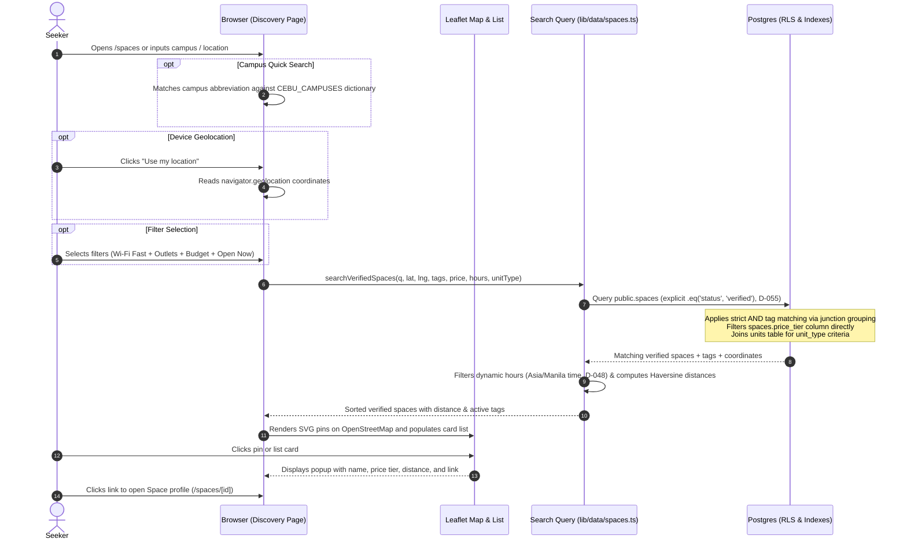

# STORY-08: Map discovery and curated tag filters

**Status:** draft · **Owner:** @lukedongque · **Story:** #57 · **FR:** FR-1.1, FR-1.2, FR-5.1 ·
**Depends on:** none ·
**Flows:** [Space verification](../flows/space-verification.md) (approved), [Host setup journey](../flows/host-setup-journey.md) (approved), [Seeker journey](../flows/seeker-journey.md) (approved) ·
**Decisions:** D-003, D-006, D-007, D-010, D-012, D-027, D-037, D-042, D-044, D-048, D-055, D-066

## 0. Scope

**In:**

- **Database migration, policies, and pgTAP tests (Luke, D-066):**
  - Add `latitude` (`double precision`, check `-90 <= latitude and latitude <= 90`), `longitude` (`double precision`, check `-180 <= longitude and longitude <= 180`), and `price_tier` (`public.price_tier` enum: `'free'`, `'budget'`, `'standard'`, `'premium'`) to `public.spaces` (D-027).
  - Explicit column permissions on `public.spaces` granted to authenticated Hosts for `latitude`, `longitude`, and `price_tier`.
  - Add `public.curated_tags` catalog table defining standardized amenity tags categorized into: `'wifi'`, `'power'`, `'noise'`, `'ac'` (FR-1.2, D-006). (Operating hours and unit types are evaluated dynamically from `spaces` hours and `units` inventory rather than static checkboxes).
  - Add `public.space_curated_tags` junction table associating Spaces with curated amenity tags.
  - Add `public.space_custom_tags` table for Host-created free-text display tags (D-006).
  - Explicit `revoke all on table ... from anon, authenticated;` before granting specific permissions on all new tables (D-007).
  - RLS policies and grants on the new tables: public read access for Verified Spaces (D-055); Hosts can view and manage tags only on Spaces they own; non-owners get zero rows and rejected writes.
  - Comprehensive pgTAP tests in `supabase/tests/08-tags.sql` verifying RLS boundaries, tag isolation, and unverified space exclusion.
- **Host space coordinate and price tier capture (STORY-05 form update):**
  - Update `spaceSchema` in `lib/validation/space.ts` and `SpaceForm` (`app/(dashboard)/host/spaces/_components/space-form.tsx`) to capture `latitude`, `longitude` (via map pin picker or coordinate input fields) and `price_tier` (single-select radio group: Free, Budget, Standard, Premium; default `'budget'`).
  - Captured at initial Space creation (`/host/spaces/new`, Step H2) and editable on the Space details form (`/host/spaces/[spaceId]/edit`, Step H13).
- **Leaflet + OpenStreetMap interactive discovery map (D-012):**
  - A dynamic Client Component (`DiscoveryMap`) loaded via Next.js dynamic import (`ssr: false`) to avoid server-side `window` execution errors.
  - Explicit import of `leaflet/dist/leaflet.css` in the discovery client wrapper.
  - Custom SVG markers / `L.divIcon` to prevent broken default Leaflet marker asset paths in Next.js bundlers.
  - Renders OpenStreetMap tiles with custom markers/pins for all matching Verified Spaces (FR-1.1).
  - Selecting a map pin highlights the venue, shows an accessible popup with venue name, price tier badge, and computed distance, and links directly to the Space profile (`/spaces/[id]`).
- **Synchronized accessible list view:**
  - An accessible list of Space cards displayed alongside the map on desktop (split view) and toggled/stacked on mobile (D-003, WCAG 2.1 AA).
  - Bidirectional synchronization: selecting a map pin highlights its corresponding card; hovering or focusing a card highlights its pin.
- **Location search, campus dictionary, and geolocation:**
  - Text search input supporting campus names and local areas (e.g., "USC", "CIT-U", "Cebu IT Park", "Lahug").
  - Curated Metro Cebu campus coordinate dictionary (`CEBU_CAMPUSES` in `lib/geo/campuses.ts`) providing predefined coordinates for Cebu university campuses, paired with an `ilike` text fallback across space name and address.
  - W3C Geolocation integration: one-tap "Use my location" button computing real-time straight-line distance (Haversine formula in `lib/geo/haversine.ts`).
- **Multi-criteria filtering with strict `AND` logic (FR-1.2):**
  - Filter panel covering the seven criteria:
    1. Minimum Wi-Fi tier (`wifi_basic`, `wifi_fast`, `wifi_ultrafast`)
    2. Power outlets (`outlets_all`, `outlets_some`)
    3. Noise level (`noise_silent`, `noise_quiet`, `noise_moderate`)
    4. Air conditioning (`ac_full`, `ac_natural`)
    5. Operating hours (dynamic filter: "Open Now", "Open Late past 10 PM", "Open 24 Hours", evaluated in `Asia/Manila` UTC+8 per D-048 against `spaces.opens_at` and `spaces.closes_at`)
    6. Price tier (`free`, `budget`, `standard`, `premium` querying `spaces.price_tier` directly)
    7. Unit / room type (`unit_seat`, `unit_standing_desk`, `unit_room` querying `public.units.unit_type` from STORY-07)
  - Strict `AND` logic: selecting multiple filters returns only Spaces satisfying every selected criterion.
  - Query helper `searchVerifiedSpaces` in `lib/data/spaces.ts` explicitly filters `.eq('status', 'verified')` (D-055), applies strict `AND` tag matching using junction table grouping (`HAVING count(distinct tag_id) = :num_tags`), filters `price_tier` directly, and evaluates dynamic opening hours and unit types.
  - Clearing a filter restores results instantly without a full page reload.
  - Mobile filter drawer (`FilterDrawer`) responsive at 360, 768, and 1024 px.
  - Custom tags are display-only and never offered as filters (D-006, FR-1.3).
- **Host space tagging form:**
  - Route `/host/spaces/[spaceId]/tags` implementing step H8 of the [Host setup journey](../flows/host-setup-journey.md).
  - Allows the Host to select applicable curated amenity tags from categorized checkboxes and enter free-text custom display tags.
  - Server Action `saveSpaceTagsAction` in `actions.ts` validating inputs with Zod (`spaceTagsSchema`), with validation enforcing lowercase uniqueness on custom tags.

**Out:**

- **Space profile and public availability view:** photos, detailed seat map, and unit selection belong to Maria in STORY-11 (#76).
- **Reserve-now holds and sandbox payments:** online checkout and payment transactions belong to Adrian in STORY-09 (#58).
- **QR check-in and wait window countdowns:** token scanning and wait-window timers belong to Luke in STORY-10 (#59).
- **Space verification queue and actions:** the Administrator approval queue at `/admin` belongs to James and Adrian in STORY-15 (#166).
- **Reviews and ratings:** aggregate star ratings and review submissions belong to Sprint 3 in STORY-13 (#78).
- **Proprietary map APIs:** Google Maps and Mapbox are rejected (D-012).

## 1. Flow

### Shared flows (D-044)

- **[Space verification flow](../flows/space-verification.md):**
  - Moves V2 (Approved) and V5 (Deleted). Only Verified Spaces (`spaces.status = 'verified'`) appear in public discovery. Pending and Rejected Spaces return zero rows to public queries (FR-5.1, D-055, RLS rule `spaces: read verified, own, or any as an administrator`).
- **[Host setup journey](../flows/host-setup-journey.md):**
  - Implements step H8 (`host-setup-tags`). While a Space is Pending (or Verified), the Host assigns curated tags and custom display tags. Edits preserve verification status (W4, D-027).
- **[Seeker journey](../flows/seeker-journey.md):**
  - Implements steps S1 to S6:
    - S1: Seeker opens Space discovery (`/spaces`).
    - S2: Searches by place or campus name, or uses device GPS location.
    - S2a: Chooses curated criteria filters.
    - S3 / P1 / P2: Filtered search returns only Verified Spaces matching all selected filters via `AND` logic (`seeker-filters-and-verification`).
    - S4: If no Spaces match, explains the empty state and lets the Seeker clear or revise filters (`seeker-search-no-results`).
    - S5: Seeker compares map pins and the synchronized list (`seeker-search-matches`).
    - S6: Selecting a Space navigates to its profile (`/spaces/[id]`).

### This story's own part



## 2. Data and state

### Tables and columns (new and modified)

#### 1. Alterations to `public.spaces` (D-027, D-066)

```sql
create type public.price_tier as enum ('free', 'budget', 'standard', 'premium');

alter table public.spaces
  add column latitude double precision check (latitude between -90 and 90),
  add column longitude double precision check (longitude between -180 and 180),
  add column price_tier public.price_tier not null default 'budget';

comment on column public.spaces.latitude is 'WGS 84 latitude coordinate for Leaflet map pin. STORY-08.';
comment on column public.spaces.longitude is 'WGS 84 longitude coordinate for Leaflet map pin. STORY-08.';
comment on column public.spaces.price_tier is 'Curated price tier for Seeker filtering and pin display. STORY-08.';

-- Update column grants for authenticated Hosts (used in SpaceForm create and edit)
grant insert (name, description, address, opens_at, closes_at, latitude, longitude, price_tier)
  on table public.spaces to authenticated;
grant update (name, description, address, opens_at, closes_at, latitude, longitude, price_tier)
  on table public.spaces to authenticated;
```

#### 2. Curated tags catalog: `public.curated_tags`

Defines the platform's standardized amenity filter vocabulary (FR-1.2, D-006). Dynamic properties (price tier, operating hours, and unit types) are evaluated against their respective first-class models rather than stored as tag rows.

```sql
create table public.curated_tags (
  id text primary key,
  category text not null check (category in (
    'wifi', 'power', 'noise', 'ac'
  )),
  label text not null check (char_length(btrim(label)) >= 1 and char_length(label) <= 50),
  description text check (char_length(description) <= 200),
  display_order smallint not null default 0,
  created_at timestamptz not null default now()
);

comment on table public.curated_tags is 'Platform-curated amenity tags powering search filters. STORY-08.';

alter table public.curated_tags enable row level security;

-- Explicit revoke all before grants (D-007)
revoke all on table public.curated_tags from anon, authenticated;
grant select on table public.curated_tags to anon, authenticated;

create policy "curated_tags: publicly readable"
  on public.curated_tags
  for select
  to anon, authenticated
  using (true);
```

#### 3. Space curated tags junction: `public.space_curated_tags`

```sql
create table public.space_curated_tags (
  space_id uuid not null references public.spaces (id) on delete cascade,
  tag_id text not null references public.curated_tags (id) on delete cascade,
  created_at timestamptz not null default now(),
  primary key (space_id, tag_id)
);

comment on table public.space_curated_tags is 'Curated amenity tags assigned to a Space by its Host. STORY-08.';

create index space_curated_tags_tag_id_idx on public.space_curated_tags (tag_id);

alter table public.space_curated_tags enable row level security;

-- Explicit revoke all before grants (D-007)
revoke all on table public.space_curated_tags from anon, authenticated;
grant select, insert, delete on table public.space_curated_tags to authenticated;
grant select on table public.space_curated_tags to anon;

create policy "space_curated_tags: read tags of visible spaces"
  on public.space_curated_tags
  for select
  to anon, authenticated
  using (
    exists (
      select 1 from public.spaces s
      where s.id = space_curated_tags.space_id
        and (
          s.status = 'verified'
          or s.host_id = (select auth.uid())
          or (select private.has_role('admin'))
        )
    )
  );

create policy "space_curated_tags: hosts manage tags for own spaces"
  on public.space_curated_tags
  for insert
  to authenticated
  with check (
    exists (
      select 1 from public.spaces s
      where s.id = space_curated_tags.space_id
        and s.host_id = (select auth.uid())
        and (select private.has_role('host'))
    )
  );

create policy "space_curated_tags: hosts delete tags for own spaces"
  on public.space_curated_tags
  for delete
  to authenticated
  using (
    exists (
      select 1 from public.spaces s
      where s.id = space_curated_tags.space_id
        and s.host_id = (select auth.uid())
        and (select private.has_role('host'))
    )
  );
```

#### 4. Space custom tags: `public.space_custom_tags`

Free-text tags added by Hosts for venue profile display only (D-006, FR-1.3). Never used for search filtering.

```sql
create table public.space_custom_tags (
  id uuid primary key default gen_random_uuid(),
  space_id uuid not null references public.spaces (id) on delete cascade,
  name text not null check (
    char_length(btrim(name)) >= 1
    and char_length(name) <= 30
    and name !~ '[<>{}\\]'
  ),
  created_at timestamptz not null default now()
);

comment on table public.space_custom_tags is 'Host-defined free-text tags for display only. STORY-08.';

create unique index space_custom_tags_space_lower_name_idx
  on public.space_custom_tags (space_id, lower(name));

alter table public.space_custom_tags enable row level security;

-- Explicit revoke all before grants (D-007)
revoke all on table public.space_custom_tags from anon, authenticated;
grant select, insert, delete on table public.space_custom_tags to authenticated;
grant select on table public.space_custom_tags to anon;

create policy "space_custom_tags: read tags of visible spaces"
  on public.space_custom_tags
  for select
  to anon, authenticated
  using (
    exists (
      select 1 from public.spaces s
      where s.id = space_custom_tags.space_id
        and (
          s.status = 'verified'
          or s.host_id = (select auth.uid())
          or (select private.has_role('admin'))
        )
    )
  );

create policy "space_custom_tags: hosts manage custom tags for own spaces"
  on public.space_custom_tags
  for insert
  to authenticated
  with check (
    exists (
      select 1 from public.spaces s
      where s.id = space_custom_tags.space_id
        and s.host_id = (select auth.uid())
        and (select private.has_role('host'))
    )
  );

create policy "space_custom_tags: hosts delete custom tags for own spaces"
  on public.space_custom_tags
  for delete
  to authenticated
  using (
    exists (
      select 1 from public.spaces s
      where s.id = space_custom_tags.space_id
        and s.host_id = (select auth.uid())
        and (select private.has_role('host'))
    )
  );
```

### Pre-seeded curated tags catalog

The migration seeds the platform catalog across the four curated amenity categories:

| Category | Tag ID           | Display Label                 | Description                                    |
| -------- | ---------------- | ----------------------------- | ---------------------------------------------- |
| `wifi`   | `wifi_basic`     | Wi-Fi: Standard (10+ Mbps)    | Basic internet suitable for reading and email  |
| `wifi`   | `wifi_fast`      | Wi-Fi: Fast (50+ Mbps)        | High-speed internet suitable for video calls   |
| `wifi`   | `wifi_ultrafast` | Wi-Fi: Ultra-Fast (100+ Mbps) | Gigabit / fiber connection for heavy workflows |
| `power`  | `outlets_all`    | Outlets: Every Seat           | Dedicated power outlet at every workstation    |
| `power`  | `outlets_some`   | Outlets: Shared / Common      | Accessible outlets in common areas             |
| `noise`  | `noise_silent`   | Noise: Silent Study           | Strictly silent; no talking or calls permitted |
| `noise`  | `noise_quiet`    | Noise: Quiet Focus            | Low murmurs permitted; headphone study         |
| `noise`  | `noise_moderate` | Noise: Collaborative          | Conversational and group discussions permitted |
| `ac`     | `ac_full`        | Air Conditioning              | Full air-conditioning throughout the venue     |
| `ac`     | `ac_natural`     | Natural Ventilation           | Open-air, ceiling fans or natural breeze       |

#### Resolution of dynamic criteria outside `curated_tags`

1. **Price Tier:** Governed strictly by `spaces.price_tier` (`'free'`, `'budget'`, `'standard'`, `'premium'`). Avoids dual-modeling conflicts. In the Host UI, hosts select exactly one price tier via radio buttons. In Seeker discovery, users can filter by one or more price tiers matching `spaces.price_tier`.
2. **Operating Hours:** Dynamically determined from `spaces.opens_at` and `spaces.closes_at` using current time in `Asia/Manila` (UTC+8, D-048):
   - **Open Now:** Current time falls between `opens_at` and `closes_at` (handling overnight spans where `closes_at < opens_at`).
   - **Open Late:** Closing time is at or after 22:00, or closes past midnight.
   - **Open 24 Hours:** `opens_at = closes_at` (D-027).
3. **Unit Types:** Dynamically queried from `public.units.unit_type` (`seat`, `standing_desk`, `room`) via table join to STORY-07 data, eliminating redundant manual tagging.

### Zod validation schemas

#### `lib/validation/search.ts`

```ts
import { z } from 'zod'

export const priceTierSchema = z.enum(['free', 'budget', 'standard', 'premium'])
export type PriceTier = z.infer<typeof priceTierSchema>

export const unitTypeFilterSchema = z.enum(['seat', 'standing_desk', 'room'])
export type UnitTypeFilter = z.infer<typeof unitTypeFilterSchema>

export const hoursFilterSchema = z.enum(['open_now', 'open_late', 'open_24h'])
export type HoursFilter = z.infer<typeof hoursFilterSchema>

export const discoverySearchQuerySchema = z.object({
  q: z.string().trim().max(100).optional(),
  lat: z
    .preprocess(
      (val) => (val === '' || val === null ? undefined : val),
      z.coerce.number().min(-90).max(90),
    )
    .optional(),
  lng: z
    .preprocess(
      (val) => (val === '' || val === null ? undefined : val),
      z.coerce.number().min(-180).max(180),
    )
    .optional(),
  radiusKm: z
    .preprocess(
      (val) => (val === '' || val === null ? undefined : val),
      z.coerce.number().min(0.5).max(50),
    )
    .optional()
    .default(10),
  tags: z
    .union([z.string(), z.array(z.string())])
    .optional()
    .transform((val) => {
      if (!val) return []
      return Array.isArray(val) ? val : [val]
    }),
  price: z
    .union([priceTierSchema, z.array(priceTierSchema)])
    .optional()
    .transform((val) => {
      if (!val) return []
      return Array.isArray(val) ? val : [val]
    }),
  hours: z
    .union([hoursFilterSchema, z.array(hoursFilterSchema)])
    .optional()
    .transform((val) => {
      if (!val) return []
      return Array.isArray(val) ? val : [val]
    }),
  unitType: z
    .union([unitTypeFilterSchema, z.array(unitTypeFilterSchema)])
    .optional()
    .transform((val) => {
      if (!val) return []
      return Array.isArray(val) ? val : [val]
    }),
})

export type DiscoverySearchQuery = z.infer<typeof discoverySearchQuerySchema>
```

#### `lib/validation/tags.ts`

```ts
import { z } from 'zod'

export const spaceTagsSchema = z.object({
  spaceId: z.string().uuid(),
  curatedTagIds: z.array(z.string().min(1).max(50)).max(20),
  customTagNames: z
    .array(
      z
        .string()
        .trim()
        .min(1, 'Tag name cannot be empty')
        .max(30, 'Tag name cannot exceed 30 characters')
        .regex(/^[^<>{}\\]+$/, 'Tag name contains invalid characters'),
    )
    .max(10, 'A Space can have at most 10 custom tags')
    .refine((tags) => new Set(tags.map((t) => t.toLowerCase())).size === tags.length, {
      message: 'Custom tag names must be unique (case-insensitive)',
    }),
})

export type SpaceTagsInput = z.infer<typeof spaceTagsSchema>
```

#### Updates to `lib/validation/space.ts` (STORY-05)

Captures `latitude`, `longitude`, and `priceTier` on space creation and editing:

```ts
// Added to spaceSchema:
latitude: z
  .preprocess(
    (val) => (val === '' || val === null ? undefined : val),
    z.coerce.number().min(-90).max(90),
  )
  .optional()
  .nullable(),
longitude: z
  .preprocess(
    (val) => (val === '' || val === null ? undefined : val),
    z.coerce.number().min(-180).max(180),
  )
  .optional()
  .nullable(),
priceTier: priceTierSchema.default('budget'),
```

### Strict `AND` query execution pattern (`lib/data/spaces.ts`)

To enforce strict `AND` filtering across curated tags and avoid Supabase `.in()` `OR` degradation:

1. `searchVerifiedSpaces` initiates a query on `public.spaces` explicitly enforcing `.eq('status', 'verified')` (D-055).
2. If `query.tags.length > 0`, an aggregation subquery finds matching `space_id` values containing all requested tags:
   ```sql
   select space_id from public.space_curated_tags
   where tag_id = any($1)
   group by space_id
   having count(distinct tag_id) = array_length($1, 1);
   ```
3. Price tier is filtered directly: `spaces.price_tier in (:prices)`.
4. Unit type joins `public.units` to match spaces with inventory of that type.
5. Operating hours are evaluated dynamically using current Manila time (D-048).
6. Campus search parses query strings against `CEBU_CAMPUSES` dictionary (`lib/geo/campuses.ts`). If recognized (e.g. "USC Talamban", "CIT-U"), search targets campus coordinates within a default radius; otherwise, falls back to text `ilike` match on name and address.

## 3. UI and files

### User experience (Maria decides, D-042)

1. **Discovery View (`/spaces`):**
   - **Hero & Search Header:** includes a text search field ("Search by campus, city, or space name...") with quick campus chips ("USC", "CIT-U", "UP Cebu") and a prominent "Use my location" button.
   - **Filter Controls:**
     - On desktop: top filter bar with dropdown chips for Wi-Fi, Outlets, Noise, AC, Price Tier, Hours, and Unit Type, with an active filter count pill.
     - On mobile (<1024px): "Filters" trigger button opening a bottom sheet / drawer (`FilterDrawer`).
     - "Clear all" button visible whenever any filter is active.
   - **Split Screen Layout (>=1024px):**
     - Left pane (50% or 45% width): synchronized scrollable list of Space cards.
     - Right pane (50% or 55% width, sticky): full-height interactive Leaflet map.
   - **Mobile Layout (<1024px):**
     - Floating toggle button ("Map" / "List") allowing seamless switching without state loss.
   - **Leaflet Integration:**
     - `leaflet/dist/leaflet.css` imported in the discovery layout.
     - Dynamic import `DiscoveryMap = dynamic(() => import('./_components/discovery-map'), { ssr: false })`.
     - Custom SVG marker / `L.divIcon` pins to avoid missing default PNG assets in Next.js bundlers.
   - **Space Card & Pin Popup Details:**
     - Venue name, address snippet, price tier badge (`Free`, `Budget`, `Standard`, `Premium`).
     - Distance in kilometers (e.g., "0.4 km away") when user location or search center is available.
     - Curated amenity tag pills (e.g., "Wi-Fi: Fast", "Outlets: Every Seat").
     - Clear link/button: "View Space" navigating to `/spaces/[id]`.
   - **Empty State (`seeker-search-no-results`):**
     - "No study spaces found matching your criteria."
     - Helpful guidance: "Try expanding your search area or clearing some filters."
     - One-click "Reset all filters" button.

2. **Host Setup Forms:**
   - **Space Form (`/host/spaces/new` and `/host/spaces/[spaceId]/edit`):**
     - Single-select radio buttons for `price_tier` (`Free`, `Budget`, `Standard`, `Premium`).
     - Coordinate inputs for `latitude` and `longitude` with interactive pin-drop or geocoded address helper.
   - **Host Tagging Form (`/host/spaces/[spaceId]/tags`):**
     - Implements Step H8 of the Host setup journey.
     - Breadcrumb navigation: `Spaces > [Space Name] > Amenities & Tags`.
     - Organized sections for curated amenity categories (`wifi`, `power`, `noise`, `ac`) with accessible checkboxes.
     - Dedicated "Custom Display Tags" section with a tag pill input: Host types a tag, presses Enter or clicks "Add" to create a pill, and clicks 'x' to remove. Explanatory note: _"Custom tags are displayed on your space profile for context, but do not power seeker search filters (D-006)."_
     - Sticky action bar with "Save tags" button and discard link.

### Where the files go

```
app/
  (public)/
    spaces/
      layout.tsx                         # Injects Leaflet stylesheet and shell layout
      page.tsx                           # Server Component: reads search params, fetches spaces
      _components/
        discovery-shell.tsx              # Client Component: manages state, layout & filter drawer
        discovery-map.tsx                # Client Component: Leaflet map container (dynamic ssr:false)
        space-card-list.tsx              # Client Component: list view of space cards
        filter-panel.tsx                 # Desktop filter controls
        filter-drawer.tsx                # Mobile responsive filter drawer
        search-bar.tsx                   # Text search + geolocation trigger
  (dashboard)/
    host/
      spaces/
        _components/
          space-form.tsx                 # Updated: coordinate picker and price tier radio group
        [spaceId]/
          tags/
            page.tsx                     # Server Component: reads space tags and curated catalog
            actions.ts                   # Server Action: saveSpaceTagsAction
            _components/
              tag-form.tsx               # Client Component: interactive tag selector and custom tags
components/
  discovery/
    space-card.tsx                       # Shared space card primitive
    price-tier-badge.tsx                 # Badge for price tier
lib/
  geo/
    haversine.ts                         # Pure logic: distance calculation between coordinates
    haversine.test.ts                    # Vitest unit tests for distance calculation
    campuses.ts                          # Cebu university campus coordinate lookup dictionary
    campuses.test.ts                     # Vitest unit tests for campus coordinate matching
  data/
    spaces.ts                            # Server query helper: searchVerifiedSpaces (.eq('status', 'verified'))
    spaces.test.ts                       # Vitest tests for query and strict AND filter logic
  validation/
    search.ts                            # Zod schemas for search query parameters (Null Island protected)
    search.test.ts                       # Vitest unit tests for search validation
    tags.ts                              # Zod schemas for space tag mutations (case-insensitive unique check)
    tags.test.ts                         # Vitest unit tests for tag validation
    space.ts                             # Updated spaceSchema with latitude, longitude, and priceTier
supabase/
  migrations/
    20261103000000_geo_and_tags.sql      # Schema additions (lat/lng, price_tier, tag tables, revoke all, RLS)
  tests/
    08-tags.sql                          # pgTAP tests for tags, coordinates, and RLS policies
```

### Accessibility (WCAG 2.1 AA)

- **Target Size:** All interactive buttons, chips, and pin touch targets are minimum 48×48 px on mobile (D-031).
- **Keyboard Navigation:** Every Space on the map has a corresponding card in the synchronized list view, completely navigable via Tab / Enter.
- **Screen Reader Announcements:** Active filter count and search result count announced via `aria-live="polite"`.
- **Contrast:** Text meets 4.5:1 minimum contrast against backgrounds.
- **Responsiveness:** Layout reflows cleanly without horizontal scrolling at 360 px, 768 px, and 1024 px.

## 4. Security and test matrix

| Layer      | Case                                                               | Expected Result                                                                |
| ---------- | ------------------------------------------------------------------ | ------------------------------------------------------------------------------ |
| **pgTAP**  | Anon / Seeker queries `public.spaces`                              | Returns only `verified` spaces; `pending` or `rejected` return 0 rows (FR-5.1) |
| **pgTAP**  | Anon / Seeker reads `space_curated_tags` of Verified Space         | Returns assigned curated tag rows                                              |
| **pgTAP**  | Anon / Seeker reads `space_curated_tags` of Pending Space          | Returns 0 rows                                                                 |
| **pgTAP**  | Host reads `space_curated_tags` of their own Pending Space         | Returns assigned tag rows                                                      |
| **pgTAP**  | Host inserts curated tags on their own Space                       | Succeeds                                                                       |
| **pgTAP**  | Host inserts curated tags on another Host's Space                  | Refused by RLS (0 rows / check violation)                                      |
| **pgTAP**  | Seeker / Anon attempts insert into `space_curated_tags`            | Refused (42501 permission denied or RLS check violation)                       |
| **pgTAP**  | Host inserts custom tag on their own Space                         | Succeeds                                                                       |
| **pgTAP**  | Host inserts duplicate custom tag (case-insensitive) on own Space  | Unique constraint violation (`space_custom_tags_space_lower_name_idx`)         |
| **pgTAP**  | Host attempts to update `status` on `public.spaces`                | Refused (42501: column `status` not granted)                                   |
| **pgTAP**  | Direct table mutation on `curated_tags` without admin role         | Refused (42501 permission denied due to explicit revoke all)                   |
| **Vitest** | `discoverySearchQuerySchema` with empty strings (`?lat=&lng=`)     | Preprocessed to `undefined` (prevents Null Island placement)                   |
| **Vitest** | `discoverySearchQuerySchema` with valid params                     | Parses and coerces coordinates and array tags                                  |
| **Vitest** | `spaceTagsSchema` with duplicate lowercase tags (e.g. `["A","a"]`) | Refined error: custom tags must be unique (case-insensitive)                   |
| **Vitest** | `haversineDistance` between known Cebu coordinates                 | Accurate distance within 0.1% tolerance                                        |
| **Vitest** | `resolveCampusCoordinates` with "USC Talamban" / "CIT-U"           | Returns exact campus coordinates                                               |
| **Vitest** | Query helper `searchVerifiedSpaces` with 2 curated filters         | Applies strict `AND` junction condition; returns only spaces matching both     |
| **Vitest** | Query helper `searchVerifiedSpaces` as Host/Admin                  | Still filters `.eq('status', 'verified')` for discovery search results (D-055) |
| **Manual** | Seeker opens `/spaces` on desktop and mobile                       | Split map/list renders; toggle works on mobile; 48px touch targets             |
| **Manual** | Seeker clicks "Use my location"                                    | Map centers on user position; cards show computed distance in km               |
| **Manual** | Seeker selects Wi-Fi Fast + Outlets filters                        | List and map update to show only spaces with both tags                         |
| **Manual** | Seeker clears one filter                                           | List and map immediately restore matching spaces without full reload           |
| **Manual** | Host visits `/host/spaces/[spaceId]/tags`                          | Can toggle curated checkboxes, add/remove custom tag chips, and save           |
| **Manual** | Host creates Space in `SpaceForm`                                  | Sets price tier radio and coordinates; space stores coordinates correctly      |

## 5. Tasks and estimates

> **Note on estimate:** Issue #57 originally carried a preliminary estimate of 8 story points and 4 days. As refined during architectural review, the full scope—encompassing Leaflet dynamic SSR isolation, custom SVG markers, Metro Cebu campus resolution, dynamic hours calculation in Manila time (D-048), strict AND junction intersection aggregation, and exhaustive pgTAP negative policy tests—totals 15 story points over 7 days across 6 tasks.

| Task         | What                                                                                                                               | Owner | Points (1–10) | Days | Depends on         |
| ------------ | ---------------------------------------------------------------------------------------------------------------------------------- | ----- | ------------- | ---- | ------------------ |
| **TSK-08.1** | Database migration for space coordinates, price tier, curated & custom tag tables, RLS policies, revoke all, and pgTAP tests       | Luke  | 4             | 1.5  | None               |
| **TSK-08.2** | Zod schemas (`search.ts`, `tags.ts`, updated `space.ts`), Haversine geo logic, campus dictionary, and `searchVerifiedSpaces` query | Luke  | 3             | 1.5  | TSK-08.1           |
| **TSK-08.3** | Dynamic Leaflet discovery map component (with `leaflet.css` & SVG markers) and synchronized space card list                        | Luke  | 3             | 1.5  | TSK-08.2           |
| **TSK-08.4** | Multi-criteria curated filter panel, mobile filter drawer (strict AND logic), campus search bar, and geolocation trigger           | Luke  | 2             | 1.0  | TSK-08.3           |
| **TSK-08.5** | Host space tagging form at `/host/spaces/[spaceId]/tags` and coordinate/price tier input updates in `SpaceForm`                    | Luke  | 2             | 1.0  | TSK-08.1           |
| **TSK-08.6** | Responsive integration, accessibility verification (WCAG 2.1 AA), and end-to-end check                                             | Luke  | 1             | 0.5  | TSK-08.4, TSK-08.5 |

## 6. Build order

Every PR targets `main` and includes its relevant tests.

| #   | Branch                              | PR Title                                                                              | Contains                                                                                                                                                                             |
| --- | ----------------------------------- | ------------------------------------------------------------------------------------- | ------------------------------------------------------------------------------------------------------------------------------------------------------------------------------------ |
| 1   | `feature/STORY-08-tags-migration`   | `feat(STORY-08): add space coordinates, price tier, and tag tables`                   | Migration adding `latitude`, `longitude`, `price_tier`, `curated_tags`, `space_curated_tags`, `space_custom_tags`, explicit revoke all, RLS policies, seed catalog, and pgTAP tests. |
| 2   | `feature/STORY-08-validation-query` | `feat(STORY-08): add discovery validation, haversine logic, and query helper`         | `lib/validation/search.ts`, `lib/validation/tags.ts`, updated `lib/validation/space.ts`, `lib/geo/haversine.ts`, `lib/geo/campuses.ts`, `lib/data/spaces.ts`, and Vitest suites.     |
| 3   | `feature/STORY-08-map-list`         | `feat(STORY-08): add discovery map and synchronized list view`                        | Dynamic Leaflet `DiscoveryMap` (importing `leaflet.css` and SVG markers), `SpaceCardList`, space card components, pin popups, and marker synchronization.                            |
| 4   | `feature/STORY-08-filters`          | `feat(STORY-08): add curated multi-criteria filters and search bar`                   | Desktop filter bar, mobile `FilterDrawer`, strict AND filtering logic, campus quick search, and geolocation integration.                                                             |
| 5   | `feature/STORY-08-host-tags`        | `feat(STORY-08): add host space tagging form and actions`                             | `/host/spaces/[spaceId]/tags` route, Server Action `saveSpaceTagsAction`, and coordinate/price tier inputs in `SpaceForm`.                                                           |
| 6   | `feature/STORY-08-polish-a11y`      | `feat(STORY-08): verify discovery accessibility, responsive layout, and empty states` | Accessibility audit (touch targets, aria-live, keyboard flow), 360/768/1024 px checks, and polish.                                                                                   |

## 7. Rejected alternatives

- **Storing tags as a plain `text[]` column on `spaces`:** Rejected because free-text arrays prevent standardized multi-criteria filtering, break index efficiency, and invite typo corruption (violates D-006).
- **Static tags for dynamic data (operating hours, unit types):** Rejected because operating hours and unit inventory are dynamic and already tracked in `spaces.opens_at`/`closes_at` and `units.unit_type`. Static tag checkboxes risk stale, conflicting data (e.g., showing a space as "Open Now" when it is closed).
- **Curated tags for price tier:** Rejected because price tier is an intrinsic single-choice property of a Space (D-027), better represented as a Postgres enum column on `public.spaces`. Checkboxes in curated tags invite conflicting selections (e.g., checking both "Free" and "Premium").
- **Google Maps or Mapbox:** Rejected by D-012 and SRS §2.5 to avoid proprietary paid per-query map APIs and credit card requirements. Leaflet + OpenStreetMap provides an open-source, zero-cost mapping solution.
- **Client-only filtering of all spaces:** Rejected because pulling unverified or thousands of distant spaces into the client violates RLS data minimization and degrades performance on mobile devices. Filtering is computed against Verified spaces in Postgres / server data helper.
- **Map-only interface without synchronized list:** Rejected by D-003 and WCAG 2.1 AA because a map-only interface is inaccessible to screen readers and keyboard-only users.

## 8. Open questions

- None blocking. Default initial map center is set to Cebu City coordinates (`10.3157, 123.8854`) at zoom level 13 when user location permission is not granted or before search.

## 9. After the build

_(To be completed when the story is merged and implemented)_

- What turned out different from this plan, and why:
- Status line changed to: `implemented YYYY-MM-DD`
- Docs this story changed:
- Who verified each acceptance criterion:
