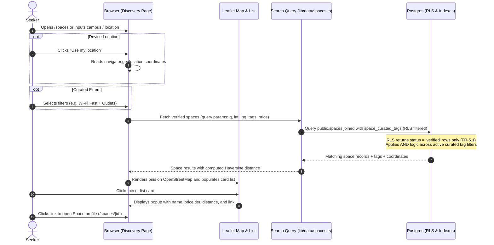

# STORY-08: Map discovery and curated tag filters

**Status:** draft · **Owner:** @lukedongque · **Story:** #57 · **FR:** FR-1.1, FR-1.2, FR-5.1 ·
**Depends on:** none ·
**Flows:** [Space verification](../flows/space-verification.md), [Host setup journey](../flows/host-setup-journey.md), [Seeker journey](../flows/seeker-journey.md) ·
**Decisions:** D-003, D-006, D-007, D-010, D-012, D-027, D-037, D-042, D-044, D-066

## 0. Scope

**In:**

- **Database migration, policies, and pgTAP tests (Luke, D-066):**
  - Add `latitude` (`double precision`, check `-90 <= latitude and latitude <= 90`), `longitude` (`double precision`, check `-180 <= longitude and longitude <= 180`), and `price_tier` (`public.price_tier` enum: `'free'`, `'budget'`, `'standard'`, `'premium'`) to `public.spaces` (D-027).
  - Add `public.curated_tags` catalog table defining platform-curated tags categorized into the seven criteria (FR-1.2).
  - Add `public.space_curated_tags` junction table associating Spaces with curated tags.
  - Add `public.space_custom_tags` table for Host-created free-text display tags (D-006).
  - RLS policies and grants on the new tables: public read access for Verified Spaces; Hosts can view and manage tags only on Spaces they own; non-owners get zero rows and rejected writes.
  - Comprehensive pgTAP tests in `supabase/tests/database/08-tags.sql` verifying RLS boundaries, tag isolation, and unverified space exclusion.
- **Leaflet + OpenStreetMap interactive discovery map (D-012):**
  - A dynamic Client Component (`DiscoveryMap`) loaded via Next.js dynamic import (`ssr: false`) to avoid server-side `window` execution errors.
  - Renders OpenStreetMap tiles with custom markers/pins for all matching Verified Spaces (FR-1.1).
  - Selecting a map pin highlights the venue, shows an accessible popup with venue name, price tier, and computed distance, and links directly to the Space profile (`/spaces/[id]`).
- **Synchronized accessible list view:**
  - An accessible list of Space cards displayed alongside the map on desktop (split view) and toggled/stacked on mobile (D-003, WCAG 2.1 AA).
  - Bidirectional synchronization: selecting a map pin highlights its corresponding card; hovering or focusing a card highlights its pin.
- **Location search and geolocation:**
  - Text search input supporting campus names and local areas (e.g., "USC", "CIT-U", "Cebu IT Park", "Lahug") with geocoded coordinates or database text matching.
  - W3C Geolocation integration: one-tap "Use my location" button computing real-time straight-line distance (Haversine formula in `lib/geo/haversine.ts`).
- **Multi-criteria curated tag filtering (FR-1.2):**
  - Filter panel covering the seven curated criteria:
    1. Minimum Wi-Fi tier (`wifi_basic`, `wifi_fast`, `wifi_ultrafast`)
    2. Power outlets (`outlets_all`, `outlets_some`)
    3. Noise level (`noise_silent`, `noise_quiet`, `noise_moderate`)
    4. Air conditioning (`ac_full`, `ac_partial`)
    5. Operating hours (`hours_open_now`, `hours_open_late`, `hours_24h`)
    6. Price tier (`free`, `budget`, `standard`, `premium`)
    7. Unit / room type (`unit_seat`, `unit_standing_desk`, `unit_room`)
  - Strict `AND` logic: selecting multiple filters returns only Spaces satisfying every selected criterion.
  - Clearing a filter restores results instantly without a full page reload.
  - Mobile filter drawer (`FilterDrawer`) responsive at 360, 768, and 1024 px.
  - Custom tags are display-only and never offered as filters (D-006, FR-1.3).
- **Host space tagging form:**
  - Route `/host/spaces/[spaceId]/tags` implementing step H8 of the [Host setup journey](../flows/host-setup-journey.md).
  - Allows the Host to select applicable curated tags from categorized checkboxes and enter free-text custom display tags.
  - Server Action `saveSpaceTagsAction` in `actions.ts` validating inputs with Zod.

**Out:**

- **Space profile and public availability view:** photos, detailed seat map, and unit selection belong to Maria in STORY-11 (#76).
- **Reserve-now holds and sandbox payments:** online checkout and payment transactions belong to Adrian in STORY-09 (#58).
- **QR check-in and wait window countdowns:** token scanning and wait-window timers belong to Luke in STORY-10 (#59).
- **Space verification queue and actions:** the Administrator approval queue at `/admin` belongs to James and Adrian in STORY-15 (#166).
- **Reviews and ratings:** aggregate star ratings and review submissions belong to Sprint 3 in STORY-13 (#78).
- **Proprietary map APIs:** Google Maps and Mapbox are rejected (D-012).

## 1. Flow

### Shared flows (D-044)

- **[Space verification flow](../flows/space-verification.md):**
  - Moves V2 (Approved) and V5 (Deleted). Only Verified Spaces (`spaces.status = 'verified'`) appear in public discovery. Pending and Rejected Spaces return zero rows to public queries (FR-5.1, D-055, RLS rule `spaces: read verified, own, or any as an administrator`).
- **[Host setup journey](../flows/host-setup-journey.md):**
  - Implements step H8 (`host-setup-tags`). While a Space is Pending (or Verified), the Host assigns curated tags and custom display tags. Edits preserve verification status (W4, D-027).
- **[Seeker journey](../flows/seeker-journey.md):**
  - Implements steps S1 to S6:
    - S1: Seeker opens Space discovery (`/spaces`).
    - S2: Searches by place or campus name, or uses device GPS location.
    - S2a: Chooses curated criteria filters.
    - S3 / P1 / P2: Filtered search returns only Verified Spaces matching all selected filters via `AND` logic (`seeker-filters-and-verification`).
    - S4: If no Spaces match, explains the empty state and lets the Seeker clear or revise filters (`seeker-search-no-results`).
    - S5: Seeker compares map pins and the synchronized list (`seeker-search-matches`).
    - S6: Selecting a Space navigates to its profile (`/spaces/[id]`).

### This story's own part



## 2. Data and state

### Tables and columns (new and modified)

#### 1. Alterations to `public.spaces` (D-027, D-066)

```sql
create type public.price_tier as enum ('free', 'budget', 'standard', 'premium');

alter table public.spaces
  add column latitude double precision check (latitude between -90 and 90),
  add column longitude double precision check (longitude between -180 and 180),
  add column price_tier public.price_tier not null default 'budget';

comment on column public.spaces.latitude is 'WGS 84 latitude coordinate for Leaflet map pin. STORY-08.';
comment on column public.spaces.longitude is 'WGS 84 longitude coordinate for Leaflet map pin. STORY-08.';
comment on column public.spaces.price_tier is 'Curated price tier for Seeker filtering and pin display. STORY-08.';

-- Update column grants for authenticated Hosts
grant insert (name, description, address, opens_at, closes_at, latitude, longitude, price_tier)
  on table public.spaces to authenticated;
grant update (name, description, address, opens_at, closes_at, latitude, longitude, price_tier)
  on table public.spaces to authenticated;
```

#### 2. Curated tags catalog: `public.curated_tags`

Defines the platform's standardized filter vocabulary across the seven criteria (FR-1.2, D-006).

```sql
create table public.curated_tags (
  id text primary key,
  category text not null check (category in (
    'wifi', 'power', 'noise', 'ac', 'hours', 'price_tier', 'unit_type'
  )),
  label text not null check (char_length(btrim(label)) >= 1 and char_length(label) <= 50),
  description text check (char_length(description) <= 200),
  display_order smallint not null default 0,
  created_at timestamptz not null default now()
);

comment on table public.curated_tags is 'Platform-curated amenity tags powering search filters. STORY-08.';

alter table public.curated_tags enable row level security;

-- Readable by all; mutations reserved for administrator / seed migrations
grant select on table public.curated_tags to anon, authenticated;

create policy "curated_tags: publicly readable"
  on public.curated_tags
  for select
  to anon, authenticated
  using (true);
```

#### 3. Space curated tags junction: `public.space_curated_tags`

```sql
create table public.space_curated_tags (
  space_id uuid not null references public.spaces (id) on delete cascade,
  tag_id text not null references public.curated_tags (id) on delete cascade,
  created_at timestamptz not null default now(),
  primary key (space_id, tag_id)
);

comment on table public.space_curated_tags is 'Curated tags assigned to a Space by its Host. STORY-08.';

create index space_curated_tags_tag_id_idx on public.space_curated_tags (tag_id);

alter table public.space_curated_tags enable row level security;

grant select, insert, delete on table public.space_curated_tags to authenticated;
grant select on table public.space_curated_tags to anon;

create policy "space_curated_tags: read tags of visible spaces"
  on public.space_curated_tags
  for select
  to anon, authenticated
  using (
    exists (
      select 1 from public.spaces s
      where s.id = space_curated_tags.space_id
        and (
          s.status = 'verified'
          or s.host_id = (select auth.uid())
          or (select private.has_role('admin'))
        )
    )
  );

create policy "space_curated_tags: hosts manage tags for own spaces"
  on public.space_curated_tags
  for insert
  to authenticated
  with check (
    exists (
      select 1 from public.spaces s
      where s.id = space_curated_tags.space_id
        and s.host_id = (select auth.uid())
        and (select private.has_role('host'))
    )
  );

create policy "space_curated_tags: hosts delete tags for own spaces"
  on public.space_curated_tags
  for delete
  to authenticated
  using (
    exists (
      select 1 from public.spaces s
      where s.id = space_curated_tags.space_id
        and s.host_id = (select auth.uid())
        and (select private.has_role('host'))
    )
  );
```

#### 4. Space custom tags: `public.space_custom_tags`

Free-text tags added by Hosts for venue profile display only (D-006, FR-1.3). Never used for search filtering.

```sql
create table public.space_custom_tags (
  id uuid primary key default gen_random_uuid(),
  space_id uuid not null references public.spaces (id) on delete cascade,
  name text not null check (
    char_length(btrim(name)) >= 1
    and char_length(name) <= 30
    and name !~ '[<>{}\\]'
  ),
  created_at timestamptz not null default now()
);

comment on table public.space_custom_tags is 'Host-defined free-text tags for display only. STORY-08.';

create unique index space_custom_tags_space_lower_name_idx
  on public.space_custom_tags (space_id, lower(name));

alter table public.space_custom_tags enable row level security;

grant select, insert, delete on table public.space_custom_tags to authenticated;
grant select on table public.space_custom_tags to anon;

create policy "space_custom_tags: read tags of visible spaces"
  on public.space_custom_tags
  for select
  to anon, authenticated
  using (
    exists (
      select 1 from public.spaces s
      where s.id = space_custom_tags.space_id
        and (
          s.status = 'verified'
          or s.host_id = (select auth.uid())
          or (select private.has_role('admin'))
        )
    )
  );

create policy "space_custom_tags: hosts manage custom tags for own spaces"
  on public.space_custom_tags
  for insert
  to authenticated
  with check (
    exists (
      select 1 from public.spaces s
      where s.id = space_custom_tags.space_id
        and s.host_id = (select auth.uid())
        and (select private.has_role('host'))
    )
  );

create policy "space_custom_tags: hosts delete custom tags for own spaces"
  on public.space_custom_tags
  for delete
  to authenticated
  using (
    exists (
      select 1 from public.spaces s
      where s.id = space_custom_tags.space_id
        and s.host_id = (select auth.uid())
        and (select private.has_role('host'))
    )
  );
```

### Pre-seeded curated tags catalog

The migration seeds the platform catalog across the seven criteria:

| Category     | Tag ID               | Display Label                 | Description                                       |
| ------------ | -------------------- | ----------------------------- | ------------------------------------------------- |
| `wifi`       | `wifi_basic`         | Wi-Fi: Standard (10+ Mbps)    | Basic internet suitable for reading and email     |
| `wifi`       | `wifi_fast`          | Wi-Fi: Fast (50+ Mbps)        | High-speed internet suitable for video calls      |
| `wifi`       | `wifi_ultrafast`     | Wi-Fi: Ultra-Fast (100+ Mbps) | Gigabit / fiber connection for heavy workflows    |
| `power`      | `outlets_all`        | Outlets: Every Seat           | Dedicated power outlet at every workstation       |
| `power`      | `outlets_some`       | Outlets: Shared / Common      | Accessible outlets in common areas                |
| `noise`      | `noise_silent`       | Noise: Silent Study           | Strictly silent; no talking or calls permitted    |
| `noise`      | `noise_quiet`        | Noise: Quiet Focus            | Low murmurs permitted; headphone study            |
| `noise`      | `noise_moderate`     | Noise: Collaborative          | Conversational and group discussions permitted    |
| `ac`         | `ac_full`            | Air Conditioning              | Full air-conditioning throughout the venue        |
| `ac`         | `ac_natural`         | Natural Ventilation           | Open-air, ceiling fans or natural breeze          |
| `hours`      | `hours_open_now`     | Open Now                      | Currently open based on daily schedule            |
| `hours`      | `hours_open_late`    | Open Late (past 10 PM)        | Closing time at or after 22:00 or past midnight   |
| `hours`      | `hours_24h`          | Open 24 Hours                 | Venue is open 24/7 (`opens_at = closes_at`)       |
| `price_tier` | `price_free`         | Free                          | Public library or no-fee study hub                |
| `price_tier` | `price_budget`       | Budget (₱)                    | Affordable hourly rate                            |
| `price_tier` | `price_standard`     | Standard (₱₱)                 | Typical commercial co-working rate                |
| `price_tier` | `price_premium`      | Premium (₱₱₱)                 | Full-service executive lounge / premium workspace |
| `unit_type`  | `unit_seat`          | Desks / Seats                 | Standard open desk seating                        |
| `unit_type`  | `unit_standing_desk` | Standing Desks                | Ergonomic standing desk options                   |
| `unit_type`  | `unit_room`          | Meeting / Private Rooms       | Whole bookable rooms with private capacity        |

### Zod validation schemas

#### `lib/validation/search.ts`

```ts
import { z } from 'zod'

export const priceTierSchema = z.enum(['free', 'budget', 'standard', 'premium'])

export const discoverySearchQuerySchema = z.object({
  q: z.string().trim().max(100).optional(),
  lat: z.coerce.number().min(-90).max(90).optional(),
  lng: z.coerce.number().min(-180).max(180).optional(),
  tags: z
    .union([z.string(), z.array(z.string())])
    .optional()
    .transform((val) => {
      if (!val) return []
      return Array.isArray(val) ? val : [val]
    }),
  price: z
    .union([priceTierSchema, z.array(priceTierSchema)])
    .optional()
    .transform((val) => {
      if (!val) return []
      return Array.isArray(val) ? val : [val]
    }),
})

export type DiscoverySearchQuery = z.infer<typeof discoverySearchQuerySchema>
```

#### `lib/validation/tags.ts`

```ts
import { z } from 'zod'

export const spaceTagsSchema = z.object({
  spaceId: z.string().uuid(),
  curatedTagIds: z.array(z.string().min(1).max(50)).max(20),
  customTagNames: z
    .array(
      z
        .string()
        .trim()
        .min(1, 'Tag name cannot be empty')
        .max(30, 'Tag name cannot exceed 30 characters')
        .regex(/^[^<>{}\\]+$/, 'Tag name contains invalid characters'),
    )
    .max(10, 'A Space can have at most 10 custom tags'),
})

export type SpaceTagsInput = z.infer<typeof spaceTagsSchema>
```

## 3. UI and files

### User experience (Maria decides, D-042)

1. **Discovery View (`/spaces` or `/` with search):**
   - **Hero & Search Header:** includes a text search field ("Search by campus, city, or space name...") and a prominent "Use my location" button with a location pinpoint icon.
   - **Filter Controls:**
     - On desktop: top filter bar with dropdown chips for the 7 criteria categories and an active filter count pill.
     - On mobile (<1024px): "Filters" trigger button opening a bottom sheet / drawer (`FilterDrawer`).
     - "Clear all" button visible whenever any filter is active.
   - **Split Screen Layout (>=1024px):**
     - Left pane (50% or 45% width): synchronized scrollable list of Space cards.
     - Right pane (50% or 55% width, sticky): full-height interactive Leaflet map.
   - **Mobile Layout (<1024px):**
     - Floating toggle button ("Map" / "List") allowing seamless switching without state loss.
   - **Space Card & Pin Popup Details:**
     - Venue name, address snippet, price tier badge (`Free`, `Budget`, `Standard`, `Premium`).
     - Distance in kilometers (e.g., "0.4 km away") when user location or search center is available.
     - Curated amenity tag pills (e.g., "Wi-Fi: Fast", "Outlets: Every Seat").
     - Clear link/button: "View Space" navigating to `/spaces/[id]`.
   - **Empty State (`seeker-search-no-results`):**
     - "No study spaces found matching your criteria."
     - Helpful guidance: "Try expanding your search area or clearing some filters."
     - One-click "Reset all filters" button.

2. **Host Tagging Form (`/host/spaces/[spaceId]/tags`):**
   - Breadcrumb navigation: `Spaces > [Space Name] > Amenities & Tags`.
   - Organized sections for each curated category with accessible checkboxes.
   - Dedicated "Custom Display Tags" section with a tag pill input: Host types a tag, presses Enter or clicks "Add" to create a pill, and clicks 'x' to remove. Clear explanatory note: _"Custom tags are displayed on your space profile for context, but do not power seeker search filters (D-006)."_
   - Sticky action bar with "Save tags" button and discard link.

### Where the files go

```
app/
  (public)/
    spaces/
      page.tsx                           # Server Component: reads search params, fetches spaces
      _components/
        discovery-shell.tsx              # Client Component: manages state, layout & filter drawer
        discovery-map.tsx                # Client Component: Leaflet map container (dynamic import)
        space-card-list.tsx              # Client Component: list view of space cards
        filter-panel.tsx                 # Desktop filter controls
        filter-drawer.tsx                # Mobile responsive filter drawer
        search-bar.tsx                   # Text search + geolocation trigger
  (dashboard)/
    host/
      spaces/
        [spaceId]/
          tags/
            page.tsx                     # Server Component: reads space tags and curated catalog
            actions.ts                   # Server Action: saveSpaceTagsAction
            _components/
              tag-form.tsx               # Client Component: interactive tag selector and custom tags
components/
  discovery/
    space-card.tsx                       # Shared space card primitive
    price-tier-badge.tsx                 # Badge for price tier
lib/
  geo/
    haversine.ts                         # Pure logic: distance calculation between coordinates
    haversine.test.ts                    # Vitest unit tests for distance calculation
  data/
    spaces.ts                            # Server query helper: searchVerifiedSpaces
    spaces.test.ts                       # Vitest tests for query and AND-filter logic
  validation/
    search.ts                            # Zod schemas for search query parameters
    search.test.ts                       # Vitest unit tests for search validation
    tags.ts                              # Zod schemas for space tag mutations
    tags.test.ts                         # Vitest unit tests for tag validation
supabase/
  migrations/
    20261103000000_geo_and_tags.sql      # Schema additions (lat/lng, price_tier, tag tables, RLS)
  tests/
    database/
      08-tags.sql                        # pgTAP tests for tags, coordinates, and RLS
```

### Accessibility (WCAG 2.1 AA)

- **Target Size:** All interactive buttons, chips, and pin touch targets are minimum 48×48 px on mobile.
- **Keyboard Navigation:** Every Space on the map has a corresponding card in the synchronized list view, completely navigable via Tab / Enter.
- **Screen Reader Announcements:** Active filter count and search result count announced via `aria-live="polite"`.
- **Contrast:** Text meets 4.5:1 minimum contrast against backgrounds.
- **Responsiveness:** Layout reflows cleanly without horizontal scrolling at 360 px, 768 px, and 1024 px.

## 4. Security and test matrix

| Layer      | Case                                                              | Expected Result                                                                |
| ---------- | ----------------------------------------------------------------- | ------------------------------------------------------------------------------ |
| **pgTAP**  | Anon / Seeker queries `public.spaces`                             | Returns only `verified` spaces; `pending` or `rejected` return 0 rows (FR-5.1) |
| **pgTAP**  | Anon / Seeker reads `space_curated_tags` of Verified Space        | Returns assigned curated tag rows                                              |
| **pgTAP**  | Anon / Seeker reads `space_curated_tags` of Pending Space         | Returns 0 rows                                                                 |
| **pgTAP**  | Host reads `space_curated_tags` of their own Pending Space        | Returns assigned tag rows                                                      |
| **pgTAP**  | Host inserts curated tags on their own Space                      | Succeeds                                                                       |
| **pgTAP**  | Host inserts curated tags on another Host's Space                 | Refused by RLS (0 rows / check violation)                                      |
| **pgTAP**  | Seeker / Anon attempts insert into `space_curated_tags`           | Refused (42501 permission denied or RLS check violation)                       |
| **pgTAP**  | Host inserts custom tag on their own Space                        | Succeeds                                                                       |
| **pgTAP**  | Host inserts duplicate custom tag (case-insensitive) on own Space | Unique constraint violation (`space_custom_tags_space_lower_name_idx`)         |
| **pgTAP**  | Host attempts to update `status` on `public.spaces`               | Refused (42501: column `status` not granted)                                   |
| **Vitest** | `discoverySearchQuerySchema` with valid params                    | Parses and coerces coordinates and array tags                                  |
| **Vitest** | `discoverySearchQuerySchema` with invalid lat/lng (>90 / >180)    | Validation error                                                               |
| **Vitest** | `spaceTagsSchema` with >10 custom tags or >30 char tag            | Validation error                                                               |
| **Vitest** | `haversineDistance` between known coordinates                     | Accurate distance within 0.1% tolerance                                        |
| **Vitest** | Query builder with 2 curated filters                              | Applies `AND` condition; returns only spaces matching both                     |
| **Vitest** | Query builder with 0 filters                                      | Returns all verified spaces in search area                                     |
| **Manual** | Seeker opens `/spaces` on desktop and mobile                      | Split map/list renders; toggle works on mobile; 48px touch targets             |
| **Manual** | Seeker clicks "Use my location"                                   | Map centers on user position; cards show computed distance in km               |
| **Manual** | Seeker selects Wi-Fi Fast + Outlets filters                       | List and map update to show only spaces with both tags                         |
| **Manual** | Seeker clears one filter                                          | List and map immediately restore matching spaces without full reload           |
| **Manual** | Host visits `/host/spaces/[spaceId]/tags`                         | Can toggle curated checkboxes, add/remove custom tag chips, and save           |

## 5. Tasks and estimates

| Task         | What                                                                                                             | Owner | Points (1–10) | Days | Depends on         |
| ------------ | ---------------------------------------------------------------------------------------------------------------- | ----- | ------------- | ---- | ------------------ |
| **TSK-08.1** | Database migration for space coordinates, price tier, curated & custom tag tables, RLS policies, and pgTAP tests | Luke  | 4             | 1.5  | None               |
| **TSK-08.2** | Zod validation schemas, Haversine geo logic, and query helper with Vitest unit tests                             | Luke  | 2             | 1.0  | TSK-08.1           |
| **TSK-08.3** | Dynamic Leaflet discovery map component and synchronized space card list                                         | Luke  | 3             | 1.5  | TSK-08.2           |
| **TSK-08.4** | Multi-criteria curated filter panel, mobile filter drawer (AND logic), and search inputs                         | Luke  | 2             | 1.0  | TSK-08.3           |
| **TSK-08.5** | Host space tagging form and Server Action at `/host/spaces/[spaceId]/tags`                                       | Luke  | 2             | 1.0  | TSK-08.1           |
| **TSK-08.6** | Responsive integration, accessibility verification (WCAG 2.1 AA), and end-to-end check                           | Luke  | 2             | 1.0  | TSK-08.4, TSK-08.5 |

## 6. Build order

Every PR targets `main` and includes its relevant tests.

| #   | Branch                              | PR Title                                                                              | Contains                                                                                                                                                        |
| --- | ----------------------------------- | ------------------------------------------------------------------------------------- | --------------------------------------------------------------------------------------------------------------------------------------------------------------- |
| 1   | `feature/STORY-08-tags-migration`   | `feat(STORY-08): add space coordinates, price tier, and tag tables`                   | Migration adding `latitude`, `longitude`, `price_tier`, `curated_tags`, `space_curated_tags`, `space_custom_tags`, RLS policies, seed catalog, and pgTAP tests. |
| 2   | `feature/STORY-08-validation-query` | `feat(STORY-08): add discovery validation, haversine logic, and query helper`         | `lib/validation/search.ts`, `lib/validation/tags.ts`, `lib/geo/haversine.ts`, `lib/data/spaces.ts`, and Vitest test suites.                                     |
| 3   | `feature/STORY-08-map-list`         | `feat(STORY-08): add discovery map and synchronized list view`                        | Dynamic Leaflet `DiscoveryMap`, `SpaceCardList`, space card components, pin popups, and marker synchronization.                                                 |
| 4   | `feature/STORY-08-filters`          | `feat(STORY-08): add curated multi-criteria filters and search bar`                   | Desktop filter bar, mobile `FilterDrawer`, AND filtering logic, location search, and geolocation integration.                                                   |
| 5   | `feature/STORY-08-host-tags`        | `feat(STORY-08): add host space tagging form and actions`                             | `/host/spaces/[spaceId]/tags` route, Server Action `saveSpaceTagsAction`, and interactive tag input form.                                                       |
| 6   | `feature/STORY-08-polish-a11y`      | `feat(STORY-08): verify discovery accessibility, responsive layout, and empty states` | Accessibility audit (touch targets, aria-live, keyboard flow), 360/768/1024 px checks, and polish.                                                              |

## 7. Rejected alternatives

- **Storing tags as a plain `text[]` column on `spaces`:** Rejected because free-text arrays prevent standardized multi-criteria filtering, break index efficiency, and invite typo corruption (violates D-006).
- **Google Maps or Mapbox:** Rejected by D-012 and SRS §2.5 to avoid proprietary paid per-query map APIs and credit card requirements. Leaflet + OpenStreetMap provides an open-source, zero-cost mapping solution.
- **Client-only filtering of all spaces:** Rejected because pulling unverified or thousands of distant spaces into the client violates RLS data minimization and degrades performance on mobile devices. Filtering is computed against Verified spaces in Postgres / server data helper.
- **Map-only interface without synchronized list:** Rejected by D-003 and WCAG 2.1 AA because a map-only interface is inaccessible to screen readers and keyboard-only users.

## 8. Open questions

- None blocking. Default initial map center is set to Cebu City coordinates (`10.3157, 123.8854`) at zoom level 13 when user location permission is not granted or before search.

## 9. After the build

_(To be completed when the story is merged and implemented)_

- What turned out different from this plan, and why:
- Status line changed to: `implemented YYYY-MM-DD`
- Docs this story changed:
- Who verified each acceptance criterion:
