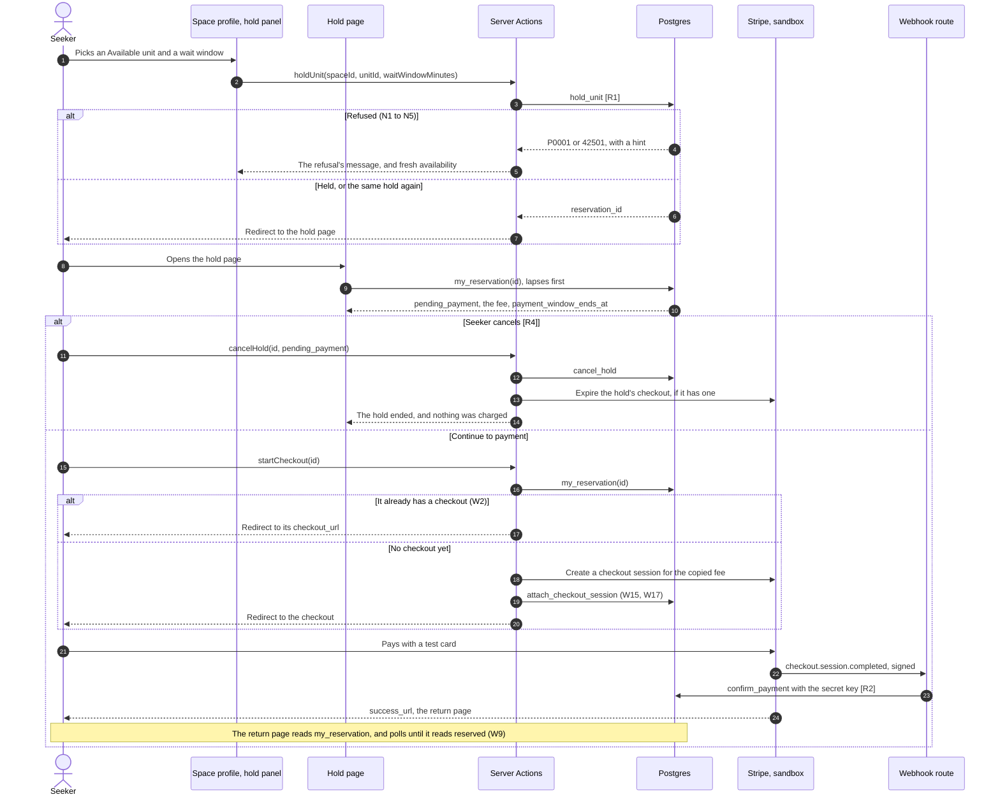

# STORY-09: Reserve-now holds and sandbox payments

**Status:** approved 2026-11-08 · **Owner:** @dreeyanzz · **Story:** #58 · **FR:** FR-2.1, FR-2.2, FR-2.3, FR-2.5, SRS §3.2.2, SRS §3.8 ·
**Depends on:** STORY-01, STORY-03, STORY-05, STORY-07, STORY-11 ·
**Flows:** [Reservation lifecycle](../flows/reservation-lifecycle.md), [Sandbox payment confirmation](../flows/sandbox-payment-confirmation.md), [Check-in](../flows/check-in.md), [Seeker journey](../flows/seeker-journey.md) ·
**Decisions:** D-001, D-004, D-005, D-008, D-010, D-011, D-042, D-046 to D-052, D-055 to D-059, D-064, D-067 to D-069

## 0. Scope

**In:**

- The `reservations` and `payments` tables, the system's hold terms, and each Space's
  maximum wait window.
- The database functions the flows give this story: `hold_unit`, `cancel_hold`,
  `attach_checkout_session`, `confirm_payment`, the first step of `private.record_lapses`,
  holds and `reservation_id` in `unit_states`, and the Seeker's own reservation, named
  here `my_reservation`. Also `hold_terms`, new here, which tells the Space profile what a
  hold costs and which wait windows fit.
- The refusals the reservation lifecycle gives this story: deleting a held unit, or a zone
  or Space with one (N17), changing a held unit (N23), and hours that cut into a hold
  (N22), with their messages in STORY-05's and STORY-07's forms.
- Stripe's hosted checkout in a sandbox (D-069), the webhook route with its signature check, and
  a script that sends a signed test webhook to a local server.
- The Seeker's screens: the hold panel on the Space profile, the hold page, the return
  page, and a link to their hold on `/seeker`.
- The maximum wait window on the Host's Space form.
- Registration that returns to the Space profile (D-058).
- The pgTAP tests the flows name for `holds`, and a race test on two connections (FR-2.5).

**Out:**

- The QR code, the Seeker dashboard's reservation card, check-in, check-out, no-show,
  closing time, and wait windows in `unit_states`: STORY-10 (#59), built on these tables
  (D-066).
- A Host ending a hold with a tap (R5, R9, R11): STORY-12's TSK-12.4.
- The Space profile page and unit selection: STORY-11 (#76). This story fills its hold
  slot (§8).
- Sandbox refunds (P1): STORY-14, in Sprint 3.
- Hold cycling, an accepted risk (D-050).

## 1. Flow

**Shared flows** (D-044). This story builds:

- **[Reservation lifecycle](../flows/reservation-lifecycle.md):** R1, R2, R3, R4, R8 and P2;
  the refusals N1 to N7, N11, N17, N18, N23 and N25, and its own halves of N8, N16, N21,
  N22 and N24; `unit_states` with holds; the lapse step's first step; and where the timers
  and the fee are kept.
- **[Sandbox payment confirmation](../flows/sandbox-payment-confirmation.md):** every
  branch, W1 to W22, its signature check (§3), its two functions (§4), and the return page
  (§5).
- **[Check-in](../flows/check-in.md):** only the booking token's format, because
  `confirm_payment` makes the token (D-059).
- **[Seeker journey](../flows/seeker-journey.md):** from the existing-hold check (S12) to
  the booking token (S34), except the token's QR code. Its paths from
  `seeker-existing-hold-opens-dashboard` to `seeker-payment-wins-cancel-race` are this
  story's, apart from `seeker-select-available-unit` (STORY-11) and the Host's overrides
  (STORY-12).

**Holding and paying are two steps** (D-068). The Seeker journey puts a Pending Payment
screen between the hold and the checkout (S28 to S31). So "Hold this unit" makes the hold
and opens the hold page, and the hold page's "Continue to payment" makes the checkout.
These are the calls the payment confirmation flow draws in its §1.1, steps 2 to 11, split
across two taps: the first tap is `hold_unit`, and the second is the checkout,
`attach_checkout_session` and the redirect. No move or branch changes.

**This story's own part:**



## 2. Data and state

### Hold terms (D-067)

| Value                         | Set to                                | Kept in                                                                                                    |
| ----------------------------- | ------------------------------------- | ---------------------------------------------------------------------------------------------------------- |
| Payment window                | 10 minutes                            | `private.reservation_settings.payment_window`                                                              |
| Reservation fee               | ₱50.00                                | `private.reservation_settings.fee_amount`, as 5000 centavos                                                |
| Wait window limits            | 15 to 120 minutes, in 15-minute steps | `private.is_valid_wait_window()`, in the checks on `spaces.max_wait_window` and `reservations.wait_window` |
| A Space's maximum wait window | 60 minutes, until its Host changes it | `spaces.max_wait_window`                                                                                   |

Adrian chose these values. Maria's approval of this doc covers what Seekers are told about
them (D-042, D-049).

Changing a value is a migration, like any other database change (rule 10). A hold copies
the fee onto its payment, so a new fee never rewrites a payment (D-049). Amounts are whole
centavos, as Stripe's API takes them, so nothing is rounded.

Columns hold intervals. Functions that the app calls take and return minutes as whole
numbers, so the app never parses an interval.

### Enums

- `public.reservation_status`: `pending_payment`, `reserved`, `occupied`, `expired`,
  `no_show`, `completed`, `cancelled` (D-046).
- `public.payment_status`: `pending`, `paid`, `forfeited`, `refunded` (SRS §3.8).

A hold is a reservation whose status is `pending_payment`, `reserved` or `occupied`. The
others have ended.

### New table: `private.reservation_settings`

One row: `id boolean primary key default true check (id)`, `payment_window interval not
null check (payment_window between '1 minute' and '1 hour')` and `fee_amount integer not
null check (fee_amount > 0)`. The migration inserts `'10 minutes'` and `5000`. It sits in
`private`, so nobody but the functions reads it.

### New table: `public.reservations`

| Column                            | Type and rule                                                         | Notes                                                                       |
| --------------------------------- | --------------------------------------------------------------------- | --------------------------------------------------------------------------- |
| `id`                              | `uuid primary key default gen_random_uuid()`                          |                                                                             |
| `seeker_id`                       | `uuid not null`, references `profiles (id) on delete cascade`         |                                                                             |
| `space_id`                        | `uuid not null`, references `spaces (id) on delete cascade`           | Stays when the unit is deleted (D-052)                                      |
| `unit_id`                         | `uuid`, references `units (id) on delete set null`                    | Null only once the reservation has ended                                    |
| `unit_label`                      | `text not null`                                                       | Copied at R1, so an ended reservation still names its unit (W20)            |
| `status`                          | `reservation_status not null default 'pending_payment'`               |                                                                             |
| `wait_window`                     | `interval not null check (private.is_valid_wait_window(wait_window))` | The Seeker's choice at R1                                                   |
| `payment_window_ends_at`          | `timestamptz not null`                                                | R1's time plus the payment window                                           |
| `wait_window_ends_at`             | `timestamptz`                                                         | R2's time plus `wait_window` (D-004)                                        |
| `booking_token`                   | `text unique`, `check (booking_token ~ '^[0-9A-HJKMNP-TV-Z]{12}$')`   | Set at R2: 12 Crockford base32 characters (D-059)                           |
| `checked_in_at`, `checked_out_at` | `timestamptz`                                                         | STORY-10 writes them. A visit is a reservation with `checked_in_at` (D-009) |
| `ended_at`                        | `timestamptz`                                                         | Set when it ends                                                            |
| `created_at`, `updated_at`        | `timestamptz not null default now()`, with `private.set_updated_at()` |                                                                             |

Checks and indexes:

- `reservations_one_active_hold_per_unit`: a unique index on `unit_id` where the status is
  a hold's (N3, FR-2.5).
- `reservations_one_active_hold_per_seeker`: a unique index on `seeker_id` where the status
  is a hold's (N2, D-008).
- A hold has a `unit_id`.
- A `pending_payment` reservation has no `booking_token` and no `wait_window_ends_at`; a
  `reserved` or `occupied` one has both.
- `ended_at` is set exactly when the status has ended.
- Plain indexes on `space_id` and `seeker_id`.

### New table: `public.payments`

| Column                     | Type and rule                                                            | Notes                                                         |
| -------------------------- | ------------------------------------------------------------------------ | ------------------------------------------------------------- |
| `id`                       | `uuid primary key default gen_random_uuid()`                             |                                                               |
| `reservation_id`           | `uuid not null unique`, references `reservations (id) on delete cascade` | One payment per reservation                                   |
| `status`                   | `payment_status not null default 'pending'`                              |                                                               |
| `fee_amount`               | `integer not null check (fee_amount > 0)`                                | Centavos, copied at R1 (D-049)                                |
| `checkout_session_id`      | `text unique`                                                            | Stripe's `cs_…`, set by `attach_checkout_session`             |
| `checkout_url`             | `text`                                                                   |                                                               |
| `external_payment_id`      | `text unique`                                                            | Stripe's PaymentIntent `pi_…`: the gateway reference (FR-2.3) |
| `paid_at`                  | `timestamptz`                                                            |                                                               |
| `created_at`, `updated_at` | `timestamptz not null default now()`, with `private.set_updated_at()`    |                                                               |

A `pending` payment has no `external_payment_id` and no `paid_at`; any other status has
both.

### Changed table: `public.spaces`

- `max_wait_window interval not null default '60 minutes' check
(private.is_valid_wait_window(max_wait_window))`. Existing Spaces get 60 minutes. Its
  Host writes it as they write the Space's other columns.

Deleting a Space deletes its ended reservations and their payments (the reservation
lifecycle). Deleting a Seeker's account deletes theirs, and frees their hold's unit.
Deleting a Host's account is refused while one of their Spaces has a hold (N17).

### New and changed functions

Each is `security definer` with `set search_path = ''`. Each revokes execute from
`public`, `anon` and `authenticated`, then grants what the reservation lifecycle's
[who may call each function](../flows/reservation-lifecycle.md#who-may-call-each-function)
says (D-047, N24). Each that reads or changes a hold records lapses first, and locks units
(by id), then reservations, then payments.

| Function                                                          | Who may call it         | What it does                                                                                                                                                                                                                                                                                                                                    |
| ----------------------------------------------------------------- | ----------------------- | ----------------------------------------------------------------------------------------------------------------------------------------------------------------------------------------------------------------------------------------------------------------------------------------------------------------------------------------------- |
| `private.is_valid_wait_window(interval)`                          | Its checks              | `immutable`. True for 15 to 120 minutes in 15-minute steps (D-067).                                                                                                                                                                                                                                                                             |
| `private.is_open(opens_at, closes_at, at)`                        | The functions here      | Whether a Space with those hours is open at that moment, in Asia/Manila (D-048).                                                                                                                                                                                                                                                                |
| `private.next_closing_time(opens_at, closes_at, at)`              | The functions here      | The next closing time after that moment, or null for a Space open 24 hours. STORY-10 adds the last closing time beside it.                                                                                                                                                                                                                      |
| `private.new_booking_token()`                                     | `confirm_payment`       | 8 bytes from `extensions.gen_random_bytes`, of which the first 60 bits become 12 Crockford base32 characters (D-059). It tries again if the token is taken.                                                                                                                                                                                     |
| `private.record_lapses(unit_ids uuid[])`                          | Only the functions here | Step 1 of the lapse step: a `pending_payment` hold whose payment window has passed becomes `expired` (R3). It looks without a lock, and only when it finds one does it lock those units in id order and check again (D-047). STORY-10 adds steps 2 to 4.                                                                                        |
| `public.unit_states(space_id)`                                    | `anon`, `authenticated` | Now `volatile`, because it records lapses first. A unit with a hold reads as the hold's status (D-046). Only the Space's Host gets `reservation_id` (N25, D-057). `wait_window_ends_at` stays null until STORY-10. Its columns don't change.                                                                                                    |
| `public.hold_terms(space_id)`                                     | `anon`, `authenticated` | `fee_amount`, `payment_window_minutes`, `max_wait_window_minutes`, `is_open`, `next_closing_at`, and `wait_window_minutes`: every wait window up to the Space's maximum that fits, with the payment window, before closing. Zero rows for a Space the caller may not see (D-055).                                                               |
| `public.hold_unit(unit_id, wait_window_minutes)`                  | `authenticated`         | R1, below.                                                                                                                                                                                                                                                                                                                                      |
| `public.cancel_hold(reservation_id, expected_status)`             | `authenticated`         | R4 and R8, below.                                                                                                                                                                                                                                                                                                                               |
| `public.my_reservation(reservation_id default null)`              | `authenticated`         | The caller's own reservation with that id, or with no id, their hold. It returns its status, payment status, fee, Space, unit label, zone, wait window and both window ends. It returns the `booking_token` only while `reserved`, and the checkout only while `pending_payment` with a `pending` payment. Another Seeker's id gives zero rows. |
| `public.attach_checkout_session(reservation_id, session_id, url)` | `authenticated`         | As the payment confirmation flow's §4.2 says.                                                                                                                                                                                                                                                                                                   |
| `public.confirm_payment(reservation_id, session_id, payment_id)`  | `service_role` only     | As that flow's §4.1 says, with the token from `private.new_booking_token()`.                                                                                                                                                                                                                                                                    |

**`hold_unit`**, in order:

1. Refuses with `42501` unless the caller is a Seeker (N5).
2. Records lapses for the unit, and for the caller's own hold, so a lapsed hold of theirs
   doesn't count against D-008.
3. Locks the unit. If the caller already holds this unit, it returns that hold unchanged,
   with its checkout if it has one (a double tap, W2).
4. Refuses with `P0001` and one of these hints, in this order:
   - `unit_not_found`: no such unit, or its Space isn't Verified (N4, D-055);
   - `space_closed`: the Space is closed now (N4);
   - `wait_window_not_allowed`: not a valid wait window, or longer than the Space's
     maximum (N4);
   - `wait_window_past_closing`: the payment window and the wait window don't both fit
     before closing time (N4, D-048);
   - `unit_not_available`: the unit has a hold, or its Host-set state isn't `available`
     (N1);
   - `seeker_has_hold`: the caller holds another unit (N2).
5. Inserts the reservation, with `unit_label` and `payment_window_ends_at`, and its
   `pending` payment with the fee copied. A unique-index violation from a race becomes the
   matching refusal above, never an error.
6. Returns `reservation_id`, `status`, `checkout_url` and `created`.

**`cancel_hold`** records lapses, then locks. It refuses with `42501` if the hold isn't the
caller's (N8). It refuses with `P0001` and `hold_changed` if the status isn't the one the
caller saw (N21, D-050), with `hold_ended` if the reservation has ended (N11), and with
`checked_in` if it is `occupied`, which STORY-10's check-out ends. A `pending_payment` hold
becomes `cancelled`, and its payment stays `pending` (R4). A `reserved` hold becomes
`cancelled`, and its payment `forfeited` (R8). Either way `ended_at` is set, and the unit
is free at once.

### Triggers (D-048, D-052)

Each records lapses first, and refuses with `P0001`:

| Trigger                                                                                                                    | Refuses when                                                                                                                                                                                              | Hint             | Move |
| -------------------------------------------------------------------------------------------------------------------------- | --------------------------------------------------------------------------------------------------------------------------------------------------------------------------------------------------------- | ---------------- | ---- |
| `before delete` on `units`                                                                                                 | The unit has a hold                                                                                                                                                                                       | `unit_held`      | N17  |
| `before delete` on `zones` and `spaces`, locking their units in id order first                                             | One of their units has a hold                                                                                                                                                                             | `unit_held`      | N17  |
| `before update` on `units`, when `zone_id`, `unit_type`, `label`, `capacity`, `grid_row`, `grid_col` or `col_span` changes | The unit has a hold                                                                                                                                                                                       | `unit_held`      | N23  |
| `before update of opens_at, closes_at` on `spaces`, locking its units in id order first                                    | Under the new hours, the Space is closed now, or closes before a hold ends. A `pending_payment` hold ends at `payment_window_ends_at` plus its wait window, and a `reserved` one at `wait_window_ends_at` | `hours_cut_hold` | N22  |

STORY-10 extends the last one to visits.

### Moves this story adds

The reservation lifecycle draws them. This is where each lands:

| From                                        | Event                         | To                                   | Precondition                        | Who               |
| ------------------------------------------- | ----------------------------- | ------------------------------------ | ----------------------------------- | ----------------- |
| (none)                                      | R1, a hold                    | `pending_payment`, payment `pending` | `hold_unit`'s checks                | A Seeker          |
| `pending_payment`                           | R2, a confirmed payment       | `reserved`, payment `paid`, token    | Payment `pending`                   | The webhook       |
| `pending_payment`                           | R3, the payment window lapses | `expired`, payment stays `pending`   | `payment_window_ends_at` has passed | The lapse step    |
| `pending_payment`                           | R4, the Seeker cancels        | `cancelled`, payment stays `pending` | The status the Seeker saw           | The hold's Seeker |
| `reserved`                                  | R8, the Seeker cancels        | `cancelled`, payment `forfeited`     | The status the Seeker saw           | The hold's Seeker |
| `expired` or `cancelled`, payment `pending` | P2, a late payment            | Unchanged, payment `paid`            | (D-064)                             | The webhook       |

### Zod schemas

- **`lib/validation/reservation.ts`:**
  - `waitWindowMinutesSchema`: one of 15, 30, …, 120, coerced from the form's string.
  - `holdUnitSchema`: `spaceId` and `unitId` as UUIDs, and `waitWindowMinutes`.
  - `cancelHoldSchema`: `reservationId` as a UUID, and `expectedStatus`, `pending_payment`
    or `reserved`.
- **`lib/validation/stripe.ts`:** `paidEventSchema`, for the webhook's body. It reads the
  event type, `checkout.session.completed` or `checkout.session.async_payment_succeeded`,
  `livemode` (which must be `false`, D-005), and
  the session's `id`, `payment_status` (`paid`), `metadata.reservation_id` and
  `payment_intent`. §4's first manual check confirms these paths against a real delivery.
- **`lib/validation/space.ts`:** `spaceSchema` gains `maxWaitWindowMinutes`, using
  `waitWindowMinutesSchema`.
- **`lib/validation/auth.ts`:** `registerSchema` gains `returnUrl`, cleaned as the login's
  is (D-058).

### RLS and grants

- **`reservations`, `payments` and `private.reservation_settings`:** RLS on, no policies,
  and every grant revoked from `anon` and `authenticated` (N6, D-047). Every read and write
  goes through the functions above. The Sprint 2 plan's task 3, "a Seeker sees only their
  own reservations; a Host sees the reservations on their own units", is met by
  `my_reservation` and `unit_states`, not by table policies.
- **`spaces.max_wait_window`:** granted like the Space's other columns.

### Seed

- `seeker2@example.test`, a second Seeker (Rina Bautista, id
  `c0000000-0000-4000-8000-000000000002`), for the "another Seeker" tests and the race
  test. `npm run db:accounts` stays as it is.
- No seeded reservations. Each test makes its own.

## 3. UI and files

### User experience (Maria approves, D-042)

The wording below is proposed. Times are shown in Asia/Manila (D-048), in a `<time>`
element, and money as "₱50.00".

**The hold panel**, in STORY-11's slot for a selected unit (§8):

| The viewer                           | Sees                                                                                                                                                                                                         | Journey path                                               |
| ------------------------------------ | ------------------------------------------------------------------------------------------------------------------------------------------------------------------------------------------------------------ | ---------------------------------------------------------- |
| A Seeker, unit Available, Space open | "Hold S4". "Reservation fee: ₱50.00. You'll have 10 minutes to pay." A radio group, "How long should we keep it after you pay?", with only the wait windows that fit, the shortest chosen. "Hold this unit". | `seeker-wait-window-before-close`, `seeker-signed-in-hold` |
| A Seeker, no wait window fits        | "No wait window fits before this Space closes at 10:00 PM." A link back to the results.                                                                                                                      | `seeker-no-wait-window-fits`                               |
| A Seeker who holds another unit      | "You're already holding S2 at Kapihan Study Hall. You can hold one unit at a time." "View your hold".                                                                                                        | `seeker-existing-hold-opens-dashboard`                     |
| A signed-out visitor                 | The fee and the payment window, then "Holding a unit needs a Seeker account. You'll come back here to pick it again." "Sign in" and "Create a Seeker account", each returning to this profile.               | `seeker-signed-out-hold`                                   |
| A Host or an Administrator           | "Only Seeker accounts can hold units." No sign-in link.                                                                                                                                                      | `seeker-non-seeker-role-cannot-hold`                       |

After "Hold this unit", a refusal shows one message, and the profile rereads availability
(`seeker-hold-stale-unit-refresh`):

| Hint                                                  | Message                                                               |
| ----------------------------------------------------- | --------------------------------------------------------------------- |
| `unit_not_available`                                  | "Someone else just took S4. Pick another unit."                       |
| `space_closed`                                        | "This Space has just closed."                                         |
| `wait_window_not_allowed`, `wait_window_past_closing` | "That wait window no longer fits before closing. Pick a shorter one." |
| `seeker_has_hold`                                     | The "already holding" message above                                   |
| `unit_not_found`                                      | "We could not find that unit. It may have been removed."              |
| Anything else                                         | "We could not hold the unit. Check your connection and try again."    |

**The hold page**, `/seeker/reservations/[id]`, by the reservation's status:

- **`pending_payment`** (`seeker-hold-available-unit`): "S4 · Quiet desks · Kapihan Study
  Hall", a Pending Payment badge with the tile's icon, and "Pay ₱50.00 by 3:42 PM (9 min
  left)". The minutes left count down on the page, and when the time passes the page
  reloads and shows the lapse. That answers the Sprint 2 plan's question of what a Seeker
  sees when their hold lapses while the page is open (D-011). "We'll keep S4 for 60 min
  after you pay." Then "Continue to payment" (`seeker-continues-to-checkout`) and "Cancel
  hold".
  - "Cancel hold" opens a confirmation step at `?cancel=1`, which works without JavaScript:
    "Cancel your hold on S4? Nothing has been charged." "Cancel hold" or "Keep my hold"
    (`seeker-cancel-pending-hold`).
  - If the checkout can't be made (W14): "We could not open the payment page. Try again,
    or cancel your hold." (`seeker-payment-failure-retry`)
  - If the hold ended meanwhile (W17), the page shows how it ended.
- **`reserved`:** "Reserved: S4", the booking token as `ABCD-EFGH-JKMN` (STORY-10 adds its
  QR code), and "Check in by 4:42 PM". "Cancel reservation" opens `?cancel=1`: "Cancel your
  reservation? Your ₱50.00 fee will be forfeited, and S4 will be released at once." (R8)
- **An ended reservation:** the return page's message for it, below.
- **`occupied`, `completed` or `no_show`:** redirects to `/seeker`, where STORY-10 shows
  it.

**The return page**, `/seeker/reservations/[id]/confirmation`, Stripe's `success_url`
and `cancel_url` (`?status=cancelled`). Its five states are the payment confirmation
flow's §5:

1. **Confirmed:** as the hold page's `reserved` state (`seeker-hold-and-pay`).
2. **Waiting for confirmation:** "Confirming your payment with Stripe…". The page
   reloads after 1.5, 3, 5, 8 and 13 seconds, about 30 seconds in all, then says "This is
   taking longer than usual. Don't pay again. Refresh in a minute." with a Refresh button.
   It never offers "Continue to payment" here
   (`seeker-payment-confirming-waits-for-webhook`).
3. **Expired, paid (P2):** "Your payment window ran out before Stripe confirmed your
   payment, so S4 was released. Your ₱50.00 payment was recorded, and an Administrator can
   refund it." "Find another Space" (`seeker-payment-window-lapses-paid`).
4. **Expired, unpaid:** "Your payment window ran out, and nothing was charged. S4 is open
   again." "Back to Kapihan Study Hall" (`seeker-payment-window-lapses-unpaid`).
5. **Cancelled:**
   - Back from `cancel_url` while still `pending_payment`: "You left the payment page.
     Your hold on S4 lasts until 3:42 PM." "Continue to payment" and "Cancel hold".
   - `cancelled`: "Your hold on S4 has ended.", then what happened to the fee: "Nothing
     was charged." (`pending`), "Your ₱50.00 fee was forfeited." (`forfeited`, R8), or
     "Your ₱50.00 payment was recorded, and an Administrator can refund it." (`paid`, P2
     or R9).
   - A cancel refused because the payment won the race (N21): "Your payment was confirmed
     just now, so your hold wasn't cancelled.", then the page as it now reads
     (`seeker-payment-wins-cancel-race`).

**`/seeker`:** while the Seeker has a hold, a "Your hold" card at the top: "S4 at Kapihan
Study Hall · Pending Payment · Pay by 3:42 PM" or "Reserved · Check in by 4:42 PM", and
"View your hold". STORY-10's design decides the card it becomes.

**The Host's Space form:** "Longest wait window", a select from 15 min to 2 hr, with the
help text "Seekers can ask you to keep a paid unit for up to this long while they travel."
A new Space starts at 1 hr.

**The Host's refusals:**

| Hint             | Where                      | Message                                                                                  |
| ---------------- | -------------------------- | ---------------------------------------------------------------------------------------- |
| `unit_held`      | Deleting a unit            | "S4 has an active hold. End it from the occupancy view, or wait for it to end."          |
| `unit_held`      | Deleting a zone or a Space | "A unit here has an active hold. End it from the occupancy view, or wait for it to end." |
| `unit_held`      | Editing or moving a unit   | "S4 has an active hold, so its label, type and place can't change until the hold ends."  |
| `hours_cut_hold` | Saving the Space's hours   | "A Seeker's hold runs past these hours. Change them after it ends."                      |

### Routes and components

| Route or file                                                    | Kind             | Does                                                                                                                     |
| ---------------------------------------------------------------- | ---------------- | ------------------------------------------------------------------------------------------------------------------------ |
| `app/(public)/spaces/[spaceId]/_components/hold-unit-panel.tsx`  | Client Component | The panel above. Every prop is serializable: the unit's id and label, the hold terms, the viewer's role, and their hold. |
| `app/(public)/spaces/[spaceId]/actions.ts`                       | Server Actions   | `holdUnit`: validates, calls `hold_unit`, maps the hint, and redirects to the hold page.                                 |
| `app/(dashboard)/seeker/reservations/[id]/page.tsx`              | Server Component | The hold page.                                                                                                           |
| `app/(dashboard)/seeker/reservations/[id]/confirmation/page.tsx` | Server Component | The return page.                                                                                                         |
| `app/(dashboard)/seeker/reservations/[id]/actions.ts`            | Server Actions   | `startCheckout` and `cancelHold`.                                                                                        |
| `…/[id]/_components/reservation-status-view.tsx`                 | Server Component | One block per status, shared by both pages.                                                                              |
| `…/[id]/_components/payment-countdown.tsx`                       | Client Component | Minutes left, and `router.refresh()` when the payment window passes.                                                     |
| `…/[id]/_components/confirmation-poller.tsx`                     | Client Component | `router.refresh()` on the back-off above, then the Refresh button.                                                       |
| `app/(dashboard)/seeker/_components/current-hold-card.tsx`       | Server Component | The "Your hold" card.                                                                                                    |
| `app/api/webhooks/stripe/route.ts`                               | Route handler    | `POST`, Node.js runtime. Reads the raw body with `request.text()`, then hands it to `lib/payments/webhook.ts`.           |

`startCheckout` creates the checkout with the copied fee as one line item in `php`,
"Reservation fee: S4, Kapihan Study Hall", Adaptive Pricing off, `expires_at` 31 minutes
ahead (Stripe's 30-minute minimum plus a minute for clock drift, D-069),
`metadata.reservation_id`, and success and
cancel URLs built from the request's own origin, which Next checks for every Server
Action. `cancelHold` expires a hold's checkout after R4, so a late payment is less likely.
`redirect()` sits outside every `try` (Next 16's `redirect` reference).

### Where the files go

```
app/(public)/spaces/[spaceId]/actions.ts                  # new: holdUnit
app/(public)/spaces/[spaceId]/_components/hold-unit-panel.tsx
app/(dashboard)/seeker/reservations/[id]/                 # new: hold and return pages
app/(dashboard)/seeker/page.tsx                           # adds the "Your hold" card
app/(dashboard)/host/_components/space-form.tsx           # adds the longest wait window
app/(dashboard)/host/actions.ts                           # N17 and N22 messages; deleteSpace checks for a hold first
app/(dashboard)/host/spaces/[spaceId]/seat-map/actions.ts # N17 and N23 messages (STORY-07's, after #234)
app/(auth)/register/…, app/(auth)/actions.ts              # registration keeps returnUrl (D-058)
app/api/auth/callback/route.ts                            # keeps it through email confirmation
app/api/webhooks/stripe/route.ts                        # new
lib/payments/signature.ts      # pure: verifies Stripe-Signature (flow §3.1)
lib/payments/webhook.ts        # pure: body + header + injected confirmPayment → status and JSON
lib/payments/checkout.ts       # pure: reuse, create, attach or expire, with injected Stripe and attach
lib/payments/refusals.ts       # pure: hint → message
lib/payments/stripe.ts         # import 'server-only': the Stripe API calls, with fetch
lib/reservations/format.ts     # pure: ₱ from centavos, token groups, minutes left
lib/data/reservations.ts       # server only: getMyReservation, getHoldTerms
lib/validation/reservation.ts, lib/validation/stripe.ts
lib/supabase/admin.ts          # the secret-key client; app/api only, as ESLint enforces
scripts/simulate-stripe-webhook.mjs
supabase/migrations/…          # one per database row of §6
supabase/tests/NN-holds.sql    # the next free number when row 1 merges
supabase/tests/race/holds.race.mjs
```

`deleteSpace` empties the Space's photo folder before it deletes the row (D-063). So it
first reads `unit_states` and stops if any unit has a `reservation_id`, which only the
Space's Host sees (STORY-07's §2 asked for this). A hold made between that check and the
delete gets N17's refusal after the photos are gone. That gap is under a second, and is
an accepted risk.

### Stripe settings

| Name                    | Holds                                                                                                                                    | Where                      |
| ----------------------- | ---------------------------------------------------------------------------------------------------------------------------------------- | -------------------------- |
| `STRIPE_SECRET_KEY`     | The sandbox's secret key. `lib/payments/stripe.ts` refuses any key that doesn't start with `sk_test_` or `rk_test_` (D-005)              | `.env.local`, and Vercel   |
| `STRIPE_WEBHOOK_SECRET` | The webhook's signing secret, `whsec_…`: locally, the one `stripe listen --print-secret` prints, and on Vercel, the Dashboard endpoint's | `.env.local`, and Vercel   |
| `STRIPE_API_URL`        | Optional. Defaults to `https://api.stripe.com`, so a test can use a stub                                                                 | Only where a test needs it |

Neither secret has `NEXT_PUBLIC_`. The sandbox is Adrian's. He puts the secret key in
Vercel and gives it to teammates who test payments, and registers the webhook once for
the deployed URL, for `checkout.session.completed` and
`checkout.session.async_payment_succeeded` only. Locally,
`stripe listen --forward-to localhost:3000/api/webhooks/stripe` forwards real sandbox
events, signed with the CLI's own secret. `scripts/simulate-stripe-webhook.mjs` signs a
`checkout.session.completed` event for a reservation with `STRIPE_WEBHOOK_SECRET` and
posts it to the local route, for §4's timed checks and for anyone without CLI access to
the sandbox. `.env.example`, `DEVELOPMENT.md` and `AGENTS.md`'s Commands block gain
these.

### Accessibility

- The wait windows are a `fieldset` with a `legend`, and every control is at least
  48×48 px.
- A status is never told by color alone: each has the tile's icon and its name in words.
- The countdown speaks only at 5 minutes, at 1 minute and at the lapse (`aria-live`
  polite). The poller says "Still confirming" once.
- Cancelling works by keyboard and without JavaScript, through `?cancel=1`.
- The booking token wraps in its groups, so nothing scrolls sideways at 360, 768 or
  1024 px, or at 200% text.

## 4. Security and test matrix

**pgTAP**, in `NN-holds.sql`: every `holds:` test that the reservation lifecycle and the
payment confirmation flow name, with their exact descriptions, plus these:

| Case                                                                                              | Expected                                            | Row |
| ------------------------------------------------------------------------------------------------- | --------------------------------------------------- | --- |
| `my_reservation` for another Seeker's reservation                                                 | 0 rows                                              | 1   |
| `my_reservation` gives the token only while `reserved`, and the checkout only while unpaid        | Nulls otherwise                                     | 1   |
| `unit_states` for a signed-out visitor, a Seeker or another Host                                  | Seat states, `reservation_id` null (N18, N25)       | 1   |
| A Seeker selects, inserts, updates or deletes `reservations`, `payments` or the settings directly | Rejected, their own rows included (N6)              | 1   |
| A held unit's label, type, capacity or place changes; it, its zone or its Space is deleted        | Refused, `unit_held` (N17, N23)                     | 1   |
| A Space's hours change to cut into a pending or a reserved hold                                   | Refused, `hours_cut_hold` (N22)                     | 1   |
| `max_wait_window` of 10 minutes, 50 minutes or 3 hours                                            | Rejected by its check                               | 1   |
| `hold_terms` for a Pending Space, as anyone but its Host or an Administrator                      | 0 rows (D-055)                                      | 2   |
| `hold_terms` an hour before closing                                                               | Only the wait windows that fit (D-048)              | 2   |
| `hold_unit` with each refusal in §2                                                               | That hint, and nothing inserted                     | 2   |
| A Seeker asks again for the unit they hold                                                        | The same hold, `created` false                      | 2   |
| A Seeker whose own hold lapsed holds another unit                                                 | Succeeds: the lapse is recorded first               | 2   |
| `cancel_hold` on a hold whose status changed, an ended one, or an `occupied` one                  | Refused: `hold_changed`, `hold_ended`, `checked_in` | 2   |
| `confirm_payment` makes a token that matches the Crockford pattern                                | Matches                                             | 3   |

**Race test** (`npm run db:race`, `supabase/tests/race/holds.race.mjs`), on two direct
Postgres connections to the local stack, each acting as a different user. The CI `db` job
runs it after `npm run db:test`.

| Case                                                           | Expected                                                                                                                                       | Row |
| -------------------------------------------------------------- | ---------------------------------------------------------------------------------------------------------------------------------------------- | --- |
| Two Seekers hold the same unit at the same moment (FR-2.5, N3) | A's call holds the unit's lock; B's call waits on it, which `pg_stat_activity` shows; A commits; B gets `unit_not_available`. Exactly one hold | 2   |
| One Seeker holds two units at the same moment (N2)             | Exactly one hold, and `seeker_has_hold` for the other                                                                                          | 2   |
| Two webhook deliveries for one payment at the same moment (W6) | One `confirmed`, one `already_processed`, one booking token                                                                                    | 3   |
| A cancel and a confirmation at the same moment (W10, W11)      | Whichever commits first wins, and the other gets its flow outcome                                                                              | 3   |

**Vitest:**

| File                                                   | Proves                                                                                                                                                                                                                                                                                                          |
| ------------------------------------------------------ | --------------------------------------------------------------------------------------------------------------------------------------------------------------------------------------------------------------------------------------------------------------------------------------------------------------- |
| `lib/payments/signature.test.ts`                       | A valid `v1`; a wrong, missing or wrong-length one (no throw); a second `v1` that matches, as while a secret is rolled; `v0` and unknown entries ignored; a timestamp more than 300 seconds off (W3, W4)                                                                                                        |
| `lib/payments/webhook.test.ts`                         | The flow's `vitest/webhooks` tests: 401 and 400 before any database call, 200 with JSON for every outcome, an unknown reservation logged with 200, 500 when the call fails, `livemode` true refused, other event types and a completed checkout that isn't `paid` answered 200 and ignored (W3 to W5, W21, W22) |
| `lib/payments/checkout.test.ts`                        | The flow's `vitest/payments` tests: reuse (W2), a failed creation keeps the hold (W14), the losing checkout is expired (W15), and so is one whose hold ended (W17)                                                                                                                                              |
| `lib/payments/refusals.test.ts`                        | Every hint in §3 has its message                                                                                                                                                                                                                                                                                |
| `lib/reservations/format.test.ts`                      | ₱ from centavos, token groups, minutes left                                                                                                                                                                                                                                                                     |
| `lib/validation/reservation.test.ts`, `stripe.test.ts` | Wait windows and the webhook body's shape                                                                                                                                                                                                                                                                       |

**Manual**, on the local stack unless it says otherwise. Use Sulok Co-working (`host2@`,
units U1 to U3), which is open 24 hours, so any hour works.

1. With `stripe listen --forward-to localhost:3000/api/webhooks/stripe` running and its
   secret as `STRIPE_WEBHOOK_SECRET`, as `seeker@`: hold a unit, continue to payment, and
   first try Stripe's declined test card, 4000 0000 0000 0002. Checkout asks again, and
   the hold stays Pending Payment (W12). Then pay with 4242 4242 4242 4242. The forwarded
   event arrives, and the return page shows Reserved and a token. Check the
   `Stripe-Signature` header's format, and where the event carries `metadata` and
   `payment_intent`, against this real delivery (flow §3.1). Once Vercel previews run,
   repeat on a preview against the cloud dev project, with the Dashboard's endpoint.
2. As `seeker@` and `seeker2@` in two browsers, hold the same unit: one gets the hold, the
   other "Someone else just took U1".
3. Hold, then move the hold's `payment_window_ends_at` into the past: the open hold page
   reloads to "Your payment window ran out, and nothing was charged", and the profile
   shows the unit Available.
4. Hold, move the payment window into the past, then run the webhook script: the return
   page shows the P2 message.
5. Open a hold's cancel confirmation, run the webhook script, then confirm the cancel: the
   page says the payment won, and shows Reserved (`seeker-payment-wins-cancel-race`).
6. Signed out, the panel offers sign-in and registration. Registering returns to the
   profile with no unit selected (D-058). As `host@`, the panel says only Seekers can hold.
7. As `host2@`, with a hold on U1: deleting U1, its zone or the Space, editing U1, and
   changing the hours so they cut into the hold each show their message, and the Space's
   photos are still there.
8. The hold panel, the hold page and the return page by keyboard alone, at 360, 768 and
   1024 px, and at 200% text.

## 5. Tasks and estimates

These rows become the story's TSK sub-issues once this doc is merged. All are Adrian's
(D-036).

> **Note on the estimate:** #58 carries 10 points over 5 days. The tasks below come to 13
> points over 6.5 days, because the two flows put more into this story than the plan
> knew: four functions, three kinds of refusal trigger, the lapse step, and the webhook's
> race cases.

| Task     | What                                                                                                                                                                                                                                                                                 | Owner      | Points (1–10) | Days | Depends on                  |
| -------- | ------------------------------------------------------------------------------------------------------------------------------------------------------------------------------------------------------------------------------------------------------------------------------------ | ---------- | ------------- | ---- | --------------------------- |
| TSK-09.1 | The reservations migration: both enums and tables, the settings, `spaces.max_wait_window`, the time and token helpers, the lapse step's first step, `unit_states` with holds, `my_reservation`, the N17, N22 and N23 triggers, grants, `seeker2@` in the seed, `db:types`, and pgTAP | @dreeyanzz | 3             | 1.5  | This design merged          |
| TSK-09.2 | `hold_terms`, `hold_unit` and `cancel_hold`, with pgTAP, and the race test (`db:race` in the Commands block, the `postgres` dev dependency, and its CI step)                                                                                                                         | @dreeyanzz | 2             | 1.0  | TSK-09.1                    |
| TSK-09.3 | `attach_checkout_session` and `confirm_payment`, with pgTAP and the two webhook races                                                                                                                                                                                                | @dreeyanzz | 2             | 1.0  | TSK-09.2                    |
| TSK-09.4 | Stripe: `lib/payments/`, `lib/supabase/admin.ts`, the webhook route, the webhook script, and the settings in `.env.example`, `DEVELOPMENT.md` and `AGENTS.md`, with Vitest                                                                                                           | @dreeyanzz | 2             | 1.0  | TSK-09.3, Stripe test keys  |
| TSK-09.5 | The hold page, the return page, `startCheckout` and `cancelHold`, the countdown, the poller, and the "Your hold" card                                                                                                                                                                | @dreeyanzz | 2             | 1.0  | TSK-09.4                    |
| TSK-09.6 | The hold panel and `holdUnit` in STORY-11's slot, and registration that returns to the profile (D-058)                                                                                                                                                                               | @dreeyanzz | 1             | 0.5  | TSK-09.5, STORY-11 TSK-11.5 |
| TSK-09.7 | The longest wait window on the Space form, the Host's refusal messages in STORY-05's and STORY-07's actions, and `deleteSpace`'s hold check                                                                                                                                          | @dreeyanzz | 1             | 0.5  | TSK-09.1, STORY-07 TSK-07.5 |

Total: 13 points over 6.5 days.

## 6. Build order

One PR per row, and every PR targets `main`. Row 1 goes first: STORY-12's TSK-12.4 and
STORY-10's functions wait for its tables. Row 7 can go at any time after row 1 and #234.

| #   | Branch                             | PR title                                                                 | Contains |
| --- | ---------------------------------- | ------------------------------------------------------------------------ | -------- |
| 1   | `feature/STORY-09-reservations`    | `feat(STORY-09): add the reservations and payments tables`               | TSK-09.1 |
| 2   | `feature/STORY-09-hold-functions`  | `feat(STORY-09): add hold_unit, cancel_hold and the race test`           | TSK-09.2 |
| 3   | `feature/STORY-09-confirm-payment` | `feat(STORY-09): add attach_checkout_session and confirm_payment`        | TSK-09.3 |
| 4   | `feature/STORY-09-stripe-webhook`  | `feat(STORY-09): add the Stripe checkout and webhook route`              | TSK-09.4 |
| 5   | `feature/STORY-09-hold-pages`      | `feat(STORY-09): add the hold and return pages`                          | TSK-09.5 |
| 6   | `feature/STORY-09-hold-panel`      | `feat(STORY-09): add the hold panel to the Space profile`                | TSK-09.6 |
| 7   | `feature/STORY-09-host-hold-rules` | `feat(STORY-09): add the longest wait window and the held-unit messages` | TSK-09.7 |

## 7. Rejected alternatives

- **One tap straight to Stripe**, as the payment confirmation flow's sequence draws it:
  the Seeker would never see the payment window in Worq, and the journey's cancel step
  would go (D-068).
- **Other hold terms:** a 5- or 15-minute payment window, a ₱20 or ₱100 fee, and wait
  windows up to 30 or 60 minutes (D-067).
- **The fee in pesos, as `numeric`:** Stripe takes whole centavos, and integers never
  round.
- **The payment window and the fee as constants inside `hold_unit`:** the hold panel shows
  them too, so they are one row that both read. The wait window limits are a function
  instead, because two checks use them, and a check can't read a table.
- **Table policies for Seekers and Hosts on `reservations`**, as the Sprint 2 plan's task 3
  first had it: D-047 sends every read through a function that records lapses first.
- **The race test through `supabase-js` in Playwright:** two HTTP calls can't show that one
  waited on the other's lock, and the CI `db` job doesn't run PostgREST. Two direct
  connections with the `postgres` package can, with no native build step. `psql` through
  `docker exec` would work too, but driving two sessions from a shell script differs
  between Git Bash and PowerShell.
- **Confirming a payment by asking Stripe for the checkout:** the flow chose the
  signature check (D-010).

## 8. Open questions

- **STORY-11's hold slot.** STORY-11's design passes the hold panel through
  `renderSelectedUnitAction`, a function prop on a Client Component. Next 16 throws when a
  Server Component passes a plain function to a Client Component (the
  server-and-client-boundary guide), and a name ending in `Action` hides it from the
  TypeScript plugin. A suggestion for TSK-11.5: the profile page renders `HoldUnitPanel`
  on the server for the `?unit=<id>` unit, and passes it to `space-seat-map-view.tsx` as a
  `ReactNode` slot, so picking a unit by link works before JavaScript too. Maria decides in
  TSK-11.5. This panel works either way, because all its props are serializable.
- **#199** (a grace period at check-in) is STORY-10's. It doesn't change this story:
  `confirm_payment` sets `wait_window_ends_at`, and any grace would be in `check_in`.

## 9. After the build

Fill this in when the story is done:

- what turned out different from this plan, and why
- the status line changed to `implemented YYYY-MM-DD`
- the docs this story changed
- who verified each acceptance criterion
