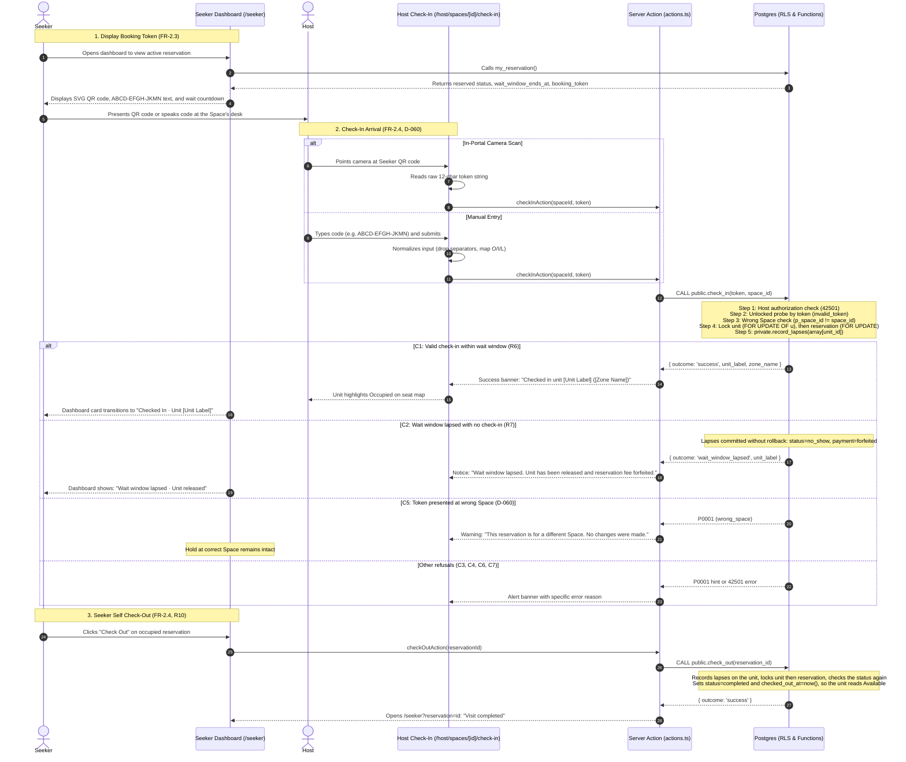

# STORY-10: Booking token, QR check-in and unit release

**Status:** draft · **Owner:** @lukedongque · **Story:** #59 · **FR:** FR-2.3, FR-2.4, FR-3.3 ·
**Depends on:** STORY-01, STORY-03, STORY-05, STORY-07, STORY-09, STORY-12 ·
**Flows:** [Check-in](../flows/check-in.md) (approved), [Reservation lifecycle](../flows/reservation-lifecycle.md) (approved), [Seeker journey](../flows/seeker-journey.md) (approved) ·
**Decisions:** D-002, D-004, D-008, D-009, D-010, D-011, D-027, D-031, D-042, D-044, D-046 to D-052, D-057, D-059, D-060, D-066, D-067, D-068

---

## 0. Scope

### In

- **Database migrations, functions, and pgTAP tests (Luke, D-066):**
  - Helper function `private.last_closing_time(p_opens_at time, p_closes_at time, p_at timestamptz)` determining the most recent closing boundary in `Asia/Manila` (D-027, D-048).
  - Complete `private.record_lapses(p_unit_ids uuid[])` (D-047) by adding steps 2, 3, and 4 to STORY-09's step 1. All four steps share one unlocked probe and one lock pass (§2):
    - Step 2: each `reserved` hold whose `wait_window_ends_at <= clock_timestamp()` transitions to `no_show`, with its payment updated to `forfeited` (R7, D-005).
    - Step 3: each `occupied` hold checked in before its Space's last closing time transitions to `completed` (R12), payment staying `paid`.
    - Step 4: each unit whose Host set it to `reserved` or `occupied` before its Space's last closing time resets `host_state = 'available'` (H3), leaving `units.host_updated_at` untouched (D-051).
  - Database function `public.check_in(p_token text, p_space_id uuid) returns jsonb`:
    - Validates caller is the Space's Host (`42501` on mismatch).
    - Unlocked probe on `reservations.booking_token` (`invalid_token`).
    - Enforces Space boundary check (`p_space_id = space_id`) before state changes; if wrong Space, fails early with `P0001` hint `wrong_space`, keeping reservation intact (D-060).
    - Locks the unit row first (`FOR UPDATE OF u`), then locks the reservation row (`FOR UPDATE`) to prevent deadlocks with Host overrides (D-047).
    - Runs `private.record_lapses(array[v_unit.id])`.
    - Evaluates status branches: returns outcome `wait_window_lapsed` without transaction rollback so fee forfeiture commits (C2); rejects `token_already_used` (C3), `reservation_cancelled` (C4), or `invalid_state`; transitions to `occupied` on success (C1, R6).
  - Database function `public.check_out(p_reservation_id uuid) returns jsonb`:
    - Refuses with `42501` when the caller is signed out or the reservation isn't theirs (N8), as `cancel_hold` does.
    - Records lapses on the unit first (D-047), so a visit that closing time already ended isn't checked out again.
    - Locks the unit row, then the reservation row, and checks the status again under the lock.
    - Transitions the `occupied` reservation to `completed` (R10), setting `checked_out_at = clock_timestamp()` and `ended_at = clock_timestamp()`. Payment remains `paid`. The unit's seat state reads `available` again.
  - Update STORY-09's `public.my_reservation` to also return `checked_in_at`, for the card's "Arrived at" line (§3).
  - Update `public.unit_states(p_space_id uuid)`:
    - Populates `wait_window_ends_at` strictly for the Space's Host (`v_is_host`) when `r.status = 'reserved'`; returns `null` for non-hosts and other states (N20, FR-3.3).
  - Extend STORY-09's trigger `private.check_space_hours_on_update()` on `spaces` to visits (N22, D-048): it refuses an hours change that would end an `occupied` visit at once, or sooner than the old hours would. §2 gives the rule.
  - pgTAP tests in `supabase/tests/10-check-in-release.sql`: every pgTAP case in §4.
  - Concurrency test in `supabase/tests/race/check-in.race.mjs`: two staff devices scanning the same token at once yield exactly one `occupied` check-in and one `token_already_used` refusal (C3). `npm run db:race`, which CI runs, runs it after `holds.race.mjs`.
- **Application logic, normalization & validation (`lib/`):**
  - Crockford base32 normalization in `lib/check-in/normalize.ts`: drop everything that isn't a letter or a digit (spaces, hyphens, dashes, dots), convert to uppercase, map `O`/`o` → `0`, map `I`/`i`/`L`/`l` → `1`, format as `ABCD-EFGH-JKMN` (D-059).
  - Zod validation schemas in `lib/validation/check-in.ts`: `checkInSchema` (12-character normalized Crockford base32 token, valid UUID `spaceId`) and `checkOutSchema` (UUID `reservationId`).
  - Countdown and time utilities in `lib/check-in/countdown.ts`: calculates remaining wait window seconds against server timestamps and formats as `MM:SS` or `X min left`.
  - Co-located Vitest unit tests in `lib/check-in/normalize.test.ts`, `lib/validation/check-in.test.ts`, and `lib/check-in/countdown.test.ts`.
- **Seeker screens (`/seeker`, and STORY-09's hold page):**
  - Pure SVG QR code component in `components/reservation/qr-code.tsx`: accessible, high-contrast, zero-runtime-dependency vector QR rendering the raw 12-character token string (D-059).
  - STORY-09's "Your hold" card on `/seeker` (`app/(dashboard)/seeker/_components/current-hold-card.tsx`, TSK-09.5) becomes the active reservation card. STORY-09's design leaves that card to this design:
    - `reserved`: Space name, address, unit label, zone name, live wait-window countdown, SVG QR code, grouped token `ABCD-EFGH-JKMN` with one-click copy, and "Cancel reservation", which opens STORY-09's confirmation step on the hold page (`/seeker/reservations/[id]?cancel=1`, R8, D-050).
    - `occupied`: "Checked In · Unit [Label] ([Zone])", check-in timestamp, and self check-out button (`check_out`, R10).
    - `pending_payment`: STORY-09's card as it is, linking to `/seeker/reservations/[id]`.
    - `no_show`, `completed` or `cancelled`, when `/seeker` is opened with `?reservation=<id>`: how the reservation ended.
  - STORY-09's hold page (`/seeker/reservations/[id]`): its `reserved` state gains the QR code above the grouped token it already shows, and its redirect for `occupied`, `completed` and `no_show` goes to `/seeker?reservation=<id>`.
  - Server Action `checkOutAction` in `app/(dashboard)/seeker/actions.ts`. Cancelling stays STORY-09's `cancelHold`, which names the status the Seeker saw (D-050, N21).
- **Host Check-In Portal (`/host/spaces/[spaceId]/check-in`):**
  - Server Component `page.tsx`: verifies Host ownership of `spaceId`, loads Space details.
  - Dual-mode check-in shell `check-in-shell.tsx`: camera viewfinder scanner and manual alphanumeric entry.
  - Camera Viewfinder `camera-scanner.tsx`: HTML5 camera capture via `navigator.mediaDevices.getUserMedia`, read by the browser's `BarcodeDetector` API where it exists (Chrome on Android, and desktop Chrome and Edge on macOS and ChromeOS), torch toggle if supported, camera permission request handling, and clear fallback states. Safari, so every iPhone, and Firefox have no `BarcodeDetector`, so there the page opens on manual entry (§3, §7).
  - Manual Entry `manual-entry-form.tsx`: auto-normalizing input, 12-character Crockford base32 validation, and immediate submission.
  - Server Action `checkInAction(spaceId, token)` in `app/(dashboard)/host/spaces/[spaceId]/check-in/actions.ts` (D-010, D-060).
  - Result Banner `check-in-result-banner.tsx`: accessible alerts for C1 success, C2 lapsed window, C3 already used, C4 cancelled, C5 wrong space, C6 invalid token, and C7 forbidden.
- **Host Live Occupancy Wait Window Display (`/host/spaces/[spaceId]/occupancy`):**
  - Update `UnitControlCard` and `OccupancyList`: render remaining wait window badge/chip on `reserved` units (`wait_window_ends_at`) with live countdown (FR-3.3).
  - A "Check-in desk" link in the occupancy header (`occupancy-header.tsx`) and on each Space card in the Host portal (`app/(dashboard)/host/_components/space-list.tsx`).
- **End-to-End Tests (`e2e/check-in.spec.ts`):**
  - Seeker reserves and pays → receives QR token on dashboard → Host checks in at `/host/spaces/[spaceId]/check-in` → unit turns Occupied → Seeker checks out → unit returns to Available.
  - Host at Space B enters token for Space A → receives `wrong_space` refusal → Space A hold remains intact.

### Out

- Creating the reservation, sandbox checkout, and generating the token (STORY-09, #58).
- Cancelling a hold, before or after paying: STORY-09's `cancel_hold`, `cancelHold` action and hold page (R4, R8).
- One-tap Host seat overrides and manual walk-ins (STORY-12, #77).
- Space profile presentation and unit selection (STORY-11, #76).
- Post-visit reviews (STORY-13, Sprint 3, FR-4.1).
- Sandbox refunds (P1) and Administrator moderation (STORY-14, Sprint 3, FR-5.3).

---

## 1. Flow

### Shared flows (D-044)

- **[Check-in](../flows/check-in.md):**
  - Implements branches C1 through C7, camera viewfinder scan and manual alphanumeric entry methods, input normalization, and `public.check_in`.
- **[Reservation lifecycle](../flows/reservation-lifecycle.md):**
  - Implements moves R6 (`reserved` → `occupied`), R7 (`reserved` → `no_show`), R10 (`occupied` → `completed`), R12 (`occupied` → `completed` at closing), and H3 (Host-set state reset at closing).
  - Implements the lapse step's steps 2, 3, and 4 in `private.record_lapses`.
  - Implements wait windows in `public.unit_states` (N20, FR-3.3), and extends the hours trigger to visits (N22).
- **[Seeker journey](../flows/seeker-journey.md):**
  - Implements step S34 (Reserved unit and booking token on `/seeker`) and step S39 (token ready for check-in).

### This story's own part



---

## 2. Data and state

### Modified tables

No new tables are introduced. This story operates on the schema established in `20261108033000_reservations.sql`:

- `public.reservations`:
  - `status public.reservation_status` (transitions `reserved` → `occupied`, `reserved` → `no_show`, `occupied` → `completed`).
  - `checked_in_at timestamptz`: set by `public.check_in` upon successful check-in (R6).
  - `checked_out_at timestamptz`: set by `public.check_out` upon Seeker checkout (R10).
  - `ended_at timestamptz`: set whenever a reservation reaches a terminal state (`no_show`, `completed`).
- `public.payments`:
  - `status public.payment_status`: moves from `paid` → `forfeited` when a reservation lapses into `no_show` (R7).
- `public.units`:
  - `host_state text`: resets to `'available'` at Space closing time (H3) without touching `host_updated_at` (D-051).

### State transitions

| From                         | Event              | To          | Precondition                                                   | Who / Function                                    | Payment                           |
| :--------------------------- | :----------------- | :---------- | :------------------------------------------------------------- | :------------------------------------------------ | :-------------------------------- |
| `reserved`                   | Host check-in      | `occupied`  | Valid token, matching `space_id`, within wait window           | Space's Host (`public.check_in`) [R6]             | Stays `paid`                      |
| `reserved`                   | Wait window lapses | `no_show`   | `wait_window_ends_at <= clock_timestamp()`                     | Time / lapse step (`private.record_lapses`) [R7]  | `paid` → `forfeited`              |
| `occupied`                   | Seeker check-out   | `completed` | Caller is the hold's Seeker, and still `occupied` after lapses | Seeker (`public.check_out`) [R10]                 | Stays `paid`                      |
| `occupied`                   | Space closing time | `completed` | `checked_in_at < last_closing_time`                            | Time / lapse step (`private.record_lapses`) [R12] | Stays `paid`                      |
| Host `reserved` / `occupied` | Space closing time | `available` | `host_updated_at < last_closing_time`                          | Time / lapse step (`private.record_lapses`) [H3]  | N/A (`host_updated_at` unchanged) |

### Database functions contract

#### 1. `private.last_closing_time(p_opens_at time, p_closes_at time, p_at timestamptz) returns timestamptz`

- Computes the most recent closing boundary for a Space in `Asia/Manila` (UTC+8, D-027, D-048).
- If any argument is `null`, or `p_opens_at = p_closes_at` (a Space open 24 hours), returns `null`, as STORY-09's `private.next_closing_time` does.
- Let `v_closing_today := ((p_at at time zone 'Asia/Manila')::date + p_closes_at) at time zone 'Asia/Manila'`.
- If `p_at >= v_closing_today`, returns `v_closing_today`.
- Otherwise, returns `(((p_at at time zone 'Asia/Manila')::date - 1) + p_closes_at) at time zone 'Asia/Manila'`.

#### 2. `private.record_lapses(p_unit_ids uuid[]) returns void`

- Step 1 (STORY-09): expired `pending_payment` holds (`payment_window_ends_at <= clock_timestamp()`) → `expired`.
- Step 2 (STORY-10): lapsed `reserved` holds (`wait_window_ends_at <= clock_timestamp()`):
  - Sets `reservations.status = 'no_show'`, `ended_at = clock_timestamp()`.
  - Sets corresponding `payments.status = 'forfeited'` (R7).
- Step 3 (STORY-10): closing visits on `occupied` holds:
  - If `last_closing_time` exists and `checked_in_at < last_closing_time`:
  - Sets `reservations.status = 'completed'`, `ended_at = clock_timestamp()` (R12).
- Step 4 (STORY-10): reset Host manual occupancy at closing:
  - For units where `host_state in ('reserved', 'occupied')` and `host_updated_at < last_closing_time`:
  - Resets `units.host_state = 'available'`, leaving `units.host_updated_at` unchanged (H3, D-051).
- How it locks (D-047): one unlocked probe finds the units with something to record for any of the four steps, and with none it returns without taking a lock. Otherwise it locks that whole set of units once, in id order, then runs the four updates, each repeating its own condition, because another call may have recorded them first. Step 2 updates the reservation before its payment (units, then reservations, then payments). Locking per step would take units out of id order across steps, and two calls could deadlock.

#### 3. `public.check_in(p_token text, p_space_id uuid) returns jsonb`

- Caller verification: `auth.uid()` must be the owner of `p_space_id` (`spaces.host_id = auth.uid()`). If not, raises `42501` (`insufficient_privilege`).
- Unlocked probe: lookup `reservations` where `booking_token = p_token`. If not found, raises `P0001` hint `invalid_token`.
- Wrong Space check (D-060): if `reservation.space_id != p_space_id`, raises `P0001` hint `wrong_space`.
- Lock order: locks `units` row first `FOR UPDATE OF u`, then locks `reservations` row `FOR UPDATE` (D-047).
- Lapses: executes `private.record_lapses(array[v_unit.id])`.
- Re-reads status:
  - If `no_show`: returns `jsonb_build_object('outcome', 'wait_window_lapsed', 'unit_id', v_unit.id, 'unit_label', v_unit.label)` (returns JSON without raising so the lapse commit persists).
  - If `cancelled`: raises `P0001` hint `reservation_cancelled`.
  - If `occupied` or `completed`: raises `P0001` hint `token_already_used`.
  - If not `reserved`: raises `P0001` hint `invalid_state`.
- Mutation: `update public.reservations set status = 'occupied', checked_in_at = clock_timestamp() where id = v_res.id`.
- Return: `jsonb_build_object('outcome', 'success', 'unit_id', v_unit.id, 'unit_label', v_unit.label, 'zone_name', v_unit.zone_name)`.

#### 4. `public.check_out(p_reservation_id uuid) returns jsonb`

- Caller verification: if `auth.uid()` is null, raises `42501`.
- Unlocked probe: reads the reservation `p_reservation_id`. If it doesn't exist or its `seeker_id` isn't the caller, raises `42501` (N8), as `cancel_hold` does.
- Lapses: executes `private.record_lapses(array[unit_id])` first (D-047). A visit that its Space's closing time has ended is `completed` from here on (R12).
- Lock order: locks the unit `FOR UPDATE`, then the reservation `FOR UPDATE`, and checks the owner again under the lock.
- Status under the lock:
  - `expired`, `no_show`, `completed` or `cancelled`: raises `P0001` hint `hold_ended`, the hint `cancel_hold` uses (N11). This is the answer when closing time or the Host's tap (R11) ended the visit first.
  - `pending_payment` or `reserved`: raises `P0001` hint `not_checked_in`.
- Mutation: `update public.reservations set status = 'completed', checked_out_at = clock_timestamp(), ended_at = clock_timestamp() where id = v_res.id`.
- Return: `jsonb_build_object('outcome', 'success', 'reservation_id', v_res.id, 'unit_id', v_res.unit_id)`.

#### 5. `public.unit_states(p_space_id uuid)`

- Executes `private.record_lapses(v_unit_ids)` on all units in Space.
- Evaluates `v_is_host := ((select auth.uid()) is not distinct from v_host_id)`.
- Returns `case when v_is_host and r.status = 'reserved' then r.wait_window_ends_at else null end as wait_window_ends_at` (N20, FR-3.3).

#### 6. `public.my_reservation(p_reservation_id uuid default null)` (STORY-09)

- Adds `checked_in_at timestamptz` to the columns it returns, for the card's "Arrived at" line (§3).
- Changing the returned columns needs `drop function` and `create function`, starting from its latest definition on `main` (D-066), then the same `revoke` and `grant` STORY-09 gives it, and `npm run db:types`.
- Nothing else changes. With an id it returns that reservation when it is the caller's, ended or not, after recording lapses on its unit. That is what `/seeker?reservation=<id>` reads to say how a reservation ended.

#### 7. `private.check_space_hours_on_update()` (STORY-09's trigger on `spaces`, N22, D-048)

- Keeps STORY-09's checks, and the `hours_cut_hold` hint that STORY-05's form already explains.
- For each `occupied` visit at the Space, it also refuses when either:
  - under the new hours, the last closing time is after the visit's `checked_in_at`, so the next read would end the visit at once (R12). STORY-09's check misses this when the Space still reads open under the new hours: hours whose closing time fell ten minutes after a Seeker checked in, with the Space reopened since, end that visit at the next read;
  - or the new next closing time comes before the old one, so the visit would end sooner (D-048: an active hold is not cut short). A Space open 24 hours has no closing time, so changing it to fixed hours counts as sooner, and changing to 24 hours never does.
- These two replace STORY-09's comparison of an `occupied` visit with its wait window, which is already over by then.

### Zod schemas (`lib/validation/check-in.ts`)

```typescript
import { z } from 'zod'

/**
 * Validates 12-character Crockford base32 booking token (D-059).
 * Preprocessing drops everything that isn't a letter or a digit (spaces, hyphens,
 * dashes, dots), uppercases, and normalizes O->0 and I/L->1.
 */
export const bookingTokenSchema = z
  .string()
  .min(1, 'Please enter a booking token')
  .transform((val) => val.replace(/[^0-9a-z]/gi, '').toUpperCase())
  .transform((val) => val.replace(/O/g, '0').replace(/[IL]/g, '1'))
  .pipe(
    z
      .string()
      .regex(
        /^[0-9A-HJKMNP-TV-Z]{12}$/,
        'Booking token must be 12 characters from the Crockford base32 alphabet',
      ),
  )

export const checkInSchema = z.object({
  spaceId: z.uuid({ error: 'Invalid Space ID' }),
  token: bookingTokenSchema,
})

export const checkOutSchema = z.object({
  reservationId: z.uuid({ error: 'Invalid reservation ID' }),
})
```

### RLS policies and GRANTs

| Object                      | Verb / Call | Role                  | Condition / Grant                                       |
| :-------------------------- | :---------- | :-------------------- | :------------------------------------------------------ |
| `private.last_closing_time` | EXECUTE     | None                  | Revoked from `public, anon, authenticated`              |
| `private.record_lapses`     | EXECUTE     | None                  | Revoked from `public, anon, authenticated`              |
| `public.check_in`           | EXECUTE     | `authenticated`       | Revoked from `public, anon`; granted to `authenticated` |
| `public.check_out`          | EXECUTE     | `authenticated`       | Revoked from `public, anon`; granted to `authenticated` |
| `public.my_reservation`     | EXECUTE     | `authenticated`       | Revoked from `public, anon`; granted to `authenticated` |
| `public.unit_states`        | EXECUTE     | `anon, authenticated` | Granted to `anon, authenticated`                        |

---

## 3. UI and files

### User experience (Maria decides, D-042)

#### 1. Seeker Dashboard (`/seeker`)

- **The "Your hold" card (STORY-09's `current-hold-card.tsx`), which this story extends:**
  - Displays above `ProfileForm` and `PreviewCards` whenever the Seeker has an active hold or visit (`my_reservation()`), or when `/seeker` is opened with `?reservation=<id>` (`my_reservation(id)`): from the hold page's redirect, after a check-out, or when the countdown runs out.
  - **Reserved State (Ready for Check-In):**
    - Header: Space name, address, unit label, and zone badge.
    - Countdown timer: "Time remaining to check in: MM:SS" with clock icon; updates smoothly in client state against server `wait_window_ends_at`. When it reaches zero, the card reloads `/seeker?reservation=<id>`.
    - Pure SVG QR code (minimum 180×180 px on mobile, 220×220 px on desktop) centered with a quiet zone, in the `card-foreground` token on the `card` token (D-031).
    - Grouped alphanumeric text directly below QR: `ABCD-EFGH-JKMN` with a 48×48 px "Copy code" button.
    - Supporting note: "Present this QR code to the host or recite your code upon arrival."
    - Secondary action: "Cancel reservation", a link to STORY-09's confirmation step on the hold page (`/seeker/reservations/[id]?cancel=1`), with STORY-09's wording: "Cancel your reservation? Your ₱50.00 fee will be forfeited, and S4 will be released at once." (R8).
  - **Occupied State (Checked In):**
    - Banner: "Checked In · Unit [Unit Label] ([Zone Name])".
    - Timestamp: "Arrived at [Time]" (`checked_in_at`).
    - Primary action: 48×48 px "Check Out" button. Prompts confirmation: "Are you ready to leave? This will release unit [Unit Label] for other Seekers."
  - **Pending Payment State:** STORY-09's card as it is, linking to `/seeker/reservations/[id]`.
  - **Ended States (only with `?reservation=<id>`):**
    - `no_show`: "Wait window lapsed · Unit released", and that the ₱50.00 fee was forfeited.
    - `completed`: "Visit completed".
    - `cancelled`: STORY-09's wording for an ended hold.
- **STORY-09's hold page (`/seeker/reservations/[id]`):** its `reserved` state shows the same QR code above the grouped token it already shows.

#### 2. Host Check-In Portal (`/host/spaces/[spaceId]/check-in`)

- Reached from a "Check-in desk" link in the occupancy page header, and on each Space card in the Host portal, next to Seat map, Photos and Tags.
- **Check-in Shell (`CheckInShell`):**
  - Mobile-optimized card layout with tabbed switcher:
    - Tab 1: **Camera Scanner**, shown only where the browser has `BarcodeDetector`, and the default there.
    - Tab 2: **Manual Entry** (text input with auto-formatting). Elsewhere, such as Safari on an iPhone or Firefox, it is the only tab, with the note "This browser can't scan QR codes. Type the code instead."
- **Camera Scanner (`CameraScanner`):**
  - Viewfinder with rounded visual scan frame and animated alignment reticle.
  - Camera permission status handling: "Allow camera access to scan booking QR codes" button if not granted.
  - Fallback message if no camera detected: "Camera unavailable. Use manual code entry below."
  - Auto-submits on recognized QR code without double-triggering.
- **Manual Entry Form (`ManualEntryForm`):**
  - Monospace text input with placeholder `ABCD-EFGH-JKMN`.
  - Auto-capitalizes, drops anything that isn't a letter or a digit, and formats in 4-character blocks as the Host types.
  - "Check In" button (disabled when string length < 12, enabled with high contrast when valid).
- **Result Banner (`CheckInResultBanner`):**
  - **C1 Success:** Emerald banner: "Checked in unit [Unit Label] ([Zone Name])" with link to occupancy seat map.
  - **C2 Lapsed Wait Window:** Amber alert: "Wait window lapsed. Unit has been released and reservation fee forfeited."
  - **C3 Already Used:** Amber alert: "This token was already checked in. Unit is currently Occupied."
  - **C4 Cancelled:** Amber alert: "This reservation was cancelled."
  - **C5 Wrong Space:** Red warning: "This reservation is for a different Space. No changes were made."
  - **C6 Invalid Token:** Destructive alert: "Invalid booking token. Please check the code."
  - **C7 Forbidden:** Destructive alert: "Access denied. You must be signed in as the host of this Space."

#### 3. Host Live Occupancy Wait Window Badges (`/host/spaces/[spaceId]/occupancy`)

- On each unit tile in `reserved` state on the seat map and in the accessible list:
  - Blue clock badge displaying live remaining time: "Wait: 18m left" or "Wait: < 1m".
  - Refreshes automatically or warns when expiry is reached.

### Routes and components

| Route / File                                                                            | Type                        | Purpose                                                                                     |
| :-------------------------------------------------------------------------------------- | :-------------------------- | :------------------------------------------------------------------------------------------ |
| `app/(dashboard)/seeker/page.tsx`                                                       | Server Component            | Reads `my_reservation()`, or `my_reservation(id)` for `?reservation=<id>`; renders the card |
| `app/(dashboard)/seeker/actions.ts`                                                     | Server Action               | `checkOutAction`                                                                            |
| `app/(dashboard)/seeker/_components/current-hold-card.tsx`                              | Server Component (STORY-09) | Extended with the states above                                                              |
| `app/(dashboard)/seeker/_components/wait-countdown.tsx`                                 | Client Component            | Wait-window countdown, its threshold announcements, and the reload at zero                  |
| `app/(dashboard)/seeker/_components/copy-token-button.tsx`                              | Client Component            | "Copy code"                                                                                 |
| `app/(dashboard)/seeker/reservations/[id]/page.tsx`                                     | Server Component (STORY-09) | Adds the QR code to `reserved`; redirects `occupied`, `completed`, `no_show` with the id    |
| `components/reservation/qr-code.tsx`                                                    | Client Component            | Pure SVG QR code vector generator                                                           |
| `app/(dashboard)/host/_components/space-list.tsx`                                       | Component (STORY-05)        | Adds a "Check-in desk" link to each Space card                                              |
| `app/(dashboard)/host/spaces/[spaceId]/check-in/page.tsx`                               | Server Component            | Host check-in portal page; verifies Host ownership                                          |
| `app/(dashboard)/host/spaces/[spaceId]/check-in/actions.ts`                             | Server Action               | `checkInAction(spaceId, token)`                                                             |
| `app/(dashboard)/host/spaces/[spaceId]/check-in/_components/check-in-shell.tsx`         | Client Component            | Shell managing camera scan / manual entry tabs and result states                            |
| `app/(dashboard)/host/spaces/[spaceId]/check-in/_components/camera-scanner.tsx`         | Client Component            | HTML5 camera viewfinder using `BarcodeDetector` / video element                             |
| `app/(dashboard)/host/spaces/[spaceId]/check-in/_components/manual-entry-form.tsx`      | Client Component            | Crockford base32 text input form with auto-formatting                                       |
| `app/(dashboard)/host/spaces/[spaceId]/check-in/_components/check-in-result-banner.tsx` | Client Component            | Accessible result notification for C1–C7 outcomes                                           |
| `app/(dashboard)/host/spaces/[spaceId]/occupancy/_components/occupancy-header.tsx`      | Component (STORY-12)        | Adds the "Check-in desk" link                                                               |
| `app/(dashboard)/host/spaces/[spaceId]/occupancy/_components/unit-control-card.tsx`     | Client Component            | Enhanced with remaining wait window badge for reserved units                                |
| `app/(dashboard)/host/spaces/[spaceId]/occupancy/_components/occupancy-list.tsx`        | Client Component            | Accessible list view updated with wait window display                                       |

### Where the files go

```
app/
  (dashboard)/
    seeker/
      _components/
        copy-token-button.tsx
        current-hold-card.tsx            # STORY-09's, extended
        current-hold-card.test.tsx
        wait-countdown.tsx
      reservations/
        [id]/
          page.tsx                       # STORY-09's: QR code, and the redirect with the id
      actions.ts
      actions.test.ts
      page.tsx
    host/
      _components/
        space-list.tsx                   # "Check-in desk" link
      spaces/
        [spaceId]/
          check-in/
            _components/
              camera-scanner.tsx
              check-in-result-banner.tsx
              check-in-shell.tsx
              manual-entry-form.tsx
              manual-entry-form.test.tsx
            actions.ts
            actions.test.ts
            page.tsx
          occupancy/
            _components/
              occupancy-header.tsx       # "Check-in desk" link
              occupancy-list.tsx
              unit-control-card.tsx
components/
  reservation/
    qr-code.tsx
    qr-code.test.tsx
lib/
  check-in/
    countdown.ts
    countdown.test.ts
    normalize.ts
    normalize.test.ts
  validation/
    check-in.ts
    check-in.test.ts
supabase/
  migrations/
    <timestamp>_check_in_and_release.sql # from npm run db:new; later than every migration on main when it merges (D-066)
  tests/
    10-check-in-release.sql
    race/
      check-in.race.mjs
package.json                             # db:race also runs check-in.race.mjs
e2e/
  check-in.spec.ts
```

### Accessibility

- **Touch targets:** All interactive buttons (Check Out, Copy Code, Scan, Submit) meet or exceed the 48×48 px minimum target requirement (WCAG 2.1 AA, D-031).
- **High contrast:** SVG QR code modules render in the `card-foreground` token on the `card` token (white), about 12:1, with quiet zone margins (D-031: colors come from tokens).
- **Screen reader announcements:**
  - QR code contains accessible metadata: `role="img"` and `aria-label="Booking QR code for token ABCD-EFGH-JKMN"`.
  - The countdown text is not itself a live region. A separate polite region announces 10, 5 and 1 minutes left and the end, so a screen reader isn't interrupted every few seconds (Maria to confirm, D-042).
- **Keyboard navigation:** Full keyboard-only workflow on the check-in portal: focus lands cleanly on the token input field; Enter triggers submission; Tab moves to clear and submit controls.
- **Responsive design:** Layout fluidly accommodates 360 px, 768 px, and 1024 px viewports without horizontal scrolling.

---

## 4. Security and test matrix

pgTAP cases use the test names the [check-in flow](../flows/check-in.md#every-branch-and-its-test) and the [reservation lifecycle](../flows/reservation-lifecycle.md#every-move-and-its-test) give them, in `supabase/tests/10-check-in-release.sql`.

| Layer           | Case                                                                              | Expected Result                                                                                                                                                                                              |
| :-------------- | :-------------------------------------------------------------------------------- | :----------------------------------------------------------------------------------------------------------------------------------------------------------------------------------------------------------- |
| **pgTAP**       | C1, R6: "a Host checks in a Reserved unit, which reads Occupied"                  | `public.check_in` succeeds; unit seat state reads Occupied; `checked_in_at` stamped; payment stays `paid`                                                                                                    |
| **pgTAP**       | C-N4: "check_in returns unit and zone labels without Seeker identity"             | The result's keys are only `outcome`, `unit_id`, `unit_label` and `zone_name`                                                                                                                                |
| **pgTAP**       | C2, N10: "a booking token cannot check in once its wait window has lapsed"        | `public.check_in` returns `{ outcome: 'wait_window_lapsed' }` without raising; reservation is `no_show`; payment is `forfeited`; unit reads Available                                                        |
| **pgTAP**       | R7: "a no-show releases the unit and forfeits the fee"                            | A read of `unit_states` after the wait window, with no scan, records `no_show` and `forfeited`, and the unit reads Available                                                                                 |
| **pgTAP**       | C3, C-N2: "a token cannot be checked in twice"                                    | Refused with `P0001` hint `token_already_used`, while `occupied` and again after check-out (`completed`)                                                                                                     |
| **pgTAP**       | C4: "a cancelled reservation cannot be checked in"                                | Refused with `P0001` hint `reservation_cancelled`                                                                                                                                                            |
| **pgTAP**       | C4: "cancelling at counter before scan refuses check-in"                          | `cancel_hold(id, 'reserved')` as the Seeker, then `check_in` as the Host: `P0001` hint `reservation_cancelled`                                                                                               |
| **pgTAP**       | C5, C-N1: "a Host cannot check in a token for another Space"                      | Refused with `P0001` hint `wrong_space`; the reservation stays `reserved` and its payment `paid`                                                                                                             |
| **pgTAP**       | C6: "an invalid token string is rejected"                                         | Refused with `P0001` hint `invalid_token`                                                                                                                                                                    |
| **pgTAP**       | C-N3: "a pending_payment hold cannot be checked in"                               | A `pending_payment` hold has no token (the table's check), and a token on a hold that isn't `reserved` (an `expired` hold paid late, P2) gets `P0001` hint `invalid_state`                                   |
| **pgTAP**       | C7, N9: "a Seeker cannot check in their own reservation"                          | `42501`                                                                                                                                                                                                      |
| **pgTAP**       | C7: "another Host cannot check in a Space they do not own"                        | `42501`                                                                                                                                                                                                      |
| **pgTAP**       | C7, N24: "a signed-out visitor cannot call check_in"                              | `42501`                                                                                                                                                                                                      |
| **pgTAP**       | R10: "a Seeker checks out, and the unit reads Available"                          | `public.check_out` succeeds; status is `completed`; `checked_out_at` and `ended_at` stamped; unit reads Available; payment stays `paid`                                                                      |
| **pgTAP**       | N8: "a Seeker cannot check out another Seeker's visit"                            | `42501`                                                                                                                                                                                                      |
| **pgTAP**       | "check-out after closing time finds the visit already completed"                  | `P0001` hint `hold_ended`; `checked_out_at` stays `null`                                                                                                                                                     |
| **pgTAP**       | "a Seeker cannot check out a hold they have not checked in to"                    | `P0001` hint `not_checked_in` for a `reserved` hold                                                                                                                                                          |
| **pgTAP**       | N24: "a signed-out visitor cannot call check_out"                                 | `42501`                                                                                                                                                                                                      |
| **pgTAP**       | R12: "closing time completes a visit, and the unit reads Available"               | `record_lapses` moves status to `completed`; unit reads Available; payment stays `paid`                                                                                                                      |
| **pgTAP**       | H3: "closing time resets a Host-set state without moving the Host-updated time"   | `record_lapses` resets `host_state` to `available`; `host_updated_at` remains unchanged (D-051); a state the Host set after closing stays                                                                    |
| **pgTAP**       | N16: "a check-in, a check-out and closing time leave the Host-updated time alone" | `units.host_updated_at` is the same before and after each                                                                                                                                                    |
| **pgTAP**       | N20: "only the Space's Host sees when a wait window ends"                         | The Host gets `wait_window_ends_at` for a Reserved unit; a Seeker and a signed-out visitor get `null`                                                                                                        |
| **pgTAP**       | N22: "a Host cannot change a Space's hours to end a visit early"                  | `P0001` hint `hours_cut_hold` for hours whose last closing time falls after the check-in (the Space still reading open), and for an earlier next closing time; a later closing time is accepted              |
| **pgTAP**       | `last_closing_time` boundaries                                                    | 07:00–22:00 at 21:59 gives yesterday's 22:00, and at 22:00 today's; 18:00–02:00 at 01:00 gives yesterday's 02:00, and at 03:00 today's; 24 hours gives `null`                                                |
| **pgTAP**       | `my_reservation` returns `checked_in_at`                                          | The caller's visit has it; another Seeker asking for that id gets 0 rows                                                                                                                                     |
| **Concurrency** | Two staff devices scanning the same token concurrently                            | Dedicated Node script (`check-in.race.mjs`, run by `npm run db:race`) executing two simultaneous calls: exactly one succeeds (R6), other receives `token_already_used` (C3)                                  |
| **Vitest**      | Crockford base32 normalization (`lib/check-in/normalize.ts`)                      | Drops spaces, hyphens, dashes and dots; upper-cases; maps `O`→`0`, `I`/`L`→`1`; rejects invalid characters; formats `ABCD-EFGH-JKMN`                                                                         |
| **Vitest**      | Zod validation schemas (`lib/validation/check-in.ts`)                             | Rejects malformed tokens, non-UUID space IDs, and invalid checkout parameters                                                                                                                                |
| **Vitest**      | Countdown helper (`lib/check-in/countdown.ts`)                                    | Accurately calculates remaining seconds against deadline and handles expired timestamps                                                                                                                      |
| **Vitest**      | Pure SVG QR code generator (`components/reservation/qr-code.tsx`)                 | Produces valid SVG DOM, accurate dark/light module matrix, and accessible ARIA attributes                                                                                                                    |
| **Vitest**      | Server Actions (`actions.ts`)                                                     | Validates caller session, forwards validated arguments, and translates SQLSTATE hints into UI messages                                                                                                       |
| **Manual**      | Full check-in & release journey on local stack                                    | Seeded Seeker holds and pays for unit → receives QR code on `/seeker` → Host scans/enters token at `/host/spaces/[spaceId]/check-in` → unit becomes Occupied → Seeker checks out → unit returns to Available |
| **Manual**      | Wrong Space isolation                                                             | Host at Space B enters token for Space A → sees `wrong_space` alert → Space A reservation remains intact                                                                                                     |
| **Manual**      | A browser without `BarcodeDetector` (Safari on an iPhone, or Firefox)             | The check-in page opens on manual entry, with the note from §3, and a typed token checks in                                                                                                                  |

---

## 5. Tasks and estimates

These rows become the story's TSK sub-issues once this design doc is merged.

| Task         | What                                                                                                                                                                     | Owner        | Points (1–10) | Days | Depends on                                     |
| :----------- | :----------------------------------------------------------------------------------------------------------------------------------------------------------------------- | :----------- | :------------ | :--- | :--------------------------------------------- |
| **TSK-10.1** | Database migration: check-in, check-out, lapse steps 2–4, the `my_reservation`, `unit_states` and hours-trigger changes, pgTAP tests, and the check-in race test (D-066) | @lukedongque | 2             | 1    | STORY-09's functions (TSK-09.1 to 09.3)        |
| **TSK-10.2** | Token normalization, Zod validation schemas, countdown logic, and unit tests                                                                                             | @lukedongque | 1             | 0.5  | none                                           |
| **TSK-10.3** | Pure SVG QR code generator, the Seeker card's states with check-out, and the QR code on STORY-09's hold page                                                             | @lukedongque | 2             | 1    | TSK-10.1, TSK-10.2, STORY-09's TSK-09.5 (#252) |
| **TSK-10.4** | Host check-in portal with camera scanner, manual token entry, and outcome banners                                                                                        | @lukedongque | 2             | 1    | TSK-10.1, TSK-10.2                             |
| **TSK-10.5** | Host occupancy wait-window countdowns and Playwright journey                                                                                                             | @lukedongque | 1             | 0.5  | TSK-10.1, TSK-10.3, TSK-10.4                   |

Total: **8 points**, **4 days** (matches issue #59).

---

## 6. Build order

One pull request per row, and every pull request targets `main`.

| #   | Branch                              | PR title                                                                            | Contains                                                                                                                                                                                                                                  |
| :-- | :---------------------------------- | :---------------------------------------------------------------------------------- | :---------------------------------------------------------------------------------------------------------------------------------------------------------------------------------------------------------------------------------------- |
| 1   | `feature/STORY-10-validation`       | `feat(STORY-10): token normalization, validation schemas, and countdown utilities`  | `lib/check-in/normalize.ts`, `lib/validation/check-in.ts`, `lib/check-in/countdown.ts`, and unit tests (TSK-10.2)                                                                                                                         |
| 2   | `feature/STORY-10-db`               | `feat(STORY-10): check-in and release functions, lapse extensions, and pgTAP tests` | Migration adding `private.last_closing_time`, extending `record_lapses`, `public.check_in`, `public.check_out`, updating `unit_states`, `my_reservation` and the hours trigger; pgTAP suite; `check-in.race.mjs` and `db:race` (TSK-10.1) |
| 3   | `feature/STORY-10-seeker-qr`        | `feat(STORY-10): SVG QR code and seeker dashboard active reservation card`          | `components/reservation/qr-code.tsx`, the Seeker card's states, `checkOutAction`, and the QR code on STORY-09's hold page (TSK-10.3)                                                                                                      |
| 4   | `feature/STORY-10-host-check-in`    | `feat(STORY-10): host check-in portal with camera scanner and manual entry`         | Route `/host/spaces/[spaceId]/check-in`, camera scanner, manual entry form, result banners, and Server Action (TSK-10.4)                                                                                                                  |
| 5   | `feature/STORY-10-occupancy-timers` | `feat(STORY-10): host occupancy wait-window timers and e2e journey`                 | Occupancy view countdown badges, the "Check-in desk" links, and `e2e/check-in.spec.ts` Playwright test (TSK-10.5)                                                                                                                         |

---

## 7. Rejected alternatives

- **Encoding URLs or `space_id` in the QR code payload:**
  - _Rejected:_ Violates D-059 and D-060. Encoding URLs exposes booking tokens in browser histories, bookmarks, and web server access logs. Encoding `space_id` allows scanning devices to be tricked into checking in units at the wrong Space without validating physical desk presence.
- **Unscoped global check-in endpoint:**
  - _Rejected:_ Allowing check-in without establishing the Host's current physical Space context would permit Hosts of several Spaces or compromised tokens to check in reservations indiscriminately. D-060 requires explicit Space binding (`p_space_id`).
- **External scheduled cron job for releasing seats:**
  - _Rejected:_ Violates D-011. Vercel Hobby plan limits cron executions to once daily, which is inadequate for 15-minute wait windows. On-demand lapse evaluation during state reads and mutations (`record_lapses`, D-047) guarantees immediate consistency without background worker dependencies.
- **Rolling back transaction on lapsed check-in (Branch C2):**
  - _Rejected:_ If `check_in` raised an exception when encountering a lapsed wait window, PostgreSQL would abort the transaction and roll back the writes performed by `record_lapses()` (marking the hold `no_show` and payment `forfeited`). Returning a structured JSON response `{ outcome: 'wait_window_lapsed' }` allows the lapse mutations to commit while informing the Host.
- **Heavy external QR scanning npm packages:**
  - _Rejected:_ Avoids adding heavy bundle dependencies like `html5-qrcode` or `@zxing/library` with canvas or polyfill bloat. Browsers that support the web-standard `BarcodeDetector` API scan natively, and lightweight SVG generation renders tokens cleanly without third-party runtime assets.
  - _The cost:_ Safari, so every iPhone, and Firefox have no `BarcodeDetector`, so Hosts there type the code. If Hosts on iPhones must scan, a small decoder loaded only on the Camera tab (for example `jsQR`) is the alternative to revisit.
- **A second cancel action on the Seeker's card:**
  - _Rejected:_ STORY-09's hold page already cancels a reservation, naming the status the Seeker saw (D-050, N21). The card links to it.
- **`check_out` finding the caller's visit without an id:**
  - _Rejected:_ The card always has the id, and naming it matches `cancel_hold`.

---

## 8. Open questions

- **#199 (`decision-needed`): Network latency grace period after `wait_window_ends_at`:**
  - _Question:_ Should `public.check_in` allow a small grace period (e.g. 30 to 60 seconds) past `reservations.wait_window_ends_at` to tolerate network latency or cellular delays at the door, or should `clock_timestamp()` strictly enforce the exact deadline?
  - _Current baseline:_ In accordance with the approved [Check-in flow](../flows/check-in.md) and [Reservation lifecycle](../flows/reservation-lifecycle.md) (N10), `clock_timestamp()` strictly enforces the deadline with zero grace period. If Adrian settles #199 in favor of a grace period, `record_lapses` and `check_in` can evaluate `clock_timestamp() <= wait_window_ends_at + interval '60 seconds'`.

---

## 9. After the build

_(To be filled in when the story is done)_

- what turned out different from this plan, and why
- the status line changed to `implemented YYYY-MM-DD`
- the docs this story changed
- who verified each acceptance criterion
