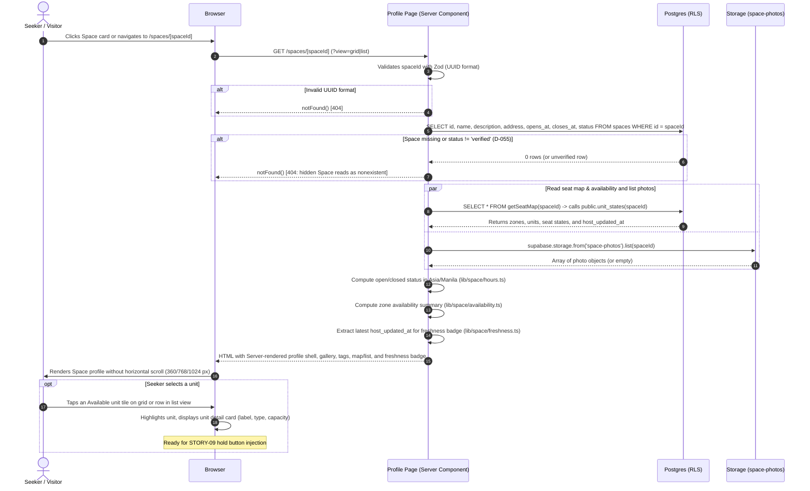
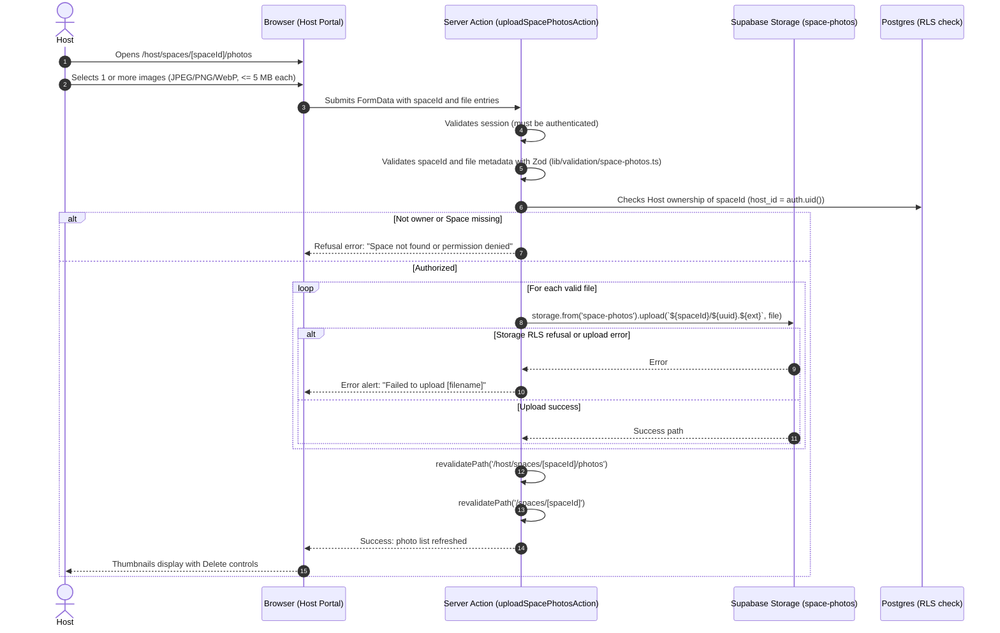

# STORY-11: Space profile and host-updated availability

**Status:** draft · **Owner:** @fayeye-09 · **Story:** #76 · **FR:** FR-1.3, FR-3.1, SRS §3.2.2 ·
**Depends on:** STORY-01, STORY-02, STORY-05, STORY-07 ·
**Flows:** [Reservation lifecycle](../flows/reservation-lifecycle.md), [Space verification](../flows/space-verification.md), [Host setup journey](../flows/host-setup-journey.md), [Seeker journey](../flows/seeker-journey.md) ·
**Decisions:** D-002, D-003, D-004, D-006, D-007, D-010, D-013, D-026, D-027, D-031, D-042, D-044, D-046, D-047, D-051, D-055, D-057, D-058, D-062, D-063

## 0. Scope

**In:**

- **Public Space profile route (`/spaces/[spaceId]`):** a responsive Server Component at `app/(public)/spaces/[spaceId]/page.tsx` accessible to anyone (signed-out visitors, Seekers, Hosts, and Administrators).
- **Public visibility enforcement (D-055):** only Spaces with `status = 'verified'` render publicly. A missing id, malformed UUID, or a hidden Space (`pending` or `rejected`) returns the identical Next.js 404 `notFound()` page, ensuring no information leaks about unverified Spaces (D-055, N19).
- **Venue header and details:** Space title, address, description, daily operating hours (`opens_at` to `closes_at` in Asia/Manila), and a computed open/closed badge ("Open now" vs "Closed · Opens at HH:mm", D-027, D-048).
- **Venue photo gallery:** public gallery and carousel displaying images stored in the `space-photos` bucket (`<spaceId>/<filename>`, D-063). Features full keyboard navigation, accessible slide controls, thumbnail navigation, and an illustrated fallback placeholder when a Space has no uploaded photos.
- **Curated and custom tag display (D-006):** platform-curated amenity tags (e.g. Wi-Fi tier, power outlets, quiet zone, air conditioning) rendered as solid primary badges with icons, alongside Host custom tags rendered as distinct outline badges under a separate "Host custom tags" label. Custom tags are display-only and never function as filters.
- **Zone availability overview (FR-1.3):** a summary card reporting the count of Available units per zone (e.g. "Quiet desks: 6 available · 8 total") and an empty state when all units in a Space are occupied or reserved (`seeker-profile-no-available-unit`).
- **"Host-updated · X min ago" freshness badge (D-002, D-051):** displayed beside availability indicators, reflecting the most recent `host_updated_at` among the Space's units. Sourced exclusively from `public.unit_states(space_id)` (D-047). Never uses the forbidden words "real-time" or "live" (Glossary). Relative timestamp formatting is calculated client-side to prevent SSR hydration mismatch.
- **Synchronized seat map and accessible list view (SRS §3.2.2):**
  - **Seat map view:** embeds STORY-07's shared `SeatMapGrid` and `SeatMapLegend` (`components/seat-map/`), rendering the snap-grid layout and unit states. Clicking a unit selects it and opens a unit detail panel.
  - **Accessible list view alternative:** provides an equivalent list/table of zones and units with their types, capacities, and states. Works by keyboard alone and before JavaScript loads via `?view=list`.
  - **Integration slot for STORY-09:** provides the selection container and unit summary slot where STORY-09 (#58) inserts the "Hold this unit" action and wait-window selector.
- **Host photo management route (`/host/spaces/[spaceId]/photos`):** a dedicated management page for the Space's owning Host (`host_id = auth.uid()`) to upload and remove venue photos (JPEG, PNG, WebP up to 5 MB per D-063), with Server Actions (`uploadSpacePhotosAction`, `deleteSpacePhotoAction`) that validate inputs and revalidate relevant paths.
- **"Photos" action in Host portal:** adds a "Photos" management link to each Space card in `app/(dashboard)/host/_components/space-list.tsx` alongside "Seat map", "Edit", and "Delete".
- **Pure logic helpers and Zod schemas:**
  - `lib/space/hours.ts`: pure functions for Asia/Manila operating hours evaluation and open/closed status.
  - `lib/space/freshness.ts`: pure formatting helper for "Host-updated · X min ago".
  - `lib/space/availability.ts`: pure calculation of available units per zone.
  - `lib/validation/space-photos.ts`: Zod validation for photo file size, MIME types, and deletion parameters.

**Out:**

- **Online holds, wait windows, and sandbox payments:** selecting a wait window, requesting a hold, hosted checkout, and payment confirmation belong to Adrian in STORY-09 (#58). STORY-11 provides the unit selection state and layout slot for the hold action.
- **Host live occupancy control and walk-ins:** one-tap state changes (`Available`, `Reserved`, `Occupied`) on the Host side belong to James in STORY-12 (#77).
- **Map discovery and search filters:** Leaflet map tiles, geolocation search, and the multi-criteria filter panel belong to Luke in STORY-08 (#57).
- **Tag schema and assignment forms:** tag database tables and the Host tag assignment form belong to Luke in STORY-08 (#57). STORY-11 provides display components that consume tag data gracefully.
- **Reviews and ratings:** review submission, display, and star ratings belong to Sprint 3 STORY-13 (#78, FR-4.x, D-009). The profile renders an empty/placeholder state for reviews in Sprint 2.
- **Storage bucket creation and RLS policies:** the `space-photos` bucket and its storage policies are created by Adrian in STORY-07 (TSK-07.2, D-063).

## 1. Flow

### Shared flows (D-044)

- **[Seeker journey](../flows/seeker-journey.md):**
  - Implements step S7 (`Review photos, hours, tags and unit availability`), step S8 (`Space open now?`), step S10 (`Available unit?`), and step S14 (`Choose an Available unit`).
  - Covers path `seeker-search-matches`: selecting a search result opens `/spaces/[spaceId]`.
  - Covers path `seeker-space-closed`: displays closed status badge and daily hours when closed now.
  - Covers path `seeker-profile-no-available-unit`: when no units are Available, explains status and offers a link back to discovery.
  - Covers path `seeker-select-available-unit`: selecting an Available unit on either the seat map or accessible list highlights the unit and displays its details.
- **[Host setup journey](../flows/host-setup-journey.md):**
  - Implements step H9 (`Add Space photos`) and path `host-setup-photos`.
  - Enables the Host to upload and manage photos while the Space is `pending`. Photos persist and become publicly visible immediately upon Space verification (W5).
  - Respects path `host-pending-space-hidden`: a `pending` Space remains hidden from public profile URLs.
- **[Space verification](../flows/space-verification.md):**
  - Enforces D-055: only `verified` Spaces are accessible on public `/spaces/[spaceId]` routes. Visiting a `pending` or `rejected` Space triggers `notFound()`, returning the standard 404 page.
- **[Reservation lifecycle](../flows/reservation-lifecycle.md):**
  - Reads unit seat states exclusively through `public.unit_states(space_id)` (D-044, D-046, D-047).
  - Respects D-051: the "Host-updated · X min ago" freshness label reflects `units.host_updated_at`, which only moves when a Host adds a unit or taps a state change. Holds, payments, and lapses do not move this timestamp.

### This story's own part

#### Seeker opens a Space profile (`/spaces/[spaceId]`)



#### Host uploads photos (`/host/spaces/[spaceId]/photos`)



## 2. Data and state

### Tables and storage bucket

This story introduces no new database migrations (D-036). It consumes tables and storage created by STORY-01, STORY-05, and STORY-07:

- **`spaces` (read-only):** reads `id`, `name`, `description`, `address`, `opens_at`, `closes_at`, and `status`. Only rows where `status = 'verified'` are exposed on public routes (D-055).
- **`zones` and `units` (read-only):** read via `getSeatMap(supabase, spaceId)` (`lib/data/seat-map.ts`), which joins `units` with `public.unit_states(space_id)` (D-047).
- **`space-photos` bucket (D-063):**
  - Storage path convention: `<spaceId>/<filename>`. Filename is generated as `<random-uuid>.<ext>` to avoid name collisions and character escaping bugs.
  - Allowed MIME types: `image/jpeg`, `image/png`, `image/webp`.
  - Max file size: 5 MB (5,242,880 bytes) per image.
  - Public URLs: constructed via `supabase.storage.from('space-photos').getPublicUrl(path).data.publicUrl`.
  - RLS policies on `storage.objects` (created in STORY-07 TSK-07.2):
    - `select`: allowed if the Space is visible to the caller (`status = 'verified'`, or caller owns the Space or is an Administrator).
    - `insert`, `update`, `delete`: allowed only if the caller is the owning Host (`host_id = auth.uid()`).

### Enums and Types

Uses existing enums and types from the codebase:

```ts
// From lib/seat-map/grid.ts (STORY-07)
export type SeatMapZone = { id: string; name: string; units: SeatMapUnit[] }
export type SeatMapUnit = {
  id: string
  unitType: 'seat' | 'standing_desk' | 'room'
  label: string
  capacity: number | null
  row: number
  col: number
  colSpan: number
  seatState: 'available' | 'pending_payment' | 'reserved' | 'occupied'
  hostUpdatedAt: string
  waitWindowEndsAt: string | null
  reservationId: string | null
}

// Story-specific types (lib/space/types.ts)
export type SpacePhoto = {
  id: string
  name: string
  url: string
  createdAt: string
}

export type ZoneAvailability = {
  zoneId: string
  zoneName: string
  availableCount: number
  totalCount: number
}

export type SpaceOperatingStatus = {
  isOpen: boolean
  opensAt: string // "HH:mm"
  closesAt: string // "HH:mm"
  displayText: string // "Open now · Closes at 10:00 PM" or "Closed · Opens at 8:00 AM"
}
```

### Zod validation schemas (`lib/validation/space-photos.ts`)

Shared between client forms and Server Actions:

```ts
import { z } from 'zod'

export const MAX_PHOTO_FILE_SIZE = 5 * 1024 * 1024 // 5 MB (D-063)
export const ALLOWED_PHOTO_MIME_TYPES = ['image/jpeg', 'image/png', 'image/webp'] as const

export const photoFileSchema = z.object({
  name: z.string().min(1),
  size: z.number().max(MAX_PHOTO_FILE_SIZE, 'Photo must be 5 MB or smaller'),
  type: z
    .string()
    .refine(
      (val) => (ALLOWED_PHOTO_MIME_TYPES as readonly string[]).includes(val),
      'Photo must be a JPEG, PNG, or WebP image',
    ),
})

export const deletePhotoSchema = z.object({
  spaceId: z.string().uuid('Invalid space ID'),
  fileName: z
    .string()
    .min(1)
    .regex(/^[a-zA-Z0-9._-]+$/, 'Invalid photo file name')
    .refine((val) => !val.includes('..'), 'Directory traversal is not allowed'),
})
```

## 3. UI and files

Maria owns the user experience (D-042). This section defines every screen, component, and accessibility invariant.

### Screen 1: Public Space Profile (`/spaces/[spaceId]`)

Sits in the public route group `app/(public)/spaces/[spaceId]/page.tsx`, wrapped by `app/(public)/layout.tsx` with `SiteHeader` and `SiteFooter`.

- **Top Navigation & Back Link:**
  - A prominent back link: `← Back to search` (links to `/` or discovery search).
- **Space Header Section:**
  - **Title:** `h1` with Space name (`text-2xl font-bold sm:text-3xl`).
  - **Address:** secondary text with a map-pin icon (`MapPin`), wrapped safely.
  - **Operating hours & Open status pill:**
    - Green badge: `Open now · Closes at 10:00 PM` when current Manila time is within `opens_at`–`closes_at`.
    - Muted badge: `Closed · Opens tomorrow at 8:00 AM` when outside hours.
    - If closed now, a friendly alert note informs the Seeker: "This Space is currently closed. You can review seats and amenities, but reservations open during operating hours."
  - **Description:** readable whitespace-pre-line paragraph.
- **Photo Gallery & Carousel (`space-photo-gallery.tsx`):**
  - **Desktop (1024px+):** a featured hero image (16:9 aspect ratio, max height 400px) with previous/next overlay buttons, slide counter ("1 / 4"), and a row of clickable thumbnail previews underneath.
  - **Mobile/Tablet (360px–768px):** swipeable/scrollable carousel with touch-friendly 48×48 px navigation buttons and visible slide dots.
  - **Keyboard controls:** Left/Right arrow keys navigate slides when focus is on the gallery; Enter/Space activates thumbnails.
  - **Alt text:** descriptive alt text for every image: `Photo of ${space.name} (photo ${index + 1})`.
  - **Empty state:** when no photos have been uploaded, displays a branded warm card with a subtle placeholder icon (`ImageOff` or building illustration) and text: "No venue photos uploaded yet."
- **Amenities and Custom Tags Section (`space-tags.tsx`):**
  - Visibly distinguishes curated tags from Host custom tags (FR-1.3, D-006).
  - **Curated amenity tags:** rendered with solid primary badge styling (`bg-primary/10 text-primary border-primary/20`) and corresponding Lucide icons (e.g. `Wifi` for Wi-Fi tier, `Plug` for power outlets, `Volume2` for noise level, `Wind` for air-conditioning).
  - **Host custom tags:** grouped under a clear label ("Host custom tags:") and rendered as subtle outline badges (`border-muted-foreground/30 text-muted-foreground bg-muted/40`). Never presented as interactive filter pills.
- **Availability Overview Banner (`availability-summary.tsx`):**
  - Prominent container sitting above the seat map.
  - **Freshness badge:** `Host-updated · X min ago` (or `Host-updated · Just now` if < 1 minute ago, D-002, D-051). Never says "real-time" or "live" (Glossary).
  - **Zone breakdown:** responsive card chips showing available count vs total:
    - "Quiet desks: 6 available · 8 total"
    - "Standing desks: 2 available · 4 total"
    - "Private rooms: 1 available · 2 total"
  - **All-occupied empty state:** if `availableCount === 0`, displays a prominent alert banner: "All units are currently occupied or reserved. Check back later or explore nearby spaces." (`seeker-profile-no-available-unit`).
- **Seat Map vs Accessible List View Switcher (`space-seat-map-view.tsx`):**
  - Tab controls: **Seat map** (default) and **List view** (`?view=list`). Works via native URL query parameters so users without JavaScript can switch views.
  - **Seat Map tab:**
    - Embeds STORY-07's `SeatMapGrid` and `SeatMapLegend`.
    - Unit tiles display label, type icon, capacity, and seat state icon/color.
    - Clicking an Available unit tile selects it (ring highlight) and opens the unit detail drawer/card below the grid.
  - **Accessible List view tab (SRS §3.2.2):**
    - Grouped by Zone in position order.
    - Renders an accessible data table / card list displaying each unit's Label, Type, Capacity, State, and selection action.
    - Fully operable by keyboard (Tab to row/action, Enter/Space to select).
- **Unit Selection & Hold Integration Slot:**
  - When an Available unit is selected, a sticky card or sheet appears:
    - Unit details: "Unit S4 · Quiet desks (Seat · 1 person)"
    - State: "Available"
    - Slot for STORY-09: renders placeholder container with ID `#hold-action-container` where STORY-09 injects the wait-window dropdown and "Hold this unit" checkout button.

### Screen 2: Host Photo Management (`/host/spaces/[spaceId]/photos`)

Sits in the Host portal route group `app/(dashboard)/host/spaces/[spaceId]/photos/page.tsx`, wrapped by the Host layout.

- **Header:** Space title, verification badge, link back to `/host` ("← Back to Spaces"), and page heading "Manage Venue Photos".
- **Upload Form (`photo-upload-form.tsx`):**
  - Accessible drag-and-drop file dropzone with native file input fallback (`input type="file" multiple accept="image/jpeg,image/png,image/webp"`).
  - Clear guidelines: "Upload up to 5 MB per photo. Supported formats: JPEG, PNG, WebP."
  - Client-side size and MIME validation before upload.
  - Progress/pending state using `useActionState` or form status indicator.
- **Photo Grid (`photo-grid.tsx`):**
  - Grid of uploaded photos (2 columns mobile, 4 columns desktop).
  - Each item displays the image thumbnail, file size, upload date, and a destructive "Delete photo" button (`Trash2` icon with accessible sr-only text "Delete [filename]").
  - Delete button triggers a native confirmation dialog or inline confirmation step before calling `deleteSpacePhotoAction`.
- **Empty state:** "No photos uploaded yet. Add photos to help Seekers get a feel for your Space before visiting."

### Host Space Card Update (`space-list.tsx`)

In `app/(dashboard)/host/_components/space-list.tsx`, add a "Photos" link to the card footer:

```tsx
<Link
  href={`/host/spaces/${space.id}/photos`}
  className={buttonVariants({ variant: 'outline' })}
>
  Photos<span className="sr-only"> for {space.name}</span>
</Link>
```

### Component hierarchy and file layout

```
app/(public)/spaces/[spaceId]/
├── page.tsx                           # Server Component: loads verified Space, seat map, photos
├── _components/
│   ├── space-profile-header.tsx       # Space name, address, hours, open/closed badge
│   ├── space-photo-gallery.tsx        # Responsive photo carousel with keyboard support
│   ├── space-tags.tsx                 # Curated and custom tag badge groups
│   ├── availability-summary.tsx       # Zone availability counts and freshness badge
│   ├── space-seat-map-view.tsx        # Client island: grid/list selection & unit details
│   └── space-unit-list.tsx            # Accessible list view alternative (SRS §3.2.2)

app/(dashboard)/host/spaces/[spaceId]/photos/
├── page.tsx                           # Server Component: loads Host's space photos
├── actions.ts                         # Server Actions: uploadSpacePhotosAction, deleteSpacePhotoAction
└── _components/
    ├── photo-upload-form.tsx          # Client Component: file input with client validation
    └── photo-grid.tsx                 # Client Component: photo list with delete actions

app/(dashboard)/host/_components/
└── space-list.tsx                     # Updated: adds "Photos" button

components/space/
└── freshness-badge.tsx                # Shared client component: "Host-updated · X min ago"

lib/space/
├── types.ts                           # SpacePhoto, ZoneAvailability, SpaceOperatingStatus
├── hours.ts                           # Open/closed calculation in Asia/Manila (pure logic)
├── hours.test.ts                      # Vitest unit tests for operating hours
├── freshness.ts                       # Format "Host-updated · X min ago" (pure logic)
├── freshness.test.ts                  # Vitest unit tests for freshness formatting
├── availability.ts                    # Calculate available units per zone (pure logic)
└── availability.test.ts               # Vitest unit tests for availability summary

lib/validation/
├── space-photos.ts                    # Zod schemas for photo upload and delete
└── space-photos.test.ts               # Vitest unit tests for schemas
```

### Accessibility (SRS §3.2.2, D-031)

- **Touch targets:** all buttons (carousel navigation, view toggles, unit tiles, thumbnail buttons, delete actions) meet the minimum 48×48 px touch target requirement (D-031, SRS §3.2.2).
- **Contrast:** all text, badges, and icons meet WCAG 2.1 AA 4.5:1 contrast against light background tokens (`#0f172a` foreground, `#475569` muted foreground).
- **Keyboard navigation:**
  - Full tab stop sequence through header, photo gallery controls, view toggles, and unit selections.
  - Visible focus indicators (`focus-visible:ring-2 focus-visible:ring-ring focus-visible:ring-offset-2`) on all interactive controls.
- **Screen readers:**
  - Photo gallery has `role="region"` and `aria-roledescription="carousel"` with descriptive slide announcements.
  - Availability summary uses `aria-live="polite"` for dynamic count updates.
  - Seat map tiles and list rows declare full unit metadata: e.g. `aria-label="Seat S1, Quiet desks, Available"`.
- **Responsive layout:**
  - Verified across 360 px (mobile), 768 px (tablet), and 1024 px (desktop).
  - No horizontal scrolling (`overflow-x-hidden` on containers; grid cells shrink or wrap).

## 4. Security and test matrix

### Security and RLS Invariants

- **Verified Space visibility (D-055):** public route checks `status === 'verified'`. Unverified Spaces (`pending` or `rejected`) return 404, preventing unauthorized discovery.
- **Storage isolation (D-063):** only the authenticated Host who owns the Space (`host_id = auth.uid()`) can upload or delete photos in `space-photos/<spaceId>/`. Storage RLS blocks any other user.
- **File safety:** Zod validates that uploaded files are valid images (JPEG, PNG, WebP) and do not exceed 5 MB. File names are generated safely on the server using UUIDs to prevent directory traversal and overwrite attacks.
- **State integrity (D-046, D-051, N15):** unit states and timestamps are read through `public.unit_states(space_id)`. Direct column access to `units.host_state` or `units.host_updated_at` is blocked by Postgres permissions.

### Test matrix

| Layer      | Case                                                        | Expected                                                 |
| ---------- | ----------------------------------------------------------- | -------------------------------------------------------- |
| **pgTAP**  | `space-photos` storage RLS: owning Host uploads photo       | Succeeds (proven by STORY-07 TSK-07.2)                   |
| **pgTAP**  | `space-photos` storage RLS: another Host or Seeker uploads  | Denied by storage RLS                                    |
| **pgTAP**  | `spaces` select policy: Seeker reads verified Space         | Returns Space row (STORY-01)                             |
| **pgTAP**  | `spaces` select policy: Seeker reads pending Space          | 0 rows returned (STORY-01, D-055)                        |
| **Vitest** | `lib/space/hours.ts`: Space open during operating hours     | Returns `isOpen: true`, formatted closing time           |
| **Vitest** | `lib/space/hours.ts`: Space closed outside operating hours  | Returns `isOpen: false`, formatted next opening time     |
| **Vitest** | `lib/space/hours.ts`: Overnight hours spanning midnight     | Correctly calculates open status across day boundary     |
| **Vitest** | `lib/space/freshness.ts`: host_updated_at < 1 min ago       | Returns `"Host-updated · Just now"`                      |
| **Vitest** | `lib/space/freshness.ts`: host_updated_at 15 mins ago       | Returns `"Host-updated · 15 min ago"`                    |
| **Vitest** | `lib/space/freshness.ts`: host_updated_at 3 hours ago       | Returns `"Host-updated · 3 hr ago"`                      |
| **Vitest** | `lib/space/freshness.ts`: glossary compliance               | Output never contains `"real-time"` or `"live"`          |
| **Vitest** | `lib/space/availability.ts`: counts available units by zone | Accurately groups and sums available vs total            |
| **Vitest** | `lib/validation/space-photos.ts`: valid JPEG <= 5 MB        | Zod parse succeeds                                       |
| **Vitest** | `lib/validation/space-photos.ts`: file > 5 MB or wrong MIME | Zod parse fails with specific error message              |
| **Vitest** | `lib/validation/space-photos.ts`: delete filename with `..` | Fails directory traversal check                          |
| **Manual** | Seeker opens verified Space profile at 360, 768, 1024 px    | Renders cleanly with zero horizontal scroll              |
| **Manual** | Seeker navigates profile and seat map using keyboard only   | All interactive controls accessible with visible focus   |
| **Manual** | Seeker navigates to pending or non-existent Space URL       | Shows standard 404 Not Found page                        |
| **Manual** | Host uploads photo on `/host/spaces/[spaceId]/photos`       | Photo uploads, persists, displays thumbnail, and deletes |

## 5. Tasks and estimates

These rows become the story's TSK sub-issues once this design doc is merged. Total: 8 story points, 4 days.

| Task         | What                                                                                                                                                                                                                                 | Owner      | Points (1–10) | Days | Depends on                                          |
| ------------ | ------------------------------------------------------------------------------------------------------------------------------------------------------------------------------------------------------------------------------------ | ---------- | ------------- | ---- | --------------------------------------------------- |
| **TSK-11.1** | Pure logic helpers and schemas: operating hours (`hours.ts`), freshness formatter (`freshness.ts`), availability summary (`availability.ts`), and photo validation schemas (`space-photos.ts`), with comprehensive Vitest unit tests | @fayeye-09 | 1             | 0.5  | This design merged                                  |
| **TSK-11.2** | Host photo management: `/host/spaces/[spaceId]/photos` route, Server Actions for upload and delete, photo grid with delete confirmation, and "Photos" link in `SpaceList`                                                            | @fayeye-09 | 2             | 1.0  | TSK-11.1, STORY-07 TSK-07.2 (`space-photos` bucket) |
| **TSK-11.3** | Public Space profile shell: `/spaces/[spaceId]` Server Component, verified check with 404 fallback (D-055), header, hours badge, and distinct curated vs custom tag badge presentation (D-006)                                       | @fayeye-09 | 2             | 1.0  | TSK-11.1                                            |
| **TSK-11.4** | Venue photo gallery & carousel: responsive hero carousel, touch navigation, keyboard controls, thumbnail navigation, and fallback illustration                                                                                       | @fayeye-09 | 1             | 0.5  | TSK-11.2, TSK-11.3                                  |
| **TSK-11.5** | Availability overview and seat map integration: zone availability cards, freshness badge ("Host-updated · X min ago"), embedding `SeatMapGrid` and accessible list view alternative (SRS §3.2.2), and unit selection slot            | @fayeye-09 | 1             | 0.5  | TSK-11.3, STORY-07 TSK-07.4 (shared renderer)       |
| **TSK-11.6** | Responsive and accessibility audit: 360/768/1024 px verification, WCAG 2.1 AA keyboard/contrast verification, empty states, and e2e journey integration                                                                              | @fayeye-09 | 1             | 0.5  | TSK-11.4, TSK-11.5                                  |

## 6. Build order

One PR per row, and every PR targets `main`.

| #   | Branch                              | PR title                                                                   | Contains                                                                                                |
| --- | ----------------------------------- | -------------------------------------------------------------------------- | ------------------------------------------------------------------------------------------------------- |
| 1   | `feature/STORY-11-pure-logic`       | `feat(STORY-11): add space hours, freshness, and photo validation helpers` | `lib/space/` (hours, freshness, availability), `lib/validation/space-photos.ts`, and Vitest tests       |
| 2   | `feature/STORY-11-host-photos`      | `feat(STORY-11): add host photo management and actions`                    | `app/(dashboard)/host/spaces/[spaceId]/photos/`, Server Actions, and `SpaceList` link                   |
| 3   | `feature/STORY-11-profile-shell`    | `feat(STORY-11): add public space profile shell and tag presentation`      | `app/(public)/spaces/[spaceId]/page.tsx`, header, hours open/closed badge, and `space-tags.tsx`         |
| 4   | `feature/STORY-11-photo-gallery`    | `feat(STORY-11): add venue photo gallery and carousel`                     | `space-photo-gallery.tsx` with keyboard controls, thumbnails, and fallback placeholder                  |
| 5   | `feature/STORY-11-availability-map` | `feat(STORY-11): add zone availability summary and seat map integration`   | `availability-summary.tsx`, `space-seat-map-view.tsx`, `space-unit-list.tsx`, and `freshness-badge.tsx` |
| 6   | `feature/STORY-11-a11y-audit`       | `test(STORY-11): verify responsive layout and accessibility invariants`    | Responsive fixes, keyboard navigation checks, and e2e test support                                      |

## 7. Rejected alternatives

- **Storing photo metadata in a dedicated `space_photos` database table:** rejected per D-063. The public Supabase Storage bucket `space-photos` with folder prefix `<space_id>/` provides all required listing, RLS, and deletion capabilities without adding a new database migration or schema complexity.
- **Private photo bucket with signed URLs:** rejected per D-063. Venue photos are intended for public browsing once a Space is Verified; generating short-lived signed URLs adds runtime overhead with negligible security benefit.
- **Calling availability "real-time" or "live":** rejected per D-002 and Glossary. In the absence of IoT sensors, occupancy states are Host-maintained. Calling them "live" would be misleading; "Host-updated · X min ago" remains completely honest about data freshness.
- **Offering custom tags as search filters:** rejected per D-006. Free-text tags break structured filtering. They are restricted to display-only badges on the profile.
- **Displaying a "Pending approval" page for unverified Spaces:** rejected per D-055. Revealing that an unverified Space exists leaks private venue information. An unverified Space returns a 404 `notFound()`, identical to a nonexistent Space.
- **Single-view spatial seat map without list view:** rejected per SRS §3.2.2. A purely visual seat map is inaccessible to screen readers and difficult to operate on small touch devices. An equivalent accessible list view is mandatory.

## 8. Open questions

- None blocking. All dependencies and database tables are specified by STORY-01, STORY-05, and STORY-07.

## 9. After the build

Fill this in when the story is done:

- what turned out different from this plan, and why
- the status line changed to `implemented YYYY-MM-DD`
- the docs this story changed
- who verified each acceptance criterion
