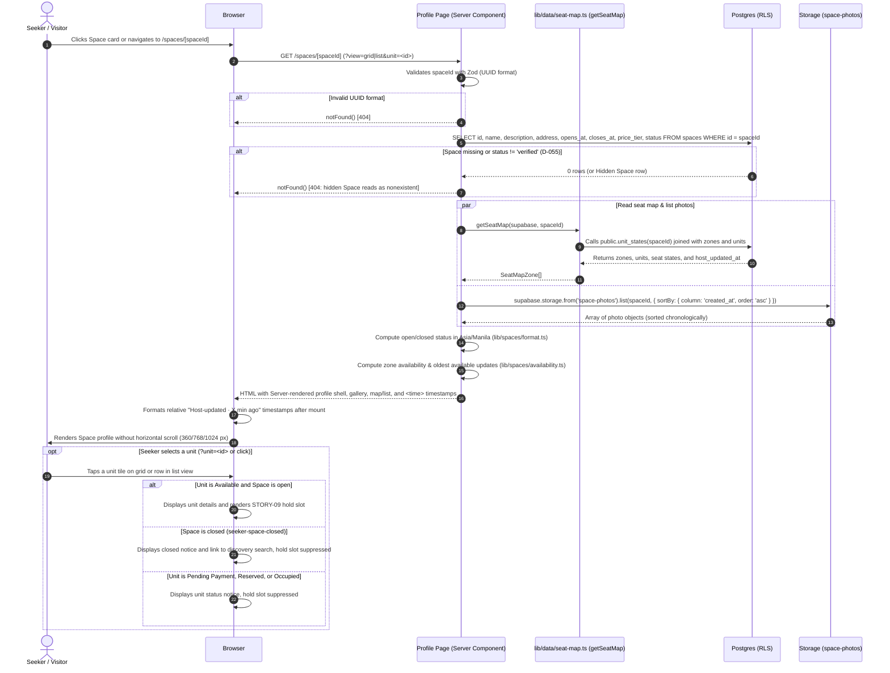
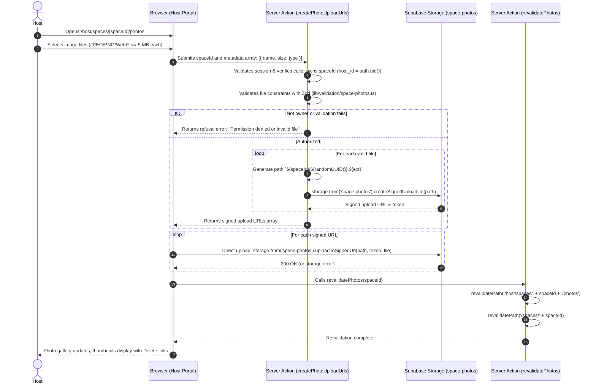

# STORY-11: Space profile and host-updated availability

**Status:** implemented 2026-11-14 · **Owner:** @fayeye-09 · **Story:** #76 · **FR:** FR-1.3, FR-3.1, SRS §3.2.2 ·
**Depends on:** STORY-01, STORY-02, STORY-05, STORY-07, STORY-08 ·
**Flows:** [Reservation lifecycle](../flows/reservation-lifecycle.md), [Space verification](../flows/space-verification.md), [Host setup journey](../flows/host-setup-journey.md), [Seeker journey](../flows/seeker-journey.md) ·
**Decisions:** D-002, D-006, D-009, D-010, D-027, D-031, D-036, D-042, D-044, D-046, D-047, D-048, D-049, D-051, D-055, D-057, D-058, D-062, D-063

## 0. Scope

**In:**

- **Public Space profile route (`/spaces/[spaceId]`):** a responsive Server Component at `app/(public)/spaces/[spaceId]/page.tsx` accessible to anyone (signed-out visitors, Seekers, Hosts, and Administrators).
- **Public visibility enforcement (D-055):** only Spaces with `status = 'verified'` render publicly. While STORY-01's RLS policy allows an owning Host or an Administrator to read a Hidden Space (`pending` or `rejected`), the page explicitly checks `status === 'verified'`. A missing id, malformed UUID, or a Hidden Space returns the identical Next.js 404 `notFound()` page, leaking no information about private Spaces (D-055, N19).
- **Space header and details:** Space title, address, description, daily operating hours (`opens_at` to `closes_at` in Asia/Manila), and a computed open/closed badge ("Open now" vs "Closed · Opens at HH:mm" / "Closed · Opens tomorrow at HH:mm", D-027, D-048). Equal opening and closing times denote a Space open 24 hours (D-027, D-048).
- **Pricing display (FR-1.3):** pricing information is presented on the profile via its two project mechanisms: the curated price tier tag (e.g. `₱`, `₱₱`, `₱₱₱`) from STORY-08, and the exact sandbox reservation fee in the hold action slot from STORY-09 (D-027, D-049).
- **Space photo gallery:** public gallery and carousel displaying images stored in the `space-photos` bucket (`<spaceId>/<filename>`, D-063) listed chronologically (`created_at ASC`) so the first upload serves as the cover photo. Features full keyboard navigation, accessible slide controls, thumbnail strip, and a fallback placeholder when a Space has no uploaded photos. Configures `images.remotePatterns` in `next.config.ts` for Supabase Storage domains.
- **Curated and custom tag presentation rules (D-006):** platform-curated amenity tags rendered as solid primary badges with icons, alongside Host custom tags rendered as distinct outline badges under a separate "Host custom tags" label. Custom tags are display-only and never function as filters. The data shape and component implementation wait for STORY-08's design and tag tables (TSK-11.6).
- **Zone availability overview (FR-1.3):** summary cards reporting the count of Available units per zone (e.g. "Quiet desks: 6 available · 8 total") and the oldest `host_updated_at` among its Available units, ensuring freshness is never overstated (D-051). An empty state is presented when no units in the Space are Available (`seeker-profile-no-available-unit`).
- **"Host-updated · X min ago" freshness labels (D-002, D-051):**
  - **Per-unit freshness:** each unit displays its own freshness timestamp in the list-view row, in the selected-unit panel, and in its tile's accessible name ("S4, Seat, Available, Host-updated · 2 hr ago"). Sourced exclusively from `public.unit_states(space_id)` (D-047). Never uses the forbidden words "real-time" or "live" (Glossary).
  - **Hydration safety:** server renders Manila clock time in a `<time dateTime="...">` element first; client-side formatting computes relative time after mount to avoid SSR hydration mismatches.
- **Synchronized seat map and accessible list view (SRS §3.2.2):**
  - **Seat map view:** embeds STORY-07's shared `SeatMapGrid` and `SeatMapLegend` (`components/seat-map/`), placed directly in the page column (without padded card wrappers) to fit within 328 px viewport width at 360 px (D-062).
  - **Accessible list view alternative:** provides an equivalent list/table of zones and units with their types, capacities, states, and individual freshness timestamps, operable by keyboard alone via links (`?view=list`).
  - **Unit selection & STORY-09 integration slot:** selecting an Available unit via link (`?unit=<id>`) or click renders the selected unit panel. Exposes a typed React prop `renderSelectedUnitAction?: (unit: SeatMapUnit) => ReactNode` where STORY-09 (#58) passes the wait-window dropdown, hold button, and S12 existing-hold check. When a Space is closed (`seeker-space-closed`), the slot is suppressed.
- **Host photo management route (`/host/spaces/[spaceId]/photos`):** a dedicated management page for the Space's owning Host (`host_id = auth.uid()`). Another Host (`host2@`) or an Administrator receives `notFound()` (matching STORY-05 §1.3 and STORY-07).
  - **Signed upload URLs (D-010, D-063):** Server Action `createPhotoUploadUrls` validates session, ownership, file size (<= 5 MB), and declared MIME type, generating safe destination paths (`<spaceId>/<uuid>.<ext>`) and returning signed upload URLs from Storage. The browser uploads directly via `uploadToSignedUrl`, bypassing Vercel's 4.5 MB request payload limit and Next.js body limits.
  - **Revalidation & deletion:** `revalidatePhotos` revalidates relevant paths; `deletePhoto` deletes a photo via Storage API using a server-rendered confirmation step (`?remove=<fileName>`, matching STORY-07).
- **"Photos" action in Host portal:** adds a "Photos" link to each Space card in `app/(dashboard)/host/_components/space-list.tsx`.
- **Shared formatting helpers and Zod schemas:**
  - `lib/spaces/format.ts`: shared space formatting module (consolidated with STORY-15; whichever of TSK-11.1 or TSK-15.2 lands first creates it and the other imports it, moving `space-list.tsx`'s `hoursText` into it) providing `hoursText` (handling 24-hour and midnight-crossing spaces) and Manila timestamps.
  - `lib/spaces/freshness.ts`: pure formatting helper for "Host-updated · X min ago" (including past 24 hours).
  - `lib/spaces/availability.ts`: pure calculation of available units and zone-level oldest available update.
  - `lib/validation/space-photos.ts`: Zod validation for photo file metadata (size <= 5 MB, JPEG/PNG/WebP, reusing `spaceIdSchema`) and delete filename safety.

**Out:**

- **Online holds, wait windows, and sandbox payments:** selecting a wait window, requesting a hold, hosted checkout, and payment confirmation belong to Adrian in STORY-09 (#58). STORY-11 provides the unit selection state and `renderSelectedUnitAction` prop.
- **Host occupancy control and walk-ins:** setting unit states by hand belongs to James in STORY-12 (#77).
- **Map discovery and search filters:** Leaflet map tiles, geolocation search, and the multi-criteria filter panel belong to Luke in STORY-08 (#57).
- **Tag schema, storage, and assignment forms:** tag database tables, unit tag assignments, and the Host tag assignment form belong to Luke in STORY-08 (#57). STORY-11 provides presentation styling and wires tag data into TSK-11.6 once STORY-08's design merges.
- **Reviews and ratings:** review submission, display, and star ratings belong to Sprint 3 STORY-13 (#78, FR-4.x, D-009). Reviews are excluded from the profile in Sprint 2.
- **Storage bucket creation and RLS policies:** the `space-photos` bucket and its storage policies are created by Adrian in STORY-07 (TSK-07.2, D-063).

## 1. Flow

### Shared flows (D-044)

- **[Seeker journey](../flows/seeker-journey.md):**
  - Implements step S7 (`Review photos, hours, tags and unit availability`), step S8 (`Space open now?`), step S10 (`Available unit?`), and step S14 (`Choose an Available unit`).
  - Covers path `seeker-search-matches`: selecting a search result opens `/spaces/[spaceId]`.
  - Covers path `seeker-space-closed`: displays closed status badge and operating hours. The selected-unit panel suppresses the hold slot and offers a link back to discovery search (`/spaces`, STORY-08 design §1 step S1).
  - Covers path `seeker-profile-no-available-unit`: when no units are Available, displays "No units are currently Available." with a link back to discovery search (`/spaces`).
  - Covers path `seeker-select-available-unit`: selecting an Available unit highlights the unit and displays its details and freshness.
  - Respects D-058: return targets from authentication drop any pre-selected `?unit=` parameter, ensuring the Seeker re-reads availability and makes a fresh selection.
- **[Host setup journey](../flows/host-setup-journey.md):**
  - Implements step H9 (`Add Space photos`) and path `host-setup-photos`.
  - Enables the Host to upload and manage photos while the Space is `pending`. Photos persist and become publicly visible immediately upon Space verification (W5).
  - Respects path `host-pending-space-hidden`: a `pending` Space remains hidden from public profile URLs.
- **[Space verification](../flows/space-verification.md):**
  - Enforces D-055: only `verified` Spaces are accessible on public `/spaces/[spaceId]` routes. Visiting a `pending` or `rejected` Space triggers `notFound()`, returning the standard 404 page even to its owning Host and Administrators.
- **[Reservation lifecycle](../flows/reservation-lifecycle.md):**
  - Reads unit seat states exclusively through `public.unit_states(space_id)` (D-044, D-046, D-047).
  - Respects D-051: the "Host-updated · X min ago" freshness label reflects `units.host_updated_at`, which only moves when a Host adds a unit or taps a state change. Holds, payments, and lapses do not move this timestamp.

### This story's own part

#### Seeker opens a Space profile (`/spaces/[spaceId]`)



#### Host uploads photos via signed upload URLs (`/host/spaces/[spaceId]/photos`)



## 2. Data and state

### Tables and storage bucket

This story introduces no new database migrations (D-036). It consumes tables and storage created by STORY-01, STORY-05, STORY-07, and STORY-08:

- **`spaces` (read-only):** reads `id`, `name`, `description`, `address`, `opens_at`, `closes_at`, `price_tier`, and `status`. Only rows where `status = 'verified'` are exposed on public routes (D-055).
- **`space_curated_tags`, `curated_tags`, and `space_custom_tags` (read-only):** created by STORY-08; read on `/spaces/[spaceId]` to display curated amenity badges (sorted by category and `display_order`) and Host custom tags (`created_at ASC`).
- **`zones` and `units` (read-only):** read via `getSeatMap(supabase, spaceId)` (`lib/data/seat-map.ts`), which joins `units` with `public.unit_states(space_id)` (D-047). Types and layout conventions follow [STORY-07 design §3](STORY-07-seat-map-builder.md#the-shared-renderer-tsk-074): rows count from 0, and `waitWindowEndsAt` and `reservationId` are returned only to the Space's Host (`null` for a Seeker, D-057).
- **`space-photos` bucket (D-063):**
  - Storage path convention: `<spaceId>/<filename>`. Filename is generated as `<random-uuid>.<ext>` on the server.
  - Listing: `list(spaceId, { sortBy: { column: 'created_at', order: 'asc' } })` ensures photos appear in stable chronological order with the first upload serving as cover.
  - Allowed MIME types: `image/jpeg`, `image/png`, `image/webp`.
  - Max file size: 5 MB (5,242,880 bytes) per image.
  - Public URLs: constructed via `supabase.storage.from('space-photos').getPublicUrl(path).data.publicUrl`.
  - RLS policies on `storage.objects` (created in STORY-07 TSK-07.2):
    - `select`: allowed if the Space is visible to the caller (`status = 'verified'`, or caller owns the Space or is an Administrator).
    - `insert`, `update`, `delete`: allowed only if the caller is the owning Host (`host_id = auth.uid()`).
- **No dedicated `space_photos` table:** photos are read directly from the Storage bucket API. This avoids schema migrations (D-036), with the accepted trade-off that custom photo ordering is not supported and images receive generic alt text ("Photo of [Space Name] (1 of N)").

### Zod validation schemas (`lib/validation/space-photos.ts`)

Shared between client and Server Actions:

```ts
import { z } from 'zod'
import { spaceIdSchema } from '@/lib/validation/space'

export const MAX_PHOTO_FILE_SIZE = 5 * 1024 * 1024 // 5 MB (D-063)
export const ALLOWED_PHOTO_MIME_TYPES = ['image/jpeg', 'image/png', 'image/webp'] as const

export const photoFileMetadataSchema = z.object({
  name: z.string().min(1),
  size: z.number().max(MAX_PHOTO_FILE_SIZE, 'Photo must be 5 MB or smaller'),
  type: z
    .string()
    .refine(
      (val) => (ALLOWED_PHOTO_MIME_TYPES as readonly string[]).includes(val),
      'Photo must be a JPEG, PNG, or WebP image',
    ),
})

export const uploadPhotosRequestSchema = z.object({
  spaceId: spaceIdSchema,
  files: z
    .array(photoFileMetadataSchema)
    .min(1, 'Select at least one photo')
    .max(10, 'Maximum 10 photos per upload'),
})

export const deletePhotoSchema = z.object({
  spaceId: spaceIdSchema,
  fileName: z
    .string()
    .min(1)
    .regex(/^[a-zA-Z0-9._-]+$/, 'Invalid photo file name')
    .refine((val) => !val.includes('..'), 'Directory traversal is not allowed'),
})
```

## 3. UI and files

Maria owns the user experience (D-042). This section defines every screen, component, and accessibility invariant.

### Screen 1: Public Space Profile (`/spaces/[spaceId]`)

Sits in the public route group `app/(public)/spaces/[spaceId]/page.tsx`, wrapped by `app/(public)/layout.tsx` with `SiteHeader` and `SiteFooter`.

- **Top Navigation & Back Link:**
  - `← Back to search` (links to discovery search at `/spaces`, STORY-08 design §1 step S1).
- **Space Header Section:**
  - **Title:** `h1` with Space name (`text-2xl font-bold sm:text-3xl`).
  - **Address:** secondary text with a map-pin icon (`MapPin`), wrapped with `min-w-0 wrap-anywhere`.
  - **Operating hours & Open status badge (D-027, D-048):**
    - Sourced from `lib/spaces/format.ts`.
    - Equal opening and closing times: `"Open 24 hours"`.
    - Manila clock time in 24-hour format matching `space-list.tsx` (`hourCycle: 'h23'`).
    - Green badge: `Open now · Closes at 22:00` (or `Closes at 02:00 next day`).
    - Muted badge: `Closed · Opens at 08:00` (or `Closed · Opens tomorrow at 08:00` if closing time has already passed for the day).
    - If closed now, a friendly alert note informs the Seeker: "This Space is closed now. You can review seats and amenities; reservations open during operating hours." Contains a link to explore other spaces at `/spaces` (`seeker-space-closed`).
  - **Description:** readable whitespace-pre-line paragraph.
- **Space Photo Gallery & Carousel (`space-photo-gallery.tsx`):**
  - **Next.js Image integration:** uses `next/image` configured with `images.remotePatterns` for Supabase Storage domains in `next.config.ts`.
  - **Desktop (1024px+):** featured hero image with previous/next overlay buttons, slide counter ("1 / 4"), and a row of thumbnail previews underneath.
  - **Mobile/Tablet (360px–768px):** swipeable carousel with touch-friendly 48×48 px navigation buttons and visible slide indicators.
  - **Keyboard controls:** Left/Right arrow keys navigate slides; Enter/Space activates thumbnails.
  - **Alt text:** descriptive alt text for every image: `Photo of ${space.name} (${index + 1} of ${total})`.
  - **Empty state:** when no photos have been uploaded, displays a branded warm card with an icon (`ImageOff`) and text: "No Space photos uploaded yet."
- **Curated and Custom Tags Section (`space-tags.tsx`):**
  - Follows D-006 visual distinction rules:
    - **Curated tags:** solid primary badge styling (`text-primary bg-primary/10 border-primary/20`) with icons.
    - **Host custom tags:** distinct outline badges (`text-muted-foreground bg-muted/40 border-muted-foreground/30`) grouped under a label ("Host custom tags:"). Never presented as filter pills.
  - Component implementation and data consumption wait for STORY-08's design and tag tables (TSK-11.6).
- **Availability Overview Banner (`availability-summary.tsx`):**
  - Prominent container sitting above the seat map.
  - **Zone breakdown:** card chips showing available count vs total, plus the zone's oldest available update:
    - "Quiet desks: 6 available · 8 total · Host-updated · 2 hr ago"
    - "Standing desks: 2 available · 4 total · Host-updated · 15 min ago"
    - "Private rooms: 1 available · 2 total · Host-updated · 1 hr ago"
    - If a zone has 0 available units, its chip displays: "Quiet desks: 0 available · 8 total · No available units"
  - **Oldest-available rule (D-051):** the zone timestamp reflects the oldest `host_updated_at` among its currently Available units, ensuring freshness is never overstated.
  - **All-occupied empty state:** if `availableCount === 0`, displays an alert banner: "No units are currently Available. Check back later or explore other spaces." with an active link to discovery search (`seeker-profile-no-available-unit`).
- **Seat Map vs Accessible List View Switcher (`space-seat-map-view.tsx`):**
  - View switcher links using `aria-current`: **Seat map** (default, `?view=grid`) and **List view** (`?view=list`). Works via URL query parameters before JavaScript loads (SRS §3.2.2).
  - **Seat map view:**
    - Embeds STORY-07's shared `SeatMapGrid` and `SeatMapLegend` directly in the page column (without extra card padding) so the 308 px grid fits 328 px viewport width at 360 px.
    - Unit tiles display label, type icon, capacity, seat state, and accessible name including unit freshness ("S4, Seat, Available, Host-updated · 2 hr ago").
    - Clicking an Available unit selects it.
  - **Accessible list view alternative (SRS §3.2.2):**
    - Grouped by Zone in position order.
    - Renders an accessible data table / card list displaying each unit's Label, Type, Capacity, State, individual freshness timestamp (`<time>`), and Select action (`?unit=<id>`).
    - Fully operable by keyboard before JavaScript loads via standard links.
- **Unit Selection Panel & Hold Slot:**
  - Selected unit panel renders below the map/list (via client state or server `?unit=<id>`):
    - Available unit & Space open: displays unit label, zone, capacity, and freshness timestamp, and renders the `renderSelectedUnitAction?.(unit)` prop container where STORY-09 passes the wait-window dropdown, hold button, and S12 check.
    - Non-available unit: displays unit status (e.g. "Reserved · Not available to hold right now", "Occupied", or "Pending Payment") and suppresses the hold slot.
    - Space closed: displays "This Space is closed now" with a link to discovery search, suppressing the hold slot (`seeker-space-closed`).

### Screen 2: Host Photo Management (`/host/spaces/[spaceId]/photos`)

Sits in the Host portal route group `app/(dashboard)/host/spaces/[spaceId]/photos/page.tsx`.

- **Access control:** owner-scoped via `.eq('host_id', user.id)`. Another Host or an Administrator receives `notFound()`.
- **Header:** Space title, "Pending verification" badge (if pending), link back to `/host` ("← Back to Spaces"), and heading "Space Photos".
- **Upload Form (`photo-upload-form.tsx`):**
  - Drag-and-drop zone and native file input (`multiple accept="image/jpeg,image/png,image/webp"`).
  - Guidelines: "Upload up to 5 MB per photo. Supported formats: JPEG, PNG, WebP."
  - Upload flow: client requests signed URLs via `createPhotoUploadUrls`, uploads files via `uploadToSignedUrl`, and calls `revalidatePhotos`.
  - Upload error handling: if an individual upload fails (storage error or network drop), an inline alert informs the Host: "Failed to upload [filename]: [error reason]. Other photos uploaded successfully.", with an option to retry the failed file.
  - Non-JS fallback notice: uploading requires JavaScript to handle direct storage transfers.
- **Photo Grid (`photo-grid.tsx`):**
  - Grid of uploaded photos with thumbnail preview, file size, and upload date.
  - **Delete photo action:** uses a link `?remove=<fileName>` that renders an in-place server confirmation panel `#confirm` ("Remove this photo?", with Confirm button and Cancel link), matching STORY-07 and requiring no client dialogs.
- **Empty state:** "No Space photos uploaded yet. Add photos to showcase your Space to Seekers."

### Host Space Card Update (`space-list.tsx`)

In `app/(dashboard)/host/_components/space-list.tsx`, add a "Photos" link to the card footer:

```tsx
<Link
  href={`/host/spaces/${space.id}/photos`}
  className={buttonVariants({ variant: 'outline' })}
>
  Photos<span className="sr-only"> for {space.name}</span>
</Link>
```

### Component hierarchy and file layout

```
app/(public)/spaces/[spaceId]/
├── page.tsx                           # Server Component: loads verified Space, seat map, photos
├── _components/
│   ├── space-profile-header.tsx       # Space name, address, hours, open/closed badge
│   ├── space-photo-gallery.tsx        # Responsive photo carousel with keyboard support
│   ├── space-tags.tsx                 # Curated and custom tag badge groups (TSK-11.6)
│   ├── availability-summary.tsx       # Zone availability counts and oldest-available freshness
│   ├── space-seat-map-view.tsx        # Client island: grid/list selection & renderSelectedUnitAction
│   └── space-unit-list.tsx            # Accessible list view alternative with ?unit=<id> links

app/(dashboard)/host/spaces/[spaceId]/photos/
├── page.tsx                           # Server Component: loads Host's space photos owner-scoped
├── actions.ts                         # Server Actions: createPhotoUploadUrls, revalidatePhotos, deletePhoto
└── _components/
    ├── photo-upload-form.tsx          # Client Component: signed URL upload handler
    ├── photo-grid.tsx                 # Client Component: photo list with ?remove= confirmation
    └── confirm-photo-removal.tsx      # Server/Client Component: in-place delete confirmation panel

app/(dashboard)/host/_components/
└── space-list.tsx                     # Updated: adds "Photos" button

components/space/
└── freshness-badge.tsx                # Client component: formats relative time after mount

lib/spaces/
├── format.ts                          # Shared hoursText, Manila date, and operating status formatters
├── format.test.ts                     # Vitest unit tests for shared formatters
├── freshness.ts                       # Pure relative time formatting (including > 24 hr)
├── freshness.test.ts                  # Vitest unit tests for relative freshness
├── availability.ts                    # Pure zone availability counts and oldest-available logic
└── availability.test.ts               # Vitest unit tests for zone availability logic

lib/validation/
├── space-photos.ts                    # Zod schemas for photo upload metadata and deletion
└── space-photos.test.ts               # Vitest unit tests for schemas
```

### Accessibility (SRS §3.2.2, D-031)

- **Touch targets:** all buttons, links, carousel navigation, and unit tiles meet the 48×48 px minimum touch target requirement (D-031, SRS §3.2.2).
- **Contrast:** design tokens maintain WCAG 2.1 AA 4.5:1 contrast on `#f8f9f3` background: `text-primary` (`#215c3f`) on `bg-primary/10` (or `--foreground` `#173c2d`) is 6.38:1; `text-muted-foreground` (`#536356`) on `bg-muted/40` is 5.86:1.
- **Keyboard navigation:** full sequential tab order with visible focus rings (`focus-visible:ring-2 focus-visible:ring-ring focus-visible:ring-offset-2`).
- **Screen readers:**
  - Photo gallery uses `role="region"` and `aria-roledescription="carousel"` with slide announcements.
  - Seat map tiles declare full metadata and freshness in accessible names: e.g. `aria-label="Seat S1, Quiet desks, Available, Host-updated · 2 hr ago"`.
- **Responsive layout & zoom:**
  - Containers use `min-w-0` and `wrap-anywhere` without `overflow-x-hidden`.
  - Verified across 360 px (mobile), 768 px (tablet), and 1024 px (desktop), and with browser text scaled to 200% without horizontal scrolling or text overlap.

## 4. Security and test matrix

### Security and RLS Invariants

- **Verified Space visibility (D-055):** public route checks `status === 'verified'`. Hidden Spaces (`pending` or `rejected`) return 404 even to their owning Host and Administrators.
- **Storage isolation (D-063):** only the owning Host (`host_id = auth.uid()`) can obtain signed upload URLs or delete photos in `space-photos/<spaceId>/`. Storage RLS blocks any other user.
- **File safety:** server validates declared file metadata (size <= 5 MB, JPEG/PNG/WebP) and generates safe random UUID filenames. The bucket enforces 5 MB and MIME limits upon upload.
- **State integrity (D-046, D-051, N15):** unit states and timestamps are read through `public.unit_states(space_id)`. Direct column access to `units.host_state` or `units.host_updated_at` is blocked by Postgres permissions.

### Test matrix

| Layer      | Case                                                                       | Expected                                                                               |
| ---------- | -------------------------------------------------------------------------- | -------------------------------------------------------------------------------------- |
| **pgTAP**  | `space-photos` storage RLS: owning Host uploads photo                      | Succeeds (proven by STORY-07 TSK-07.2)                                                 |
| **pgTAP**  | `space-photos` storage RLS: another Host or Seeker uploads                 | Denied by storage RLS                                                                  |
| **pgTAP**  | `spaces` select policy: Seeker reads verified Space                        | Returns Space row (STORY-01)                                                           |
| **pgTAP**  | `spaces` select policy: Seeker reads pending Space                         | 0 rows returned (STORY-01, D-055)                                                      |
| **Vitest** | `lib/spaces/format.ts`: Space open 24 hours (`opens_at === closes_at`)     | Returns `isOpen: true`, displayText `"Open 24 hours"`                                  |
| **Vitest** | `lib/spaces/format.ts`: Space open during normal daytime hours             | Returns `isOpen: true`, formatted closing time                                         |
| **Vitest** | `lib/spaces/format.ts`: Space closed outside operating hours               | Returns `isOpen: false`, formatted next opening time                                   |
| **Vitest** | `lib/spaces/format.ts`: Overnight hours spanning midnight                  | Correctly calculates open status across day boundary                                   |
| **Vitest** | `lib/spaces/freshness.ts`: `host_updated_at` < 1 min ago                   | Returns `"Host-updated · Just now"`                                                    |
| **Vitest** | `lib/spaces/freshness.ts`: `host_updated_at` 15 mins ago                   | Returns `"Host-updated · 15 min ago"`                                                  |
| **Vitest** | `lib/spaces/freshness.ts`: `host_updated_at` 3 hours ago                   | Returns `"Host-updated · 3 hr ago"`                                                    |
| **Vitest** | `lib/spaces/freshness.ts`: `host_updated_at` 2 days ago                    | Returns `"Host-updated · 2 d ago"`                                                     |
| **Vitest** | `lib/spaces/freshness.ts`: glossary compliance                             | Output never contains `"real-time"` or `"live"`                                        |
| **Vitest** | `lib/spaces/availability.ts`: zone oldest-available rule                   | Returns the oldest `host_updated_at` among available units                             |
| **Vitest** | `lib/spaces/availability.ts`: zone with 0 available units                  | Correctly calculates 0 available and total units                                       |
| **Vitest** | `lib/validation/space-photos.ts`: valid JPEG <= 5 MB                       | Zod parse succeeds                                                                     |
| **Vitest** | `lib/validation/space-photos.ts`: file > 5 MB or wrong MIME                | Zod parse fails with specific error message                                            |
| **Vitest** | `lib/validation/space-photos.ts`: delete filename with `..`                | Fails directory traversal check                                                        |
| **Manual** | `host@` opens own Pending Space profile at `/spaces/[id]`                  | Returns 404 Not Found (D-055)                                                          |
| **Manual** | `admin@` opens Pending Space profile at `/spaces/[id]`                     | Returns 404 Not Found (D-055)                                                          |
| **Manual** | Anyone opens malformed UUID at `/spaces/not-a-uuid`                        | Returns 404 Not Found                                                                  |
| **Manual** | `host2@` or `admin@` opens `/host/spaces/[host1Id]/photos`                 | Returns 404 Not Found (owner-scoped)                                                   |
| **Manual** | `host2@` calls `createPhotoUploadUrls` for `host@`'s Space                 | Returns permission denied refusal                                                      |
| **Manual** | Seeker opens verified Space profile at 360, 768, 1024 px, and text at 200% | Renders cleanly with zero horizontal scroll or clipping                                |
| **Manual** | Seeker navigates profile and seat map using keyboard only                  | All interactive controls accessible with visible focus                                 |
| **Manual** | Host uploads photo via signed URL on `/host/spaces/[spaceId]/photos`       | Obtains signed URL, uploads to storage, displays thumbnail, and deletes via `?remove=` |

## 5. Tasks and estimates

These rows become the story's TSK sub-issues once this design doc is merged. Total: 8 story points, 4 days.

| Task         | What                                                                                                                                                                                                                                                                                                                                                                                                 | Owner      | Points (1–10) | Days | Depends on                                          |
| ------------ | ---------------------------------------------------------------------------------------------------------------------------------------------------------------------------------------------------------------------------------------------------------------------------------------------------------------------------------------------------------------------------------------------------- | ---------- | ------------- | ---- | --------------------------------------------------- |
| **TSK-11.1** | Shared formatting helpers and schemas: shared `lib/spaces/format.ts` (whichever of TSK-11.1 or TSK-15.2 lands first creates it and the other imports it, moving `space-list.tsx`'s `hoursText` into it), relative freshness (`freshness.ts` with > 24h support), zone availability logic (`availability.ts`), and photo validation schemas (`space-photos.ts`), with comprehensive Vitest unit tests | @fayeye-09 | 1             | 0.5  | This design merged                                  |
| **TSK-11.2** | Host photo management: `/host/spaces/[spaceId]/photos` route (owner-scoped), Server Actions for signed upload URLs (`createPhotoUploadUrls`, `revalidatePhotos`, `deletePhoto`), `?remove=` confirmation step, and "Photos" link in `SpaceList`                                                                                                                                                      | @fayeye-09 | 2             | 1.0  | TSK-11.1, STORY-07 TSK-07.2 (`space-photos` bucket) |
| **TSK-11.3** | Public Space profile shell: `/spaces/[spaceId]` Server Component, verified check with 404 fallback (D-055), header, hours badge, and empty/closed notices with discovery links (`seeker-space-closed`, `seeker-profile-no-available-unit`)                                                                                                                                                           | @fayeye-09 | 2             | 1.0  | TSK-11.1                                            |
| **TSK-11.4** | Space photo gallery & carousel: responsive hero carousel with `next/image` (`next.config.ts` remotePatterns), chronological listing, touch navigation, keyboard controls, thumbnail strip, and fallback illustration                                                                                                                                                                                 | @fayeye-09 | 1             | 0.5  | TSK-11.2, TSK-11.3                                  |
| **TSK-11.5** | Availability overview and seat map: zone cards with oldest available freshness, per-unit freshness in list view and tile aria-labels, `SeatMapGrid` integration, `?view=list` support, and unit selection with `renderSelectedUnitAction` slot for STORY-09                                                                                                                                          | @fayeye-09 | 1             | 0.5  | TSK-11.3, STORY-07 TSK-07.4 (shared renderer)       |
| **TSK-11.6** | Tag presentation: distinct curated vs custom tag styling on profile, list view, and selected unit panel, consuming tag tables once STORY-08's design merges                                                                                                                                                                                                                                          | @fayeye-09 | 1             | 0.5  | TSK-11.3, STORY-08 design & tables                  |

## 6. Build order

One PR per row, and every PR targets `main`. Each UI task includes responsive checks (360/768/1024 px), text at 200%, and keyboard navigation in its verification.

| #   | Branch                              | PR title                                                                        | Contains                                                                                                                                 |
| --- | ----------------------------------- | ------------------------------------------------------------------------------- | ---------------------------------------------------------------------------------------------------------------------------------------- |
| 1   | `feature/STORY-11-pure-logic`       | `feat(STORY-11): add space formatters, freshness, and photo validation helpers` | `lib/spaces/` (format, freshness, availability), `lib/validation/space-photos.ts`, and Vitest tests                                      |
| 2   | `feature/STORY-11-host-photos`      | `feat(STORY-11): add host photo management and signed upload actions`           | `app/(dashboard)/host/spaces/[spaceId]/photos/`, signed URL Server Actions, `?remove=` confirmation, and `SpaceList` link                |
| 3   | `feature/STORY-11-profile-shell`    | `feat(STORY-11): add public space profile shell and hours badge`                | `app/(public)/spaces/[spaceId]/page.tsx`, header, hours open/closed badge, closed/empty notices with discovery links                     |
| 4   | `feature/STORY-11-photo-gallery`    | `feat(STORY-11): add space photo gallery and carousel`                          | `space-photo-gallery.tsx` with chronological order, keyboard controls, thumbnails, and `next.config.ts` remotePatterns                   |
| 5   | `feature/STORY-11-availability-map` | `feat(STORY-11): add zone availability summary and seat map integration`        | `availability-summary.tsx`, `space-seat-map-view.tsx`, `space-unit-list.tsx`, `freshness-badge.tsx`, and `renderSelectedUnitAction` slot |
| 6   | `feature/STORY-11-tags`             | `feat(STORY-11): add curated and custom tag presentation`                       | `space-tags.tsx` consuming STORY-08 tag data on profile, list view, and selected unit panel                                              |

## 7. Rejected alternatives

- **Uploading photos through Server Action `FormData`:** rejected because Vercel caps serverless function request bodies at 4.5 MB, and Next.js caps Server Action bodies at 1 MB by default. Uploading 5 MB photos directly through a Server Action causes production `413 FUNCTION_PAYLOAD_TOO_LARGE` errors. Generating signed upload URLs on the server and uploading directly from the browser to Supabase Storage respects D-010 while avoiding Vercel payload limits.
- **Uploading from the browser with no Server Action:** rejected because D-010 requires Server Actions to mutate data and authorize operations. A pure client-side upload would bypass server-side file metadata validation, ownership checks, and server-generated UUID naming.
- **Single "Host-updated" freshness label for the entire Space:** rejected per D-051 and the Seeker journey (P4). A single Space-level timestamp overstates freshness for all other units when a Host updates only one unit. Displaying individual unit timestamps and zone oldest-available timestamps keeps freshness completely honest.
- **Storing photo metadata in a dedicated `space_photos` database table:** rejected to avoid database schema migrations (which Maria and James do not write, D-036). Supabase Storage bucket listing provides all required functionality, with the accepted trade-off that custom ordering is not supported and images receive generic alt text.
- **Private photo bucket with signed URLs:** rejected per D-063. Space photos are intended for public browsing once a Space is Verified; generating short-lived signed URLs adds runtime overhead with negligible security benefit.
- **Calling availability "real-time" or "live":** rejected per D-002 and Glossary. In the absence of IoT sensors, occupancy states are Host-maintained. Calling them "live" would be misleading; "Host-updated · X min ago" remains completely honest about data freshness.
- **Offering custom tags as search filters:** rejected per D-006. Free-text tags break structured filtering. They are restricted to display-only badges on the profile.
- **Displaying a "Pending approval" page for Hidden Spaces:** rejected per D-055. Revealing that a Hidden Space exists leaks private Space information. A Hidden Space returns a 404 `notFound()`, identical to a nonexistent Space.
- **Single-view spatial seat map without list view:** rejected per SRS §3.2.2. A purely visual seat map is inaccessible to screen readers and difficult to operate on small touch devices. An equivalent accessible list view is mandatory.

## 8. Open questions

- Tag database tables and schema wait for STORY-08's design (Luke). TSK-11.6 is positioned at the end of the build order and depends on STORY-08.

## 9. After the build

Implemented 2026-11-14. All six tasks were built in the §6 order:

| Task         | PR   | What it added                                                                                                                                                                  | Who built it                                            |
| :----------- | :--- | :----------------------------------------------------------------------------------------------------------------------------------------------------------------------------- | :------------------------------------------------------ |
| **TSK-11.1** | #271 | Operating status (`computeOperatingStatus`), relative freshness (`freshness.ts`), zone availability (`availability.ts`), and photo validation (`space-photos.ts`) + unit tests | @fayeye-09                                              |
| **TSK-11.2** | #274 | Host photo management route (`/host/spaces/[spaceId]/photos`), signed upload URL Server Actions, in-place `?remove=` confirmation, and `SpaceList` "Photos" link               | @fayeye-09                                              |
| **TSK-11.3** | #276 | Public Space profile shell (`/spaces/[spaceId]`), `getVerifiedSpace` 404 check (D-055), header with open/closed badge, and closed / no-units notices linking to `/spaces`      | @fayeye-09                                              |
| **TSK-11.4** | #283 | Responsive Space photo gallery and carousel (`space-photo-gallery.tsx`) with `next/image`, chronological listing, keyboard/touch controls, thumbnails, and empty fallback      | @JamesNino-Mandawe                                      |
| **TSK-11.5** | #284 | Zone availability summary (`availability-summary.tsx`), hydration-safe `FreshnessBadge`, `SeatMapGrid` and accessible list view (`space-unit-list.tsx`), and STORY-09 slot     | @fayeye-09                                              |
| **TSK-11.6** | #285 | Curated and Host custom tag presentation (`space-tags.tsx`, D-006), `PriceTierBadge` integration on the profile header (`FR-1.3`, `D-027`), and story close-out                | @fayeye-09 (price tier badge and close-out: @dreeyanzz) |

### What differed from this plan

- **Shared Space helpers folder (`lib/space/`, #271):** §0 and §3 named `lib/spaces/`, while §0 noted that whichever of TSK-11.1 or TSK-15.2 landed first would create the folder. STORY-15 landed first with `lib/space/format.ts` (`formatOpeningHours` and `formatDateTime`), so STORY-11 placed `computeOperatingStatus`, `freshness.ts`, and `availability.ts` in `lib/space/`.
- **Host photo upload & removal (#274):** `PhotoGrid` uses alt text `${spaceName}, ${index + 1} of ${total}` to satisfy ESLint's `jsx-a11y/img-redundant-alt` rule; `ConfirmPhotoRemoval` uses `useActionState(deletePhoto, {})` and focuses `<h2 id="confirm-heading">` when `#confirm` opens.
- **Profile Space lookup & discovery links (#276):** `page.tsx` wraps `getVerifiedSpace` in React `cache()` so `generateMetadata` and `SpaceProfilePage` share one query per request, and points all discovery back/fallback links to `/spaces` (STORY-08 design §1, step S1).
- **Local Storage image optimization & carousel a11y (#283):** `next.config.ts` enables `images.dangerouslyAllowLocalIP` in development (`NODE_ENV === 'development'`) because Next.js 16 blocks image optimization from `127.0.0.1:54321` by default; the hero image uses Next.js 16's `preload` prop instead of deprecated `priority`; the empty-state title uses `<p>` instead of `<h3>` directly under `<h1>`.
- **Hydration-safe freshness & STORY-09 hold slot (#284):** `FreshnessBadge` (`components/space/freshness-badge.tsx`) uses `useSyncExternalStore` (`useFreshnessNow`) to render Manila time on SSR and relative `"Host-updated · X min ago"` after hydration; `SpaceSeatMapView` accepts both `renderSelectedUnitAction` and a server-rendered `selectedUnitActionSlot` (guarded by `selectedUnit.id === initialSelectedUnitId`, STORY-09 design §8), uses `<Link scroll={false}>` for `?view=` and `?unit=` switches, and uses `data-testid="selected-unit-space-closed"` inside the selected-unit panel so `data-testid="seeker-space-closed"` stays unique on the page.
- **Tag presentation, price tier badge & heading order (#285):** `SpaceProfileHeader` renders `<PriceTierBadge tier={space.price_tier} showSymbol />` (`components/discovery/price-tier-badge.tsx`) alongside the operating hours and status badge (`FR-1.3`, `D-027`); `page.tsx` queries `space_curated_tags` joined with `curated_tags(id, category, label, display_order)` and sorts curated tags deterministically by category (`wifi`, `power`, `noise`, `ac`) and `display_order`; `SpaceTags` uses `<h2>` headings for `"Curated Amenities"` and `"Host custom tags"` (avoiding an `h1` → `h3` skip) and wraps tag pills with `max-w-full min-w-0 wrap-anywhere` so 30-character unhyphenated custom tags wrap without horizontal overflow at 360 px and 200% text zoom. The `#` before each custom tag is hidden from screen readers, which read the list as "Host custom tags".
- **Tags on the profile only (#285):** §5 and §6 put tags on the profile, the list view and the selected-unit panel. STORY-08 built tags for whole Spaces only (`space_curated_tags` and `space_custom_tags`), not for units, although D-006 said tags exist at both levels. With no unit tags to show, the list view and the selected-unit panel show none, and the Space's tags appear once, on the profile. D-069 (#292) later settled it: tags belong to a Space only.

### Docs changed by this story

- `docs/design/STORY-11-space-profile.md` (this doc, status `implemented 2026-11-14`, §1, §2, §3, and §9)
- `docs/design/README.md` (status updated to `implemented 2026-11-14`)
- `AGENTS.md` (updated layout notes for `(public)/spaces/[spaceId]/`, `(dashboard)/host/` photo page, `lib/space/`, and `lib/validation/` Space photo rules in #271, #274, #276)

### Acceptance criteria (#76)

The unit tests named below run in `npm run check`. No Playwright spec covers the profile yet. The page checks ran signed out, on the local Supabase stack, against seeded Kapihan Study Hall in headless Edge, in Adrian's reviews of two PRs, both written with Claude:

- #283 (2026-11-12), with three photos placed on Kapihan.
- #285 (2026-11-14), with five curated and five custom tags placed on Kapihan and removed afterwards.

| Criterion                                                                                                                          | How it was verified                                                                                                                                                                                                                                                                                                                                                                                         |
| :--------------------------------------------------------------------------------------------------------------------------------- | :---------------------------------------------------------------------------------------------------------------------------------------------------------------------------------------------------------------------------------------------------------------------------------------------------------------------------------------------------------------------------------------------------------- |
| **The availability view shows Available units per zone and when it was last updated (`"Host-updated · X min ago"`, never "live")** | Unit tests: `lib/space/availability.test.ts`, `lib/space/freshness.test.ts`, `availability-summary.test.tsx` and `components/space/freshness-badge.test.tsx`. On the page (#285's review): each zone shows its Available and total counts with `Host-updated · 3 d ago`, and the page never says "live" or "real-time" (D-002, D-051).                                                                      |
| **Custom tags are visibly distinct from curated tags, and are never offered as filters**                                           | Unit tests: `space-tags.test.tsx` and `page.test.tsx`. On the page (#285's review): curated tags are green pills with icons, custom tags are grey outlined pills with `#` under "Host custom tags", and the tag section has no links, buttons or Tab stops. Discovery filters read only `space_curated_tags` (`lib/data/spaces.ts`).                                                                        |
| **The accessible list view shows every unit's state and is fully keyboard navigable**                                              | Unit tests: `space-unit-list.test.tsx` and `space-seat-map-view.test.tsx`. On `?view=list` (#285's review): all 14 units show their label, type, room capacity, state and freshness. Tab reaches every unit's Select link (62×48 px) with a visible focus ring, Enter selects it, and axe finds no WCAG 2.1 A/AA violations.                                                                                |
| **The profile renders responsively without horizontal scrolling at 360, 768 and 1024 px**                                          | At 360, 768 and 1024 px, with text at 100% and 200%, the page never scrolls sideways: with three photos (#283's review), and with tags, zone chips, the seat map and the list view (#285's review). One exception: at 360 px with text at 200%, the seat map scrolls sideways inside its own box (STORY-07's renderer wraps it in `overflow-x-auto`). The list view shows the same units without scrolling. |
