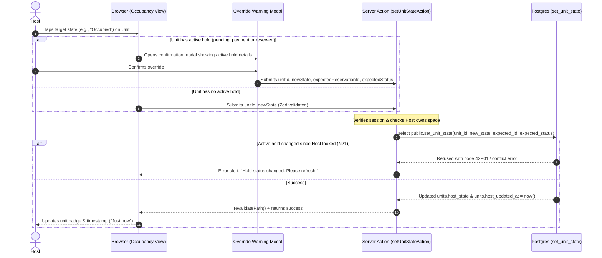

# STORY-12: Host live occupancy control

**Status:** draft · **Owner:** @JamesNino-Mandawe · **Story:** #77 · **FR:** FR-3.2 ·
**Depends on:** STORY-05, STORY-07 · **Flows:** [Reservation lifecycle](../flows/reservation-lifecycle.md) ·
**Decisions:** D-002, D-004, D-010, D-036, D-042, D-044, D-046, D-047, D-048, D-050, D-051, D-052

## 0. Scope

**In:**

- **Host occupancy control view** (`app/(dashboard)/host/spaces/[id]/occupancy/page.tsx`): an interactive live management view displaying each unit in the Host's Space, available both as a spatial grid map and an accessible list view.
- **One-tap state controls:** quick buttons/pills on each unit allowing the Host to set its state to `Available`, `Reserved`, or `Occupied` with a single tap (FR-3.2, D-004).
- **Walk-in customer handling:** setting an Available unit to `Occupied` directly with no online reservation record required.
- **Host-updated timestamp display:** showing a dynamic freshness badge ("Host-updated · X min ago") reflecting `units.host_updated_at` (D-002, D-051).
- **Active hold override protection:** if a Host taps a unit that currently holds an active online reservation (`pending_payment` or `reserved`), an accessible confirmation modal warns the Host with the hold details and requires explicit confirmation before overriding (D-050). The call passes the expected reservation ID and status seen by the Host to prevent race conditions (N21).
- **Server Action** (`app/(dashboard)/host/spaces/[id]/occupancy/actions.ts`): `setUnitStateAction` validates inputs with Zod, verifies the authenticated user owns the Space, calls Postgres function `public.set_unit_state(...)`, and triggers page revalidation.
- **Zod validation schema** (`lib/validation/occupancy.ts`): validates `unitId`, target state, and optional override parameters (`expectedReservationId`, `expectedReservationStatus`).
- **Test coverage:** Vitest unit tests for the Zod schema and UI state transitions; pgTAP tests in `supabase/tests/` (specified here, built by Adrian per D-036) verifying state changes, timestamp updates, and negative security constraints.

**Out:**

- **Seat map builder and unit creation:** snap-grid layout and unit setup belong to Adrian in STORY-07 (#56).
- **Seeker availability view:** displaying public availability and the "Host-updated" tag on the Space profile belongs to Maria in STORY-11 (#76).
- **QR check-in and checkout:** booking token scanning and automatic unit release belong to Luke and Adrian in STORY-10 (#59).
- **Online holds and sandbox payment:** online checkout and payment confirmation belong to Adrian in STORY-09 (#58).
- **Database migrations and pgTAP execution:** Adrian writes database migrations, functions, and pgTAP tests (D-036).

## 1. Flow

### Shared flows (D-044)

This story implements the Host-driven moves defined in the [Reservation lifecycle flow](../flows/reservation-lifecycle.md):

- **Move H2:** Any state → `available`, `reserved`, or `occupied`. A Host taps the unit (walk-ins included). With an active hold, only allowed when the call names the hold they saw. Stamps `units.host_updated_at`.
- **Move R5:** `pending_payment` → `cancelled`. Host override cancels an unpaid hold.
- **Move R10:** `reserved` → `cancelled`. Host override cancels a paid reservation, marking the payment `forfeited`.

### This story's own part



## 2. Data and state

### Tables and columns

This story builds on the columns established in the [Reservation lifecycle flow](../flows/reservation-lifecycle.md) and STORY-07:

- `units.host_state`: text check constraint `host_state in ('available', 'reserved', 'occupied')`. Defaults to `'available'`. Never `'pending_payment'` (D-004, D-046, N12).
- `units.host_updated_at`: `timestamptz not null default now()`. Updated on every tap that sets a unit's state (D-051).

### Database function (D-036, D-047)

Adrian implements `public.set_unit_state` in Postgres:

```sql
create or replace function public.set_unit_state(
  p_unit_id uuid,
  p_state text,
  p_expected_reservation_id uuid default null,
  p_expected_reservation_status text default null
) returns void;
```

- **Grants (D-047, N24):** execute revoked from `public` and `anon`; granted to `authenticated`.
- **Security Definer:** runs with `set search_path = ''`. Checks that `auth.uid()` matches `spaces.host_id` of the Space containing the unit (N13).
- **Lapse step first (D-047):** records any lapses on the unit before evaluating or updating state.
- **Optimistic lock check (D-050, N21):** if the unit has an active hold, requires `p_expected_reservation_id` and `p_expected_reservation_status`. If the hold status changed between view and tap, the transaction refuses the change.

### State transitions

| Current State                   | Host Tap / Event                | Target State                          | Precondition                                   | Who          | Move    |
| :------------------------------ | :------------------------------ | :------------------------------------ | :--------------------------------------------- | :----------- | :------ |
| `available`                     | Taps "Occupied"                 | `occupied`                            | None (Walk-in customer)                        | Space's Host | H2      |
| `available`                     | Taps "Reserved"                 | `reserved`                            | None (Manual phone reservation)                | Space's Host | H2      |
| `occupied`                      | Taps "Available"                | `available`                           | Customer departs                               | Space's Host | H2      |
| `reserved`                      | Taps "Occupied"                 | `occupied`                            | Walk-in or phone customer arrives              | Space's Host | H2      |
| Active Hold (`pending_payment`) | Taps any state + confirms modal | `available` / `occupied` / `reserved` | Must name reservation ID & status seen (D-050) | Space's Host | H2, R5  |
| Active Hold (`reserved`)        | Taps any state + confirms modal | `available` / `occupied` / `reserved` | Must name reservation ID & status seen (D-050) | Space's Host | H2, R10 |

### Zod schemas (`lib/validation/occupancy.ts`)

```typescript
import { z } from 'zod'

export const unitStateEnum = z.enum(['available', 'reserved', 'occupied'], {
  errorMap: () => ({ message: 'State must be available, reserved, or occupied' }),
})

export const setUnitStateSchema = z.object({
  unitId: z.string().uuid({ message: 'Invalid unit ID' }),
  state: unitStateEnum,
  expectedReservationId: z.string().uuid().optional().nullable(),
  expectedReservationStatus: z
    .enum(['pending_payment', 'reserved', 'occupied'])
    .optional()
    .nullable(),
})

export type SetUnitStateInput = z.infer<typeof setUnitStateSchema>
```

## 3. UI and files

### User Experience (Maria decides, D-042)

- **Occupancy Management Page (`/host/spaces/[id]/occupancy`):**
  - **Header:** Space title, breadcrumb back to `/host/spaces/[id]`, and overall occupancy counter (e.g. "14 / 20 units occupied").
  - **Freshness Badge:** "Host-updated · 2 min ago" (dynamically formatted relative time).
  - **View Toggle:** Segmented button to switch between **Grid Map View** (spatial layout) and **List View** (accessible tabular list).
  - **Unit Card:** Displays unit label (e.g., "Desk A-12"), unit type badge, current seat state badge with clear color/icon indicators:
    - `Available`: Green badge / border.
    - `Reserved`: Blue badge / border.
    - `Occupied`: Orange/Amber badge / border.
    - `Pending Payment`: Purple badge (read-only indicator with hold notice).
  - **Action Pills:** 3 buttons on each unit: `[Available]`, `[Reserved]`, `[Occupied]`. The active state is styled as a filled solid pill; other states are subtle outlines.
  - **Override Warning Modal:** If the unit has an active hold, clicking a state opens an `AlertDialog`:
    - Title: _"Override active reservation?"_
    - Description: _"This unit currently has an active reservation (Status: Reserved). Overriding it will cancel the Seeker's hold. Are you sure you want to proceed?"_
    - Actions: `[Cancel]` (returns with no changes), `[Confirm Override]` (destructive button calling Server Action with expected hold details).

### Routes and components

```
app/(dashboard)/host/spaces/[id]/occupancy/
  page.tsx                              Server Component: checks auth, loads space & units with unit_states
  actions.ts                            Server Action: setUnitStateAction()
  _components/
    occupancy-header.tsx                Server Component: title, breadcrumb, freshness badge
    occupancy-view.tsx                  Client Component: state holder for grid vs. list view toggle
    occupancy-grid.tsx                  Client Component: visual grid of unit cards
    occupancy-list.tsx                  Client Component: accessible table view of all units
    unit-control-card.tsx               Client Component: individual unit display with one-tap state pills
    override-warning-dialog.tsx         Client Component: confirmation modal for overriding active holds
lib/validation/
  occupancy.ts                          Zod schema for state update input
  occupancy.test.ts                     Vitest tests for Zod validation rules
```

### Accessibility

- **Touch targets:** All state buttons and pills meet the minimum 48×48 px touch target requirement (D-031).
- **Accessible List View:** A complete keyboard-navigable table alternative to the spatial grid, ensuring full accessibility for screen readers and keyboard-only users.
- **Color Contrast & Indicators:** States do not rely on color alone; each badge includes distinct text and iconography (`CheckCircle` for Available, `Clock` for Reserved, `User` for Occupied). Contrast ratio exceeds 4.5:1.
- **Dialog focus trap:** `override-warning-dialog.tsx` uses shadcn `AlertDialog` with accessible focus trapping, escape key dismissal, and explicit ARIA labels.
- **Responsive design:** Flexible layouts supporting 360 px, 768 px, and 1024 px viewports without horizontal scrolling.

## 4. Security and test matrix

| Layer      | Case                                                                           | Expected Result                                                |
| :--------- | :----------------------------------------------------------------------------- | :------------------------------------------------------------- |
| **Vitest** | Valid state (`available`, `reserved`, `occupied`) and UUID                     | Schema parses successfully                                     |
| **Vitest** | Invalid state (e.g., `pending_payment` or random string)                       | Validation fails with descriptive error message                |
| **Vitest** | Malformed UUID for unitId or expectedReservationId                             | Validation fails with UUID error                               |
| **pgTAP**  | Space's Host sets unit state to `occupied` (Move H2)                           | State updates, `units.host_updated_at` moves to `now()`        |
| **pgTAP**  | Space's Host overrides an unpaid hold naming the hold seen (Move R5)           | Hold transitions to `cancelled`, unit updates                  |
| **pgTAP**  | Space's Host overrides a paid reservation naming the hold seen (Move R10)      | Reservation transitions to `cancelled`, payment to `forfeited` |
| **pgTAP**  | Host attempts to set state to `pending_payment` (Negative N12)                 | Check constraint rejects write                                 |
| **pgTAP**  | Host attempts to update a unit in a Space owned by another Host (Negative N13) | Rejected with error / 0 rows affected                          |
| **pgTAP**  | Tap on held unit without expected reservation ID (Negative N14)                | Refused without modifying hold                                 |
| **pgTAP**  | Override attempted when hold status changed concurrently (Negative N21)        | Refused due to optimistic status mismatch                      |
| **pgTAP**  | Signed-out visitor or Seeker calls `public.set_unit_state` (Negative N24)      | Permission denied (`42501`)                                    |
| **Manual** | Host taps "Occupied" for walk-in on `/host/spaces/[id]/occupancy`              | State changes immediately, badge updates to "Just now"         |
| **Manual** | Host refreshes Seeker view in another tab                                      | Seeker view displays unit as unavailable within 1 refresh      |
| **Manual** | Host triggers override on reserved unit                                        | Dialog pops up; canceling aborts, confirming updates state     |
| **Manual** | Responsive check at 360 px, 768 px, 1024 px                                    | Layout stacks cleanly with zero horizontal scroll              |

## 5. Tasks and estimates

These rows become the story's TSK sub-issues once this doc is merged:

| Task         | What                                                                   | Owner | Points (1–10) | Days | Depends on                |
| :----------- | :--------------------------------------------------------------------- | :---- | :------------ | :--- | :------------------------ |
| **TSK-12.1** | Zod schema and unit tests (`lib/validation/occupancy.ts`)              | James | 2             | 1    | —                         |
| **TSK-12.2** | Server Action `setUnitStateAction` and database function integration   | James | 3             | 1    | TSK-12.1, STORY-07 tables |
| **TSK-12.3** | Live occupancy view: Grid map, accessible List view, and one-tap pills | James | 3             | 1.5  | TSK-12.2                  |
| **TSK-12.4** | Override warning modal and optimistic conflict error handling          | James | 2             | 0.5  | TSK-12.3                  |

## 6. Build order

One PR per row, and every PR targets `main`:

| #   | Branch                        | PR title                                                        | Contains                                                |
| :-- | :---------------------------- | :-------------------------------------------------------------- | :------------------------------------------------------ |
| 1   | `feature/STORY-12-validation` | `feat(STORY-12): add occupancy validation schema and tests`     | `lib/validation/occupancy.ts` and `occupancy.test.ts`   |
| 2   | `feature/STORY-12-action`     | `feat(STORY-12): add setUnitState server action`                | `app/(dashboard)/host/spaces/[id]/occupancy/actions.ts` |
| 3   | `feature/STORY-12-ui`         | `feat(STORY-12): add host occupancy control view and list view` | Grid and list occupancy components, state pills         |
| 4   | `feature/STORY-12-override`   | `feat(STORY-12): add override confirmation dialog`              | `override-warning-dialog.tsx` and conflict toast alerts |

## 7. Rejected alternatives

- **Storing seat state directly in `units.state` column:** Rejected by Decision D-046. Storing seat state creates redundant sources of truth between `units` and `reservations`. Seat state is always computed on read from active holds or `units.host_state`.
- **A generic database trigger stamping `updated_at` on every change:** Rejected by Decision D-051. Automatic triggers would stamp the time even when a lapsed hold expires, falsely making a seat appear "recently vouched for by the Host". Only explicit Host taps move `units.host_updated_at`.
- **Simple yes/no boolean override flag without reservation context:** Rejected by Decision D-050. A generic boolean override cannot prevent race conditions where a hold transitions (e.g. from unpaid to paid) right as the Host taps. Requiring the expected reservation ID and status guarantees the Host only overrides what they actually saw (N21).

## 8. Open questions

- None. All architectural rules, moves, and constraints are established in the baselined [Reservation lifecycle flow](../flows/reservation-lifecycle.md) and Decisions D-046 through D-052.

## 9. After the build

Fill this in when the story is done:

- what turned out different from this plan, and why
- the status line changed to `implemented YYYY-MM-DD`
- the docs this story changed
- who verified each acceptance criterion
