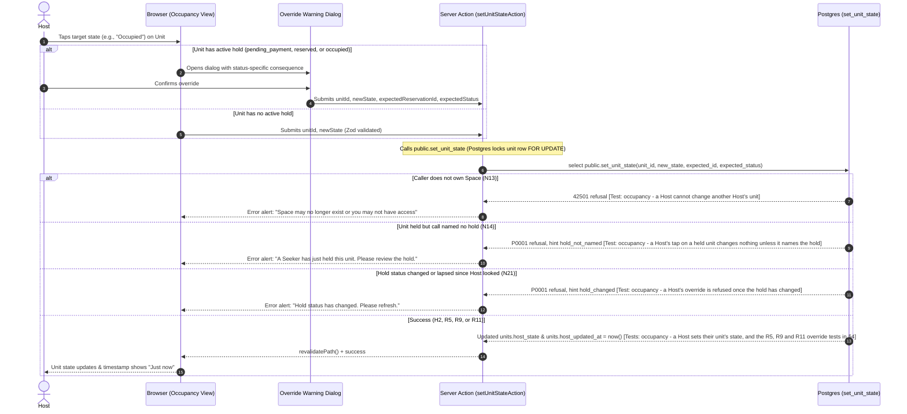

# STORY-12: Host occupancy control

**Status:** draft · **Owner:** @JamesNino-Mandawe · **Story:** #77 · **FR:** FR-3.2 ·
**Depends on:** STORY-05, STORY-07, STORY-09 · **Flows:** [Reservation lifecycle](../flows/reservation-lifecycle.md) ·
**Decisions:** D-002, D-004, D-010, D-031, D-036, D-042, D-044, D-046, D-047, D-048, D-050, D-051, D-052, D-057

## 0. Scope

**In:**

- **Host occupancy control view** (`app/(dashboard)/host/spaces/[spaceId]/occupancy/page.tsx`): a Host-maintained management view displaying each unit in the Host's Space, embedding STORY-07's seat map for the spatial view and providing an accessible list view alternative.
- **One-tap state controls:** quick buttons/pills on each unit allowing the Host to set its state to `Available`, `Reserved`, or `Occupied` with a single tap (FR-3.2, D-004).
- **Walk-in customer handling:** setting an Available unit to `Occupied` directly with no online reservation record in the database.
- **Host-updated timestamp display:** showing freshness per unit ("Updated · X min ago") and at the page header ("Most recent update · X min ago") reflecting `units.host_updated_at` (D-002, D-051). Relative time is calculated client-side after load to avoid SSR hydration mismatch.
- **Active hold override protection:** if a Host taps a unit that currently holds an active online reservation (`pending_payment`, `reserved`, or `occupied`), an accessible confirmation modal warns the Host with status-specific consequences before proceeding (D-050). The call passes the expected reservation ID and status seen by the Host, as `unit_states` gave them (D-057), to prevent race conditions (N21).
- **Server Action** (`app/(dashboard)/host/spaces/[spaceId]/occupancy/actions.ts`): `setUnitStateAction` validates inputs with Zod 4, calls Postgres function `public.set_unit_state(...)`, maps database refusals to user messages, and triggers page revalidation.
- **Zod validation schema** (`lib/validation/occupancy.ts`): validates `unitId`, target state, and requires both `expectedReservationId` and `expectedReservationStatus` together when overriding.
- **Pure logic helper** (`lib/occupancy/override.ts`): determines which units require an override warning and provides the status-specific dialog copy with co-located Vitest unit tests.
- **Database function and pgTAP tests:** Adrian implements `public.set_unit_state` and pgTAP tests in `supabase/tests/` (D-036) covering Host-set states (H2, N12, N13, N24) and hold overrides (R5, R9, R11, N14, N21).

**Out:**

- **Seat map builder and unit layout:** snap-grid builder, unit placement, and coordinates belong to Adrian in STORY-07 (#56).
- **Seeker availability view:** displaying public availability and the "Host-updated" tag on the Space profile belongs to Maria in STORY-11 (#76).
- **Remaining wait windows and QR check-in:** displaying the remaining wait window countdown for Reserved units (FR-3.3) and QR scanning belong to Luke and Adrian in STORY-10 (#59). This story's unit card leaves visual layout space for STORY-10's wait window timer.
- **Online holds and sandbox payment:** online checkout and payment confirmation belong to Adrian in STORY-09 (#58).
- **Database migrations and pgTAP execution:** Adrian writes database migrations, functions, and pgTAP tests (D-036).

## 1. Flow

### Shared flows (D-044)

This story implements the Host-driven moves defined in the [Reservation lifecycle flow](../flows/reservation-lifecycle.md):

- **Move H2:** Any state → `available`, `reserved`, or `occupied`. A Host taps the unit (walk-ins included). With an active hold, only allowed when the call names the hold they saw. Stamps `units.host_updated_at` (D-051).
- **Move R5:** `pending_payment` → `cancelled`. Host override cancels an unpaid hold. Payment remains `pending`.
- **Move R9:** `reserved` → `cancelled`. Host override cancels a paid reservation. Payment stays `paid` until an Administrator refunds it in sandbox (P1, STORY-14, D-005, D-050).
- **Move R11:** `occupied` → `completed`. Host tap on an occupied unit ends the visit. Ending it `completed` keeps the Seeker's right to review the visit (D-009). Payment stays `paid`.

### This story's own part



## 2. Data and state

### Tables and columns

This story builds on the columns established in the [Reservation lifecycle flow](../flows/reservation-lifecycle.md) and STORY-07:

- `units.host_state`: text check constraint `host_state in ('available', 'reserved', 'occupied')`. Defaults to `'available'`. Never `'pending_payment'` (D-004, D-046, N12).
- `units.host_updated_at`: `timestamptz not null default now()`. Updated on every tap that sets a unit's state (D-051).
- Closing time rule (D-048): When a Space's closing time passes in Asia/Manila, closing time resets a Host-set Reserved or Occupied state to Available without moving `units.host_updated_at` (Move H3).

### Reading the units (D-047, D-057)

The page reads `public.unit_states(space_id)`, never the tables. To the Space's Host it returns each unit's seat state and `host_updated_at`, and each held unit's `reservation_id` ([reading a state](../flows/reservation-lifecycle.md#reading-a-state), added by #185). A unit with a `reservation_id` has an active hold: a tap on it opens the warning dialog, and the call sends that `reservation_id` as `expectedReservationId` and the seat state shown as `expectedReservationStatus`. A unit without one has no hold, so the call sends neither. A seat state of Reserved or Occupied alone can't tell the two apart, because a Host's own tap can set it too.

### Database function (D-036, D-047)

Adrian implements `public.set_unit_state` in Postgres:

```sql
create or replace function public.set_unit_state(
  p_unit_id uuid,
  p_state text,
  p_expected_reservation_id uuid default null,
  p_expected_reservation_status text default null
) returns void;
```

- **Grants (D-047, N24):** execute revoked from `public`, `anon`, and `authenticated`; granted to `authenticated`.
- **Security Definer:** runs with `set search_path = ''`. Checks that `auth.uid()` matches `spaces.host_id` of the Space containing the unit; raises `42501` if not, as `set_space_status` does for anyone who isn't an Administrator (D-053), and the same for a unit that doesn't exist, so the two read alike (N13). A signed-out visitor cannot call the function (`42501` from the missing grant, N24), and a signed-in Seeker is refused by the Space owner check (`42501`, N13).
- **Locking order (D-047):** locks rows in strict order: unit row first (`for update`), then active reservation, then payment. If a hold commits concurrently after the Host looked, the call names no hold and is refused as N14: `P0001` with the hint `hold_not_named`.
- **Lapse step first (D-047):** records any lapses on the unit before evaluating or updating state.
- **Optimistic lock check (D-050, N21):** if the unit has an active hold, requires `p_expected_reservation_id` and `p_expected_reservation_status`. If the hold status changed between view and tap (or lapsed in the meantime), raises `P0001` with the hint `hold_changed` (N21).
- **Target state check (D-004, N12):** rejects any attempt to set `pending_payment` with the check constraint's error, `23514`.
- **Telling refusals apart:** the action reads the error's `code` and `hint` (Supabase passes both on), never its message text: `42501` is N13, `P0001` with `hold_not_named` is N14, and `P0001` with `hold_changed` is N21.

### State transitions

This story implements the Host's state transitions defined in [Reservation lifecycle flow](../flows/reservation-lifecycle.md#the-host-set-state):

- Direct Host taps (Move H2): `available` ↔ `occupied`, `available` ↔ `reserved`, and `reserved` ↔ `occupied`.
- Overrides on active holds naming what the Host saw (D-050):
  - On `pending_payment`: cancels unpaid hold, payment stays `pending` (Move R5).
  - On `reserved`: cancels paid hold, payment stays `paid` for an Administrator's refund (Move R9).
  - On `occupied`: ends checked-in visit `completed`, payment stays `paid` (Move R11).

### Zod schemas (`lib/validation/occupancy.ts`)

```typescript
import { z } from 'zod'

export const unitStateEnum = z.enum(['available', 'reserved', 'occupied'], {
  error: 'State must be available, reserved, or occupied',
})

export const setUnitStateSchema = z
  .object({
    unitId: z.uuid({ error: 'Invalid unit ID' }),
    state: unitStateEnum,
    expectedReservationId: z
      .uuid({ error: 'Invalid reservation ID' })
      .optional()
      .nullable(),
    expectedReservationStatus: z
      .enum(['pending_payment', 'reserved', 'occupied'], {
        error: 'Invalid expected reservation status',
      })
      .optional()
      .nullable(),
  })
  .refine(
    (data) =>
      (data.expectedReservationId == null && data.expectedReservationStatus == null) ||
      (data.expectedReservationId != null && data.expectedReservationStatus != null),
    {
      error: 'Expected reservation ID and status must be provided together',
      path: ['expectedReservationId'],
    },
  )

export type SetUnitStateInput = z.infer<typeof setUnitStateSchema>
```

## 3. UI and files

### User Experience (Maria decides, D-042)

- **Occupancy Management Page (`/host/spaces/[spaceId]/occupancy`):**
  - **Header:** Space title, a link back to the Host's Spaces at `/host` (STORY-05 has no page at `/host/spaces/[spaceId]`), occupancy counter (e.g. "14 / 20 units occupied"), and header freshness badge ("Host-updated · 2 min ago").
  - **View Toggle:** two `Button`s with `aria-pressed` switch between **Seat Map View** (spatial layout reusing STORY-07's seat map) and **List View** (accessible tabular list). `components/ui/` has no segmented control, and two buttons need none.
  - **Unit Card:** Displays unit label (e.g., "Desk A-12"), unit type, per-unit freshness label ("Host-updated · 2 min ago"), and current seat state badge in its seat-state color. When `unit.reservation_id` is present (D-057), a concise "Seeker hold" badge is displayed alongside the seat state badge, visually distinguishing online Seeker holds from Host-set states without displaying the opaque UUID. For walk-ins or Host-set states (`reservation_id` is null), no "Seeker hold" badge appears. The colors come from four seat-state token pairs that Maria picks (D-031, D-042, §8); the colors below are proposals:
    - `Available`: green badge / border (`CheckCircle` icon).
    - `Reserved`: blue badge / border (`Clock` icon). Leaves room for STORY-10's wait window countdown.
    - `Occupied`: orange/amber badge / border (`User` icon).
    - `Pending Payment`: purple badge with a hold notice. No button sets it, but the Host may tap another state to override the hold, after the warning.
  - **Action Pills:** 3 buttons on each unit: `[Available]`, `[Reserved]`, `[Occupied]`. Active state is a solid filled pill; inactive states are outlines. All buttons meet 48×48 px touch targets (D-031). Buttons are disabled while an update action is pending. **Same-state tap:** Tapping the button matching the unit's currently displayed state (e.g., tapping `[Reserved]` on an already-Reserved unit, whether Seeker-held or Host-set) is a no-op: it remains visually selected, triggers no network request or Server Action, and never opens the override dialog. Only tapping a different target state initiates a transition or override.
  - **List View:** Table includes columns for Unit, Type, State (with the "Seeker hold" badge when held), Host-updated freshness, and Action Pills. Same-state taps are also no-ops here.
  - **Empty State:** If the Space has no zones or units yet, renders a descriptive empty state card directing the Host to the Seat Map builder (STORY-07): _"No units found. Set up your seat map first to manage occupancy."_
  - **Loading State:** while `unit_states` loads, `loading.tsx` shows the header and a placeholder where the seat map goes.
  - **Override Warning Dialog:** If the unit has an active hold and the Host taps a different state, clicking that state opens a shadcn `AlertDialog`:
    - Title: _"Override active hold?"_
    - Description by status and requested target state:
      - For `pending_payment` (R5): _"This unit currently has an unpaid hold. Overriding it will cancel the Seeker's hold and mark this unit {targetState}. Proceed?"_
      - For `reserved` (R9): _"The Seeker has already paid for this hold. Overriding it will cancel their hold and mark this unit {targetState}, and their fee stays paid until an Administrator refunds it. Proceed?"_
      - For `occupied` (R11): _"A Seeker is currently checked in at this unit. Setting this state to {targetState} will end their visit. Proceed?"_
    - Actions: `[Cancel]` (aborts with no changes), `[Cancel hold and mark {targetState}]` / `[End visit and mark {targetState}]` (destructive action button, disabled while submitting).
  - **Error handling:** each refusal (§2) renders an inline `Alert` (`role="alert"`). N14 and N21 also offer a one-click refresh button:
    - `42501` (N13): _"Space may no longer exist or you may not have access."_
    - `P0001`, `hold_not_named` (N14): _"A Seeker has just held this unit. Please review the hold."_
    - `P0001`, `hold_changed` (N21): _"Hold status has changed. Please refresh."_
    - Anything else, a lost connection included: _"We could not save that change. Check your connection and try again."_

### Routes and components

```
app/(dashboard)/host/spaces/[spaceId]/occupancy/
  page.tsx                              Server Component: checks auth, loads space & units with unit_states
  loading.tsx                           Server Component: the loading state
  actions.ts                            Server Action: setUnitStateAction()
  _components/
    occupancy-header.tsx                Server Component: title, link back, latest update badge (through relative-time.tsx)
    relative-time.tsx                   Client Component: "X min ago", worked out after load, for the header and each unit card
    occupancy-view.tsx                  Client Component: state holder for view toggle
    occupancy-list.tsx                  Client Component: accessible table view of all units
    unit-control-card.tsx               Client Component: individual unit display with one-tap state pills
    override-warning-dialog.tsx         Client Component: confirmation modal for overriding active holds
lib/validation/
  occupancy.ts                          Zod 4 schema for state update input
  occupancy.test.ts                     Vitest tests for Zod validation rules
lib/occupancy/
  override.ts                           Pure logic: determines override requirement & dialog copy
  override.test.ts                      Vitest tests for override logic
components/ui/
  alert-dialog.tsx                      New primitive, added with `npx shadcn add alert-dialog`; its buttons sized 48×48 px (D-031)
```

### Accessibility

- **Touch targets:** All state buttons and pills meet the minimum 48×48 px touch target requirement (D-031).
- **Accessible List View:** Complete keyboard-navigable table alternative to the spatial grid, ensuring full accessibility for screen readers and keyboard-only users.
- **Color Contrast & Indicators:** States do not rely on color alone; each badge includes distinct text and iconography. Each seat-state token pair is checked at 4.5:1 when it is added (D-031).
- **Dialog focus trap:** Uses shadcn `AlertDialog` with accessible focus trapping, escape key dismissal, and explicit ARIA labels.
- **Responsive design:** Flexible layouts supporting 360 px, 768 px, and 1024 px viewports without horizontal scrolling, and supports text zoom up to 200%.

## 4. Security and test matrix

| Layer      | Case                                                                               | Expected Result                                                                        |
| :--------- | :--------------------------------------------------------------------------------- | :------------------------------------------------------------------------------------- |
| **Vitest** | Valid state (`available`, `reserved`, `occupied`) and unit UUID                    | Schema parses successfully                                                             |
| **Vitest** | Invalid state (e.g., `pending_payment`, empty, or typo)                            | Validation fails with custom error message                                             |
| **Vitest** | Half-named override (reservation ID without status or vice-versa)                  | Validation fails with pairing error                                                    |
| **Vitest** | Pure logic: override message helper and refusal error mapping                      | Returns status-specific consequence with target state; maps error hints to UI messages |
| **pgTAP**  | Space's Host sets unit state to `occupied` (Move H2)                               | State updates, `units.host_updated_at` moves to `now()`                                |
| **pgTAP**  | Space's Host overrides an unpaid hold naming the hold seen (Move R5)               | Hold transitions to `cancelled`, payment stays `pending`                               |
| **pgTAP**  | Space's Host overrides a paid reservation naming the hold seen (Move R9)           | Hold transitions to `cancelled`, payment stays `paid` for refund                       |
| **pgTAP**  | Space's Host sets state on occupied unit naming the hold seen (Move R11)           | Visit transitions to `completed`, payment stays `paid`                                 |
| **pgTAP**  | Signed-out visitor reads `unit_states` after Host state change                     | Returns updated state and Host-updated time within one read                            |
| **pgTAP**  | Host attempts to set state to `pending_payment` (Negative N12)                     | Check constraint rejects write (`23514`), unit unchanged                               |
| **pgTAP**  | Host attempts to update a unit in a Space owned by another Host (Negative N13)     | Refused with `42501`, unit unchanged                                                   |
| **pgTAP**  | Tap on held unit without expected reservation ID (Negative N14)                    | Refused with `P0001`, hint `hold_not_named`; hold and unit unchanged                   |
| **pgTAP**  | Override attempted when hold status changed concurrently (Negative N21)            | Refused with `P0001`, hint `hold_changed`; hold and unit unchanged                     |
| **pgTAP**  | Signed-out visitor calls `public.set_unit_state` (Negative N24)                    | Permission denied (`42501`)                                                            |
| **pgTAP**  | Authenticated Seeker calls `public.set_unit_state` (Negative N24 / N13)            | Refused with `42501` by the owner check, unit unchanged                                |
| **Manual** | Host taps "Occupied" for walk-in on `/host/spaces/[spaceId]/occupancy`             | State changes immediately, badge updates to "Just now"                                 |
| **Manual** | Host triggers override on pending, reserved, and occupied units                    | Dialog displays status-specific consequence; cancel aborts, confirm updates            |
| **Manual** | Host triggers override after hold status changes concurrently (second tab)         | Action maps error hint to inline alert: "Hold status has changed. Please refresh."     |
| **Manual** | Host taps the currently active state button on a unit (e.g. Reserved on Reserved)  | No-op: no Server Action invoked, no warning dialog opened, state unchanged             |
| **Manual** | Responsive check at 360 px, 768 px, 1024 px; text zoom at 200%; keyboard-only pass | Layout stacks cleanly; no sideways scroll; focus visible                               |
| **Manual** | When STORY-11 Space profile exists: Seeker views space                             | Shows the unit as Occupied within one refresh                                          |

## 5. Tasks and estimates

These rows become the story's TSK sub-issues once this doc is merged. Total points: 16 (Adrian: 6 pts; James: 8 pts for story + 2 pts Sprint 2 QA tracked in plan):

| Task         | What                                                                                                                     | Owner              | Points (1–10) | Days | Depends on                                   |
| :----------- | :----------------------------------------------------------------------------------------------------------------------- | :----------------- | :------------ | :--- | :------------------------------------------- |
| **TSK-12.1** | `public.set_unit_state` for Host-set states (H2, N12, N13, N24), pgTAP tests, and `db:types` regenerated                 | @dreeyanzz         | 3             | 1    | STORY-07 tables                              |
| **TSK-12.2** | Zod 4 schema and pure override logic with Vitest unit tests                                                              | @JamesNino-Mandawe | 1             | 0.5  | —                                            |
| **TSK-12.3** | Server Action `setUnitStateAction` calling `set_unit_state` with error mapping                                           | @JamesNino-Mandawe | 2             | 0.5  | TSK-12.1, TSK-12.2                           |
| **TSK-12.4** | `public.set_unit_state` override part (R5, R9, R11, N14, N21) and pgTAP tests                                            | @dreeyanzz         | 3             | 1    | TSK-12.1, STORY-09 reservations and payments |
| **TSK-12.5** | Occupancy screen: reuses STORY-07 seat map, accessible list view, and one-tap pills                                      | @JamesNino-Mandawe | 3             | 1.5  | TSK-12.3, STORY-07 seat map                  |
| **TSK-12.6** | Override warning dialog (adds the `AlertDialog` primitive) with status-specific consequences and conflict alert handling | @JamesNino-Mandawe | 2             | 0.5  | TSK-12.4, TSK-12.5                           |
| **TSK-12.7** | Sprint 2 QA: Seeker and Host Playwright journey tests and Definition of Done verification                                | @JamesNino-Mandawe | 2             | 1    | TSK-12.6, Maria's journeys                   |

_(Note: James's STORY-12 build tasks TSK-12.2, 12.3, 12.5, 12.6 total exactly 8 story points, matching issue #77. TSK-12.7 tracks the 2-point Sprint 2 QA allocation from the baselined Sprint 2 plan.)_

## 6. Build order

One PR per row, and every PR targets `main`:

| #   | Branch                          | PR title                                                               | Contains                                                                                |
| :-- | :------------------------------ | :--------------------------------------------------------------------- | :-------------------------------------------------------------------------------------- |
| 1   | `feature/STORY-12-db-states`    | `feat(STORY-12): add set_unit_state function and host-set pgTAP tests` | Adrian: `set_unit_state` (H2, N12, N13, N24), tests, `db:types`                         |
| 2   | `feature/STORY-12-validation`   | `feat(STORY-12): add occupancy validation schema and tests`            | James: `lib/validation/occupancy.ts` and `lib/occupancy/`                               |
| 3   | `feature/STORY-12-action`       | `feat(STORY-12): add setUnitState server action`                       | James: `app/(dashboard)/host/spaces/[spaceId]/occupancy/actions.ts`                     |
| 4   | `feature/STORY-12-db-overrides` | `feat(STORY-12): add hold override moves to set_unit_state`            | Adrian: R5, R9, R11, N14, N21 moves and pgTAP tests                                     |
| 5   | `feature/STORY-12-ui`           | `feat(STORY-12): add host occupancy control view and list view`        | James: Seat map integration, list view, one-tap pills                                   |
| 6   | `feature/STORY-12-dialog`       | `feat(STORY-12): add override confirmation dialog`                     | James: `override-warning-dialog.tsx`, `components/ui/alert-dialog.tsx`, conflict alerts |
| 7   | `feature/STORY-12-qa`           | `test(STORY-12): add playwright journey tests and DoD verification`    | James: E2E Playwright tests and sprint verification                                     |

## 7. Rejected alternatives

- **Storing seat state directly in `units.state` column:** Rejected by Decision D-046. Storing seat state creates redundant sources of truth between `units` and `reservations`. Seat state is always computed on read from active holds or `units.host_state`.
- **A generic database trigger stamping `updated_at` on every change:** Rejected by Decision D-051. Automatic triggers would stamp the time even when a lapsed hold expires, falsely making a seat appear "recently vouched for by the Host". Only explicit Host taps move `units.host_updated_at`.
- **Simple yes/no boolean override flag without reservation context:** Rejected by Decision D-050. A generic boolean override cannot prevent race conditions where a hold transitions (e.g. from unpaid to paid) right as the Host taps. Requiring the expected reservation ID and status guarantees the Host only overrides what they actually saw (N21).
- **Custom standalone grid component:** Rejected per project guidelines. Embedding STORY-07's shared seat map component ensures the Host and Seeker view the exact same layout (FR-3.1).

## 8. Open questions

- **Reservation ID on `unit_states`:** settled by #185 (D-057). `unit_states` gives the Space's Host each held unit's `reservation_id`, and `null` everywhere else, so the page can tell a hold from a Host-set state and name it without reading `reservations` (N6, D-047). §2 relies on it, so this design merges after #185.
- **Seat map component exports from STORY-07:** TSK-12.5 waits for STORY-07's design to name the seat map component export and its container layout.
- **Seat-state colors (Maria, D-031, D-042):** `app/globals.css` has no seat-state tokens yet. Maria picks the four token pairs and checks each at 4.5:1. STORY-11's availability view shows the same four seat states, so the two stories share them: whichever builds its view first adds them.
- **The wording in §3** is proposed here, and Maria approves it (D-042).

## 9. After the build

Fill this in when the story is done:

- what turned out different from this plan, and why
- the status line changed to `implemented YYYY-MM-DD`
- the docs this story changed
- who verified each acceptance criterion
