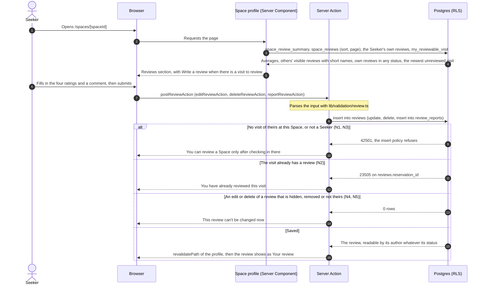

# STORY-13: Community reviews and ratings

**Status:** draft · **Owner:** @dreeyanzz (database), @lukedongque (app and screens) ·
**Story:** #78 · **FR:** FR-4.1, FR-4.2, SRS §3.5.2 · **Depends on:** STORY-08, STORY-09,
STORY-10, STORY-11 · **Flows:** [Review lifecycle](../flows/review-lifecycle.md),
[Reservation lifecycle](../flows/reservation-lifecycle.md) · **Decisions:** D-009, D-047,
D-052, D-055, D-073 to D-076, D-080, D-081, D-087

A Seeker who checked in at a Space rates it for quietness, Wi-Fi reliability, cleanliness
and comfort, and may add a comment. Everyone, signed out included, reads the reviews and
the averages on the Space profile, and the overall average on the Space card in search.
Any signed-in user but the author can report a review, which waits for an Administrator
(STORY-14). Adrian builds the database half, and Luke builds the app half and writes §3's
screens (D-073, D-075).

## 0. Scope

**In:**

- **The database (Adrian):** the `review_status`, `review_report_reason` and
  `review_report_outcome` types; the `reviews` and `review_reports` tables, with their
  policies, grants and triggers; the read functions `public.space_reviews`,
  `public.space_review_summary` and `public.my_reviewable_visit`; two private helpers;
  demo visits, reviews and a report in `seed.sql`; the pgTAP tests in
  `supabase/tests/NN-reviews.sql`; and `db:types`.
- **The app (Luke):** the form rules in `lib/validation/review.ts`; the reads in
  `lib/data/reviews.ts`; four Server Actions on the Space profile (post, edit, delete,
  report); the reviews section on the profile, with the averages, the list, its sort and
  "Show more reviews", the Seeker's own reviews and the form; a review form component that
  STORY-16 reuses; the overall average on STORY-08's Space card; and their Vitest and
  Playwright tests.

**Out:**

- **Moderation** (STORY-14): `public.moderate_review`, the moderation log, and the
  Reported, Hidden and Removed lists on `/admin`. This story creates the columns STORY-14
  writes, so STORY-14 adds no columns to these tables.
- **"Leave a review" in the reservation history** (STORY-16), which is how a Seeker
  reviews a visit to a Space that isn't Verified (D-081). It uses this story's form and
  action.
- **Sorting or filtering search by rating** (D-076: Won't Have in Sprint 3).
- **Host replies and notifications.** Nobody is told about a new review or a report
  (D-080).
- **The final look** (STORY-17). Maria and James review these screens once built, and
  restyle what doesn't fit (D-073, D-074).

## 1. Flow

### Shared flows (D-044)

- **[Review lifecycle](../flows/review-lifecycle.md)** (#339). This story builds:
  - RV1 posted, RV2 edited, RV3 deleted by its author, and RV9 deleted with its Space,
    visit or author;
  - RP1 a report filed, and RP3 a report deleted with its review or reporter;
  - the database the flow's "How the database enforces it" describes for `reviews`,
    `review_reports`, `space_review_summary` and reading reviews with the author's short
    name;
  - the flow's tests in the `reviews` file: N1 to N6, N10 to N12, and N15 to N17.

  STORY-14 builds RV4 to RV8, RP2, `moderate_review`, the moderation log, and the tests in
  the `review-moderation` file (N7 to N9, N13, N14). This story's grants are what make N13
  pass.

- **[Reservation lifecycle](../flows/reservation-lifecycle.md)** (#173): this story reads
  "a visit, for reviews", a reservation with `checked_in_at` set. It makes no move there.

### This story's own part

Posting a review from the Space profile. Editing, deleting and reporting take the same
path, with the write named in brackets.



## 2. Data and state

### Types

| Type                    | Values                                          | Used by                                                  |
| ----------------------- | ----------------------------------------------- | -------------------------------------------------------- |
| `review_status`         | `visible`, `hidden`, `removed`                  | `reviews.status` (D-080)                                 |
| `review_report_reason`  | `spam`, `offensive`, `not_about_space`, `other` | `review_reports.reason` (D-080)                          |
| `review_report_outcome` | `dismissed`, `hidden`, `removed`                | `review_reports.outcome`, which STORY-14's function sets |

### `reviews`

| Column              | Type            | Rule                                                                                               |
| ------------------- | --------------- | -------------------------------------------------------------------------------------------------- |
| `id`                | `uuid`          | Primary key, `gen_random_uuid()`                                                                   |
| `reservation_id`    | `uuid`          | Not null, unique (N2), references `reservations`, `on delete cascade` (RV9)                        |
| `space_id`          | `uuid`          | Not null, references `spaces`, `on delete cascade` (RV9)                                           |
| `author_id`         | `uuid`          | Not null, default `auth.uid()`, references `profiles`, `on delete cascade` (RV9)                   |
| `quietness`         | `smallint`      | Not null, 1 to 5, where 5 is very quiet: FR-4.1's "noise" (D-087)                                  |
| `wifi_reliability`  | `smallint`      | Not null, 1 to 5                                                                                   |
| `cleanliness`       | `smallint`      | Not null, 1 to 5                                                                                   |
| `comfort`           | `smallint`      | Not null, 1 to 5                                                                                   |
| `comment`           | `text`          | Null, or 1 to 500 characters after trimming (N15)                                                  |
| `status`            | `review_status` | Not null, default `visible`. Only STORY-14's function changes it                                   |
| `version`           | `integer`       | Not null, default 1. The edit trigger raises it                                                    |
| `edited_at`         | `timestamptz`   | Null until the first edit. "Edited" shows once it is set                                           |
| `status_changed_by` | `uuid`          | Null, references `profiles`, `on delete set null`. STORY-14's function sets it                     |
| `status_changed_at` | `timestamptz`   | Null. STORY-14's function sets it                                                                  |
| `created_at`        | `timestamptz`   | Not null, default `now()`. The date a review shows ("Reviewed 3 Nov 2026"), never the visit's date |

An index on `(space_id, status, created_at desc)` serves the profile's list. A review's
overall rating is the average of its four ratings, worked out when it is read, never
stored (D-076).

### `review_reports`

| Column           | Type                    | Rule                                                                             |
| ---------------- | ----------------------- | -------------------------------------------------------------------------------- |
| `id`             | `uuid`                  | Primary key, `gen_random_uuid()`                                                 |
| `review_id`      | `uuid`                  | Not null, references `reviews`, `on delete cascade` (RP3)                        |
| `reporter_id`    | `uuid`                  | Not null, default `auth.uid()`, references `profiles`, `on delete cascade` (RP3) |
| `review_version` | `integer`               | Not null. A trigger copies the review's current version (D-080)                  |
| `reason`         | `review_report_reason`  | Not null                                                                         |
| `note`           | `text`                  | Null, or 1 to 300 characters after trimming (N15)                                |
| `outcome`        | `review_report_outcome` | Null while open. STORY-14's function sets it with `closed_by` and `closed_at`    |
| `closed_by`      | `uuid`                  | Null, references `profiles`, `on delete set null`                                |
| `closed_at`      | `timestamptz`           | Null while open                                                                  |
| `created_at`     | `timestamptz`           | Not null, default `now()`                                                        |

It is unique on `(review_id, reporter_id, review_version)` (N11), and a check keeps
`outcome`, `closed_by` and `closed_at` set together or not at all.

### Triggers

- **`reviews`, `before update`:** when any of the four ratings or the comment changes, it
  raises `version` by 1 and sets `edited_at` to now (RV2). A change to the status alone,
  which only STORY-14 makes, leaves both as they were.
- **`review_reports`, `before insert`:** `security definer`. It sets `review_version` to
  the review's current version, so a report is always about the text that was there when
  it was filed. The insert policy then refuses a review the reporter may not report.

### Policies and grants

| Table            | Role                    | Verb   | Rule                                                                                                                                                                   |
| ---------------- | ----------------------- | ------ | ---------------------------------------------------------------------------------------------------------------------------------------------------------------------- |
| `reviews`        | `authenticated`         | insert | RV1. The caller has the Seeker role, `author_id` is the caller, and `private.is_reviewable_visit(reservation_id, space_id)`. The Space's status doesn't matter (D-081) |
| `reviews`        | `authenticated`         | update | RV2. The author's own rows while `status = 'visible'`, before and after                                                                                                |
| `reviews`        | `authenticated`         | delete | RV3. The author's own rows while `status = 'visible'`                                                                                                                  |
| `reviews`        | `anon`, `authenticated` | select | Visible reviews of a Verified Space for everyone; the author's own in any status; every review for Administrators (N10)                                                |
| `review_reports` | `authenticated`         | insert | RP1. `reporter_id` is the caller, and the review is visible, on a Verified Space, not the caller's own, and at the `review_version` the trigger recorded (N11)         |
| `review_reports` | `authenticated`         | select | The reporter's own reports, and every report for Administrators (N12)                                                                                                  |

Grants, besides the policies:

- `reviews`: select to `anon` and `authenticated`; insert on `reservation_id`, `space_id`,
  the four ratings and `comment`; update on the four ratings and `comment`; delete. No
  role may write `author_id`, `status`, `version`, `edited_at` or the `status_changed_`
  columns (N6).
- `review_reports`: select, and insert on `review_id`, `reason` and `note`, to
  `authenticated`. No role may update or delete a report (N13).

**Why the insert policy needs a helper:** no role may read `reservations` (the
reservation lifecycle's N6, D-047), so a policy that looked at it directly would fail with
`42501` for everyone. `private.is_reviewable_visit` answers the one question it needs.

### Functions

Each runs as `security definer` with an empty `search_path`, revokes execute from
`public`, `anon` and `authenticated`, and grants exactly what this list says (D-047).

- **`private.reviewer_short_name(p_full_name text) returns text`**, immutable: the first
  word, a space, and the first letter of the last word with a full stop. "Juan dela Cruz"
  reads "Juan C.", a one-word name reads as it is, and an empty or null name reads "Worq
  Seeker" (D-081).
- **`private.is_reviewable_visit(p_reservation_id uuid, p_space_id uuid) returns boolean`**:
  true when the reservation is the caller's, has `checked_in_at` set, and belongs to that
  Space (N1). Only the insert policy uses it.
- **`public.space_reviews(p_space_id uuid, p_sort text default 'newest', p_page_size integer default 10, p_page_offset integer default 0)`**,
  for `anon` and `authenticated`:
  - It returns the visible reviews of the Space, and only while the Space is Verified
    (N10, D-055). It leaves out the caller's own reviews, which the page reads itself.
  - Each row has the review's id, the reviewer's short name (never the full name, N17),
    the four ratings, its overall rating, the comment, `created_at`, whether it has been
    edited, its `version`, and whether the caller has reported that version.
  - `p_sort` is `newest` (by `created_at`, newest first), `highest` or `lowest` (by the
    overall rating, then newest first). Anything else is refused with `P0001` and the hint
    `invalid_sort`. `p_page_size` is kept between 1 and 50, and `p_page_offset` at 0 or more.
- **`public.space_review_summary(p_space_ids uuid[])`**, for `anon` and `authenticated`:
  one row for each of those Spaces that is Verified, with the count of its visible
  reviews, the average of each rating, and the overall average. A Space with no visible
  review has a count of 0 and null averages, and a Space that isn't Verified has no row
  (N16). At most 100 ids at once, or `P0001` with the hint `too_many_spaces`. Search calls
  it once for all its results, and the profile for its one Space.
- **`public.my_reviewable_visit(p_space_id uuid)`**, for `authenticated`: the caller's
  newest visit to the Space that has no review in any status, as its reservation id and
  `checked_in_at`, or no row. A hidden or removed review keeps its visit used (D-081).
  Only a Seeker can have one. It needs no lapse step, because a visit's check-in never
  changes once it is made.

### State transitions

None beyond the flow's: RV1 to RV3, RV9, RP1 and RP3 are drawn in the
[review lifecycle](../flows/review-lifecycle.md#every-move-and-its-test).

### Seed data

`seed.sql` gains, with fixed ids beside the others:

- two `completed` reservations by `seeker2@example.test` (Rina Bautista) at Kapihan Study
  Hall, on the standing desks D1 and D2, checked in and out a few days before the seed
  runs, each with a `paid` payment of the system fee;
- a review of each, one with a comment and one without, so the profile shows two reviews,
  averages and the Space card's rating locally;
- one open report on one of them, filed by `seeker@example.test`.

They avoid what the tests delete: `e2e/check-in.spec.ts` deletes every reservation of
`seeker@example.test`, and the race tests and `e2e/host-occupancy.spec.ts` delete those on
units U1 to U3 and S1 to S3. A review would go with its reservation (D-081). pgTAP tests
that count reviews use a Space of their own.

### Form rules (`lib/validation/review.ts`, Luke)

- **A rating:** a whole number from 1 to 5, read from the form's string.
- **A comment:** trimmed, at most 500 characters, and an empty one becomes null.
- **`postReviewSchema`:** the Space id (for revalidating), the reservation id, the four
  ratings and the comment.
- **`editReviewSchema`:** the Space id, the review id, the four ratings and the comment.
- **`deleteReviewSchema`:** the Space id and the review id.
- **`reportReviewSchema`:** the Space id, the review id, a reason from the four, and a
  note: trimmed, at most 300 characters, an empty one null.
- **`reviewListSchema`**, from the page's search params: `sort`, one of `newest`,
  `highest` and `lowest` (default `newest`), and how many are shown: 10, 20, 30, 40 or
  50 (default 10). Anything else falls back to the default.

## 3. UI and files

### Screens

**Luke writes this part, on this branch, before he approves (D-073, D-075).** Maria and
James review the screens once they're built (D-073). It has to cover each screen and the
order of steps, the wording, and the empty, loading and error states, for:

- the reviews section on the Space profile: the averages, the list, the sort control,
  "Show more reviews", the Seeker's own reviews, and Write a review;
- the review form, used on the profile and from STORY-16's history;
- editing, and deleting with a confirmation (`alert-dialog`, STORY-12);
- the report dialog, and the "You reported this" mark;
- the overall average on the Space card, in the list view and on the map's card.

These are already decided, so the screens follow them:

- **The ratings are labelled** Quietness, Wi-Fi reliability, Cleanliness and Comfort, and
  5 is the best for each (D-087).
- **A reviewer shows** by their short name, with "Checked-in visit" and the date the
  review was posted, never the date of the visit (D-076, D-081).
- **The averages** show from the first review, always with the count, such as "4.3 · 2
  reviews", and a Space with none says so. The overall average is the average of the four
  (D-076).
- **The list** reads newest first, 10 at a time, with "Show more reviews", and can be
  sorted by newest, highest or lowest rating. A signed-in Seeker's own reviews of the
  Space are pinned above it in any status, with "Hidden by an Administrator" or "Removed
  by an Administrator" where that applies, and Edit and Delete only while visible (D-080).
- **Write a review** appears only when `my_reviewable_visit` returns a visit, and reviews
  that visit, the newest one with no review. Older ones are reviewed from STORY-16's
  history.
- **Report** is offered on others' visible reviews to a signed-in user, with the four
  reasons and an optional note. Once reported, the review shows "You reported this"
  (D-080).
- **Review text is text.** The comment renders as a text node, never as HTML (SRS §3.5.2).

### Routes and components

Luke's section confirms or changes these.

| File                                                                 | Type             | Purpose                                                                                                                                   |
| -------------------------------------------------------------------- | ---------------- | ----------------------------------------------------------------------------------------------------------------------------------------- |
| `app/(public)/spaces/[spaceId]/page.tsx`                             | Server Component | Reads the summary, the list (from `reviewListSchema`), the Seeker's own reviews and their reviewable visit                                |
| `app/(public)/spaces/[spaceId]/actions.ts`                           | Server Actions   | `postReviewAction`, `editReviewAction`, `deleteReviewAction`, `reportReviewAction`, beside the hold actions                               |
| `app/(public)/spaces/[spaceId]/_components/space-reviews.tsx`        | Server Component | The reviews section: averages, list, sort, Show more, own reviews                                                                         |
| `app/(public)/spaces/[spaceId]/_components/report-review-dialog.tsx` | Client Component | The report dialog                                                                                                                         |
| `components/review/review-form.tsx`                                  | Client Component | The four ratings and the comment, for posting and editing. It takes the action, so STORY-16 reuses it                                     |
| `components/review/review-rating.tsx`                                | Shared, no state | A rating's number and its accessible label, shared by the profile and the Space card                                                      |
| `components/discovery/space-card.tsx`                                | Changed          | Shows the overall average and the count, or that there are no reviews yet                                                                 |
| `lib/data/spaces.ts`                                                 | Changed          | `searchVerifiedSpaces` adds `review_count` and `avg_overall` from one `space_review_summary` call                                         |
| `lib/data/reviews.ts`                                                | Server-only      | `getReviewSummaries`, `getSpaceReviews` (one more than the page shows, to know if there are more), `getMyReviews`, `getMyReviewableVisit` |
| `lib/validation/review.ts`                                           | Pure TS          | The form rules in §2                                                                                                                      |

**Each action** parses its input, writes with the signed-in client, turns each refusal
into the message §1 shows, and revalidates `/spaces/[spaceId]` and, for posting, editing
and deleting, `/spaces`. STORY-16's history imports `postReviewAction` from here, so one
action holds the rules.

### Where the files go

```
app/(public)/spaces/[spaceId]/page.tsx, actions.ts
app/(public)/spaces/[spaceId]/_components/space-reviews.tsx, report-review-dialog.tsx
components/review/review-form.tsx, review-rating.tsx
components/discovery/space-card.tsx
lib/data/reviews.ts, spaces.ts
lib/validation/review.ts
supabase/migrations/<timestamp>_reviews.sql
supabase/tests/NN-reviews.sql
supabase/seed.sql
e2e/reviews.spec.ts
```

### Accessibility (SRS §3.2.2, D-031)

- Each rating is a group of five radio buttons with a visible legend, each at least
  48 × 48 px, and works from the keyboard alone. The comment and the note show how many
  characters are left.
- An average is never shown by stars or colour alone: its number and an accessible label
  ("Overall 4.3 out of 5, from 2 reviews") go with it.
- Every result of an action, success or refusal, is announced in an `aria-live` region.
- No horizontal scrolling at 360, 768 and 1024 px, and nothing clipped with text at 200%.

## 4. Security and test matrix

pgTAP tests go in `supabase/tests/NN-reviews.sql`, numbered when created. A test that
needs a hidden or removed review sets the status as the test's own role before it acts as
a user, because STORY-14's function doesn't exist yet. The flow names most of them.

| Layer      | Case                                                                                                                                                                                  | Expected                             |
| ---------- | ------------------------------------------------------------------------------------------------------------------------------------------------------------------------------------- | ------------------------------------ |
| pgTAP      | RV1: "a Seeker with a visit posts a review, and it is visible at version 1"                                                                                                           | Saved                                |
| pgTAP      | RV1: "a Seeker reviews a visit to a Pending Space, and only they can read it"                                                                                                         | Saved, and others read 0 rows        |
| pgTAP      | RV2: "an author edits their review: its version goes up and edited_at is set"                                                                                                         | Saved                                |
| pgTAP      | RV3: "an author deletes their visible review and posts a new one for the same visit"                                                                                                  | Both succeed                         |
| pgTAP      | RV9: "deleting a Space deletes its reviews and their reports"                                                                                                                         | 0 rows left                          |
| pgTAP      | RP1: "a Seeker reports another Seeker's review"; "a user reports a review again after its author edits it"                                                                            | Saved                                |
| pgTAP      | RP3: "deleting a review deletes its reports"                                                                                                                                          | 0 rows left                          |
| pgTAP      | N1: "a Seeker cannot review a reservation with no check-in", "… another Seeker's visit", "… a visit under another Space"                                                              | `42501`                              |
| pgTAP      | N2: "a Seeker cannot post a second review on one visit"; "an author cannot post again on a visit whose review was hidden or removed"                                                  | `23505`                              |
| pgTAP      | N3: "a Host and an Administrator cannot post a review"; "a signed-out visitor cannot post a review"                                                                                   | `42501`                              |
| pgTAP      | N4: "another Seeker editing or deleting a review affects 0 rows"                                                                                                                      | 0 rows                               |
| pgTAP      | N5: "an author cannot edit or delete a hidden or removed review"                                                                                                                      | 0 rows                               |
| pgTAP      | N6: "an author cannot change their review's status or version"; "an Administrator cannot write a review's status directly"                                                            | `42501`                              |
| pgTAP      | N10: "a signed-out visitor, a Seeker and the Space's Host cannot read a hidden or removed review"; "only its author and Administrators read a review of a Pending Space"              | 0 rows                               |
| pgTAP      | N11: "an author cannot report their own review", "a user cannot report the same version twice", "a user cannot report a hidden review", "a signed-out visitor cannot report a review" | `42501` or `23505`                   |
| pgTAP      | N12: "a review's author and the Space's Host read 0 of its reports"                                                                                                                   | 0 rows                               |
| pgTAP      | N15: "a rating of 0 or 6 is refused"; "a comment over 500 characters is refused"; "a report note over 300 characters is refused"                                                      | `23514`                              |
| pgTAP      | N16: "the averages leave out hidden and removed reviews"; "a Pending Space's averages read as none"                                                                                   | Visible reviews only; no row         |
| pgTAP      | N17: "a review read returns the reviewer's short name, never their full name"                                                                                                         | "Juan C."                            |
| pgTAP      | "the short name is the first word and the last word's initial, a one-word name as it is, and Worq Seeker for an empty name"                                                           | As described                         |
| pgTAP      | "a report records the review's current version"                                                                                                                                       | The review's `version`               |
| pgTAP      | "space_reviews sorts by newest, highest and lowest, pages by size and offset, and leaves out the caller's own reviews"                                                                | As described                         |
| pgTAP      | "space_reviews refuses an unknown sort"; "space_review_summary refuses more than 100 Spaces"                                                                                          | `P0001`                              |
| pgTAP      | "space_review_summary gives a Verified Space with no reviews a count of 0"                                                                                                            | Count 0, null averages               |
| pgTAP      | "my_reviewable_visit returns the caller's newest visit with no review, and nothing to a Host"; "a signed-out visitor cannot run my_reviewable_visit"                                  | One row; none; `42501`               |
| Vitest     | The form rules: ratings are whole numbers from 1 to 5, the comment and the note are trimmed and limited, the list's params fall back to their defaults                                | Pass or fail as described            |
| Vitest     | A comment of `<script>alert(1)</script>` renders as that text, and no script element is created (SRS §3.5.2)                                                                          | Text only                            |
| Vitest     | Each action turns `42501`, `23505` and 0 rows into its message                                                                                                                        | The message §1 shows                 |
| Vitest     | The Space card shows the overall average with the count, or that there are no reviews yet                                                                                             | As described                         |
| Playwright | `e2e/reviews.spec.ts`: a Seeker with a finished visit reviews the Space, edits it and sees "edited", then deletes it and writes it again                                              | As described                         |
| Playwright | `e2e/reviews.spec.ts`: a signed-out visitor reads the reviews and the averages on the profile, and the rating on the Space card                                                       | As described                         |
| Playwright | `e2e/reviews.spec.ts`: another Seeker reports the review, and sees "You reported this"                                                                                                | As described                         |
| Manual     | As the seeded `seeker2@example.test`, the profile pins their two reviews; as `seeker@example.test`, one shows "You reported this"                                                     | As described                         |
| Manual     | The reviews section and the form at 360, 768 and 1024 px, with text at 200%, and with the keyboard alone                                                                              | No clipping, every control reachable |

The Playwright spec makes its own Space and visit, and removes them after, as
`e2e/seeker-journey.spec.ts` does, so it never depends on the seed or on another spec's
rows.

## 5. Tasks and estimates

These rows become the story's TSK sub-issues once this doc is merged. They total the
story's **8 points and 4 days**: 4 points for the database, and 4 for the app.

| Task     | What                                                                                                                                                                                                                               | Owner        | Points (1–10) | Days | Depends on         |
| -------- | ---------------------------------------------------------------------------------------------------------------------------------------------------------------------------------------------------------------------------------- | ------------ | ------------- | ---- | ------------------ |
| TSK-13.1 | The migration: the three types, `reviews` and `review_reports` with their policies, grants and triggers, the two private helpers and the three read functions. The pgTAP tests in §4 ride along (AGENTS.md rule 5), and `db:types` | @dreeyanzz   | 3             | 1.5  | This design merged |
| TSK-13.2 | Seed data: two finished visits with reviews and a report (§2), checked against `npm run db:test`, `npm run db:race` and the Playwright suite                                                                                       | @dreeyanzz   | 1             | 0.5  | TSK-13.1           |
| TSK-13.3 | `lib/validation/review.ts` and `lib/data/reviews.ts`, with their Vitest tests                                                                                                                                                      | @lukedongque | 1             | 0.5  | TSK-13.1           |
| TSK-13.4 | The reviews section on the profile, the review form component, the post, edit and delete actions, and the Space card's rating, with their Vitest tests                                                                             | @lukedongque | 2             | 1    | TSK-13.3           |
| TSK-13.5 | The report dialog, its action and "You reported this", the text-not-HTML test, and `e2e/reviews.spec.ts`                                                                                                                           | @lukedongque | 1             | 0.5  | TSK-13.4           |

Luke can build TSK-13.3 and TSK-13.4 against sample data while TSK-13.1 is in review, as
the Sprint 3 brief suggests. They merge after it, because they use its `db:types`.

## 6. Build order

One PR per row, and every PR targets `main`.

| #   | Branch                            | PR title                                                     | Contains                                 |
| --- | --------------------------------- | ------------------------------------------------------------ | ---------------------------------------- |
| 1   | `feature/STORY-13-design`         | `docs(STORY-13): design community reviews and ratings`       | This doc, the index, D-087, the glossary |
| 2   | `feature/STORY-13-reviews-db`     | `feat(STORY-13): add the reviews and review reports tables`  | TSK-13.1 (Adrian)                        |
| 3   | `feature/STORY-13-review-rules`   | `feat(STORY-13): add the review form rules and data reads`   | TSK-13.3 (Luke)                          |
| 4   | `feature/STORY-13-review-seed`    | `feat(STORY-13): seed demo visits and reviews`               | TSK-13.2 (Adrian)                        |
| 5   | `feature/STORY-13-review-profile` | `feat(STORY-13): show and post reviews on the space profile` | TSK-13.4 (Luke)                          |
| 6   | `feature/STORY-13-review-reports` | `feat(STORY-13): report a review`                            | TSK-13.5 (Luke)                          |

## 7. Rejected alternatives

- **Keeping the label "Noise"**, with 5 meaning quiet or noisy. Either way it reads both
  ways, and if 5 meant noisy, a noisy Space would score higher overall (D-087).
- **Count and average columns on `spaces`, kept by triggers.** Every review would move
  `spaces.updated_at`, so an Administrator deciding that Space would be refused as out of
  date (the Space verification flow's N9), and the Sprint 3 edit trigger (#340) would see
  a write on every review.
- **A database view joined into the search query:** a second way to read the same
  numbers, and harder to embed in PostgREST's query than one function call.
- **The form asking which visit,** or only the newest visit ever being reviewable. The
  newest unreviewed visit covers the common case, and STORY-16's history reaches the rest.
- **Every review at once, or no sort.** Adrian chose 10 at a time with a sort on 22 Nov.
- **Showing the visit's date:** it tells strangers when a named person was at a place.
- **The insert policy reading `reservations` directly:** no role may read it (D-047), so
  it would refuse everyone. A `security definer` helper answers the one question.
- **The client sending the version it reported:** it could name an old version. The
  trigger records the current one.
- **`space_reviews` returning the caller's own reviews too:** the author reads their own
  straight from `reviews`, which the select policy allows in any status, so the function
  keeps one rule for everyone.
- **Seeding visits for `seeker@example.test`, or on units U1 to U3 and S1 to S3:** tests
  delete those reservations, and the reviews would go with them.

## 8. Open questions

None blocking. Luke's screens section may move a file or rename a component in §3, which
he records on this branch.

## 9. After the build

Filled in when the story is done.
