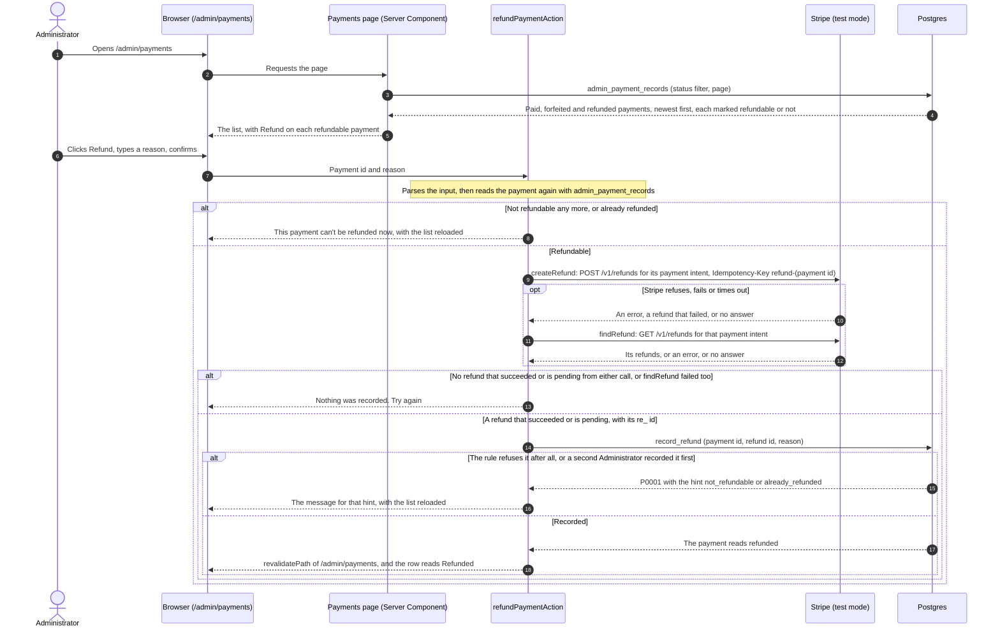

# STORY-14: Administration console

**Status:** approved 2026-11-22 · **Owner:** @dreeyanzz (database and refund), @lukedongque (pages and
screens) · **Story:** #79 · **FR:** FR-5.2, FR-5.3 · **Depends on:** STORY-09, STORY-10,
STORY-12, STORY-13, STORY-15 · **Flows:** [Review lifecycle](../flows/review-lifecycle.md),
[Reservation lifecycle](../flows/reservation-lifecycle.md),
[Sandbox payment confirmation](../flows/sandbox-payment-confirmation.md) ·
**Decisions:** D-005, D-010, D-013, D-047, D-050, D-053, D-070, D-073 to D-076, D-080, D-085,
D-088

An Administrator moderates reported reviews from `/admin`: hides, restores or removes a
review, or dismisses its reports (FR-5.2). They read every sandbox payment where money
moved, and refund a paid fee when the Seeker never got the seat they paid for (FR-5.3).
Adrian builds the database half and the Stripe refund, and Luke builds the pages and
writes §3's screens (D-073, D-075). The verification queue on `/admin` stays STORY-15's,
and its Sprint 3 follow-ups are STORY-20's.

## 0. Scope

**In:**

- **Moderation, in the database (Adrian):** `public.moderate_review`, the moderation log
  `review_moderation_events` and its `review_moderation_action` type, as the review
  lifecycle flow describes, and `public.admin_review_queue`, which reads the Reported,
  Hidden and Removed lists.
- **Refunds, in the database (Adrian):** four refund columns on `payments`,
  `public.record_refund`, `public.admin_payment_records`, and the private rule that says
  which fees can be refunded (D-088).
- **The Stripe refund (Adrian):** `createRefund` in `lib/payments/stripe.ts`, a test-mode
  refund through Stripe's REST API with one idempotency key per payment, and
  `findRefund`, which reads a payment's earlier refund for a retry after Stripe has
  forgotten the key (D-070, D-088).
- **The pgTAP tests** in `supabase/tests/NN-review-moderation.sql` and
  `supabase/tests/NN-refunds.sql`, and `db:types` (Adrian).
- **The pages (Luke):** the Reported, Hidden and Removed lists and the Payments page on
  `/admin`, their Server Actions, form rules and reads, and the Vitest and Playwright
  tests, including a refunds endpoint in the Playwright Stripe stub.
- **The Seeker's hold page (Luke):** its ended view says "Your ₱50.00 payment was
  refunded." for an expired hold too. Today only a cancelled hold's view has that line, so
  a refunded late payment (P2), an expired hold with a `refunded` payment, would read
  "nothing was charged". STORY-16's history shows the same status.

**Out:**

- **Posting, editing and reporting reviews** (STORY-13), and the tables this story
  moderates, which STORY-13 creates with the columns this story writes.
- **Space verification** (STORY-15) and its follow-ups (STORY-20). STORY-20's take-down
  refunds fees through this story's `createRefund` and `record_refund` (D-085).
- **Refunds recorded by Stripe's webhook, and partial refunds** (D-088).
- **Notifications.** Nobody is told about a moderation action (D-080) or a refund, and
  the only email is the hold confirmation (D-078, D-083).
- **The final look** (STORY-17). Maria and James review these screens once built (D-073,
  D-074).

## 1. Flow

### Shared flows (D-044)

- **[Review lifecycle](../flows/review-lifecycle.md)** (#339). This story builds RV4 to
  RV8 and RP2, `public.moderate_review`, the moderation log, the Reported, Hidden and
  Removed lists, and the tests in the `review-moderation` file: N7 to N9, N13 and N14.
  STORY-13 builds the rest.
- **[Reservation lifecycle](../flows/reservation-lifecycle.md)** (#173). This story builds
  P1, a payment going from `paid` to `refunded`, and names its test, which the flow left
  to this design. P1 follows R9 (a Host's override), R14 (a take-down) or P2.
- **[Sandbox payment confirmation](../flows/sandbox-payment-confirmation.md)** (#175): its
  P2 case records a late payment as `paid` on an ended hold and leaves it for an
  Administrator's refund. This story is that refund.

### This story's own part

A refund from the Payments page. Moderation follows the same shape, with
`moderate_review` in place of Stripe and `record_refund`.



If `record_refund` fails after Stripe accepted the refund, for example on a dropped
connection, clicking Refund again is safe: the idempotency key makes Stripe return the
same refund, and the payment is then recorded. But Stripe keeps a key for at least 24
hours and may drop it after that, so a later retry is a new request, which Stripe refuses
because the charge is already refunded. So whenever `createRefund` doesn't come back with
an accepted refund, whether Stripe refused it, the call failed or it timed out, the action
asks `findRefund` whether that payment intent already has a refund, and if it has,
records that one. A payment refunded in Stripe never stays Paid here. After a timeout,
Stripe may still be making the refund, so `findRefund` can find none yet. Nothing is
recorded then, and the next click is safe within the key's 24 hours. If `findRefund`
fails or times out too, nothing is recorded either. Only a refusal (a 4xx answer or a
failed refund, with none found) may say Stripe didn't accept it. After a timeout, a
network failure or a 5xx answer, the message says only that nothing was recorded, because
Stripe may have refunded it (§3 has the wording).

## 2. Data and state

### Types

| Type                       | Values                                 | Used by                                                           |
| -------------------------- | -------------------------------------- | ----------------------------------------------------------------- |
| `review_moderation_action` | `hide`, `remove`, `restore`, `dismiss` | `review_moderation_events.action`, and `moderate_review`'s action |

### `review_moderation_events`, the moderation log

| Column       | Type                       | Rule                                                |
| ------------ | -------------------------- | --------------------------------------------------- |
| `id`         | `uuid`                     | Primary key, `gen_random_uuid()`                    |
| `review_id`  | `uuid`                     | Not null, references `reviews`, `on delete cascade` |
| `action`     | `review_moderation_action` | Not null                                            |
| `actor_id`   | `uuid`                     | Null, references `profiles`, `on delete set null`   |
| `created_at` | `timestamptz`              | Not null, default `now()`                           |

Select: Administrators only (N14). No role is granted insert, update or delete: only
`moderate_review` writes it (N13).

### `payments`, four new columns

| Column          | Type          | Rule                                                                     |
| --------------- | ------------- | ------------------------------------------------------------------------ |
| `refund_id`     | `text`        | Null, unique. Stripe's refund id (`re_…`)                                |
| `refunded_at`   | `timestamptz` | Null until refunded                                                      |
| `refunded_by`   | `uuid`        | Null, references `profiles`, `on delete set null`                        |
| `refund_reason` | `text`        | Null, or 1 to 300 characters after trimming. Only Administrators read it |

A new check keeps `refund_id`, `refunded_at` and `refund_reason` set exactly when
`status = 'refunded'`. `refunded_by` can be null afterwards, if that account is deleted.
No role is granted any column of `payments`, as before (the reservation lifecycle's N6).

### Which fees can be refunded (D-088)

A payment is **refundable** when its status is `paid`, and its reservation has ended
without a check-in: the reservation is `cancelled` or `expired`, and `checked_in_at` is
null. That is R9 (a Host's override), R14 (a take-down, D-085) and P2 (a payment after
its hold ended). A forfeited fee (R7, R8), a visit that happened, and an active hold's fee
aren't refundable. An ended reservation never moves again (the reservation lifecycle's
N11), so the rule can't change under a refund. It lives in one private function,
`private.is_refundable(payment_id)`, which both functions below use.

### State transitions

| From           | Event                                                    | To                 | Precondition                                    | Who                                       |
| -------------- | -------------------------------------------------------- | ------------------ | ----------------------------------------------- | ----------------------------------------- |
| payment `paid` | P1: an Administrator refunds it, after Stripe accepts it | payment `refunded` | Refundable, and a reason of 1 to 300 characters | An Administrator, through `record_refund` |

The review's and the report's moves, RV4 to RV8 and RP2, are the
[review lifecycle's](../flows/review-lifecycle.md#every-move-and-its-test).

### Functions

Each public one runs as `security definer` with an empty `search_path`, revokes execute
from `public`, `anon` and `authenticated`, grants it to `authenticated` only, and refuses
anyone who isn't an Administrator with `42501`, as `set_space_status` does (D-047, D-053).

- **`public.moderate_review(p_review_id uuid, p_action review_moderation_action, p_version integer)`**,
  as the flow's "How the database enforces it" describes:
  - It refuses with `P0001` and the hint `not_found` when the review no longer exists,
    because its author deleted it (RV3) or it went with its Space or visit (RV9).
  - It locks the review, then refuses with `P0001` and the hint `stale_version` if its
    version isn't the one the Administrator saw (N9).
  - It allows only these, and refuses anything else with `P0001` and the hint
    `not_allowed` (N8): hide and remove a visible review (RV4, RV5); dismiss the open
    reports of a visible review that has some (RV6); restore and remove a hidden one (RV7,
    RV8).
  - Hide, remove and dismiss close every open report on the review, whatever version it
    was about, with `outcome`, `closed_by` and `closed_at` (RP2). Hide, remove and restore
    set `status_changed_by` and `status_changed_at`.
  - Every action adds a row to the moderation log.
- **`public.admin_review_queue(p_list text, p_page_size integer default 25, p_page_offset integer default 0)`**:
  - `p_list` is `reported`, `hidden` or `removed`, and anything else is refused with
    `P0001` and the hint `invalid_list`. `p_page_size` is clamped to 1 to 101, one more
    than the 100 the page shows at most, so it can tell whether there are more.
    `p_page_offset` is clamped to 0 or more.
  - **Reported:** visible reviews with at least one open report, the oldest open report
    first.
  - **Hidden:** hidden reviews, the most recently hidden first.
  - **Removed:** removed reviews, the most recently removed first.
  - Each row has the review (its Space's id and name, the author's full name, the four
    ratings, the comment, `version`, `edited_at`, `created_at`), who last changed its
    status and when, the count of open reports, and its reports as a list: each
    reporter's full name, reason, note, the version it was about, when, and, once closed,
    its outcome. Administrators may read full names already (STORY-01's `profiles`
    policy).
- **`public.admin_payment_records(p_status payment_status default null, p_refundable_only boolean default false, p_payment_id uuid default null, p_page_size integer default 25, p_page_offset integer default 0)`**:
  - It records lapses first, for every unit with an active hold (D-047), so a fee that a
    lapsed wait window forfeited reads Forfeited.
  - It returns `paid`, `forfeited` and `refunded` payments, newest payment first, and
    never `pending` ones. `p_status` narrows it to one of those three, and `pending` or
    anything else is refused with `P0001` and the hint `invalid_status`.
    `p_refundable_only` narrows it to the payments that are refundable now, so no
    refundable fee is ever out of reach behind newer payments. `p_payment_id` narrows it
    to that one payment, which is how the Refund action reads it again.
  - `p_page_size` is clamped to 1 to 101, one more than the 100 the page shows at most,
    so it can tell whether there are more. `p_page_offset` is clamped to 0 or more.
  - Each row has the payment (its id, status, fee, `paid_at`, Stripe's payment intent id,
    and, once refunded, when, by whom and why), its reservation (id, status, unit label, `checked_in_at`,
    `ended_at`), the Space's id and name, the Seeker's full name, and `refundable`.
- **`public.record_refund(p_payment_id uuid, p_refund_id text, p_reason text)`**:
  - It locks the payment, then refuses with `P0001`: `already_refunded` if it is already
    refunded, `not_refundable` if the rule above says no, `invalid_refund_id` if the id
    doesn't start with `re_`, and `invalid_reason` if the trimmed reason isn't 1 to 300
    characters.
  - Otherwise it sets the status to `refunded`, with the refund id, now, the caller and
    the reason.
  - It locks only the payment, and the reservation it reads has ended and can't move, so
    it keeps the reservation lifecycle's lock order.

### Reads that need no function

The moderation log, for one review's history, is a plain select, which only
Administrators pass (N14).

### The Stripe refund (`lib/payments/stripe.ts`, Adrian)

`createRefund({ paymentIntentId, paymentId })` posts to `/v1/refunds` with
`payment_intent`, `metadata[payment_id]` and an `Idempotency-Key` header of
`refund-<payment id>`, through the same `fetch` helper, API version and sandbox-key check
as the checkout (D-070). The helper gains an optional headers argument for the key. It
returns the refund's id and status. It throws `StripeApiError` on an error answer, or on
a refund whose status isn't `succeeded` or `pending`, or that has no `re_` id. A network
failure or a timeout throws the helper's own error, as the checkout's does (the timeout
is a `DOMException`), and the action treats it like a refusal: nothing was recorded, so
the Administrator tries again.

`findRefund({ paymentIntentId })` reads `GET /v1/refunds?payment_intent=<id>&limit=10`
through a GET twin of the helper, and returns that payment's refund that `succeeded` or
is `pending`, or none. It reads up to 10, because a refund that failed can sit beside the
one that succeeded. The action calls it only when `createRefund` doesn't return an
accepted refund: a refusal, a failure or a timeout (§1). It throws on an error answer,
a network failure or a timeout, as `createRefund` does, and the action then records
nothing, as when it finds none.

`STRIPE_API_URL` points both at the Playwright stub, as the checkout already is.

### Form rules (`lib/validation/admin.ts`, Luke)

- **`moderateReviewSchema`:** the review id, the action (one of the four), and the
  version the Administrator saw.
- **`refundPaymentSchema`:** the payment id, and a reason: trimmed, 1 to 300 characters.
- **`reviewQueueSchema`** and **`paymentRecordsSchema`**, from the pages' search params:
  the list, or the filter (all, Paid, Forfeited, Refunded or Refundable), and how many
  are shown, in steps of 25 up to 100. Anything else falls back to the default.

## 3. UI and files

### Screens

1. **Portal navigation (`AdminHeader` + `AdminNav`):**
   - `AdminHeader` (Server Component) keeps the Administrator's name, `"Administrator"` badge, and `"Log out"` form, and renders a Client Component `AdminNav` (`usePathname()`) inside `<nav aria-label="Administration portal">`.
   - Three 48 × 48 px navigation links: `"Verification Queue"` (`/admin`), `"Moderation"` (`/admin/moderation`), and `"Payments"` (`/admin/payments`). Sets `aria-current="page"` strictly on the active route (`pathname === '/admin'`, `pathname.startsWith('/admin/moderation')`, `pathname.startsWith('/admin/payments')`).
2. **Moderation (`/admin/moderation`):**
   - **Header & tabs:** `h1` `"Review Moderation"` and subtitle `"Review reported content, restore hidden reviews, or remove them permanently."` Filter links (`?list=reported|hidden|removed`, default `reported`, `aria-current="page"`): `"Reported"`, `"Hidden"`, `"Removed"`.
   - **Loading, empty, and error states:**
     - `app/(dashboard)/admin/moderation/loading.tsx` renders card skeletons (`animate-pulse`).
     - Empty states: `"No reported reviews"`, `"No hidden reviews"`, `"No removed reviews"`.
     - Load error: `"We couldn't load the moderation queue. Refresh the page to try again."`
   - **List items & order:**
     - **Reported:** Oldest open report first. Each card displays Space name (linked to `/spaces/[spaceId]` if Verified, else plain text), reviewer full name (`profiles.full_name`), posted/edited dates in `Asia/Manila`, the four ratings + plain-text comment (`SRS §3.5.2`), open-report count badge (`"2 open reports"`), each open report's reason, optional note, reporter full name, and an `"edited after this report"` badge when `report.review_version < review.version`, plus the moderation log history (`"Moderation history"`, newest first). Actions (48 × 48 px): `"Hide"`, `"Remove"`, `"Dismiss reports"`.
     - **Hidden:** Displays who hid it, when (`Asia/Manila`), its reports, and its moderation log history. Actions (48 × 48 px): `"Restore"`, `"Remove"`.
     - **Removed:** Read-only (no action buttons); displays who removed it, when (`Asia/Manila`), its reports, and its moderation log history.
     - **Pagination:** 25 items at a time (`?show=25|50|75|100`, default `25`). If `hasMore` and `shown < 100`, renders `"Show more"`; at 100 with `hasMore`, renders `"Showing the first 100 reviews in this list."`
   - **Confirmations (`AlertDialog` from `components/ui/alert-dialog.tsx`):**
     - **Hide:** Title `"Hide review?"`, body `"The review leaves public view and averages. You can restore it later."`, `"Cancel"` / `"Hide"`.
     - **Remove:** Title `"Remove review?"`, body `"This cannot be undone. The review stays out of public view permanently and the Seeker cannot review that visit again."`, `"Cancel"` / destructive `"Remove permanently"`.
     - **Restore:** Title `"Restore review?"`, body `"The review returns to public view and counts in the Space's averages again."`, `"Cancel"` / `"Restore"`.
     - **Dismiss reports:** Title `"Dismiss reports?"`, body `"Open reports close and the review stays visible."`, `"Cancel"` / `"Dismiss reports"`.
     - While pending, action buttons disable (`aria-busy="true"`). Success revalidates and announces `"Review hidden."`, `"Review removed."`, `"Review restored."`, or `"Reports dismissed."` in `aria-live="polite"`. On `stale_version` or `not_allowed`, which both mean the review changed after the page loaded, shows an inline alert `"This review changed since you loaded the page. Refresh to see its latest state."`, and on `not_found`, `"This review was already deleted."`.
3. **Payments (`/admin/payments`):**
   - **Header & filter:** `h1` `"Payment Records"` and subtitle `"Inspect paid, forfeited, and refunded sandbox fees, and refund a fee whose hold ended without a check-in."` Filter links (`?status=all|paid|forfeited|refunded|refundable`, default `all`, `aria-current="page"`): `"All"`, `"Paid"`, `"Forfeited"`, `"Refunded"`, `"Refundable"`.
   - **Loading, empty, and error states:**
     - `app/(dashboard)/admin/payments/loading.tsx` renders row skeletons.
     - Empty state: `"No payments match this filter."`
     - Load error: `"We couldn't load payment records. Refresh the page to try again."`
   - **List items & pagination:**
     - Ordered newest first, 25 at a time (`?show=25|50|75|100`, default `25`). If `hasMore` and `shown < 100`, renders `"Show more"`; at 100 with `hasMore`, renders `"Showing the first 100 payments for this filter."`
     - Each row displays Space name, unit label, Seeker full name, reservation status, payment status badge in words (`Paid`, `Forfeited`, `Refunded`), formatted fee (`₱50.00`), timestamps (`paid_at`, and `refunded_at` if refunded), Stripe payment intent id (`pi_…`), and when refunded: Stripe refund id (`re_…`), `refunded_by` name, and `refund_reason` (Administrators only, D-088).
     - `"Refund"` button (48 × 48 px) renders **only** when `refundable` is `true`, and always refunds the full fee (D-088).
   - **Refund dialog (`RefundDialog`, on `Dialog` from `components/ui/dialog.tsx`):**
     - Focus-trapped modal opened by `"Refund"`. Title `"Refund reservation fee"`, showing Space, unit, Seeker name, and `"Full refund: ₱50.00"`.
     - Required `"Reason"` textarea (`1–300` characters, trimmed, `"X / 300 characters remaining"`, inline error if blank or >300).
     - `"Confirm refund"` (disabled `"Refunding..."`, `aria-busy="true"` while pending) and `"Cancel"` (closes and returns focus to trigger).
     - On success: closes dialog, revalidates `/admin/payments`, row shows `Refunded` with reason/timestamp, and announces `"Refund recorded."` in `aria-live="polite"`.
     - On a refusal or a failure, shows its message inline (§1): `"Stripe didn't accept the refund, so nothing changed."` only when Stripe answered with a 4xx or a failed refund and `findRefund` found none; `"Nothing was recorded. Try again."` after a timeout, a network failure, a 5xx answer, or `findRefund` failing too; `"This payment is already refunded."` for `already_refunded` and `"This payment is not eligible for a refund."` for `not_refundable`, reloading the list for those two.
4. **Seeker hold & confirmation pages (`EndedView` in `reservation-status-view.tsx`):**
   - When `reservation.status === 'expired' && reservation.paymentStatus === 'refunded'` (P2 late payment refunded), `EndedView` renders title `"Your payment window ran out"` and body `"Your ₱50.00 payment was refunded."` (instead of `"nothing was charged"`), covering `/seeker/reservations/[id]`, `/seeker/reservations/[id]/confirmation`, and `/seeker`'s `CurrentHoldCard`.

Already-decided rules followed above: D-080, D-088, and §0.

### Routes and components

| File                                                                               | Type             | Purpose                                                                                                                                    |
| ---------------------------------------------------------------------------------- | ---------------- | ------------------------------------------------------------------------------------------------------------------------------------------ |
| `app/(dashboard)/admin/moderation/page.tsx`                                        | Server Component | Reads `admin_review_queue` for the chosen list, and each shown review's history                                                            |
| `app/(dashboard)/admin/moderation/loading.tsx`                                     | Server Component | Card placeholder skeletons while the moderation queue loads                                                                                |
| `app/(dashboard)/admin/moderation/actions.ts`                                      | Server Action    | `moderateReviewAction`: parses, calls `moderate_review`, maps each hint to its message, revalidates                                        |
| `app/(dashboard)/admin/moderation/_components/moderation-queue.tsx`                | Client Component | List tabs, review cards, moderation history, `AlertDialog` confirmations, `aria-live` feedback, and Show more                              |
| `app/(dashboard)/admin/payments/page.tsx`                                          | Server Component | Reads `admin_payment_records` for the chosen filter and page                                                                               |
| `app/(dashboard)/admin/payments/loading.tsx`                                       | Server Component | Row placeholder skeletons while payment records load                                                                                       |
| `app/(dashboard)/admin/payments/actions.ts`                                        | Server Action    | `refundPaymentAction`, in §1's order: read the payment, `createRefund`, `findRefund` on failure/timeout (catching errors), `record_refund` |
| `app/(dashboard)/admin/payments/_components/payments-list.tsx`                     | Client Component | Filter bar, payment cards, Show more, and `aria-live` feedback                                                                             |
| `app/(dashboard)/admin/payments/_components/refund-dialog.tsx`                     | Client Component | Modal on `components/ui/dialog.tsx`, with reason field (1–300 chars), confirmation, and inline error handling                              |
| `components/ui/dialog.tsx`                                                         | New primitive    | `npx shadcn add dialog`, shared with STORY-13's report and STORY-16's review dialogs. The first task that needs it adds it                 |
| `app/(dashboard)/admin/_components/admin-header.tsx`                               | Changed          | Renders `AdminNav` alongside the Administrator badge and Log out form                                                                      |
| `app/(dashboard)/admin/_components/admin-nav.tsx`                                  | Client Component | Portal navigation links (`/admin`, `/admin/moderation`, `/admin/payments`) using `usePathname()` for `aria-current="page"`                 |
| `app/(dashboard)/seeker/reservations/[id]/_components/reservation-status-view.tsx` | Changed          | The ended view's `"Your ₱50.00 payment was refunded."` line for an expired hold too (§0)                                                   |
| `lib/data/admin.ts`                                                                | Server-only      | `getReviewQueue`, `getModerationHistory`, `getPaymentRecords`                                                                              |
| `lib/validation/admin.ts`                                                          | Pure TS          | The form rules in §2                                                                                                                       |
| `lib/payments/stripe.ts`                                                           | Changed (Adrian) | `createRefund`, `findRefund`, and the helper's optional headers and its GET twin                                                           |
| `e2e/support/stripe-stub.ts`                                                       | Changed          | Answers `POST /v1/refunds` with a succeeded refund                                                                                         |

Each new page sets its own `metadata` title. The `/admin` layout's "Space Verification"
is the verification queue's, and would otherwise show on every page.

`proxy.ts` already sends everyone but Administrators away from `/admin` and its pages
(STORY-15, D-032). The `/admin` layout doesn't check the role, so each new page checks
it again, as `/admin`'s own page does, and every function refuses them anyway.

### Where the files go

```
app/(dashboard)/admin/moderation/page.tsx, loading.tsx, actions.ts
app/(dashboard)/admin/moderation/_components/moderation-queue.tsx
app/(dashboard)/admin/payments/page.tsx, loading.tsx, actions.ts
app/(dashboard)/admin/payments/_components/payments-list.tsx, refund-dialog.tsx
app/(dashboard)/admin/_components/admin-header.tsx, admin-nav.tsx
components/ui/dialog.tsx
app/(dashboard)/seeker/reservations/[id]/_components/reservation-status-view.tsx
lib/data/admin.ts
lib/validation/admin.ts
lib/payments/stripe.ts
supabase/migrations/<timestamp>_review_moderation.sql
supabase/migrations/<timestamp>_refunds.sql
supabase/tests/NN-review-moderation.sql, NN-refunds.sql
e2e/admin-console.spec.ts, e2e/support/stripe-stub.ts
```

### Accessibility (SRS §3.2.2, D-031)

- Every control is at least 48 × 48 px and works from the keyboard alone, and each
  confirmation keeps focus inside it until it closes.
- A status is never shown by colour alone: Paid, Forfeited, Refunded, Hidden and Removed
  are words.
- Every result of an action, success or refusal, is announced in an `aria-live` region.
- The lists reflow at 360, 768 and 1024 px with no horizontal scrolling, and nothing is
  clipped with text at 200%.

## 4. Security and test matrix

pgTAP tests go in `supabase/tests/NN-review-moderation.sql` and
`supabase/tests/NN-refunds.sql`, numbered when created. The review lifecycle flow names
the moderation ones, and the reservation lifecycle's P1 leaves its test to this design.

| Layer      | Case                                                                                                                                                          | Expected                                       |
| ---------- | ------------------------------------------------------------------------------------------------------------------------------------------------------------- | ---------------------------------------------- |
| pgTAP      | RV4: "an Administrator hides a reported review: it leaves the averages, and its reports close as hidden"                                                      | Hidden; reports closed                         |
| pgTAP      | RV5: "an Administrator removes a reported review, and its reports close as removed"                                                                           | Removed; reports closed                        |
| pgTAP      | RV6: "an Administrator dismisses a review's reports: it stays visible and leaves the Reported list"                                                           | Visible; reports closed as dismissed           |
| pgTAP      | RV7: "an Administrator restores a hidden review, and it counts in the averages again"                                                                         | Visible                                        |
| pgTAP      | RV8: "an Administrator removes a hidden review"                                                                                                               | Removed                                        |
| pgTAP      | "every moderation action adds a row to the moderation log, with who took it"                                                                                  | One row each                                   |
| pgTAP      | N7: "a Seeker and a Host cannot moderate a review"; "a signed-out visitor cannot run moderate_review"                                                         | `42501`                                        |
| pgTAP      | N8: "an Administrator cannot restore or change a removed review"; "an Administrator cannot dismiss a review with no open reports"                             | `P0001`, `not_allowed`                         |
| pgTAP      | N9: "an Administrator cannot moderate a review edited since they read it"                                                                                     | `P0001`, `stale_version`                       |
| pgTAP      | "an Administrator cannot moderate a review its author has deleted"                                                                                            | `P0001`, `not_found`                           |
| pgTAP      | N13: "nobody can edit or delete a report"; "nobody can write to the moderation log directly"                                                                  | `42501`                                        |
| pgTAP      | N14: "a Seeker and a Host read 0 rows of the moderation log"                                                                                                  | 0 rows                                         |
| pgTAP      | "admin_review_queue lists reported reviews oldest open report first, and hidden and removed ones most recent first"                                           | As described                                   |
| pgTAP      | "a Seeker and a Host cannot run admin_review_queue"                                                                                                           | `42501`                                        |
| pgTAP      | P1: "an Administrator refunds a paid fee whose hold ended without a check-in"                                                                                 | `refunded`                                     |
| pgTAP      | "a refund records Stripe's refund id, who made it, when and why"                                                                                              | All four set                                   |
| pgTAP      | "a Host's override, a take-down and a late payment each leave a refundable fee"                                                                               | `refundable` is true                           |
| pgTAP      | "an Administrator cannot refund a forfeited fee, a completed visit's fee or an active hold's fee"                                                             | `P0001`, `not_refundable`                      |
| pgTAP      | "an Administrator cannot refund a fee twice"                                                                                                                  | `P0001`, `already_refunded`                    |
| pgTAP      | "a refund needs a reason of 1 to 300 characters, and a re_ refund id"                                                                                         | `P0001`, `invalid_reason`, `invalid_refund_id` |
| pgTAP      | "a Seeker and a Host cannot record a refund"; "a signed-out visitor cannot run record_refund"                                                                 | `42501`                                        |
| pgTAP      | "admin_payment_records lists paid, forfeited and refunded payments, newest first, and never unpaid ones"                                                      | As described                                   |
| pgTAP      | "admin_payment_records reads a lapsed wait window's fee as forfeited"                                                                                         | `forfeited`                                    |
| pgTAP      | "a Seeker and a Host cannot run admin_payment_records"                                                                                                        | `42501`                                        |
| pgTAP      | "admin_payment_records with p_refundable_only lists only refundable fees, older ones included"                                                                | As described                                   |
| pgTAP      | "admin_payment_records and admin_review_queue clamp a page size of 500 to 101, and a negative offset to 0"                                                    | 101 rows at most, from the first               |
| pgTAP      | "a Seeker's own reservation reads a refunded payment as refunded"                                                                                             | `refunded`                                     |
| Vitest     | `createRefund` sends the payment intent, the metadata and the idempotency key, and throws on an error, a failed refund or a timeout                           | Against a stubbed `fetch`                      |
| Vitest     | `findRefund` returns the payment intent's succeeded or pending refund, or none, and throws on an error or a timeout                                           | Against a stubbed `fetch`                      |
| Vitest     | `refundPaymentAction`, when Stripe refuses, fails or times out, asks `findRefund`, records an earlier refund it finds, and records nothing when there is none | As described                                   |
| Vitest     | `refundPaymentAction` records nothing and says to try again when `findRefund` fails or times out too                                                          | As described                                   |
| Vitest     | `refundPaymentAction` says Stripe didn't accept the refund only after a 4xx answer or a failed refund, and that nothing was recorded otherwise                | As described                                   |
| Vitest     | `refundPaymentAction` calls Stripe only for a refundable payment, records only after Stripe accepts, and records nothing when Stripe fails                    | As described                                   |
| Vitest     | Each action turns each hint into its message                                                                                                                  | As described                                   |
| Vitest     | The form rules: the four actions, the reason's trim and limit, and the params' defaults                                                                       | Pass or fail as described                      |
| Vitest     | The hold page's ended view says the fee was refunded for an expired hold with a `refunded` payment, and for a cancelled one                                   | "Your ₱50.00 payment was refunded."            |
| Playwright | `e2e/admin-console.spec.ts`: an Administrator removes a reported review, and the profile's average changes                                                    | As described                                   |
| Playwright | `e2e/admin-console.spec.ts`: an Administrator refunds the fee of a hold the Host overrode, and the Seeker's hold page says it was refunded                    | Through the Stripe stub                        |
| Playwright | `e2e/admin-console.spec.ts`: a Seeker and a Host who open `/admin/moderation` or `/admin/payments` go to their own portal                                     | Redirected                                     |
| Manual     | The moderation and payments pages at 360, 768 and 1024 px, with text at 200%, and with the keyboard alone                                                     | No clipping, every control reachable           |
| Manual     | A real test-mode refund through `npm run stripe:listen` and the sandbox: the Stripe Dashboard shows it, and so does `/admin/payments`                         | Refunded in both                               |

The Playwright spec makes its own Space, visit, review, report and paid hold, and removes
them after, as `e2e/seeker-journey.spec.ts` does.

## 5. Tasks and estimates

These rows become the story's TSK sub-issues once this doc is merged. They total the
story's **7 points and 3.5 days**: 4 points for the database and the refund, and 3 for
the pages.

| Task     | What                                                                                                                                                                                                                  | Owner        | Points (1–10) | Days | Depends on                       |
| -------- | --------------------------------------------------------------------------------------------------------------------------------------------------------------------------------------------------------------------- | ------------ | ------------- | ---- | -------------------------------- |
| TSK-14.1 | The moderation migration: the action type, the moderation log, `moderate_review` and `admin_review_queue`, with the `review-moderation` pgTAP tests (AGENTS.md rule 5), and `db:types`                                | @dreeyanzz   | 2             | 1    | This design merged, and TSK-13.1 |
| TSK-14.2 | The refund migration: the four columns, `private.is_refundable`, `record_refund` and `admin_payment_records`, with the `refunds` pgTAP tests, `db:types`, and `createRefund` and `findRefund` with their Vitest tests | @dreeyanzz   | 2             | 1    | This design merged               |
| TSK-14.3 | The moderation page: its lists, actions, form rules, reads and Vitest tests                                                                                                                                           | @lukedongque | 1             | 0.5  | TSK-14.1                         |
| TSK-14.4 | The Payments page: its list, filter, Refund dialog and action, form rules, reads and Vitest tests, and the hold page's refunded line for an expired hold (§0)                                                         | @lukedongque | 1             | 0.5  | TSK-14.2                         |
| TSK-14.5 | `e2e/admin-console.spec.ts`, and the refunds endpoint in the Stripe stub                                                                                                                                              | @lukedongque | 1             | 0.5  | TSK-14.3, TSK-14.4               |

TSK-14.2 doesn't need STORY-13, so the refund can land first, which STORY-20's take-down
also waits for (D-085).

## 6. Build order

One PR per row, and every PR targets `main`.

| #   | Branch                             | PR title                                                        | Contains                                 |
| --- | ---------------------------------- | --------------------------------------------------------------- | ---------------------------------------- |
| 1   | `feature/STORY-14-design`          | `docs(STORY-14): design the administration console`             | This doc, the index, D-088, the glossary |
| 2   | `feature/STORY-14-refunds-db`      | `feat(STORY-14): record sandbox refunds and read payments`      | TSK-14.2 (Adrian)                        |
| 3   | `feature/STORY-14-moderation-db`   | `feat(STORY-14): moderate reviews and keep a moderation log`    | TSK-14.1 (Adrian), after TSK-13.1        |
| 4   | `feature/STORY-14-payments-page`   | `feat(STORY-14): list payments and refund a fee on /admin`      | TSK-14.4 (Luke)                          |
| 5   | `feature/STORY-14-moderation-page` | `feat(STORY-14): moderate reported reviews on /admin`           | TSK-14.3 (Luke)                          |
| 6   | `feature/STORY-14-admin-e2e`       | `test(STORY-14): walk the administration console in Playwright` | TSK-14.5 (Luke)                          |

## 7. Rejected alternatives

- **Recording a refund from Stripe's webhook:** the deployed Stripe endpoint and
  `npm run stripe:listen` would need one more event each, and the Seeker would see the
  refund a moment later (D-088).
- **Recording a refund before asking Stripe:** a failed Stripe call would leave a payment
  reading Refunded with no money moved.
- **Refunding forfeited fees at the Administrator's judgment, or any fee:** FR-5.3 is
  about a Host who can't honour a paid hold, and D-005 forfeits a fee for the Seeker's own
  no-show (D-088).
- **Partial refunds, and refunds without a reason** (D-088).
- **A select policy and grant on `payments` for Administrators:** the reservation
  lifecycle keeps every read of `payments` and `reservations` in functions, so a lapse is
  always recorded before a status is read (D-047).
- **Listing unpaid holds on the Payments page:** no money moved, and the acceptance
  criterion names paid, forfeited and refunded.
- **Most reports first, or short names for Administrators:** first come, first served
  matches the verification queue, and an Administrator needs to know who wrote what.
- **One read function for each list:** one `admin_review_queue` with a list argument
  keeps one shape for all three.

## 8. Open questions

None blocking. TSK-14.1 waits for STORY-13's tables (TSK-13.1), which #347's design sets.

## 9. After the build

Filled in when the story is done.
