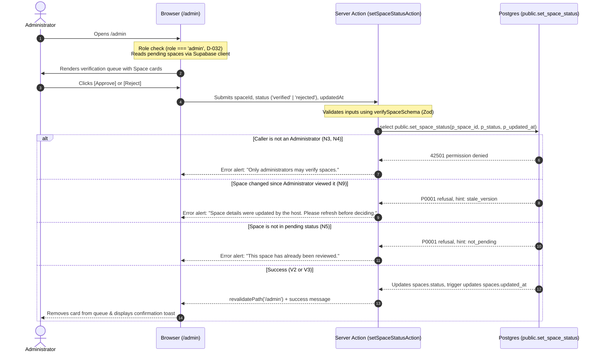

# STORY-15: Space verification (approve or reject)

**Status:** draft · **Owner:** @JamesNino-Mandawe (page and actions), @dreeyanzz (database function and policy) · **Story:** #166 · **FR:** FR-5.1 ·
**Depends on:** STORY-01, STORY-03, STORY-05 · **Flows:** [Space verification](../flows/space-verification.md), [Host setup journey](../flows/host-setup-journey.md) · **Decisions:** D-010, D-016, D-027, D-031, D-032, D-036, D-037, D-042, D-044, D-053, D-054, D-055, D-061, D-065

## 0. Scope

**In:**

- **Administrator portal shell and route access** (`app/(dashboard)/admin/layout.tsx`): protected portal layout accessible strictly by users with `role = 'admin'` (D-032, FR-5.1). Seekers and Hosts attempting to access `/admin` are redirected to their respective dashboards (`/seeker`, `/host`) via `evaluateRouteAccess` and the proxy layer. Unauthenticated visitors are redirected to `/login?returnUrl=%2Fadmin`.
- **Space verification queue view** (`app/(dashboard)/admin/page.tsx`): a dedicated administrative queue displaying every Space currently in `pending` status, ordered chronologically by creation timestamp (`created_at ASC`, FIFO review order).
- **Verification item card** (`app/(dashboard)/admin/_components/verification-card.tsx`): clearly displays essential venue details needed for manual verification: Space name, address, description, opening and closing hours (formatted in `Asia/Manila` time), Host contact identity (name and email), and submission date.
- **Immediate decision actions** (`app/(dashboard)/admin/actions.ts`): one-click `[Approve]` and `[Reject]` controls per pending Space that execute Server Actions (D-010). Approving sets status to `verified` (Move V2); rejecting sets status to `rejected` (Move V3).
- **Optimistic concurrency / freshness protection** (D-053): the Server Action passes the exact `updated_at` timestamp string retrieved when the page rendered. If a Host modified their Space while the Administrator was reviewing, the mutation is refused with a clear user prompt to refresh and inspect the updated details (N9).
- **Zod validation schema** (`lib/validation/verification.ts`): validates UUID format for `spaceId`, target status enum (`verified` or `rejected`), and timestamp string for `updatedAt`, with co-located Vitest unit tests (`lib/validation/verification.test.ts`).
- **Postgres function and pgTAP test suite:** Adrian implements `public.set_space_status` and writes `supabase/tests/03-space-verification.sql` (D-036, D-053) covering positive transitions (V2, V3) and negative denials (N2–N7, N9).
- **End-to-end journey tests:** Playwright test in `e2e/space-verification.spec.ts` verifying the Administrator login, queue listing, approval, rejection, and unauthorized access denials.

**Out:**

- **Rejection reasons and feedback to Host:** in Sprint 2, rejection is a direct status change with no mandatory reason input (D-037, D-054). Rejection reasons and re-submission workflows belong to STORY-14 in Sprint 3.
- **Editing Space details as an Administrator:** Administrators review and verify/reject, but cannot modify Host venue attributes (D-053, N6). Listing moderation belongs to STORY-14.
- **Reversing decisions or re-reviewing in Sprint 2:** once approved or rejected, a Space status never transitions again in Sprint 2 (D-054). Taking down a verified space or re-evaluating rejected spaces belongs to STORY-14.
- **Seat map layout and unit construction:** building zones and units belongs to STORY-07 (#56). Spaces enter the verification queue immediately upon creation, with or without units (D-054).
- **Public search discovery and profile presentation:** filtering verified spaces in search belongs to STORY-08 (#57); viewing the public Space profile belongs to STORY-11 (#76).

## 1. Flow

### Shared flows (D-044)

This story implements the Administrator verification moves defined in the [Space verification flow](../flows/space-verification.md) and [Host setup journey](../flows/host-setup-journey.md):

- **Move V2 (`pending` → `verified`):** an Administrator approves a Pending Space on `/admin`. Changes `spaces.status` to `verified`, making the Space visible in public search (STORY-08) and profile/holds (STORY-11, STORY-09).
- **Move V3 (`pending` → `rejected`):** an Administrator rejects a Pending Space on `/admin`. Changes `spaces.status` to `rejected`, keeping the Space hidden from Seekers and public search (D-055).
- **Enforced Denials:**
  - **N2:** No direct write to `spaces.status` is permitted; mutations must go through `public.set_space_status` (D-053).
  - **N3:** Hosts and Seekers cannot execute `public.set_space_status` (refused with `42501`).
  - **N4:** Signed-out visitors cannot execute `public.set_space_status`.
  - **N5:** Non-pending Spaces (already `verified` or `rejected`) cannot be moved in Sprint 2 (D-054).
  - **N6:** Administrators cannot update Host venue details directly.
  - **N7:** Seekers and anonymous visitors cannot read Pending or Rejected Spaces (D-055).
  - **N9:** An Administrator cannot decide a Space that changed after they loaded the page (concurrency check on `updated_at`, D-053).

### This story's own part



## 2. Data and state

### Tables and columns

This story operates on the `public.spaces` table established in STORY-01:

- `spaces.id` (`uuid`, primary key)
- `spaces.host_id` (`uuid`, references `profiles(id)`)
- `spaces.name` (`text`, not null)
- `spaces.description` (`text`, nullable)
- `spaces.address` (`text`, not null)
- `spaces.opens_at` (`time`, not null)
- `spaces.closes_at` (`time`, not null)
- `spaces.status` (`space_status`, enum: `'pending'`, `'verified'`, `'rejected'`, default `'pending'`)
- `spaces.created_at` (`timestamptz`, not null, default `now()`)
- `spaces.updated_at` (`timestamptz`, not null, default `now()`, maintained by `set_updated_at` trigger)

### State transitions

| From      | Event                           | To         | Precondition                                                                                           | Who                                  |
| --------- | ------------------------------- | ---------- | ------------------------------------------------------------------------------------------------------ | ------------------------------------ |
| `pending` | Move V2: Administrator approves | `verified` | Caller has `role = 'admin'`; Space is currently `pending`; `updated_at` matches current database value | Administrator via `set_space_status` |
| `pending` | Move V3: Administrator rejects  | `rejected` | Caller has `role = 'admin'`; Space is currently `pending`; `updated_at` matches current database value | Administrator via `set_space_status` |

In Sprint 2, once a Space transitions to `verified` or `rejected`, the decision is final and `spaces.status` never transitions again (D-054).

### Zod schemas (`lib/validation/verification.ts`)

```typescript
import { z } from 'zod'

export const spaceVerificationDecisionSchema = z.enum(['verified', 'rejected'], {
  error: 'Decision must be either verified or rejected',
})

export const verifySpaceSchema = z.object({
  spaceId: z.string().uuid({ error: 'Invalid Space ID' }),
  status: spaceVerificationDecisionSchema,
  updatedAt: z.string().min(1, { error: 'Timestamp is required for verification' }),
})

export type VerifySpaceInput = z.infer<typeof verifySpaceSchema>
```

### Database function specification (`public.set_space_status`)

Implemented by Adrian (@dreeyanzz) in `supabase/migrations/` (D-036, D-053):

- **Signature:** `public.set_space_status(p_space_id uuid, p_status space_status, p_updated_at timestamptz) returns void`
- **Security:** `security definer`, `set search_path = ''`.
- **Permissions:** Revoke all execution grants from `public` and `anon`. Grant execution strictly to `authenticated`.
- **Role verification:** Calls `private.has_role(auth.uid(), 'admin')`. If false, raises exception with SQLSTATE `42501` (insufficient privilege).
- **Target status validation:** Ensures `p_status in ('verified', 'rejected')`. If not, raises `P0001` with hint `invalid_target_status`.
- **Row lock & status check:** Queries `public.spaces` row `where id = p_space_id for update`.
  - If no row found or `status != 'pending'`, raises exception `P0001` with hint `not_pending` (N5).
  - If `updated_at != p_updated_at`, raises exception `P0001` with hint `stale_version` (N9).
- **Update:** Updates `status = p_status`. Postgres triggers automatically advance `updated_at` to `now()`.

## 3. UI and files

### User experience (Maria decides, D-042)

The Administrator verification experience lives at `/admin`:

1. **Header & Navigation:**
   - Consistent dashboard navigation bar (`AdminHeader`) with the Worq logo, a distinct "Administrator" badge (using badge design token), current user's name, and "Sign out" button.
2. **Page Header:**
   - Primary heading: "Space Verification" (`text-2xl font-bold`).
   - Summary description: "Review newly submitted spaces. Approved spaces become immediately visible in public search."
   - Active queue count: A badge indicating pending count (e.g., "3 pending").
3. **Queue Content:**
   - **Loading state:** Accessible skeleton cards displaying placeholder pulsing blocks matching card layout.
   - **Empty state:** When no pending spaces exist:
     - Icon: Check circle / Inbox icon.
     - Heading: "No pending spaces".
     - Subtitle: "All registered study spaces have been reviewed."
   - **Queue Card List:**
     - Each pending Space is rendered as a distinct card with clear visual separation.
     - **Header area:** Space name in prominent text (`text-lg font-semibold`), accompanied by a "Pending Review" pill tag.
     - **Metadata area:**
       - Address with location pin icon.
       - Operating hours: formatted daily opening and closing time (e.g., "Open daily: 08:00 – 22:00" or "Open 24 hours" if opening equals closing time, D-027).
       - Host information: "Host: [Full Name] ([Email])".
       - Submitted date: relative time formatted client-side (e.g., "Submitted 2 hours ago").
     - **Description area:** venue description reflowing gracefully without horizontal truncation.
     - **Action area:**
       - Two prominent action buttons aligned at the bottom right of the card:
         - **`[Reject]` Button:** destructive outline styling (`border-destructive text-destructive hover:bg-destructive/10`), minimum 48×48 px touch target.
         - **`[Approve]` Button:** primary styling (`bg-primary text-primary-foreground hover:bg-primary/90`), minimum 48×48 px touch target.
       - While an action is processing, both buttons on that card enter a disabled loading state displaying a spinner and accessible `aria-busy="true"`.
4. **Feedback & Concurrency Alerts:**
   - Success: On approval/rejection, the card transitions out of the queue and an accessible toast/banner confirms: `"[Space Name] has been approved"` or `"[Space Name] has been rejected"`.
   - Stale data alert: If the Space was edited by the Host after page load, an inline alert banner informs: `"Space details were updated by the host while you were reviewing. Please refresh the page to inspect the latest information."`

### Routes and components

| File                                                       | Type                    | Purpose                                                                  |
| ---------------------------------------------------------- | ----------------------- | ------------------------------------------------------------------------ |
| `app/(dashboard)/admin/layout.tsx`                         | Server Component        | Portal shell layout providing `AdminHeader` and role guard encapsulation |
| `app/(dashboard)/admin/page.tsx`                           | Server Component        | Fetches pending spaces and renders the verification queue                |
| `app/(dashboard)/admin/actions.ts`                         | Server Action           | Implements `setSpaceStatusAction` executing `public.set_space_status`    |
| `app/(dashboard)/admin/_components/admin-header.tsx`       | Server/Client Component | Navigation header with Administrator badge and profile/sign-out controls |
| `app/(dashboard)/admin/_components/verification-queue.tsx` | Client Component        | Manages queue list rendering, action states, and optimistic removal      |
| `app/(dashboard)/admin/_components/verification-card.tsx`  | Client Component        | Individual Space card with details, action triggers, and loading states  |
| `lib/validation/verification.ts`                           | Pure TS                 | Zod validation schema for verification actions                           |
| `lib/validation/verification.test.ts`                      | Vitest                  | Unit tests for Zod validation schema                                     |

### Accessibility (SRS §3.2.2, D-031)

- **Touch targets:** All interactive buttons (`[Approve]`, `[Reject]`, navigation links) are sized at least 48×48 px.
- **Keyboard navigation:** Complete tab order traversing through cards sequentially, with visible focus rings (`focus-visible:ring-2 focus-visible:ring-ring focus-visible:ring-offset-2`).
- **Contrast:** Text tokens maintain at least 4.5:1 contrast against surface backgrounds.
- **Screen reader announcements:** Action outcomes and error alerts utilize semantic `aria-live="polite"` regions.
- **Responsiveness:** Full layout reflows seamlessly at 360 px, 768 px, and 1024 px viewports without horizontal scrolling.

## 4. Security and test matrix

| Layer                | Case                                                                                   | Expected                                                                             |
| -------------------- | -------------------------------------------------------------------------------------- | ------------------------------------------------------------------------------------ |
| **pgTAP**            | Administrator approves a Pending Space (Move V2)                                       | Succeeds; `spaces.status` becomes `verified`; signed-out visitors can read the space |
| **pgTAP**            | Administrator rejects a Pending Space (Move V3)                                        | Succeeds; `spaces.status` becomes `rejected`; Seekers and visitors get 0 rows        |
| **pgTAP**            | Administrator cannot write `spaces.status` directly via `UPDATE spaces` (N2)           | Permission denied (`42501`)                                                          |
| **pgTAP**            | Host attempts to run `public.set_space_status` on their own Space (N3)                 | Permission denied (`42501`)                                                          |
| **pgTAP**            | Seeker attempts to run `public.set_space_status` (N3)                                  | Permission denied (`42501`)                                                          |
| **pgTAP**            | Anonymous caller attempts to run `public.set_space_status` (N4)                        | Execution denied by function grant                                                   |
| **pgTAP**            | Administrator attempts to decide a Space that is already `verified` or `rejected` (N5) | Refused with `P0001` hint `not_pending`                                              |
| **pgTAP**            | Administrator attempts to update a Host's Space details directly (N6)                  | Affects 0 rows (enforced by RLS)                                                     |
| **pgTAP**            | Seeker and signed-out visitor attempt to read a Rejected Space (N7)                    | Returns 0 rows (enforced by RLS)                                                     |
| **pgTAP**            | Administrator decides a Space with a stale `updated_at` timestamp (N9)                 | Refused with `P0001` hint `stale_version`                                            |
| **Vitest**           | Valid verification action payload (`spaceId`, `status`, `updatedAt`)                   | Zod schema parse succeeds                                                            |
| **Vitest**           | Invalid UUID or missing timestamp payload                                              | Zod schema parse fails with validation error                                         |
| **Vitest**           | Target status other than `verified` or `rejected`                                      | Zod schema parse fails with validation error                                         |
| **E2E (Playwright)** | Authenticated Administrator opens `/admin`, views pending spaces, and clicks Approve   | Space card disappears from queue; Space becomes public                               |
| **E2E (Playwright)** | Authenticated Administrator clicks Reject on a pending Space                           | Space card disappears from queue; Space remains hidden from public search            |
| **E2E (Playwright)** | Authenticated Seeker or Host navigates to `/admin`                                     | Redirected to `/seeker` or `/host` dashboard (D-032)                                 |
| **E2E (Playwright)** | Anonymous visitor navigates to `/admin`                                                | Redirected to `/login?returnUrl=%2Fadmin`                                            |

## 5. Tasks and estimates

These rows become the story's TSK sub-issues once this doc is merged:

| Task         | What                                                                                                           | Owner              | Points (1–10) | Days | Depends on         |
| ------------ | -------------------------------------------------------------------------------------------------------------- | ------------------ | ------------- | ---- | ------------------ |
| **TSK-15.1** | Database function `public.set_space_status` and pgTAP test suite in `supabase/tests/03-space-verification.sql` | @dreeyanzz         | 2             | 0.5  | None               |
| **TSK-15.2** | Verification Zod validation schema and unit tests in `lib/validation/verification.ts`                          | @JamesNino-Mandawe | 1             | 0.25 | None               |
| **TSK-15.3** | `/admin` portal shell layout, header, and verification queue UI components                                     | @JamesNino-Mandawe | 3             | 0.5  | TSK-15.2           |
| **TSK-15.4** | Server Actions for Approve/Reject and optimistic concurrency handling in `app/(dashboard)/admin/actions.ts`    | @JamesNino-Mandawe | 2             | 0.25 | TSK-15.1, TSK-15.3 |
| **TSK-15.5** | End-to-end Playwright journey tests (`e2e/space-verification.spec.ts`) and accessibility checks                | @JamesNino-Mandawe | 2             | 0.25 | TSK-15.4           |

## 6. Build order

One PR per row, and every PR targets `main`:

| #   | Branch                          | PR title                                                  | Contains                                                                       |
| --- | ------------------------------- | --------------------------------------------------------- | ------------------------------------------------------------------------------ |
| 1   | `feature/STORY-15-design`       | `docs(STORY-15): design space verification`               | Design doc in `docs/design/` and README index update                           |
| 2   | `feature/STORY-15-db-function`  | `feat(STORY-15): add set_space_status function and tests` | Migration, `public.set_space_status`, and `03-space-verification.sql` (Adrian) |
| 3   | `feature/STORY-15-validation`   | `feat(STORY-15): add verification schema and tests`       | `lib/validation/verification.ts` and `verification.test.ts` (James)            |
| 4   | `feature/STORY-15-admin-portal` | `feat(STORY-15): add admin portal shell and queue UI`     | `app/(dashboard)/admin/` layout, page, and components (James)                  |
| 5   | `feature/STORY-15-actions`      | `feat(STORY-15): wire approve and reject server actions`  | `actions.ts` wiring to Postgres function with error mapping (James)            |
| 6   | `feature/STORY-15-e2e`          | `test(STORY-15): add admin verification journey tests`    | Playwright journey in `e2e/space-verification.spec.ts` (James)                 |

## 7. Rejected alternatives

- **Direct table updates via RLS policy:** Granting column-level update permission on `spaces.status` to `admin` was considered in D-037. Rejected by D-053 because grants target Postgres roles (`authenticated`), which both Hosts and Administrators share. Postgres allows an update if any policy matches, which would allow Hosts to update their own space status. A `security definer` function strictly verifies the user's role via `private.has_role` and prevents unauthorized status writes.
- **Allowing Administrators to edit Space details during review:** Rejected by D-053. Admin listing moderation belongs to STORY-14. Keeping STORY-15 strictly scoped to approval/rejection ensures separation of concerns and maintains Host authorship integrity.
- **Client-side `Date` object parsing for optimistic locking:** Rejected by D-053. JavaScript `Date` truncates sub-millisecond microsecond precision, causing Postgres `timestamptz` comparisons to fail consistently. The exact ISO timestamp string returned by Postgres must be preserved and passed back without conversion.
- **Rejection reasons modal and appeal workflows in Sprint 2:** Rejected by D-037 and D-054. Space verification is focused on unblocking the Prefinal demo so newly registered spaces can reach public search. Rich rejection feedback, host notifications, and re-submission workflows are deferred to Sprint 3 in STORY-14.

## 8. Open questions

None. Decision D-061 and D-065 established the Administrator test account (`admin@example.test`) and credential distribution on the cloud development project, unblocking V2 and V3 testing for STORY-15.

## 9. After the build

_To be filled when the story is implemented._
