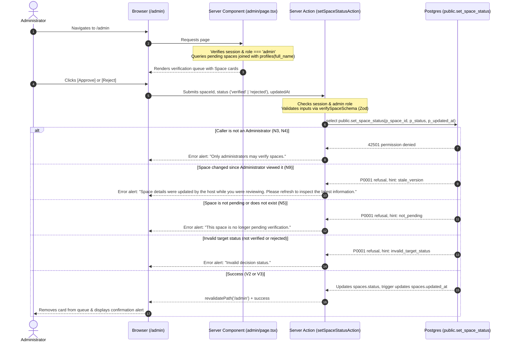

# STORY-15: Space verification (approve or reject)

**Status:** approved 2026-11-04 · **Owner:** @JamesNino-Mandawe (page and actions), @dreeyanzz (database function and policy) · **Story:** #166 · **FR:** FR-5.1 ·
**Depends on:** STORY-01, STORY-03, STORY-05 · **Flows:** [Space verification](../flows/space-verification.md), [Host setup journey](../flows/host-setup-journey.md) · **Decisions:** D-010, D-016, D-027, D-031, D-032, D-036, D-037, D-042, D-044, D-053, D-054, D-055, D-061, D-065

## 0. Scope

**In:**

- **Administrator portal shell and route access** (`app/(dashboard)/admin/layout.tsx`, `app/(dashboard)/admin/page.tsx`): protected portal layout accessible strictly by users with `role = 'admin'` (D-032, FR-5.1). Both `proxy.ts` (for page requests) and the Server Component in `page.tsx` verify the authenticated user's role via `evaluateRouteAccess`. Non-admin users are redirected to their designated dashboard (`/seeker` or `/host`); unauthenticated visitors are redirected to `/login?returnUrl=%2Fadmin`.
- **Space verification queue view** (`app/(dashboard)/admin/page.tsx`): a dedicated administrative queue displaying every Space currently in `pending` status, ordered chronologically by creation timestamp (`created_at ASC`, FIFO review order).
- **Verification item card** (`app/(dashboard)/admin/_components/verification-card.tsx`): clearly displays essential Space details needed for manual verification: Space name, address, description, daily hours formatted with midnight-crossing support, Host name (from `public.profiles(full_name)` with fallback to "Host: Unnamed"), and creation date in `Asia/Manila` time.
- **Immediate decision actions** (`app/(dashboard)/admin/actions.ts`): one-click `[Approve]` and `[Reject]` controls per pending Space that execute Server Actions (D-010). Approving sets status to `verified` (Move V2); rejecting sets status to `rejected` (Move V3). The Server Action checks the caller's session via `signedInClient()` and confirms the `admin` role.
- **Optimistic concurrency / freshness protection** (D-053): the Server Action passes the exact `updated_at` timestamp string retrieved when the page rendered (preserving full microsecond precision per the Space verification flow). If a Host modified their Space while the Administrator was reviewing, the mutation is refused with a clear user prompt to refresh and inspect the updated details (N9).
- **Shared Space formatting helpers** (`lib/space/format.ts`): shared utilities for formatting daily operating hours (including midnight-crossing and 24-hour Spaces, matching STORY-05's `hoursText`) and Manila timestamps, co-located with Vitest unit tests (`lib/space/format.test.ts`), shared between Host and Admin portals.
- **Zod validation schema** (`lib/validation/verification.ts`): reuses `spaceIdSchema` from `lib/validation/space.ts`, validates target status enum (`verified` or `rejected`), and validates the timestamp string for `updatedAt`, with co-located Vitest unit tests (`lib/validation/verification.test.ts`).
- **Postgres function and pgTAP test suite:** Adrian implements `public.set_space_status`, rewrites the comment on `spaces.status` in the migration and in `seed.sql`, regenerates `lib/supabase/database.types.ts`, and writes `supabase/tests/NN-space-verification.sql` (D-036, D-053) covering positive transitions (V2, V3), negative denials (N2–N7, N9), and the flow's V4 and refusal cases.
- **End-to-end journey tests:** Playwright test in `e2e/space-verification.spec.ts` where the test creates its own dedicated Space on `/host`, logs in as `admin@example.test`, views the queue on `/admin`, executes approval and rejection, and verifies status updates on `/host` and unauthorized route redirects. Also updates the stale `/admin` note in `e2e/smoke.spec.ts`.

**Out:**

- **Host contact email on card:** Emails live in `auth.users` and are not exposed via `public.profiles` (STORY-01). Who sees whose email is a call for Adrian and Luke, and is out of Sprint 2.
- **Rejection reasons and feedback to Host:** in Sprint 2, rejection is a direct status change with no mandatory reason input (D-037, D-054). Rejection reasons and re-submission workflows belong to STORY-14 in Sprint 3.
- **Editing Space details as an Administrator:** Administrators review and verify/reject, but cannot modify Host Space attributes (D-053, N6). Listing moderation belongs to STORY-14.
- **Reversing decisions or re-reviewing in Sprint 2:** once approved or rejected, a Space status never transitions again in Sprint 2 (D-054). Taking down a verified Space or re-evaluating rejected Spaces belongs to STORY-14.
- **Seat map layout and unit construction:** building zones and units belongs to STORY-07 (#56). Spaces enter the verification queue immediately upon creation, with or without units (D-054).
- **Public search discovery and profile presentation:** filtering verified Spaces in search belongs to STORY-08 (#57); viewing the public Space profile belongs to STORY-11 (#76).

## 1. Flow

### Shared flows (D-044)

This story implements the Administrator verification moves defined in the [Space verification flow](../flows/space-verification.md) and [Host setup journey](../flows/host-setup-journey.md):

- **Move V2 (`pending` → `verified`):** an Administrator approves a Pending Space on `/admin`. Changes `spaces.status` to `verified`, making the Space visible in public search (STORY-08) and profile/holds (STORY-11, STORY-09).
- **Move V3 (`pending` → `rejected`):** an Administrator rejects a Pending Space on `/admin`. Changes `spaces.status` to `rejected`, keeping the Space hidden from Seekers and public search (D-055).
- **Enforced Denials:**
  - **N2:** No direct write to `spaces.status` is permitted; mutations must go through `public.set_space_status` (D-053).
  - **N3:** Hosts and Seekers cannot execute `public.set_space_status` (refused with `42501`).
  - **N4:** Signed-out visitors cannot execute `public.set_space_status`.
  - **N5:** Non-pending Spaces (already `verified` or `rejected`) cannot be moved in Sprint 2 (D-054).
  - **N6:** Administrators cannot update Host Space details directly.
  - **N7:** Seekers and anonymous visitors cannot read Pending or Rejected Spaces (D-055).
  - **N9:** An Administrator cannot decide a Space that changed after they loaded the page (concurrency check on `updated_at`, D-053).

### This story's own part



## 2. Data and state

### Tables and columns

This story operates on the `public.spaces` table established in STORY-01:

- `spaces.id` (`uuid`, primary key)
- `spaces.host_id` (`uuid`, references `profiles(id)`)
- `spaces.name` (`text`, not null)
- `spaces.description` (`text`, nullable)
- `spaces.address` (`text`, not null)
- `spaces.opens_at` (`time`, not null)
- `spaces.closes_at` (`time`, not null)
- `spaces.status` (`space_status`, enum: `'pending'`, `'verified'`, `'rejected'`, default `'pending'`)
- `spaces.created_at` (`timestamptz`, not null, default `now()`)
- `spaces.updated_at` (`timestamptz`, not null, default `now()`, maintained by `set_updated_at` trigger)

STORY-15's migration updates the comment on `spaces.status`, which currently says STORY-14 changes it, to state:
`'Verification status: pending until an Administrator approves or rejects it on /admin (STORY-15, FR-5.1).'`.

### State transitions

| From      | Event                           | To         | Precondition                                                                                                                  | Who                                  |
| --------- | ------------------------------- | ---------- | ----------------------------------------------------------------------------------------------------------------------------- | ------------------------------------ |
| `pending` | Move V2: Administrator approves | `verified` | Caller has `role = 'admin'`; Space is currently `pending`; `p_updated_at` is not null and matches current `spaces.updated_at` | Administrator via `set_space_status` |
| `pending` | Move V3: Administrator rejects  | `rejected` | Caller has `role = 'admin'`; Space is currently `pending`; `p_updated_at` is not null and matches current `spaces.updated_at` | Administrator via `set_space_status` |

In Sprint 2, once a Space transitions to `verified` or `rejected`, the decision is final and `spaces.status` never transitions again (D-054).

### Zod schemas (`lib/validation/verification.ts`)

```typescript
import { z } from 'zod'
import { spaceIdSchema } from '@/lib/validation/space'

export const spaceVerificationDecisionSchema = z.enum(['verified', 'rejected'], {
  error: 'Decision must be either verified or rejected',
})

export const verifySpaceSchema = z.object({
  spaceId: spaceIdSchema,
  status: spaceVerificationDecisionSchema,
  updatedAt: z.string().min(1, { error: 'Timestamp is required for verification' }),
})

export type VerifySpaceInput = z.infer<typeof verifySpaceSchema>
```

### Database function specification (`public.set_space_status`)

Implemented by Adrian (@dreeyanzz) in `supabase/migrations/` (D-036, D-053):

- **Signature:** `public.set_space_status(p_space_id uuid, p_status space_status, p_updated_at timestamptz) returns void`
- **Security:** `security definer`, `set search_path = ''`.
- **Permissions:** Revoke all execution grants from `public` and `anon`. Grant execution strictly to `authenticated`.
- **Role check:** If not `(select private.has_role('admin'))`, raises exception with SQLSTATE `42501` (permission denied).
- **Target status check:** If `p_status is null or p_status not in ('verified', 'rejected')`, raises exception `P0001` with hint `invalid_target_status`.
- **Row query & lock:** Queries `public.spaces` row `where id = p_space_id for update`.
  - If `not found or status is distinct from 'pending'`, raises exception `P0001` with hint `not_pending` (N5).
  - If `p_updated_at is null or updated_at is distinct from p_updated_at`, raises exception `P0001` with hint `stale_version` (N9).
- **Update:** Updates `status = p_status`. Postgres triggers automatically advance `updated_at` to `now()`.

## 3. UI and files

### User experience (Maria decides, D-042)

The Administrator verification experience lives at `/admin`:

1. **Header & Navigation:**
   - Consistent dashboard navigation bar (`AdminHeader`) with the Worq logo, a distinct "Administrator" badge (using `badge` design token), current user's name, and "Log out" button (matching `/host` and `/seeker`).
2. **Page Header:**
   - Primary heading: "Space Verification" (`text-2xl font-bold`).
   - Summary description: "Review pending Spaces. Approved Spaces become immediately visible in public search."
   - Active queue count: A badge indicating pending count (e.g., "3 pending").
3. **Queue Content:**
   - **Loading state:** Rendered via `app/(dashboard)/admin/loading.tsx` with card placeholders with subtle pulsing backgrounds (`animate-pulse bg-muted/50 rounded-lg`).
   - **Error state:** If the queue query fails to load:
     - Inline alert: `"We could not load the verification queue. Refresh the page to try again."`
   - **Empty state:** When no pending Spaces exist:
     - Icon: Inbox icon (`lucide-react`).
     - Heading: `"No pending spaces"`.
     - Subtitle: `"All spaces have been reviewed."`
   - **Queue Card List:**
     - Each pending Space is rendered as an accessible card (`components/ui/card.tsx`).
     - **Header area:** Space name in prominent text (`text-lg font-semibold`), accompanied by a `"Pending verification"` badge (matching STORY-05).
     - **Metadata area:**
       - Address with location pin icon.
       - Daily hours: formatted via shared `hoursText` helper (e.g., "18:00 to 02:00 next day" or "Open 24 hours").
       - Host information: "Host: [Full Name]" (using `profiles(full_name)` with fallback to "Host: Unnamed" if full name is empty or null).
       - Created date: formatted in `Asia/Manila` time (e.g., "Nov 2, 2026, 18:00").
     - **Description area:** description reflowing gracefully without horizontal truncation.
     - **Action area:**
       - Two prominent action buttons aligned at the bottom right of the card:
         - **`[Reject]` Button:** destructive outline styling (`border-destructive text-destructive hover:bg-destructive/10`), minimum 48×48 px touch target.
         - **`[Approve]` Button:** primary styling (`bg-primary text-primary-foreground hover:bg-primary/90`), minimum 48×48 px touch target.
       - While an action is processing, both buttons on that card enter a disabled loading state displaying a spinner and accessible `aria-busy="true"`.
4. **Feedback & Concurrency Alerts:**
   - Success: On approval/rejection, the card transitions out of the queue and an accessible dismissible inline alert (`components/ui/alert.tsx`) confirms: `"[Space Name] has been approved"` or `"[Space Name] has been rejected"`.
   - Stale data alert: If the Space was edited by the Host after page load, an inline alert informs: `"Space details were updated by the host while you were reviewing. Please refresh to inspect the latest information."`
   - Non-pending alert: If the Space was already reviewed or deleted by the Host: `"This space is no longer pending verification."`

### Routes and components

| File                                                       | Type                    | Purpose                                                                                 |
| ---------------------------------------------------------- | ----------------------- | --------------------------------------------------------------------------------------- |
| `app/(dashboard)/admin/layout.tsx`                         | Server Component        | Portal shell layout providing `AdminHeader`                                             |
| `app/(dashboard)/admin/loading.tsx`                        | Server Component        | Card placeholder skeletons while the verification queue loads                           |
| `app/(dashboard)/admin/page.tsx`                           | Server Component        | Role check, fetches pending spaces joined with `profiles(full_name)`, and renders queue |
| `app/(dashboard)/admin/actions.ts`                         | Server Action           | `setSpaceStatusAction` checking session and executing `public.set_space_status`         |
| `app/(dashboard)/admin/_components/admin-header.tsx`       | Server/Client Component | Navigation header with Administrator badge, user name, and Log out controls             |
| `app/(dashboard)/admin/_components/verification-queue.tsx` | Client Component        | Manages queue list rendering, action states, and removing reviewed cards                |
| `app/(dashboard)/admin/_components/verification-card.tsx`  | Client Component        | Individual Space card with details, action triggers, and loading states                 |
| `app/(dashboard)/host/_components/space-list.tsx`          | Server Component        | Refactored to import shared hours and date formatters from `lib/space/format.ts`        |
| `lib/space/format.ts`                                      | Pure TS                 | Shared operating hours and Manila timestamp formatters (used by Host and Admin portals) |
| `lib/space/format.test.ts`                                 | Vitest                  | Unit tests for shared space formatting helpers                                          |
| `lib/validation/verification.ts`                           | Pure TS                 | Zod validation schema for verification actions (reusing `spaceIdSchema`)                |
| `lib/validation/verification.test.ts`                      | Vitest                  | Unit tests for Zod validation schema                                                    |

### Accessibility (SRS §3.2.2, D-031)

- **Touch targets:** All interactive buttons (`[Approve]`, `[Reject]`, navigation links) are sized at least 48×48 px.
- **Keyboard navigation:** Complete tab order traversing through cards sequentially, with visible focus rings (`focus-visible:ring-2 focus-visible:ring-ring focus-visible:ring-offset-2`).
- **Contrast:** Text tokens maintain at least 4.5:1 contrast against surface backgrounds.
- **Screen reader announcements:** Action outcomes and error alerts utilize semantic `aria-live="polite"` regions.
- **Responsiveness:** Full layout reflows seamlessly at 360 px, 768 px, and 1024 px viewports without horizontal scrolling.

## 4. Security and test matrix

| Layer                | Case                                                                                      | Expected                                                                             |
| -------------------- | ----------------------------------------------------------------------------------------- | ------------------------------------------------------------------------------------ |
| **pgTAP**            | an Administrator approves a Pending Space, and a signed-out visitor can read it (Move V2) | Succeeds; `spaces.status` becomes `verified`; signed-out visitors can read the Space |
| **pgTAP**            | an Administrator rejects a Pending Space, and a Seeker still cannot read it (Move V3)     | Succeeds; `spaces.status` becomes `rejected`; Seekers and visitors get 0 rows        |
| **pgTAP**            | a Host's edit leaves a Pending or a Rejected Space as it was (Move V4)                    | Succeeds; Space details update while `status` remains unchanged                      |
| **pgTAP**            | an Administrator cannot write status directly (N2)                                        | Permission denied (`42501`)                                                          |
| **pgTAP**            | a Host cannot approve or reject a Space, their own included (N3)                          | Permission denied (`42501`)                                                          |
| **pgTAP**            | a Seeker cannot approve or reject a Space (N3)                                            | Permission denied (`42501`)                                                          |
| **pgTAP**            | a signed-out visitor cannot run set_space_status (N4)                                     | Execution denied by function grant                                                   |
| **pgTAP**            | an Administrator cannot move a Verified or a Rejected Space (N5)                          | Refused with `P0001` hint `not_pending`                                              |
| **pgTAP**            | an Administrator cannot decide a Space that does not exist                                | Refused with `P0001` hint `not_pending`                                              |
| **pgTAP**            | an Administrator cannot set status to pending, or to no status (null)                     | Refused with `P0001` hint `invalid_target_status`                                    |
| **pgTAP**            | an Administrator updating a Host's space affects 0 rows (N6)                              | Affects 0 rows (enforced by RLS)                                                     |
| **pgTAP**            | a Seeker and a signed-out visitor cannot read a Rejected Space (N7)                       | Returns 0 rows (enforced by RLS)                                                     |
| **pgTAP**            | an Administrator cannot decide a Space that changed since they read it (N9)               | Refused with `P0001` hint `stale_version`                                            |
| **pgTAP**            | an Administrator cannot decide a Space when passing a null updated_at timestamp           | Refused with `P0001` hint `stale_version`                                            |
| **Vitest**           | Valid verification action payload (`spaceId`, `status`, `updatedAt`)                      | Zod schema parse succeeds                                                            |
| **Vitest**           | Invalid UUID or missing timestamp payload                                                 | Zod schema parse fails with validation error                                         |
| **Vitest**           | Target status other than `verified` or `rejected`                                         | Zod schema parse fails with validation error                                         |
| **Vitest**           | Shared `hoursText` formatting for 24-hour Spaces and overnight closing times              | Matches expected formatted strings                                                   |
| **E2E (Playwright)** | Authenticated Administrator approves a newly created Space on `/admin`                    | Space card leaves queue; Space status shows Verified on `/host`                      |
| **E2E (Playwright)** | Authenticated Administrator rejects a newly created Space on `/admin`                     | Space card leaves queue; Space status shows Rejected on `/host`                      |
| **E2E (Playwright)** | Authenticated Seeker or Host navigates to `/admin`                                        | Redirected to `/seeker` or `/host` dashboard (D-032)                                 |
| **E2E (Playwright)** | Anonymous visitor navigates to `/admin`                                                   | Redirected to `/login?returnUrl=%2Fadmin`                                            |

## 5. Tasks and estimates

These rows become the story's TSK sub-issues once this doc is merged. Estimates total exactly **3 points and 1.5 days** (matching Issue #166 and the Sprint 2 plan):

| Task         | What                                                                                                                                                                                        | Owner              | Points (1–10) | Days | Depends on         |
| ------------ | ------------------------------------------------------------------------------------------------------------------------------------------------------------------------------------------- | ------------------ | ------------- | ---- | ------------------ |
| **TSK-15.1** | Database function `public.set_space_status`, status comment update in migration and `seed.sql`, `db:types` regeneration, and pgTAP test suite in `supabase/tests/NN-space-verification.sql` | @dreeyanzz         | 1             | 0.5  | This design merged |
| **TSK-15.2** | Shared Space formatting helpers (`lib/space/format.ts`), refactoring `space-list.tsx` to use them, verification Zod schema (`lib/validation/verification.ts`), and unit tests               | @JamesNino-Mandawe | 1             | 0.25 | This design merged |
| **TSK-15.3** | `/admin` portal shell layout, `loading.tsx`, queue UI, Server Actions, smoke test comment update, and Playwright journey tests (`e2e/space-verification.spec.ts`)                           | @JamesNino-Mandawe | 1             | 0.75 | TSK-15.1, TSK-15.2 |

## 6. Build order

One PR per row, and every PR targets `main`:

| #   | Branch                          | PR title                                                   | Contains                                                                                                                                               |
| --- | ------------------------------- | ---------------------------------------------------------- | ------------------------------------------------------------------------------------------------------------------------------------------------------ |
| 1   | `feature/STORY-15-design`       | `docs(STORY-15): design space verification`                | Design doc in `docs/design/` and README index update                                                                                                   |
| 2   | `feature/STORY-15-db-function`  | `feat(STORY-15): add set_space_status function and tests`  | TSK-15.1: Migration, `public.set_space_status`, status comment updates in migration & `seed.sql`, `db:types`, and `NN-space-verification.sql` (Adrian) |
| 3   | `feature/STORY-15-validation`   | `feat(STORY-15): add verification schema and formatters`   | TSK-15.2: `lib/space/format.ts`, refactored `space-list.tsx`, `lib/validation/verification.ts`, and unit tests (James)                                 |
| 4   | `feature/STORY-15-admin-portal` | `feat(STORY-15): add admin portal, actions, and e2e tests` | TSK-15.3: `/admin` portal, `loading.tsx`, queue UI, Server Actions, and Playwright tests (James)                                                       |

## 7. Rejected alternatives

- **Direct table updates via RLS policy:** Granting column-level update permission on `spaces.status` to `admin` was considered in D-037. Rejected by D-053 because grants target Postgres roles (`authenticated`), which both Hosts and Administrators share. Postgres allows an update if any policy matches, which would allow Hosts to update their own space status. A `security definer` function strictly verifies the user's role via `(select private.has_role('admin'))` and prevents unauthorized status writes.
- **Allowing Administrators to edit Space details during review:** Rejected by D-053. Admin listing moderation belongs to STORY-14. Keeping STORY-15 strictly scoped to approval/rejection ensures separation of concerns and maintains Host authorship integrity.
- **Client-side `Date` object parsing for optimistic locking:** Rejected by the Space verification flow ("The function"). JavaScript `Date` truncates sub-millisecond microsecond precision, causing Postgres `timestamptz` comparisons to fail consistently. The exact ISO timestamp string returned by Postgres must be preserved and passed back without conversion.
- **Rejection reasons modal and appeal workflows in Sprint 2:** Rejected by D-037 and D-054. Space verification is focused on unblocking the Prefinal demo so newly registered spaces can reach public search. Rich rejection feedback, host notifications, and re-submission workflows are deferred to Sprint 3 in STORY-14.

## 8. Open questions

None. Decision D-061 and D-065 established the Administrator test account (`admin@example.test`) and credential distribution on the cloud development project, unblocking V2 and V3 testing for STORY-15.

## 9. After the build

- During TSK-15.2 build (#225), corrected §3 table entry for `space-list.tsx` to Server Component (matches `main`, renders within Host page Server Component, and contains no `'use client'`).
