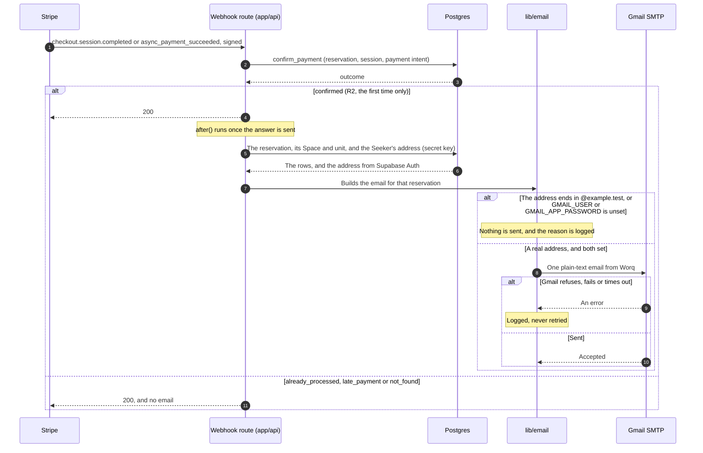

# STORY-16: Reservation history, Hold again and the confirmation email

**Status:** draft · **Owner:** @dreeyanzz (database and email), @lukedongque (pages and
screens) · **Story:** #335 · **FR:** none (a Sprint 3 addition, D-075) · **Depends on:**
STORY-09, STORY-10, STORY-11, STORY-13, STORY-14 · **Flows:**
[Reservation lifecycle](../flows/reservation-lifecycle.md),
[Sandbox payment confirmation](../flows/sandbox-payment-confirmation.md),
[Review lifecycle](../flows/review-lifecycle.md) · **Decisions:** D-001, D-010, D-013,
D-047, D-055, D-073 to D-075, D-077, D-081, D-083, D-089

A Seeker reads their past reservations on `/seeker/reservations`: every one they paid
for, newest first, with how it ended and what happened to the fee. From a past
reservation, Hold again opens the Space's profile with the same unit picked (D-077), and
a visit with no review offers Leave a review. When a payment confirms a hold, Worq emails
the Seeker once, through a team Gmail account (D-089). Adrian builds the database half
and the email, and Luke builds the pages and writes §3's screens (D-073, D-075).

## 0. Scope

**In:**

- **The history read (Adrian):** `public.my_reservation_history`, with its pgTAP tests in
  `supabase/tests/NN-reservation-history.sql`, and `db:types`.
- **The confirmation email (Adrian):** `lib/email/`, sent from the Stripe webhook route
  after it answers, through Gmail's SMTP with `nodemailer`, a new dependency (D-089), and
  its Vitest tests with a fake transport.
- **The pages (Luke):** the history page on `/seeker/reservations`, Hold again, the
  profile's line saying why the unit can't be held, Leave a review and Edit your review in
  a dialog, the Seeker portal's link to the history, and their Vitest and Playwright
  tests.

**Out:**

- **Holding for later** (D-001). Hold again never holds anything by itself (D-077).
- **The review form and its actions** (STORY-13). This story opens them from the history.
- **Unpaid holds that lapsed or were cancelled at the checkout.** No money moved, so the
  history leaves them out.
- **Any email but the hold confirmation:** no email for a refund, a take-down, a review
  or a report (D-080, D-085, D-088).
- **Retrying a failed email** (D-089).
- **The final look** (STORY-17). Maria and James review these screens once built (D-073,
  D-074).

## 1. Flow

### Shared flows (D-044)

- **[Reservation lifecycle](../flows/reservation-lifecycle.md)** (#173): the history reads
  ended reservations and their payments, through a function that records lapses first
  (D-047). It makes no move.
- **[Sandbox payment confirmation](../flows/sandbox-payment-confirmation.md)** (#175): the
  email is sent after R2, when `confirm_payment` answers `confirmed`. A repeated event
  (`already_processed`) or a late payment (`late_payment`, P2) sends nothing.
- **[Review lifecycle](../flows/review-lifecycle.md)** (#339): Leave a review is RV1 and
  Edit your review is RV2, through STORY-13's form and actions. The history is how a
  Seeker reviews a visit to a Space that isn't Verified (D-081).

### This story's own part

The confirmation email. The history and Hold again are plain reads, which §2 and §3
describe.



## 2. Data and state

No table or column is added. The history reads what STORY-09, STORY-10, STORY-13 and
STORY-14 store.

### `public.my_reservation_history(p_page_size integer default 20, p_page_offset integer default 0)`

`security definer`, empty `search_path`. Execute is revoked from `public`, `anon` and
`authenticated`, then granted to `authenticated` only (D-047).

- It records lapses first, for the units of the caller's active holds (D-047), so a hold
  whose wait window has lapsed reads as a no-show.
- It returns the caller's own reservations that have ended (`expired`, `no_show`,
  `completed` or `cancelled`) and whose payment isn't `pending`. That is every hold they
  paid for, and never an unpaid one. Newest first, by when it was held. `p_page_size` is
  clamped to 1 to 101, one more than the 100 the page shows at most, so the page can tell
  whether there are more. `p_page_offset` is clamped to 0 or more.
- Each row has:
  - the reservation's id, status, `created_at`, `checked_in_at` and `ended_at`;
  - its Space's id and name, and `space_listed`, whether the Space is Verified now;
  - its unit's id, null once the unit was removed (D-052), and its `unit_label`;
  - its payment's status and fee, and when it was refunded;
  - for a visit, its review's id and status, if it has one.
- Anyone else, a Host or an Administrator included, gets only their own reservations,
  which for them is none.

### The confirmation email (`lib/email/`, Adrian)

- **`lib/email/transport.ts`:** `sendMail({ to, subject, text })`, through `nodemailer`
  to `smtp.gmail.com` on port 465 with TLS, as `GMAIL_USER` with `GMAIL_APP_PASSWORD`,
  from "Worq <GMAIL_USER>". Server only. When either variable is unset, it sends nothing
  and says so.
- **`lib/email/hold-confirmation.ts`:** builds the email for one reservation, and decides
  whether to send it:
  - It skips an address ending in `@example.test` (D-013): every seeded and test account.
  - It skips a missing or empty address, which `auth.admin.getUserById` can return for a
    deleted account, and logs why.
  - **Subject:** "Your hold at Kapihan Study Hall is confirmed".
  - **Body, plain text:** the Space, the unit, when the wait window ends in Asia/Manila
    time (STORY-09's `formatManilaTime`), and the link to the hold page,
    `<origin>/seeker/reservations/<id>`, where the QR code is. It never contains the
    booking token (D-089). Plain text means a Space's name can't inject markup.
  - It takes its inputs as plain values, so it has no database or session of its own.
- **The webhook route** (`app/api/webhooks/stripe/route.ts`): when the outcome is
  `confirmed`, it calls Next's `after()`, so the email waits until Stripe has its answer.
  Inside, it reads the reservation, the Space, the unit and `wait_window_ends_at` with
  the secret-key client, and the Seeker's address with `auth.admin.getUserById`. Both
  are allowed only in `app/api` (D-007). `<origin>` is the webhook request's own origin,
  so the link points at the deployment Stripe called. Any error is logged, and the
  webhook's answer to Stripe never depends on the email.

### Environment values

| Name                 | Where                                                                                                                                                                    |
| -------------------- | ------------------------------------------------------------------------------------------------------------------------------------------------------------------------ |
| `GMAIL_USER`         | Server only. The team Gmail address. In Vercel's Production environment, and optional in `.env.local`                                                                    |
| `GMAIL_APP_PASSWORD` | Server only. The account's app password. In Vercel's Production environment only, and in Adrian's `.env.local` for trying it. Never in Preview, CI, code or chat (D-089) |

Adrian creates the account for the team, turns on 2-Step Verification and makes the app
password. The address is shared with the team, and the password isn't. TSK-16.2 adds both
to `DEVELOPMENT.md`.

### Form rules (`lib/validation/history.ts`, Luke)

- **`historyPageSchema`**, from the page's search params: how many are shown, in steps of
  20 up to 100. Anything else falls back to 20.

The review dialog reuses STORY-13's `postReviewSchema` and `editReviewSchema`.

## 3. UI and files

### Screens

1. **Seeker portal link (`app/(dashboard)/seeker/page.tsx`):**
   - Renders a `"Reservation history"` card on `/seeker` with a 48 × 48 px `"View reservation history"` link to `/seeker/reservations` and summary copy `"See past paid holds, hold the same unit again, or leave a review."`
2. **History page (`/seeker/reservations`):**
   - **Navigation & header:** 48 × 48 px `"Back to dashboard"` breadcrumb link to `/seeker`, `h1` `"Reservation history"`, and subtitle `"Every reservation you paid for after it ended, newest first."`
   - **Loading, empty, and error states:**
     - `app/(dashboard)/seeker/reservations/loading.tsx` renders skeleton cards (`animate-pulse`).
     - **Empty state:** Heading `"No past reservations yet"` and body `"Your completed, cancelled, and refunded holds will appear here."` with a 48 × 48 px `"Find a Space"` link to `/spaces`.
     - **Error state:** Inline alert `"We couldn't load your reservation history. Refresh the page to try again."`
   - **Past reservation row (`HistoryRow`):**
     - Displays Space name (linked to `/spaces/[spaceId]` when `space_listed`, plain text otherwise), unit label (with `"(removed)"` when `unit_id` is null), and held timestamp in `Asia/Manila` (e.g., `"Nov 18, 2026, 14:00"`).
     - Outcome wording (always words, never colour alone):
       - `completed`: `"Visit completed"`
       - `no_show`: `"Missed check-in (no-show)"`
       - `cancelled`: `"Hold cancelled"`
       - `expired` (P2 late payment): `"Payment arrived after hold ended"`
     - Fee fate wording (`formatPeso`):
       - `paid`: `"₱50.00 paid"`
       - `forfeited`: `"₱50.00 forfeited"`
       - `refunded`: `"₱50.00 refunded"` (with `refunded_at` date in `Asia/Manila`)
     - **Hold again action:**
       - If `!space_listed`: displays `"This Space isn't listed right now"` instead of a button (D-055).
       - Else if `unit_id === null`: 48 × 48 px `"Hold again"` link to `/spaces/${spaceId}?from=history&unit_removed=1`.
       - Else: 48 × 48 px `"Hold again"` link to `/spaces/${spaceId}?unit=${unitId}&from=history`.
     - **Review action (only when `checked_in_at !== null`):**
       - No review yet: 48 × 48 px `"Leave a review"` button opening `ReviewDialog` in create mode.
       - `review_status === 'visible'`: displays `"Reviewed"` alongside a 48 × 48 px `"Edit your review"` button opening `ReviewDialog` in edit mode.
       - `review_status === 'hidden'`: displays `"Review hidden by an Administrator"` (no edit button, D-080).
       - `review_status === 'removed'`: displays `"Review removed by an Administrator"` (no edit button, D-080).
   - **Pagination (`"Show more"`):**
     - Reads `?show=20|40|60|80|100` (default `20`). If `hasMore` and `shown < 100`, renders a 48 × 48 px `"Show more"` link (`?show=${shown + 20}`). At 100 when `hasMore`, replaces the button with `"Showing your newest 100 past reservations."`
3. **Hold again on the Space profile (`app/(public)/spaces/[spaceId]/page.tsx`):**
   - Never holds anything by itself (D-001, D-077). When `from=history`:
     - **Space closed (`!operatingStatus.isOpen`):** `SpaceProfilePage` already renders `data-testid="seeker-space-closed"` (`"This Space is closed now"`). Do **not** render a second closed banner; instead adjust that existing alert when `from=history` to add `"You can't hold that unit while the Space is closed."` so only one closed alert appears.
     - **Unit removed (`unit_removed=1` or `?unit=<id>` does not match any unit in `zones`):** Renders an announced `Alert` (`data-testid="hold-again-notice"`, `role="status"`) above the seat map: `"The unit you held before was removed. Pick another Available unit below."`
     - **Unit taken (`selectedUnit` exists, Space is open, and `selectedUnit.seatState !== 'available'`):** Renders `data-testid="hold-again-notice"` above the seat map: `"{unit.label} is taken right now ({stateLabel}). Pick another Available unit below."`
     - **Unit available (`selectedUnit` exists, Space is open, and `selectedUnit.seatState === 'available'`):** No `hold-again-notice` error banner; `HoldUnitPanel` opens pre-selected for `?unit=<id>` as usual.
4. **Leave a review and Edit your review dialog (`ReviewDialog`):**
   - Uses `Dialog` from `components/ui/dialog.tsx` (focus-trapped; Escape or `"Cancel"` closes and returns focus to the trigger button).
   - Title `"Leave a review — {spaceName}"` or `"Edit your review — {spaceName}"`.
   - Embeds STORY-13's `components/review/review-form.tsx` wired to `postReviewAction` or `editReviewAction` (passing `spaceId`, `reservationId` or `reviewId`, and existing values when editing).
   - On success: closes dialog, calls `router.refresh()` so `/seeker/reservations` immediately reflects `"Reviewed"` / `"Edit your review"`, and announces `"Review posted."` / `"Review updated."` in an `aria-live="polite"` region. On error, displays the `§1` refusal or validation message inside the dialog.

Already-decided rules followed above: D-001, D-055, D-077, D-080, and D-081.

### Routes and components

| File                                                                | Type                 | Purpose                                                                                                                                     |
| ------------------------------------------------------------------- | -------------------- | ------------------------------------------------------------------------------------------------------------------------------------------- |
| `app/(dashboard)/seeker/reservations/page.tsx`                      | Server Component     | The history: reads `my_reservation_history` and the Seeker's own reviews for the rows shown                                                 |
| `app/(dashboard)/seeker/reservations/loading.tsx`                   | Server Component     | Card placeholder skeletons while the reservation history loads                                                                              |
| `app/(dashboard)/seeker/reservations/_components/history-row.tsx`   | Server Component     | One past reservation, outcome/fee labels, Hold again link, and review state/trigger                                                         |
| `app/(dashboard)/seeker/reservations/_components/review-dialog.tsx` | Client Component     | Modal on `components/ui/dialog.tsx`, for Leave a review and Edit your review, using `review-form.tsx`, `router.refresh()`, and `aria-live`  |
| `components/ui/dialog.tsx`                                          | New primitive        | `npx shadcn add dialog`, shared with STORY-13's report and STORY-14's refund dialogs. The first task that needs it adds it                  |
| `app/(dashboard)/seeker/page.tsx`                                   | Changed              | Adds the `"Reservation history"` card with a 48 × 48 px link to `/seeker/reservations`                                                      |
| `app/(public)/spaces/[spaceId]/page.tsx`                            | Changed              | Reads `from=history`, `unit_removed`, and unresolved `unit=<id>`, and shows one notice above the seat map without duplicating closed alerts |
| `lib/data/history.ts`                                               | Server-only          | `getReservationHistory`, one more row than the page shows, to know if there are more                                                        |
| `lib/validation/history.ts`                                         | Pure TS              | The form rule in §2                                                                                                                         |
| `lib/email/transport.ts`, `lib/email/hold-confirmation.ts`          | Server-only (Adrian) | §2's email                                                                                                                                  |
| `app/api/webhooks/stripe/route.ts`                                  | Changed (Adrian)     | Schedules the email with `after()` on `confirmed`                                                                                           |

### Where the files go

```
app/(dashboard)/seeker/reservations/page.tsx, loading.tsx
app/(dashboard)/seeker/reservations/_components/history-row.tsx, review-dialog.tsx
components/ui/dialog.tsx
app/(dashboard)/seeker/page.tsx
app/(public)/spaces/[spaceId]/page.tsx
app/api/webhooks/stripe/route.ts
lib/data/history.ts
lib/validation/history.ts
lib/email/transport.ts, hold-confirmation.ts
supabase/migrations/<timestamp>_reservation_history.sql
supabase/tests/NN-reservation-history.sql
e2e/history.spec.ts
```

### Accessibility (SRS §3.2.2, D-031)

- Every control is at least 48 × 48 px and works from the keyboard alone, and the review
  dialog keeps focus inside it until it closes.
- How a reservation ended and the fee's fate are words, never colour alone.
- The profile's line saying why the unit can't be held is announced, like the other
  alerts there.
- No horizontal scrolling at 360, 768 and 1024 px, and nothing clipped with text at 200%.

## 4. Security and test matrix

| Layer      | Case                                                                                                                                                                                         | Expected                             |
| ---------- | -------------------------------------------------------------------------------------------------------------------------------------------------------------------------------------------- | ------------------------------------ |
| pgTAP      | "a Seeker reads their paid, ended reservations, newest first"                                                                                                                                | As described                         |
| pgTAP      | "another Seeker and a Host get 0 rows of someone else's history"                                                                                                                             | 0 rows                               |
| pgTAP      | "an unpaid hold that lapsed or was cancelled isn't listed, and neither is an active hold"                                                                                                    | Not listed                           |
| pgTAP      | "a hold whose wait window lapsed reads as a no-show, with its fee forfeited"                                                                                                                 | `no_show`, `forfeited`               |
| pgTAP      | "a removed unit keeps its label and has no unit id"                                                                                                                                          | As described                         |
| pgTAP      | "a Space that isn't Verified reads as not listed"                                                                                                                                            | `space_listed` false                 |
| pgTAP      | "a visit shows its review's status, and a refunded fee when it was refunded"                                                                                                                 | As described                         |
| pgTAP      | "a signed-out visitor cannot run my_reservation_history"                                                                                                                                     | `42501`                              |
| pgTAP      | "my_reservation_history clamps a page size of 500 to 101, and a negative offset to 0"                                                                                                        | 101 rows at most, from the first     |
| Vitest     | The email is built with the Space, the unit, the Manila time and the hold page's link, and never the booking token                                                                           | As described                         |
| Vitest     | No email for an `@example.test` address or a missing one, or when `GMAIL_USER` or `GMAIL_APP_PASSWORD` is unset                                                                              | Nothing sent, the reason logged      |
| Vitest     | The webhook schedules the email only for `confirmed`, never for `already_processed`, `late_payment` or `not_found`, and answers Stripe the same whether the email succeeds or fails          | As described                         |
| Vitest     | A transport error is logged and not retried                                                                                                                                                  | One attempt                          |
| Vitest     | The history page's param falls back to 20; the profile's line for a taken unit, a closed Space and a removed unit                                                                            | As described                         |
| Playwright | `e2e/history.spec.ts`: a Seeker with a finished visit sees it in the history, leaves a review from there, and edits it                                                                       | As described                         |
| Playwright | `e2e/history.spec.ts`: Hold again opens the profile with the unit picked when it is Available, and says why when it is taken                                                                 | As described                         |
| Playwright | `e2e/history.spec.ts`: a visit to a Space that isn't listed shows no Hold again, and can still be reviewed                                                                                   | As described                         |
| Manual     | With `GMAIL_USER` and `GMAIL_APP_PASSWORD` in `.env.local` and `npm run stripe:listen`, a hold paid by a Seeker signed up with a real address sends one email, and a resent event sends none | One email                            |
| Manual     | The history and the dialog at 360, 768 and 1024 px, with text at 200%, and with the keyboard alone                                                                                           | No clipping, every control reachable |

The Playwright spec makes its own Space, visits and paid holds, and removes them after,
as `e2e/seeker-journey.spec.ts` does. Its accounts are `@example.test`, so it never sends
an email.

## 5. Tasks and estimates

These rows become the story's TSK sub-issues once this doc is merged. They total the
story's **6 points and 3 days**: 3 points for the database and the email, and 3 for the
pages.

| Task     | What                                                                                                                                                                 | Owner        | Points (1–10) | Days | Depends on                             |
| -------- | -------------------------------------------------------------------------------------------------------------------------------------------------------------------- | ------------ | ------------- | ---- | -------------------------------------- |
| TSK-16.1 | `my_reservation_history`, with its pgTAP tests (AGENTS.md rule 5), and `db:types`                                                                                    | @dreeyanzz   | 1             | 0.5  | This design merged, TSK-13.1, TSK-14.2 |
| TSK-16.2 | The email: `lib/email/`, `nodemailer`, the webhook's `after()`, the skip rules and their Vitest tests, and `GMAIL_USER` and `GMAIL_APP_PASSWORD` in `DEVELOPMENT.md` | @dreeyanzz   | 2             | 1    | This design merged                     |
| TSK-16.3 | The history page, its reads and form rule, and the portal's link, with Vitest tests                                                                                  | @lukedongque | 1             | 0.5  | TSK-16.1                               |
| TSK-16.4 | Hold again, the profile's line saying why, and the review dialog                                                                                                     | @lukedongque | 1             | 0.5  | TSK-16.3, TSK-13.4                     |
| TSK-16.5 | `e2e/history.spec.ts`                                                                                                                                                | @lukedongque | 1             | 0.5  | TSK-16.4                               |

TSK-16.1 needs STORY-13's `reviews` table for each visit's review state (TSK-13.1), and
STORY-14's `payments.refunded_at` for when a fee was refunded (TSK-14.2). TSK-16.2 needs
nothing else, so the email can land first. Luke can build the history page against
sample data before TSK-16.1 merges.

## 6. Build order

One PR per row, and every PR targets `main`.

| #   | Branch                          | PR title                                                      | Contains                                       |
| --- | ------------------------------- | ------------------------------------------------------------- | ---------------------------------------------- |
| 1   | `feature/STORY-16-design`       | `docs(STORY-16): design reservation history and the email`    | This doc, the index, D-089, stale docs         |
| 2   | `feature/STORY-16-email`        | `feat(STORY-16): email the seeker when a hold is confirmed`   | TSK-16.2 (Adrian)                              |
| 3   | `feature/STORY-16-history-db`   | `feat(STORY-16): read a seeker's reservation history`         | TSK-16.1 (Adrian), after TSK-13.1 and TSK-14.2 |
| 4   | `feature/STORY-16-history-page` | `feat(STORY-16): list past reservations on the seeker portal` | TSK-16.3 (Luke)                                |
| 5   | `feature/STORY-16-hold-again`   | `feat(STORY-16): hold again and review from the history`      | TSK-16.4 (Luke), after TSK-13.4                |
| 6   | `feature/STORY-16-history-e2e`  | `test(STORY-16): walk the reservation history in Playwright`  | TSK-16.5 (Luke)                                |

## 7. Rejected alternatives

- **Listing unpaid holds too, or only visits:** an unpaid hold that lapsed is noise, and a
  no-show or a refund is exactly what a Seeker checks their history for.
- **Leave a review linking to the Space profile:** a Space that isn't Verified reads as
  not found (D-055), and the history is how its visits get reviewed (D-081).
- **Deciding Hold again's outcome in the history:** availability changes by the minute,
  so the profile decides with today's state, as D-077 says. The history decides only what
  the profile can't show: a Space that isn't listed and a removed unit.
- **The booking token or its QR code in the email,** **sending from Preview deployments,**
  **retrying a failed send,** **Resend without a domain,** and **a teammate's personal
  Gmail** (D-089).
- **Sending the email before the webhook answers Stripe:** a slow SMTP server would delay
  Stripe's answer, and Stripe retries a webhook that answers late. `after()` keeps them
  apart.
- **An HTML email:** a Space's name, which a Host writes, would need escaping, and the
  email says four things.

## 8. Open questions

None blocking. Adrian creates the team Gmail account and its app password before
TSK-16.2's manual check (D-089). Luke's screens section may move a file or rename a
component in §3, recorded on this branch.

## 9. After the build

Filled in when the story is done.
