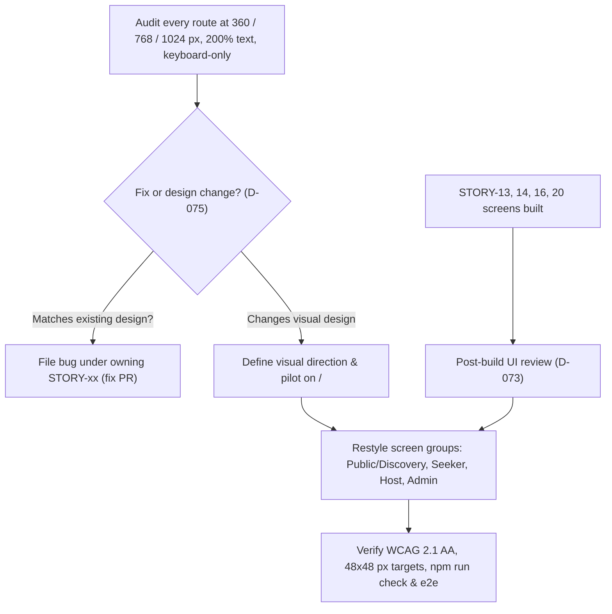

# STORY-17: UI/UX refresh

**Status:** draft · **Owner:** @fayeye-09, @JamesNino-Mandawe · **Story:** #336 · **FR:** SRS §3.2.1, §3.2.2, §3.7.1 ·
**Depends on:** none to start (post-build review waits for STORY-13, STORY-14, STORY-16, STORY-20) · **Flows:** none (UI/UX only; D-074) · **Decisions:** D-031, D-042, D-073, D-074, D-075

## 0. Scope

**In:**

- Route-by-route UI/UX audit across the existing app at 360, 768 and 1024 px, with text at 200% and with the keyboard only.
- Sorting each audit finding per D-075: a **fix** (making a screen match its merged design) is filed as a bug under the story that built the screen; a **design change** belongs here.
- Visual direction and pilot restyle on the public landing page and shell (`/`), including the startup desk lamp overlay, hero composition, header, and footer.
- Group-by-group restyle of existing screens: public/discovery/auth, Seeker portal and booking/hold pages, Host portal, and Administrator portal.
- Post-build UI review and restyle of Sprint 3 feature screens (STORY-13, STORY-14, STORY-16, STORY-20) once built (D-073).
- Updating any unit or Playwright tests broken by restyled markup or copy in the same pull request.

**Out:**

- What the system allows and stores, database schemas, RLS policies, Server Action contracts, and new product features (D-042).
- Bug fixes that only bring a screen into compliance with its already-merged design (handled as `fix(STORY-xx)` under the owning story, D-075).
- Adding a dark theme or replacing the Worq design tokens (D-031).

## 1. Flow

**Shared flows** (D-044): STORY-17 does not alter any shared flow in [`docs/flows/`](../flows/README.md). Every user journey, route, and Server Action contract remains intact; where Maria or James restyle a screen, what they built becomes the reference for what users see (D-074).

**This story's own part:** how audit findings, visual direction, and screen restyles flow through Sprint 3.



## 2. Data and state

Not applicable: STORY-17 adds or modifies no Postgres tables, columns, enums, Zod schemas, or RLS policies (D-042). Any interactive UI state introduced for visual polish (such as the landing page startup lamp overlay) is strictly client-local presentation state, respects `prefers-reduced-motion`, and never blocks keyboard navigation or core flows.

## 3. UI and files

- **User experience & visual direction** (Maria and James decide, D-042):
  - **Tokens & palette (D-031):** Keep the Worq light-mode-only semantic tokens in `app/globals.css` (forest green `#173c2d` / `#215c3f`, warm cream `#f8f9f3`, sage `#e5eddc` / `#ddebcc`, Georgia headings + Geist body). Do not re-introduce `.dark` overrides.
  - **Public landing & shell pilot (`/`):**
    - Startup desk lamp overlay (`app/(public)/_components/startup-lamp.tsx`) that introduces the Worq study-space atmosphere on initial visit while remaining dismissible/skippable and safe under `prefers-reduced-motion`.
    - Full-bleed workspace hero with an overlapping blurred card for hero copy and primary CTAs, plus refined header (lamp mark + navigation) and footer in `app/(public)/_components/site-header.tsx` and `site-footer.tsx`.
  - **Restyle consistency across portals:** Clear visual hierarchy, mobile-first spacing at 360 px, no clipped text at 200% zoom, and consistent use of `components/ui/` primitives.
- **Routes and components:**
  - `app/(public)/_components/startup-lamp.tsx` — **Client Component** (interactive startup overlay).
  - `app/(public)/page.tsx`, `app/(public)/_components/site-header.tsx`, `app/(public)/_components/site-footer.tsx` — **Server Components** (keep public shell server-rendered).
  - Restyled portal pages under `app/(dashboard)/{seeker,host,admin}/` keep their existing Server/Client Component boundaries.
- **Where the files go:**

  ```text
  app/(public)/
    _components/
      startup-lamp.tsx
      site-header.tsx
      site-footer.tsx
    discovery.css
    page.tsx
    page.test.tsx
  app/(public)/spaces/
  app/(auth)/
  app/(dashboard)/{seeker,host,admin}/
  ```

- **Accessibility (SRS §3.2.2, D-031):**
  - Minimum 48×48 px (`min-h-12 min-w-12`) interactive targets for buttons, links, and form controls.
  - Keyboard-only path through every screen with visible opaque focus rings (`outline-ring` / `ring-ring`).
  - WCAG 2.1 AA contrast (≥ 4.5:1 for normal text, ≥ 3:1 for large text, borders, and focus indicators).
  - Zero horizontal scrolling at 360, 768, and 1024 px and at 200% text zoom.
  - List view preserved alongside any map view.

## 4. Security and test matrix

No database tables, policies, or functions are added or changed in STORY-17, so pgTAP negative RLS tests are not applicable (D-042).

| Layer      | Case                                                                    | Expected                                                               |
| ---------- | ----------------------------------------------------------------------- | ---------------------------------------------------------------------- |
| Vitest     | Component and page tests (`app/(public)/page.test.tsx`, etc.)           | Updated in the same PR as any restyle; `npm run check` passes          |
| Playwright | Existing role journeys and accessibility specs (`e2e/*.spec.ts`)        | Pass after restyle; selectors/copy updated in same PR if changed       |
| Manual     | Every restyled route at 360, 768, 1024 px, 200% text, and keyboard-only | No horizontal scroll, 48×48 px controls, WCAG 2.1 AA contrast, no trap |

## 5. Tasks and estimates

These rows become the story's TSK sub-issues once this doc is merged. Total: 8 points / 4 days (re-estimated after `TSK-17.1`; if the audit finds more than 10 points of design-change work, the remainder splits into `STORY-18`).

| Task     | What                                                                               | Owner                          | Points (1–10) | Days | Depends on                       |
| -------- | ---------------------------------------------------------------------------------- | ------------------------------ | ------------- | ---- | -------------------------------- |
| TSK-17.1 | Route-by-route UI/UX audit (360/768/1024 px, 200% text, keyboard) & finding triage | @fayeye-09, @JamesNino-Mandawe | 2             | 1    | —                                |
| TSK-17.2 | Public landing startup lamp overlay (`startup-lamp.tsx`)                           | @fayeye-09                     | 1             | 0.5  | —                                |
| TSK-17.3 | Public landing page, header, and footer refresh                                    | @fayeye-09                     | 1             | 0.5  | TSK-17.2                         |
| TSK-17.4 | Discovery, Space profile, and auth screens restyle                                 | @fayeye-09, @JamesNino-Mandawe | 1             | 0.5  | TSK-17.1                         |
| TSK-17.5 | Seeker portal, hold, and payment screens restyle                                   | @JamesNino-Mandawe             | 1             | 0.5  | TSK-17.1                         |
| TSK-17.6 | Host and Administrator portals restyle                                             | @JamesNino-Mandawe, @fayeye-09 | 1             | 0.5  | TSK-17.1                         |
| TSK-17.7 | Post-build UI review & restyle of STORY-13, STORY-14, STORY-16, STORY-20 screens   | @fayeye-09, @JamesNino-Mandawe | 1             | 0.5  | STORY-13, STORY-14, STORY-16, 20 |

## 6. Build order

One PR per row, and every PR targets `main`.

| #   | Branch                               | PR title                                                            | Contains                                              |
| --- | ------------------------------------ | ------------------------------------------------------------------- | ----------------------------------------------------- |
| 1   | `feature/STORY-17-startup-lamp`      | `feat(STORY-17): add startup desk lamp overlay on landing page`     | `TSK-17.2`: `startup-lamp.tsx`, `discovery.css`, `/`  |
| 2   | `feature/STORY-17-landing-page`      | `feat(STORY-17): refresh landing page layout, header and footer`    | `TSK-17.3`: `page.tsx`, `site-header.tsx`, footer     |
| 3   | `feature/STORY-17-audit`             | `docs(STORY-17): record UI/UX audit findings and triage`            | `TSK-17.1`: audit checklist and bug/design split      |
| 4   | `feature/STORY-17-discovery-auth`    | `feat(STORY-17): restyle discovery, space profile and auth screens` | `TSK-17.4`: restyle + updated tests                   |
| 5   | `feature/STORY-17-seeker-portal`     | `feat(STORY-17): restyle seeker portal, hold and payment screens`   | `TSK-17.5`: restyle + updated tests                   |
| 6   | `feature/STORY-17-host-admin-portal` | `feat(STORY-17): restyle host and administrator portals`            | `TSK-17.6`: restyle + updated tests                   |
| 7   | `feature/STORY-17-s3-screen-review`  | `feat(STORY-17): restyle sprint 3 feature screens after UI review`  | `TSK-17.7`: post-build restyles for STORY-13/14/16/20 |

## 7. Rejected alternatives

- **Replacing Worq tokens or introducing a dark theme:** rejected because D-031 locks the light-mode forest green/warm cream/sage token system and contrast ratios.
- **Changing Server Action contracts or database fields during restyle:** rejected because D-042 keeps what the system allows and stores with Adrian and Luke.
- **Blocking Sprint 3 feature designs on Maria's upfront approval:** rejected per D-073 so backend/app feature work proceeds in parallel and receives UI review once built.

## 8. Open questions

- None blocking design approval. If `TSK-17.1` uncovers more than 10 points of design-change work, split the overflow into `STORY-18` per `#336` and the Sprint 3 plan.

## 9. After the build

- What turned out different from this plan, and why: _to be filled when STORY-17 is done._
- Status line changed to `implemented YYYY-MM-DD`.
- Docs changed by this story.
- Who verified each acceptance criterion.
