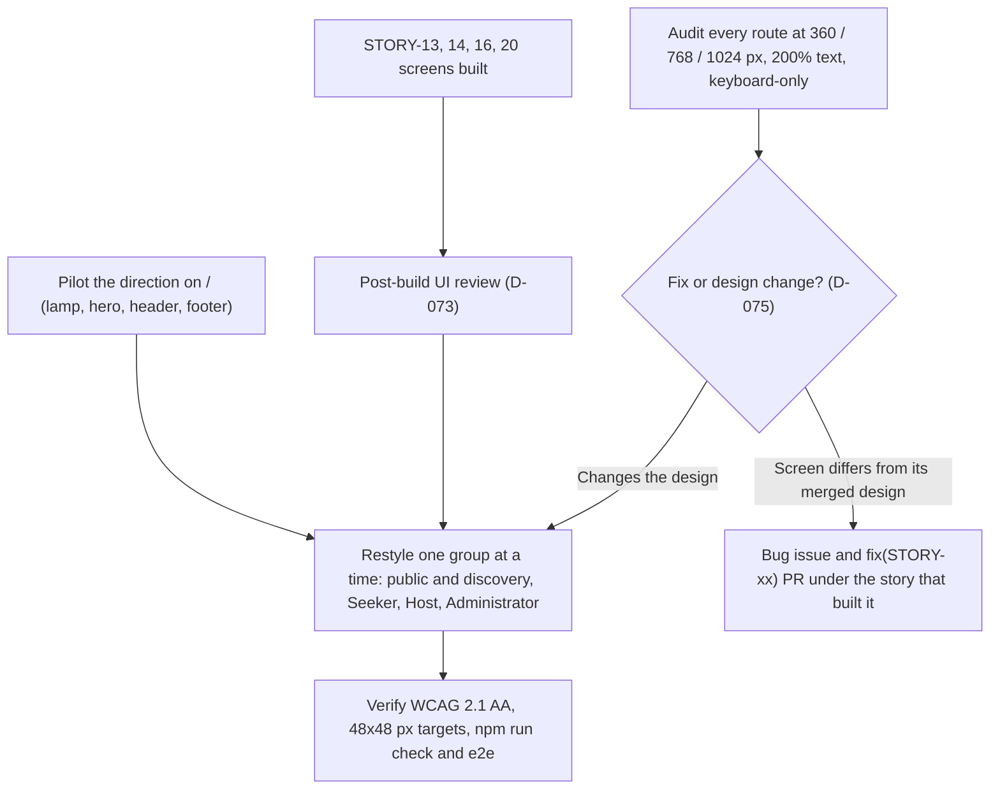

# STORY-17: UI/UX refresh

**Status:** approved 2026-11-23 · **Owner:** @fayeye-09, @JamesNino-Mandawe · **Story:** #336 · **FR:** SRS §3.2.1, §3.2.2, §3.4, §3.7.1 ·
**Depends on:** none to start (post-build review waits for STORY-13, STORY-14, STORY-16, STORY-20) · **Flows:** none (UI/UX only; D-074) · **Decisions:** D-031, D-033, D-042, D-073, D-074, D-075

## 0. Scope

**In:**

- Route-by-route UI/UX audit across the existing app at 360, 768 and 1024 px, with text at 200% and with the keyboard only.
- Sorting each audit finding per D-075: a **fix** (making a screen match its merged design) is filed as a bug under the story that built the screen; a **design change** belongs here.
- Visual direction and pilot restyle on the public landing page and shell (`/`), including the startup desk lamp overlay, hero composition, header, and footer.
- Group-by-group restyle of existing screens: public/discovery/auth, Seeker portal and hold and payment pages, Host portal, and Administrator portal.
- Post-build UI review and restyle of Sprint 3 feature screens (STORY-13, STORY-14, STORY-16, STORY-20) once built (D-073).
- Updating any unit or Playwright tests broken by restyled markup or copy in the same pull request.

**Out:**

- What the system allows and stores, database schemas, RLS policies, Server Action contracts, and new product features (D-042).
- Bug fixes that only bring a screen into compliance with its already-merged design (handled as `fix(STORY-xx)` under the owning story, D-075).
- Adding a dark theme or replacing the Worq design tokens (D-031).

## 1. Flow

**Shared flows** (D-044): STORY-17 does not alter any shared flow in [`docs/flows/`](../flows/README.md). Every user journey, route, and Server Action contract remains intact; where Maria or James restyle a screen, what they built becomes the reference for what users see (D-074).

**This story's own part:** how audit findings, visual direction, and screen restyles flow through Sprint 3. The landing page pilot and the audit don't depend on each other, so they run side by side; the group restyles wait for both (§6).



## 2. Data and state

Not applicable: STORY-17 adds or modifies no Postgres tables, columns, enums, Zod schemas, or RLS policies (D-042). Any interactive UI state introduced for visual polish (such as the landing page startup lamp overlay) is strictly client-local presentation state, respects `prefers-reduced-motion`, and never blocks keyboard navigation or core flows. The lamp's one piece of state is a `sessionStorage` flag that it has played this session (§3).

## 3. UI and files

- **User experience & visual direction** (Maria and James decide, D-042):
  - **Tokens & palette (D-031):** Keep the Worq light-mode-only semantic tokens in `app/globals.css` (forest green `#173c2d` / `#215c3f`, warm cream `#f8f9f3`, sage `#e5eddc` / `#ddebcc`, Georgia headings + Geist body). Do not re-introduce `.dark` overrides.
  - **Public landing & shell pilot (`/`):**
    - Startup desk lamp overlay (`app/(public)/_components/startup-lamp.tsx`) that introduces the Worq study-space atmosphere when `/` loads. Its look is Maria and James's call; it keeps these limits, because `/` is where SRS §3.2.1 starts counting clicks and STORY-19 measures page speed (SRS §3.4):
      - **It never costs a click or a keypress.** It is decorative: `aria-hidden="true"`, no focusable content, and `pointer-events: none`, so clicks and Tab reach the page underneath from the first moment. It waits for page load (plus a brief minimum beat) and fades out on its own.
      - **It covers the viewport from first paint.** It renders in the initial SSR HTML so `/` is covered while subresources load underneath; the lamp is drawn in CSS and inline SVG so it adds no image download.
      - **It plays on every load/reload of `/`.** No `sessionStorage` flag blocks repeat views.
      - **It is skipped entirely** via CSS under `prefers-reduced-motion: reduce` and `@media (scripting: none)` for visitors without JavaScript.
    - Full-bleed workspace hero with an overlapping blurred card for hero copy and primary CTAs, plus refined header (lamp mark + navigation) and footer in `app/(public)/_components/site-header.tsx` and `site-footer.tsx`.
      - **The card's contrast is checked against the photo.** Because the photo shows through the blur, D-031's token-pair check doesn't cover the card's text. The pilot PR measures the text against the card where the photo behind it is darkest and lightest, at 360, 768 and 1024 px, and records the lowest ratio in its PR body (4.5:1 for normal text, 3:1 for large text).
      - **The photo:** the hero keeps the D-033 workspace photo (`/images/public-landing/workspace.webp`). A new photo needs its source page, photographer and licence recorded here, with no identifiable people (D-033).
      - **A hero search** (SRS §3.7.1): the card leads with a search box that submits to `/spaces?q=` as a plain form, so it works before JavaScript loads. It follows STORY-08's search field, as D-033's revisit note asks of real search controls.
    - **Hero & Host split (`/` and `/for-hosts`, follow-up landing redesign):**
      - **Seeker-centered `/`:** Removes the competing Host promo block and floating decorative blobs from `/`. Uses an Architectural Editorial & Warm Print direction strictly within Worq's D-031 palette (`#f8f9f3` warm cream ground, `#173c2d` deep forest ink and closing trust band, `#215c3f` primary, `#eef1e8`/`#e5eddc` sage surfaces, `#f0c95c` lamp-gold primary CTA with `#173c2d` text, Georgia headings + Geist sans + Geist mono). Leads with a split search-first hero (plain GET form to `/spaces?q=` + real Metro Cebu campus shortcuts + framed `workspace.webp` editorial plate + preserved `StartupLamp`), followed by an interactive illustrative 6-column snap-grid seat-map walkthrough (`app/(public)/_components/seat-map-preview.tsx`, clearly labeled non-live per D-002/D-033), a 3-step hairline Seeker ledger, a 3-card non-interactive study environments triptych (`library.webp`, `cafe.webp`, `workspace.webp`, D-033), and a deep-forest Seeker trust & CTA band.
      - **Dedicated `/for-hosts` page:** Public route (`app/(public)/for-hosts/page.tsx`) reachable from both `SiteHeader` and `SiteFooter` (`For Hosts`, visible on mobile and desktop with 48×48 px targets). Leads with a split Host hero (`Become a Host` → `/register?role=host`, `Host sign in` → `/login`, framed `library.webp` plate), an interactive illustrative Host front-desk preview (`app/(public)/for-hosts/_components/host-desk-preview.tsx`) demonstrating one-tap walk-in occupancy updates (STORY-12, D-051) and QR booking-token check-in/check-out (STORY-10), a 4-stage onboarding rail, a 4-question ground-rules FAQ covering no-hardware operation, no-show lapse, sandbox fees, and Administrator verification, and a deep-forest closing CTA band. Registered in `e2e/support/routes.ts` as `public-for-hosts`.
      - **Shared public shell:** `SiteHeader` streamlines top-level navigation to `Find a Space` (`/spaces`), `For Hosts` (`/for-hosts`), `Log in` (`/login`), and `Sign up` (`/register`) with 48×48 px wrapping targets across all widths; `SiteFooter` reuses `<WorqMark />` and links `For Hosts` to `/for-hosts`.
  - **Restyle consistency across portals:** Clear visual hierarchy, mobile-first spacing at 360 px, no clipped text at 200% zoom, and consistent use of `components/ui/` primitives.
  - **The other screen groups' direction grows here.** The pilot on `/` sets the direction. Each group's restyle PR (rows 4 to 7 of §6) adds that group's notes to this section, under a heading of its own: layout, type, spacing, components and wording. Those notes are reviewed with the code in the same PR, so no group waits on a separate design PR. Where a restyled screen and its notes disagree, the screen wins (D-074).
  - **Administrator portal (`/admin`):**
    - **Layout:** Collapsible left navigation sidebar on desktop (`w-72` expanded, `w-20` collapsed via `Ctrl+B` or accessible toggle button), with persistent navigation links for Space Verification (`/admin`), Review Moderation (`/admin/moderation`), and Payments & Refunds (`/admin/payments`). Sticky mobile top nav (`<1024px`) with accessible 48×48 px touch targets. Single main content area containing the Space Verification queue.
    - **Type & Spacing:** Georgia headings (`font-heading`) paired with Geist body text for operational data. Single `<h1>` per view (`<h1>Space Verification</h1>`), while sidebar brand identity uses styled non-heading text to preserve heading hierarchy.
    - **Components:**
      - `AdminSidebar`: Collapsible sidebar with active route detection via `usePathname()`, live pending Space counter badge, Administrator profile, Discovery map shortcut, and accessible sign-out. All collapsed controls include explicit `aria-label`s.
      - `AdminMobileHeader`: Mobile top bar with tab navigation, Administrator avatar, and sign-out button. The Worq brand in it and in `AdminSidebar` is a 48×48 px link to `/admin`, and the mobile bar adds a 48×48 px `View Discovery Map` link (new tab) beside sign-out (#448).
      - **Moderation and Payments pages (#448):** the same title, tabs and cards as `/admin`. A count badge beside each title reads like `/admin`'s "3 pending" ("3 reported", "1 hidden", "3 payments", "1 refundable"), counts the rows on screen, and adds "+" when Show more has more. A guide banner on each says what the actions do: on Moderation, Hide takes a review off the profile and out of the averages and Restore brings it back, Remove does the same for good, and Dismiss reports closes the open reports and leaves the review up (the review lifecycle flow; the glossary's "remove", never "delete"); on Payments, which fees can be refunded.
      - `VerificationCard`: Responsive pending Space card with host, hours, submitted timestamp, and accessible 48×48 px `[Inspect]`, `[Reject]`, and `[Approve]` action buttons. `wrap-anywhere` without `truncate` prevents text clipping at 200% zoom.
      - `SpaceInspectionDialog`: Accessible split inspection modal dossier built on `components/ui/dialog.tsx` (Base UI primitive). Features physical address with OpenStreetMap check (`D-012`), operating schedule, host details, description, photo gallery loaded from the `space-photos` bucket (`D-063`) with loop navigation (when host photos exist) or neutral empty/unavailable state, and Approve/Reject action buttons. Never fabricates capacity counts or amenities.
    - **Wording:** Follows Glossary strictly (`Space`, `Unit`, `Administrator`, `Visit`).
  - **Audit findings** (`TSK-17.1`) go in an "Audit findings" subsection at the end of this section: one row per route, with the widths, 200% text and keyboard results. Each finding is either a **fix**, linked to the bug issue filed under the story that built the screen, or a **design change**, assigned to one of `TSK-17.4` to `TSK-17.7`. The subsection ends with the re-estimate that decides whether `STORY-18` splits off (§5).
- **Routes and components:**
  - `app/(public)/_components/startup-lamp.tsx` — **Client Component** (decorative startup overlay: renders on SSR to cover first paint, then fades out once loaded or unmounts immediately under reduced motion, §3).
  - `app/(public)/page.tsx`, `app/(public)/_components/site-header.tsx`, `app/(public)/_components/site-footer.tsx` — **Server Components** (keep public shell server-rendered).
  - Restyled portal pages under `app/(dashboard)/{seeker,host,admin}/` keep their existing Server/Client Component boundaries.
- **Where the files go:**

  ```text
  app/(public)/
    _components/
      startup-lamp.tsx
      site-header.tsx
      site-footer.tsx
    discovery.css
    page.tsx
    page.test.tsx
  app/(public)/spaces/
  app/(auth)/
  app/(dashboard)/{seeker,host,admin}/
  ```

- **Accessibility (SRS §3.2.2, D-031):**
  - Minimum 48×48 px (`min-h-12 min-w-12`) interactive targets for buttons, links, and form controls.
  - Keyboard-only path through every screen with visible opaque focus rings (`outline-ring` / `ring-ring`).
  - WCAG 2.1 AA contrast (≥ 4.5:1 for normal text, ≥ 3:1 for large text, borders, and focus indicators).
  - Zero horizontal scrolling at 360, 768, and 1024 px and at 200% text zoom.
  - List view preserved alongside any map view.

### Auth screens (`/login`, `/register`, and `/choose-role`, part of `TSK-17.4`)

- **Layout:** Shared split white-and-photo `AuthShell` (`max-w-4xl`, `rounded-3xl`) inside `app/(auth)/layout.tsx` on a soft `bg-muted/40` canvas, with the desk-lamp brand mark and an outline pill `Find a Space` link (`/spaces`) in the header. Two columns (`5fr / 6fr`) from `md` up — form panel on the left and a framed study-space photo (`/images/public-landing/library.webp`, D-033) with decorative `aria-hidden` frosted-glass callout pins on the right (all entrance and pin animations disabled under `prefers-reduced-motion: reduce` in `app/(auth)/auth.css`). Stacks to a single column (`grid-cols-[minmax(0,1fr)]`) below `md`.
- **Type:** Georgia (`font-heading`) `Worq` link and `h1` (`text-3xl`) for the form title; Geist body and helper text.
- **Spacing:** Responsive mobile padding (`px-[min(1rem,3vw)]` on `<main>`, `px-4 py-6 sm:px-8 sm:py-8` inside the form panel) so 360 px at 200% text never clips.
- **Components:** Pill inputs (`rounded-full border-input bg-muted/85` for ≥ 3:1 WCAG 2.1 AA boundary contrast) with a 48 × 48 px (`size-12`) password visibility toggle in `FormField`, pill primary submit buttons (`h-auto min-h-12 py-3 whitespace-normal`), `Alert`, `GoogleAuthButton`, `LoginForm`, `RegisterForm`, and `ChooseRoleForm` with all Server Action contracts, `returnUrl`, `defaultRole`, and Google OAuth onboarding unchanged (D-042, D-095).
- **Wording:** Form headings (`"Welcome back"` on `/login`, `"Start your focus"` on `/register`, `"Finish setting up your account"` on `/choose-role`) and decorative callouts highlighting quiet study desks, the snap-grid seat map, and verified Spaces.

### Discovery, Space profile, reviews, and Seeker portal screens (`TSK-17.4`, `TSK-17.5`)

- **Layout:** Full-width edge-aligned public shell (`SiteHeader`, `SiteFooter`, `/spaces`, `/spaces/[spaceId]`) and Seeker portal (`SeekerLayout`, `SeekerHeader`) using consistent horizontal padding (`px-4 sm:px-6 lg:px-10`). On `/spaces`, a centered editorial header leads into a floating pill search bar, centered campus pills, translucent multi-criteria filter dropdowns, and the synchronized list-and-map split with atmospheric frosted-glass `SpaceCard` items. On `/spaces/[spaceId]`, a full-bleed progressive-blur frosted-glass Space Info Card sits beside stacked `Current Availability` (live occupancy meter) and `Curated Amenities` / `Host custom tags` cards, followed by an elevated `Reserve a Seat` booking workspace (interactive seat grid beside a sticky forest-green-header `Selected Unit` ticket card), an editorial `Explore More · Photos & Reviews` divider, a dedicated `Space Photos` gallery card, and the sage `Community Feedback` reviews band with `SolidStars` paired with numeric scores. On `/seeker`, `/seeker/reservations/[id]`, and `/seeker/reservations/[id]/confirmation`, active holds and check-in passes render in balanced side-by-side white and sage ticket cards.
- **Type:** Preserves Worq's existing typography scales (`font-heading` Georgia headings and Geist body sizes) with no scale changes across existing elements.
- **Spacing:** Responsive full-width gutters (`px-4 sm:px-6 lg:px-10`), `grid-cols-1 sm:grid-cols-2` for 4-item spec and rating grids so cards stay balanced without clipping at 360 px or 200% zoom, and `px-0` below `sm:` around `SeatMapGrid` to preserve the 328 px fit on 360 px viewports (D-062).
- **Components:** Shared `SolidStars` visual rating strip in `components/review/review-rating.tsx` (using CSS `clip-path` rather than `overflow-hidden` to avoid 200% zoom clipping), warm Worq lamp-gold primary action CTAs (`#f0c95c` with `#173c2d` text, >8:1 contrast) for `Search`, `View Space`, right-aligned `Hold this unit`, and `Continue to payment`, plus frosted glass controls meeting 48×48 px touch minimums (`min-h-12 min-w-12`) and WCAG 2.1 AA contrast. `SpaceCard` surfaces an `Open now` / `Closed` status pill beside operating hours, `DiscoveryShell` adds a `Sort by` control (`Recommended`, `Open now first`, `Highest rated`, `Nearest`), `ReservationHistoryCard` matches `CurrentHoldCard`'s `rounded-3xl` + `font-heading` card style, and `CurrentHoldCard` links back to `/spaces/[spaceId]` (`View Space details`) during a `reserved` hold. All existing Server Actions, routes, and accessibility labels remain unchanged (D-042).
- **Wording:** Retains all glossary terms (`Space`, `Unit`, `Seeker`, `Host`, `Administrator`), adds lightweight section eyebrows (`Discover Spaces`, `Reserve a Seat`, `Explore More · Photos & Reviews`, `Gallery`, `Community Feedback`), and preserves existing button/status copy.

### Host portal (`TSK-17.6`)

- **Layout:** Full-width edge-aligned dashboard shell (`HostLayout`, `HostHeader`) on `bg-muted/30` with `px-4 sm:px-6 lg:px-10` gutters matching `SeekerLayout` and `SeekerHeader`. `HostHeader` pairs the `WorqMark` + `font-heading` `Worq` brand link (pointing to `/host` to keep the Host inside their portal), `Spaces` and `Discovery map` pill nav links, user avatar + role badge + `Host Portal` subtitle, and a 48×48 px pill `Log out` button. On `/host`, an editorial header with a warm lamp-gold `Create a Space` pill CTA leads into a 3-card portfolio summary strip (`Total Spaces`, `Verified`, `Pending verification`), followed by the `Your Spaces` grid and `Create a Space` card.
- **Type:** Georgia (`font-heading`) for `<h1>Manage Spaces</h1>`, section `<h2>`s, Space card titles, and summary counts, paired with Geist body text and uppercase eyebrows (`Host Portal`, `Your portfolio`, `Add a location`).
- **Spacing:** Full-width `px-4 sm:px-6 lg:px-10` gutters, `gap-5 lg:grid-cols-2` for `SpaceList` cards, `wrap-anywhere` on names and addresses for 200% text zoom, and `min-h-12` (48×48 px) interactive targets on all header, card action, and form buttons.
- **Components:** `SpaceList` renders `rounded-2xl border-border/80 bg-card shadow-sm` cards with structured `Daily hours` / `Last updated` metadata strips, `Setup checklist` (`bg-secondary/35`), icon-labeled workspace and management action buttons in `CardFooter`, and `SpaceForm` / `DeleteSpaceForm` with warm lamp-gold primary submit CTAs (`#f0c95c` with `#173c2d` text).
- **SpaceSubNav:** Shared `space-sub-nav.tsx` component mounted on every `/host/spaces/[spaceId]/*` sub-page, providing 48×48 px pill navigation links across `Occupancy`, `Check-in desk`, `Seat map`, `Photos`, `Tags`, and `Edit`, with `aria-current="page"` on the active section.
- **Sub-page breadcrumbs and titles (#447):** every `/host/spaces/[spaceId]/*` sub-page opens with a `Your Spaces / {Space name} / {page}` breadcrumb (`nav aria-label="Breadcrumb"`, a 48×48 px `Your Spaces` link, `aria-current="page"` on the last crumb) and a `font-heading text-3xl sm:text-4xl` title matching `/host`. Titles and crumbs that include the Space's name use `wrap-anywhere`, so a long name wraps at 360 px with 200% text. Edit and Delete also get the 48×48 px `Back to Spaces` button that Occupancy already had.
- **Occupancy Refresh:** `occupancy-view.tsx` adds a manual `Refresh` button (with `motion-reduce:animate-none` on its spinner) and 30-second / tab-focus `router.refresh()` auto-refresh so new Seeker holds appear at the front desk without a manual reload.
- **Wording:** Preserves all glossary terms (`Space`, `Unit`, `Host`, `Administrator`, `Pending verification`) and existing accessible `sr-only` action contexts (`Seat map for ...`, `Occupancy for ...`, etc.).

## 4. Security and test matrix

No database tables, policies, or functions are added or changed in STORY-17, so pgTAP negative RLS tests are not applicable (D-042).

| Layer      | Case                                                                                    | Expected                                                               |
| ---------- | --------------------------------------------------------------------------------------- | ---------------------------------------------------------------------- |
| Vitest     | Component and page tests (`app/(public)/page.test.tsx`, etc.)                           | Updated in the same PR as any restyle; `npm run check` passes          |
| Playwright | Existing role journeys and accessibility specs (`e2e/*.spec.ts`)                        | Pass after restyle; selectors/copy updated in same PR if changed       |
| Manual     | Every restyled route at 360, 768, 1024 px, 200% text, and keyboard-only                 | No horizontal scroll, 48×48 px controls, WCAG 2.1 AA contrast, no trap |
| Vitest     | `startup-lamp.test.tsx`: reduced motion on, session flag set, storage blocked           | Renders nothing in each case; otherwise renders with `aria-hidden`     |
| Manual     | `/` in a new session: click Find a Space while the lamp shows; press Tab from page load | The click lands at once; focus goes to the page's first link           |

## 5. Tasks and estimates

These rows become the story's TSK sub-issues once this doc is merged. Total: 8 points / 4 days (re-estimated after `TSK-17.1`; if the audit finds more than 10 points of design-change work, the remainder splits into `STORY-18`).

| Task     | What                                                                               | Owner                          | Points (1–10) | Days | Depends on                                       |
| -------- | ---------------------------------------------------------------------------------- | ------------------------------ | ------------- | ---- | ------------------------------------------------ |
| TSK-17.1 | Route-by-route UI/UX audit (360/768/1024 px, 200% text, keyboard) & finding triage | @fayeye-09, @JamesNino-Mandawe | 2             | 1    | —                                                |
| TSK-17.2 | Public landing startup lamp overlay (`startup-lamp.tsx`)                           | @fayeye-09                     | 1             | 0.5  | —                                                |
| TSK-17.3 | Public landing page, hero search, header, and footer refresh                       | @fayeye-09                     | 1             | 0.5  | TSK-17.2                                         |
| TSK-17.4 | Discovery, Space profile, and auth screens restyle                                 | @fayeye-09, @JamesNino-Mandawe | 1             | 0.5  | TSK-17.1, TSK-17.3                               |
| TSK-17.5 | Seeker portal, hold, and payment screens restyle                                   | @JamesNino-Mandawe             | 1             | 0.5  | TSK-17.1, TSK-17.3                               |
| TSK-17.6 | Host and Administrator portals restyle                                             | @JamesNino-Mandawe, @fayeye-09 | 1             | 0.5  | TSK-17.1, TSK-17.3                               |
| TSK-17.7 | Post-build UI review & restyle of STORY-13, STORY-14, STORY-16, STORY-20 screens   | @fayeye-09, @JamesNino-Mandawe | 1             | 0.5  | TSK-17.3; STORY-13, STORY-14, STORY-16, STORY-20 |

## 6. Build order

One PR per row, and every PR targets `main`. Rows 1 to 3 can run side by side: the audit doesn't wait for the pilot, or the pilot for the audit. Rows 4 to 6 wait for rows 2 and 3, and row 7 waits for row 2 and for each feature screen it reviews. Rows 4 to 7 each add their group's notes to §3.

| #   | Branch                               | PR title                                                            | Contains                                                                                   |
| --- | ------------------------------------ | ------------------------------------------------------------------- | ------------------------------------------------------------------------------------------ |
| 1   | `feature/STORY-17-startup-lamp`      | `feat(STORY-17): add startup desk lamp overlay on landing page`     | `TSK-17.2`: `startup-lamp.tsx`, its test, `discovery.css`, `/`                             |
| 2   | `feature/STORY-17-landing-page`      | `feat(STORY-17): refresh landing page layout, header and footer`    | `TSK-17.3`: `page.tsx`, hero search, `site-header.tsx`, footer, the card's contrast ratios |
| 3   | `feature/STORY-17-audit`             | `docs(STORY-17): record UI/UX audit findings and triage`            | `TSK-17.1`: §3's "Audit findings" subsection, and the bug issues it links                  |
| 4   | `feature/STORY-17-discovery-auth`    | `feat(STORY-17): restyle discovery, space profile and auth screens` | `TSK-17.4`: restyle + updated tests + §3 notes                                             |
| 5   | `feature/STORY-17-seeker-portal`     | `feat(STORY-17): restyle seeker portal, hold and payment screens`   | `TSK-17.5`: restyle + updated tests + §3 notes                                             |
| 6   | `feature/STORY-17-host-admin-portal` | `feat(STORY-17): restyle host and administrator portals`            | `TSK-17.6`: restyle + updated tests + §3 notes                                             |
| 7   | `feature/STORY-17-s3-screen-review`  | `feat(STORY-17): restyle sprint 3 feature screens after UI review`  | `TSK-17.7`: post-build restyles for STORY-13/14/16/20 + §3 notes                           |

## 7. Rejected alternatives

- **Replacing Worq tokens or introducing a dark theme:** rejected because D-031 locks the light-mode forest green/warm cream/sage token system and contrast ratios.
- **Changing Server Action contracts or database fields during restyle:** rejected because D-042 keeps what the system allows and stores with Adrian and Luke.
- **A startup overlay the visitor dismisses with a click:** rejected because it would add a click to the path SRS §3.2.1 counts from the landing page, and a keypress to the keyboard path. The lamp is decorative and ends on its own instead (§3).
- **Finishing the audit before any restyle:** rejected because the landing page pilot doesn't depend on the audit, and trying the direction on one key screen first (the Sprint 3 brief) gives the group restyles a direction to follow.
- **A separate design PR for each screen group's direction:** rejected because each group's notes are reviewed with its code instead (§3). A second design round per group would cost more than the restyle, the same reason D-074 gives for not rewriting older docs.

## 8. Open questions

- None blocking design approval. If `TSK-17.1` uncovers more than 10 points of design-change work, split the overflow into `STORY-18` per `#336` and the Sprint 3 plan.

## 9. After the build

- What turned out different from this plan, and why: _to be filled when STORY-17 is done._
- Status line changed to `implemented YYYY-MM-DD`.
- Docs changed by this story.
- Who verified each acceptance criterion.
