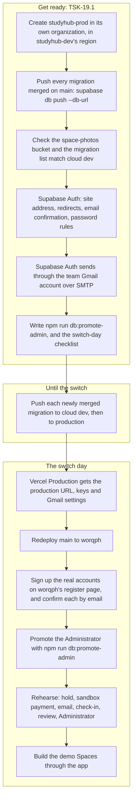

# STORY-19: Final hardening

**Status:** approved 2026-11-22 · **Owner:** @dreeyanzz (production and the Definition of Done),
@lukedongque (accessibility, speed and the journeys) · **Story:** #337 · **FR:** FR-2.5,
SRS §3.2.2, §3.4 · **Depends on:** every Sprint 3 story, for the final checks ·
**Flows:** [Host setup journey](../flows/host-setup-journey.md),
[Seeker journey](../flows/seeker-journey.md) · **Decisions:** D-005, D-013, D-014, D-017,
D-028, D-029, D-061, D-063, D-073, D-074, D-089 to D-093, D-097

Worq is built as a product, not a classroom demo: the team wants to present and pitch it
as close to the real thing as possible. So this story makes a production Supabase project
ready to run the app on any day Adrian chooses, with real email and real accounts. It
checks every page against WCAG 2.1 AA on every pull request, so the restyle can't quietly
break it. It measures speed against SRS §3.4, and runs the Definition of Done check
before the last merge. Adrian builds production, the Definition of Done check and the
final manual accessibility pass, and Luke the accessibility sweep, the speed measures and
any missing journey.

## 0. Scope

**In:**

- **A production project ready for the switch (Adrian, D-090):** every merged migration
  applied, Supabase Auth set up for production with email confirmation and the team
  Gmail account as its sender, the Vercel settings it needs written down,
  `npm run db:promote-admin`, and a checklist for the day Worq moves onto it, which is
  when the real account for each role is made (D-091).
- **#218, decided here (D-092):** whatever deletes a Space or its owner's account empties
  the Space's photo folder first. This PR adds the rule to D-063's notes and the manual
  step to `DEVELOPMENT.md`, and closes #218.
- **The accessibility sweep (Luke, D-093):** every route, signed out and as each role,
  checked with axe's WCAG 2.1 A and AA rules and the checks axe can't make, in CI on
  every pull request. `e2e` becomes a required check as soon as it lands.
- **The journeys for every role (Luke):** a table of which Playwright test walks each
  role's journey, and a test for any gap left once STORY-13, STORY-14, STORY-16 and
  STORY-20 add theirs.
- **Speed (Luke):** First Contentful Paint and Largest Contentful Paint on the landing,
  search and profile pages, and search time, measured on worqph and recorded in §9.
- **The Definition of Done check (Adrian),** of every Sprint 3 story before the last
  merge, and the final keyboard and screen-reader pass after the last restyle, both
  recorded in §9.
- **`npm run db:race` in CI:** already done. The `db` job has run it since #262 (9 Nov),
  so its acceptance criterion only needs checking off.

**Out:**

- **The day Worq moves onto production.** Adrian decides it when the project is ready
  (D-090). This design makes any day possible.
- **Live payments.** Payments stay in Stripe's sandbox (D-005, SRS §1.2).
- **Paid services:** a custom domain, Supabase's paid backups, a paid email sender.
- **The restyle itself** (STORY-17). The sweep checks whatever Maria and James build
  (D-074, D-093).
- **Features.** Every page this story checks belongs to another story.

## 1. Flow

### Shared flows (D-044)

No shared flow changes. The [Host setup journey](../flows/host-setup-journey.md) and the
[Seeker journey](../flows/seeker-journey.md) are already walked by
`e2e/host-setup.spec.ts` and `e2e/seeker-journey.spec.ts`. They are part of the coverage
table in §3, and the accessibility sweep visits every page they reach.

### This story's own part

Getting production ready, then the switch on the day Adrian chooses. Every step is
Adrian's, on Adrian's own machine or in the services' dashboards: agents never push to or
link a cloud database (AGENTS.md).



The real accounts are made on the switch day, once worqph runs on production. Before
that, worqph's `/register` writes to cloud dev, and a sign-up from `localhost` can't
confirm, because production's Auth only accepts redirects to worqph. Signing them up
through worqph also rehearses the real sign-up and its confirmation email.

Previews stay on cloud dev the whole time. Before any pitch, Adrian opens the app the day
before, because the free plan pauses a project after about a week without use.

## 2. Data and state

No table, policy or function changes. This story is settings, accounts, tests and
records.

### The production project (D-090)

| Setting                  | Value                                                                                                                       |
| ------------------------ | --------------------------------------------------------------------------------------------------------------------------- |
| Name and place           | `studyhub-prod`, in a Supabase organization of its own with Adrian as its only member, in the same region as `studyhub-dev` |
| Who can reach it         | Adrian only: the dashboard, the database password, the keys and the secret key (D-029)                                      |
| Migrations               | `npx supabase db push --db-url "$PRODUCTION_DB_URL"`, from merged `main` only, after cloud dev                              |
| Checking it              | `npx supabase migration list --db-url "$PRODUCTION_DB_URL"`, which must match cloud dev's                                   |
| Auth: site address       | `https://worqph.vercel.app`                                                                                                 |
| Auth: redirect addresses | `https://worqph.vercel.app/**`, so STORY-03's callback at `/api/auth/callback` is accepted                                  |
| Auth: email confirmation | On: a new account confirms its address before it can sign in                                                                |
| Auth: password rules     | The same as STORY-03's form: at least 8 characters, with a number and a symbol                                              |
| Auth: email sender       | Custom SMTP: `smtp.gmail.com`, port 465, the team Gmail account and its app password, sender name "Worq" (D-089)            |
| Payments                 | Stripe's sandbox, unchanged: the same test keys and webhook endpoint (D-005, D-070)                                         |
| Keeping it awake         | Open the app the day before any pitch                                                                                       |

**Why its own organization:** on the Free plan, a role in an organization covers every
project in it, and `lamph-org` gives Luke, Maria and James roles for cloud dev (D-065).
A project there would be theirs too. The free plan's two active projects are cloud dev
and this one: the projects in `vesper-org` are paused, and must stay paused.

`PRODUCTION_DB_URL` is the production database's connection string, in Adrian's
`.env.local` only. Pushing with `--db-url` never re-links the CLI, so a push meant for
cloud dev can't land on production, or the other way round. Supabase's built-in email
sender sends only a few emails an hour and isn't meant for production, so Auth's
confirmation and password emails go through the same team account as STORY-16's email.

### Vercel, on the day of the switch

Vercel's **Production** environment gets the production project's
`NEXT_PUBLIC_SUPABASE_URL`, `NEXT_PUBLIC_SUPABASE_PUBLISHABLE_KEY` and
`SUPABASE_SECRET_KEY`, plus `GMAIL_USER` and `GMAIL_APP_PASSWORD` (D-089). The Stripe
values stay as they are. **Preview** keeps cloud dev's values. An environment change
takes effect on the next deployment, so the switch is the settings change plus a redeploy
of `main`.

**Payments on previews stop confirming after the switch.** Stripe's sandbox sends its
events to one endpoint, worqph's `/api/webhooks/stripe`, and today that deployment and
every preview share cloud dev. Once worqph runs on production, a sandbox payment made on
a preview reaches production's `confirm_payment`, which finds no such reservation and
answers `not_found`. The webhook logs it and answers 200, as it already does (the sandbox
payment confirmation flow's W21), and the preview's hold stays unpaid until it lapses. No
deployment serves cloud dev at a fixed address Stripe could call instead, so after the
switch payments are tried locally, with `npm run stripe:listen` or
`npm run webhook:simulate`, and `DEVELOPMENT.md` says so. Production's log of unknown
reservations from previews is expected.

### Production accounts (D-091)

| Role          | Address                           | How it is made                                                                 |
| ------------- | --------------------------------- | ------------------------------------------------------------------------------ |
| Host          | `<team address>+host@gmail.com`   | Signs up on `/register` as a Host, and confirms by email                       |
| Seeker        | `<team address>+seeker@gmail.com` | Signs up on `/register` as a Seeker, and confirms by email                     |
| Administrator | `<team address>+admin@gmail.com`  | Signs up as a Seeker and confirms, then `npm run db:promote-admin` promotes it |

- They are made on the switch day, right after worqph moves onto production (§1), so
  they land in production and their confirmation links work.
- Gmail delivers every `+` address to the one team inbox, and Supabase treats each as its
  own account, so the accounts are real without anyone's personal address.
- Adrian chooses their passwords, keeps them out of the repository and chat, and gives
  them privately to teammates for rehearsals (D-029).
- `npm run db:promote-admin -- <email>` (TSK-19.1) sets that account's role to `admin`
  with the secret key, as `npm run db:accounts` does on cloud dev (D-061). It reads
  production's URL and secret key from names of its own, `PRODUCTION_SUPABASE_URL` and
  `PRODUCTION_SECRET_KEY`, in Adrian's `.env.local` only beside `PRODUCTION_DB_URL`, never
  from the names cloud dev uses, so it can't promote an account on cloud dev by mistake.
  It prints the project it is about to change, and runs on Adrian's machine only.
- `seed.sql` never runs on production: it holds a public password (D-028). Demo Spaces,
  seat maps, photos and approvals are made through the app, which rehearses it too.
- Anyone else who signs up on production, at a pitch for example, is an ordinary Seeker
  or Host.

### #218: a Space's photos when it is deleted outside `deleteSpace` (D-092)

Whatever deletes a Space, or the account that owns it, empties `space-photos/<space_id>`
first. In Sprint 3 nothing in the app deletes an account or a listing: STORY-14 moderates
reviews, and STORY-20's take-down hides a Space without deleting it. So the only gap is
deleting an account in the Supabase dashboard, and `DEVELOPMENT.md` now says to delete
that Host's Spaces in the app first, or empty each one's folder on the dashboard's Storage
page. A later story that adds deleting accounts or listings empties the folders first.

## 3. UI and files

### Screens

This story adds no screens. The sweep checks every screen the other stories build, and
Maria and James's restyle of them (D-074).

### The accessibility sweep (D-093, Luke)

- **`e2e/support/routes.ts`** lists every route, with the role that opens it and how to
  reach any route with a parameter. Each story that adds a route adds it here, so the
  sweep grows with the app.
- **`e2e/accessibility.spec.ts`** visits each route as its role, signed out where the
  route is public:
  - axe's WCAG 2.1 A and AA rules (`wcag2a`, `wcag2aa`, `wcag21a`, `wcag21aa`), through
    `@axe-core/playwright`, a new development dependency. Any violation fails the test,
    with its rule and the element it found.
  - The checks axe can't make: every control at least 48 × 48 px, no horizontal
    scrolling at 360, 768 and 1024 px, nothing clipped with text at 200%, and a keyboard
    path that reaches every control with visible focus. `e2e/discovery-a11y.spec.ts`
    already makes the first two for discovery, with text at 200% too, and checks the
    filter drawer's focus trap. The clipping check (inside cards, whose primitive hides
    overflow) and the visible-focus check are new in this spec.
  - It finds things by their role and label, never by class names or layout, so it
    keeps working as the restyle changes the look.
- **What is already on `main` when it lands:** TSK-19.3 runs the sweep once and lists
  each violation it finds in `e2e/support/known-violations.ts`, by route and rule, with
  the `fix(STORY-xx)` issue it files for each (D-075). The sweep fails on any violation
  that isn't on the list, and on a listed one that no longer happens, so the list only
  shrinks, and a fix removes its entry. It is empty by TSK-19.2's check.
- **When it fails on a restyled screen,** whoever restyled it fixes it, as a STORY-17
  fix: their built UI wins on look (D-074), and WCAG 2.1 AA still binds it (SRS §3.2.2).
- **The final manual pass** (TSK-19.2, Adrian) runs after Maria and James's last restyle
  lands, before the last merge: every route with the keyboard alone, and a screen-reader
  spot check of the hold, check-in, review and refund steps.

### The journeys for every role (Luke)

Each role's journey has a Playwright test. The ones on `main` today:

| Role               | Its journey                                          | Test                                                                           |
| ------------------ | ---------------------------------------------------- | ------------------------------------------------------------------------------ |
| Signed-out visitor | Search, a profile, and the sign-in prompt for a hold | `e2e/seeker-journey.spec.ts`, `e2e/discovery-a11y.spec.ts`                     |
| Seeker             | Search, hold, sandbox payment, and the booking token | `e2e/seeker-journey.spec.ts`                                                   |
| Host               | A new Space to a public one, occupancy, and check-in | `e2e/host-setup.spec.ts`, `e2e/host-occupancy.spec.ts`, `e2e/check-in.spec.ts` |
| Administrator      | Approving and rejecting a Space                      | `e2e/space-verification.spec.ts`, `e2e/host-setup.spec.ts`                     |

STORY-13, STORY-14, STORY-16 and STORY-20 each add their own: reviews, moderation and
refunds, the history, and the verification follow-ups. TSK-19.4 adds this table to §9
once they have merged, and writes a test for any journey still without one.

### Speed (Luke)

- **First Contentful Paint and Largest Contentful Paint:** `npx lighthouse <url>
--preset=desktop`, three runs each on worqph's landing page, `/spaces` and one Space's
  profile, recording the median. The first run after a quiet spell is a serverless cold
  start, which SRS §3.4 allows for, so it is recorded on its own.
- **Search time:** `scripts/measure-search.mjs <url>` drives the repo's Playwright in a
  headless browser through 10 searches on `/spaces`, and prints the median and the
  slowest time from submitting to the results showing. It only reads.
- **Where:** on worqph, on production once Adrian has switched, otherwise on cloud dev,
  and §9 says which. The results go in §9 against SRS §3.4's targets: about 1 second for
  search, and under about 2 and 3 seconds for the two paints. A first run can come early,
  but the measures are run again after the last restyle, before TSK-19.2's check, so §9
  holds the Final build's numbers.

### Where the files go

```
e2e/accessibility.spec.ts
e2e/support/routes.ts, known-violations.ts
scripts/measure-search.mjs
scripts/promote-admin.mjs
docs/DEVELOPMENT.md
package.json (@axe-core/playwright, db:promote-admin)
AGENTS.md (the Commands block, and the required checks)
.github/rulesets/main-pr-ci-reviews.json (e2e as a required check)
```

## 4. Security and test matrix

| Layer      | Case                                                                                                                                                                               | Expected                                        |
| ---------- | ---------------------------------------------------------------------------------------------------------------------------------------------------------------------------------- | ----------------------------------------------- |
| Playwright | `e2e/accessibility.spec.ts`: every route in `routes.ts`, as its role, against axe's WCAG 2.1 A and AA rules                                                                        | No violations                                   |
| Playwright | `e2e/accessibility.spec.ts`: every route's controls at 48 × 48 px, no horizontal scroll at three widths, nothing clipped at 200% text, and a full keyboard path                    | As described                                    |
| Playwright | `e2e/accessibility.spec.ts`: a violation not in `known-violations.ts` fails, and so does a listed one that no longer happens                                                       | Fails, naming the route and the rule            |
| CI         | The `db` job runs `npm run db:race` on every pull request (since #262)                                                                                                             | Green                                           |
| CI         | The `e2e` job is a required check from the day TSK-19.3 merges (D-093)                                                                                                             | Listed in the ruleset and in `AGENTS.md`        |
| Manual     | Production's migration list matches cloud dev's after every push                                                                                                                   | The same list                                   |
| Manual     | A real account signs up on production, gets the confirmation email from Worq, and signs in only after confirming                                                                   | As described                                    |
| Manual     | The rehearsal on the switch day: a hold paid in the sandbox sends STORY-16's email, the Host checks the Seeker in, the Seeker reviews, and the Administrator moderates and refunds | Every step works on worqph                      |
| Manual     | A Seeker or a Host on production can't open `/admin`, and the promoted Administrator can                                                                                           | As described                                    |
| Manual     | Lighthouse and `scripts/measure-search.mjs` against SRS §3.4, recorded in §9                                                                                                       | Within the targets, or recorded with the reason |
| Manual     | The final keyboard and screen-reader pass, after the last restyle (TSK-19.2)                                                                                                       | Recorded in §9                                  |
| Manual     | The Definition of Done check of every Sprint 3 story                                                                                                                               | Recorded in §9                                  |

No table, policy or function changes, so no pgTAP tests are added. The production
project runs the same migrations and the same policies that `npm run db:test` proves on
every pull request.

## 5. Tasks and estimates

These rows become the story's TSK sub-issues once this doc is merged. The story moves
from 5 to **6 points and 3 days**, 3 for Adrian and 3 for Luke. The plan's
`db:race` task was already done in #262, and #218 is settled in this PR, but the
production-level setup Adrian chose on 22 Nov is more than the plan assumed.

| Task     | What                                                                                                                                                                                                                                                                                                                        | Owner        | Points (1–10) | Days | Depends on                                         |
| -------- | --------------------------------------------------------------------------------------------------------------------------------------------------------------------------------------------------------------------------------------------------------------------------------------------------------------------------- | ------------ | ------------- | ---- | -------------------------------------------------- |
| TSK-19.1 | The production project made ready (§1's first two lanes): migrations, Auth settings and SMTP, `npm run db:promote-admin`, the switch-day checklist, and `DEVELOPMENT.md`. The real accounts come on the switch day (§1)                                                                                                     | @dreeyanzz   | 2             | 1    | This design merged; the team Gmail account (D-089) |
| TSK-19.2 | The Definition of Done check of every Sprint 3 story and the final manual pass after the last restyle (§3), both recorded in §9; `db:race`'s criterion checked off                                                                                                                                                          | @dreeyanzz   | 1             | 0.5  | TSK-19.3, and every other story's last PR          |
| TSK-19.3 | The accessibility sweep: `@axe-core/playwright`, `e2e/support/routes.ts`, `e2e/accessibility.spec.ts`, `known-violations.ts` with an issue filed for each entry (§3), and `e2e` added to `AGENTS.md`'s required checks and to `.github/rulesets/main-pr-ci-reviews.json`. Adrian turns the rule on in GitHub when it merges | @lukedongque | 1             | 0.5  | This design merged                                 |
| TSK-19.4 | The journeys table in §9, and a test for any journey still without one                                                                                                                                                                                                                                                      | @lukedongque | 1             | 0.5  | STORY-13, STORY-14, STORY-16 and STORY-20's tests  |
| TSK-19.5 | Speed: Lighthouse and `scripts/measure-search.mjs`, recorded in §9, and run again after the last restyle (§3)                                                                                                                                                                                                               | @lukedongque | 1             | 0.5  | This design merged                                 |

TSK-19.3 goes early, so every later pull request, the restyle's included, is checked,
and `e2e` is required from the day it merges: only Adrian can change the ruleset
(AGENTS.md), so its pull request updates the file and `AGENTS.md`, and Adrian applies the
rule when it merges.
The final manual pass waits for the last restyle, so it sits in TSK-19.2, which runs
last.
The switch itself has no task: it is Adrian's call, on the day Adrian chooses (D-090).

## 6. Build order

One PR per row, and every PR targets `main`.

| #   | Branch                                | PR title                                              | Contains                                        |
| --- | ------------------------------------- | ----------------------------------------------------- | ----------------------------------------------- |
| 1   | `feature/STORY-19-design`             | `docs(STORY-19): design final hardening`              | This doc, D-090 to D-093, #218's step, the plan |
| 2   | `feature/STORY-19-accessibility`      | `test(STORY-19): sweep every route for accessibility` | TSK-19.3 (Luke)                                 |
| 3   | `feature/STORY-19-production`         | `chore(STORY-19): get the production project ready`   | TSK-19.1 (Adrian)                               |
| 4   | `feature/STORY-19-speed`              | `test(STORY-19): measure page and search speed`       | TSK-19.5 (Luke)                                 |
| 5   | `feature/STORY-19-journeys`           | `test(STORY-19): cover every role's journey`          | TSK-19.4 (Luke)                                 |
| 6   | `feature/STORY-19-definition-of-done` | `docs(STORY-19): record the definition of done check` | TSK-19.2 (Adrian), before the last merge        |

## 7. Rejected alternatives

- **Switching to production on a fixed date,** whether now or on 5 December. Adrian
  wants it ready on any day, and decides when (D-090).
- **A production seed script with demo Spaces,** or running `seed.sql` there: the seed
  holds a public password (D-028), and building the demo through the app rehearses it.
- **The team, as on cloud dev, reaching production** (D-065): the Final and every pitch
  run there, and one wrong change in a dashboard can break it (D-090).
- **Invented `@example.test` addresses on production,** **teammates' personal addresses,**
  and **a Gmail account for each role** (D-091).
- **Supabase's built-in email sender on production:** a few emails an hour, and not meant
  for production use.
- **Re-linking the CLI to production to push** (`supabase link`): a push meant for one
  project could land on the other.
- **A daily sweep of orphaned photo folders, or a trigger on `spaces`** (#218's options 2
  and 3, D-092).
- **An accessibility sweep only at the end, or by hand:** problems would surface far from
  the pull request that caused them (D-093).
- **Measuring speed in DevTools by hand:** it can't be repeated the same way.

## 8. Open questions

None. The switch day is Adrian's to choose (D-090), and the team Gmail account comes
first, for STORY-16 too (D-089).

## 9. After the build

Filled in when the story is done: the journeys table, the speed results against SRS
§3.4, the final accessibility pass, and the Definition of Done check of every Sprint 3
story.

### Role journeys coverage (TSK-19.4)

Every role's end-to-end journey on `main` is covered by the Playwright suite (`npm run test:e2e`, required CI check `e2e`, D-093), audited on **26 Nov 2026**:

| Role                              | End-to-end journeys covered                                                                                                                                                                                                                                                                                                                                                                                                        | Playwright spec(s)                                                                                                                                                                                                                                                          |
| --------------------------------- | ---------------------------------------------------------------------------------------------------------------------------------------------------------------------------------------------------------------------------------------------------------------------------------------------------------------------------------------------------------------------------------------------------------------------------------- | --------------------------------------------------------------------------------------------------------------------------------------------------------------------------------------------------------------------------------------------------------------------------- |
| **Signed-out visitor**            | Landing hero search (`/` → `/spaces?q=...`), discovery filters, reset & filter-drawer accessibility, Verified Space profile, public reviews & averages, hidden non-Verified Spaces, hold sign-in/registration return prompt, Google OAuth entry & callback errors, Privacy Policy (`/privacy`), and protected-route redirects                                                                                                      | `e2e/role-journeys.spec.ts`, `e2e/seeker-journey.spec.ts`, `e2e/discovery-a11y.spec.ts`, `e2e/reviews.spec.ts`, `e2e/google-oauth.spec.ts`, `e2e/space-verification.spec.ts`, `e2e/host-occupancy.spec.ts`, `e2e/accessibility.spec.ts`                                     |
| **OAuth user (unconfirmed role)** | Portal blocking before confirmation, `/choose-role` name & role confirmation (Seeker with `returnUrl` or Host), locking `/choose-role` once confirmed, and signing out from `/choose-role`                                                                                                                                                                                                                                         | `e2e/google-oauth.spec.ts`, `e2e/accessibility.spec.ts`                                                                                                                                                                                                                     |
| **Seeker**                        | Sign-in & dashboard, form-error value retention, profile editing with validation & persistence (`/seeker`), search, hold, stale-unit conflict, Stripe sandbox checkout/retry/webhook confirmation, booking token QR, payment lapses & late payments, Host override outcomes, check-in & early check-out, posting/editing/deleting/reporting reviews, reservation history, Hold again & reviewing from history, and `/admin` denial | `e2e/smoke.spec.ts`, `e2e/form-values.spec.ts`, `e2e/role-journeys.spec.ts`, `e2e/seeker-journey.spec.ts`, `e2e/check-in.spec.ts`, `e2e/reviews.spec.ts`, `e2e/history.spec.ts`, `e2e/space-verification.spec.ts`, `e2e/admin-console.spec.ts`, `e2e/accessibility.spec.ts` |
| **Host**                          | Sign-in & portal, creating/editing/deleting Spaces, seat map builder (grid & list parity), tags, photos, verification status visibility, occupancy walk-ins & re-vouch, active-hold override warnings & concurrent-conflict refresh, Check-in desk & wrong-space protection, non-owner 404 isolation, and `/admin` denial                                                                                                          | `e2e/smoke.spec.ts`, `e2e/host-setup.spec.ts`, `e2e/form-values.spec.ts`, `e2e/host-occupancy.spec.ts`, `e2e/check-in.spec.ts`, `e2e/space-verification.spec.ts`, `e2e/admin-console.spec.ts`, `e2e/accessibility.spec.ts`                                                  |
| **Administrator**                 | Sign-in & audit access to `/host` and `/seeker`, Space verification queue approval & rejection with mandatory reason (including 360 px / 200% text check), review moderation (remove, hide, restore with history, and dismiss reports) with live average updates, and payment records & Stripe sandbox refunds                                                                                                                     | `e2e/smoke.spec.ts`, `e2e/space-verification.spec.ts`, `e2e/host-setup.spec.ts`, `e2e/admin-console.spec.ts`, `e2e/role-journeys.spec.ts`, `e2e/accessibility.spec.ts`                                                                                                      |

**Gaps closed by `TSK-19.4` (`e2e/role-journeys.spec.ts`):**

- Landing hero search (`/` → `/spaces?q=...`) through to a Verified Space profile and `/privacy`.
- Seeker profile editing on `/seeker` (validation, reload persistence, and clearing optional `phone_number` back to `null`).
- Administrator review moderation hide → restore (`RV4`, `RV6`) and dismiss reports (`RP2`) alongside `e2e/admin-console.spec.ts`'s permanent removal (`RV5`) and refund (`P1`).

**Added after this audit by `TSK-20.4` (#444):** STORY-20's journeys, so no role's journey is left without a test:

- Host: `host-edit-returns-pending` (the warning, then back to Pending marked Edited) and `host-resubmits-space`, in `e2e/host-setup.spec.ts`.
- Administrator: `host-admin-takes-down-space` and `host-admin-restores-space` in `e2e/host-setup.spec.ts`, and the live notice across two browser sessions ("an Administrator looking at a Space sees the Host's edit at once, and decides the latest version") in `e2e/space-verification.spec.ts`.

### Speed baseline (TSK-19.5, pre-restyle)

Measured on **23 Nov 2026** against `https://worqph.vercel.app` (running on **cloud dev** prior to switch day and final restyle merges; will be re-run after the last restyle so this section holds the Final build's numbers, §3).

#### Page load (`npx lighthouse <url> --preset=desktop`, 3 runs each)

| Page                                                           | Target (SRS §3.4)      | Run 1 (initial)              | Run 2                        | Run 3                        | Median FCP / LCP    |
| -------------------------------------------------------------- | ---------------------- | ---------------------------- | ---------------------------- | ---------------------------- | ------------------- |
| Landing (`/`)                                                  | FCP < ~2 s, LCP < ~3 s | 324 ms / 776 ms (score 83)   | 348 ms / 683 ms (score 65)   | 552 ms / 958 ms (score 76)   | **0.35 s / 0.78 s** |
| Search (`/spaces`)                                             | FCP < ~2 s, LCP < ~3 s | 414 ms / 1,436 ms (score 72) | 721 ms / 2,263 ms (score 60) | 361 ms / 1,400 ms (score 91) | **0.41 s / 1.44 s** |
| Space profile (`/spaces/1cd4beb9-33fc-4992-9d58-5bd131df7a51`) | FCP < ~2 s, LCP < ~3 s | 376 ms / 376 ms (score 72)   | 400 ms / 400 ms (score 95)   | 438 ms / 438 ms (score 96)   | **0.40 s / 0.40 s** |

#### Search & filter latency (`node scripts/measure-search.mjs https://worqph.vercel.app`)

10 headless Chromium searches on `/spaces` measuring end-to-end duration from submit click until URL/RSC response and visible results render (SRS §3.4 target: about 1 second):

- **Fastest:** 782 ms (`Mabolo`)
- **Median:** 1,300 ms (`1.30 s`, includes Next.js RSC URL update roundtrip to Vercel + Supabase cloud dev)
- **Slowest:** 1,468 ms (`USC TC`, Run 1)

### Definition of Done check (TSK-19.2)

Checked on **27 Nov 2026** by Adrian, with Claude Code, against `main` at `e327ee9` and
the 69 pull requests merged from 17 to 26 November. The Definition of Done is Sprint 1's
(its plan's §6), with Sprint 2's four checks and Sprint 3's four (the Sprint 3 plan's §9).
The check runs again before the last merge, for whatever merges after `e327ee9`.

#### Checks run on `main` (`e327ee9`)

| Check                                   | Result                                                                                                                       |
| --------------------------------------- | ---------------------------------------------------------------------------------------------------------------------------- |
| `npm run check`                         | Passed: typecheck, lint, Prettier, and Vitest's 131 files and 1,374 tests (Node 22 locally; CI uses Node 24)                 |
| `npm run build`, with CI's placeholders | Passed                                                                                                                       |
| `npm run db:test`                       | Passed: 14 files and 952 pgTAP checks, on the local stack                                                                    |
| `npm run db:race`                       | Passed: the hold and payment races, and the check-in races                                                                   |
| CI on `main` (run 741)                  | `checks`, `db` (which runs `db:race`) and `e2e` (which runs the accessibility sweep) passed                                  |
| `npm run test:e2e` locally              | Not run: this check's local stack left out Storage and Realtime, which some tests need. CI's `e2e` run above is the evidence |

#### Sprint 3's stories

| Story         | Design merged                  | PRs | Approved when merged       | Criteria ticked | Issue  | Manual checks still open                                                                               |
| ------------- | ------------------------------ | --- | -------------------------- | --------------- | ------ | ------------------------------------------------------------------------------------------------------ |
| STORY-13 #78  | #347, 22 Nov; code from 24 Nov | 7   | 1 (#413)                   | 0 of 5          | closed | None in its §9. Maria and James review its screens (D-073)                                             |
| STORY-14 #79  | #349, 22 Nov; code from 24 Nov | 8   | 0                          | 0 of 4          | closed | §4's two manual rows: the pages at three widths, 200% text and keyboard; a real test-mode refund       |
| STORY-16 #335 | #350, 22 Nov; code from 23 Nov | 7   | 6 (all but #350)           | 0 of 4          | closed | The real confirmation email; the review dialog at three widths                                         |
| STORY-17 #336 | #352, 23 Nov; code from 23 Nov | 13  | 11 (all but #417 and #438) | 0 of 5          | open   | The restyle goes on: #447 and #448 are open                                                            |
| STORY-19 #337 | #351, 22 Nov; code from 23 Nov | 6   | 2 (#380, #381)             | 0 of 6          | open   | The final manual pass below, the speed re-run, and the switch to production                            |
| STORY-20 #338 | #411, 24 Nov; code from 26 Nov | 6   | 4 (all but #411 and #427)  | 0 of 5          | open   | §4's rows: `/host` and `/admin` at three widths; a take-down with a paid hold; the live notice by hand |
| STORY-21 #392 | #393, 23 Nov; code from 24 Nov | 5   | 0                          | 5 of 5          | closed | None                                                                                                   |

The other 17 pull requests are STORY-00's 12 (2 approved: #341 and #342) and the five fixes
to Sprint 2 stories on 17 November, #330 to #334 (none approved).

#### Each check

**Sprint 1's Definition of Done:**

| Check                         | Result                     | Evidence                                                                                                                                                                                                                                                                                                                                                                                                   |
| ----------------------------- | -------------------------- | ---------------------------------------------------------------------------------------------------------------------------------------------------------------------------------------------------------------------------------------------------------------------------------------------------------------------------------------------------------------------------------------------------------- |
| Branch and squash merge       | Met                        | All 69 came from `feature/STORY-xx-*` branches and were squash-merged, the only method the ruleset allows                                                                                                                                                                                                                                                                                                  |
| Design gate                   | Met                        | Each design merged before its story's first code pull request (the table above), and each flow before the designs that use it: the review lifecycle (#342, 19 Nov), the Space verification change (#346, 21 Nov) and Google OAuth (#391, 23 Nov)                                                                                                                                                           |
| Local checks                  | Met                        | The runs above, and each pull request's own Verification section                                                                                                                                                                                                                                                                                                                                           |
| CI                            | Met                        | `checks`, `pr-title`, `db` and `e2e` passed on all 69. GitHub shows #349, #350, #393 and #411 as pending only because Vercel's deployment status never finished, and that isn't a required check                                                                                                                                                                                                           |
| Database integrity, security  | Met                        | Each of Sprint 3's eight migrations shipped with its pgTAP tests in the same pull request: `11-reviews.sql`, `12-refunds.sql`, `13-google-oauth.sql`, `14-review-moderation.sql`, `15-reservation-history.sql` and the rewritten `05-space-verification.sql`. Each story's §9 names its negatives, and they pass in `db:test` above. Only `app/api/webhooks/stripe/route.ts` imports the secret-key client |
| Accessibility, responsiveness | Met by the sweep           | `e2e/support/known-violations.ts` is empty, and the sweep passes on `main`. The final manual pass and each story's open manual rows (above) are still to do                                                                                                                                                                                                                                                |
| Verified criteria             | Not met yet                | No box is ticked on #78, #79, #335, #336, #337 or #338. Each story's §9 names the tests that prove each criterion, and each owner ticks what they checked (AGENTS.md rule 6). #337's `db:race` criterion is checked: CI's `db` job runs it                                                                                                                                                                 |
| Peer code review              | Not met: accepted (D-097)  | 43 of the 69 had no approval standing when they merged. See below                                                                                                                                                                                                                                                                                                                                          |
| Docs                          | Met, with three fixes here | Each story closed out its §9 (#413, #429, #445, #449). This pull request corrects STORY-13's §9 (the review lifecycle is implemented since #429), STORY-14's §9 (#438 fixed #431 and #432) and this doc's journeys note (#444 landed)                                                                                                                                                                      |
| Tracking                      | Partly                     | #78, #79, #335 and #392 are closed. #336, #337 and #338 are open, and all four of #338's tasks are closed. #336 still has `needs-design`, though its design merged on 23 Nov, and it has no task issues                                                                                                                                                                                                    |

**Sprint 2's four checks:**

| Check             | Result  | Evidence                                                                                                                                                                                                                                                                                                                                            |
| ----------------- | ------- | --------------------------------------------------------------------------------------------------------------------------------------------------------------------------------------------------------------------------------------------------------------------------------------------------------------------------------------------------- |
| Seat map parity   | Met     | Three Sprint 3 pull requests touched the seat map, and none changed what the grid or the list can do: #334 (a React key warning in the unit form), #416 (a 48 × 48 px breadcrumb link) and #441 (the Space's sub-navigation). Nothing in `components/seat-map/` or `lib/seat-map/` changed. The Host journey's grid and list tests still pass in CI |
| Freshness honesty | Not met | The landing page from #369 calls Host-updated availability "live" four times, against D-002 and the glossary. Filed as #450 for Maria and James. A search of `app/` and `components/` found no other page text that calls availability "live" or "real-time"                                                                                        |
| No double booking | Met     | `db:race` passed locally and in CI's `db` job, which has run it on every pull request since #262                                                                                                                                                                                                                                                    |
| Sandbox only      | Met     | Every Stripe call, refunds and take-down cleanup included, goes through `send()` in `lib/payments/stripe.ts`, which takes only a sandbox key (`sandboxSecretKey`). The only `sk_live` strings in the repository are the test that proves live keys are refused                                                                                      |

**Sprint 3's four checks:**

| Check                 | Result           | Evidence                                                                                                                                                                                                                                                       |
| --------------------- | ---------------- | -------------------------------------------------------------------------------------------------------------------------------------------------------------------------------------------------------------------------------------------------------------- |
| Fix or design change  | Met              | Every pull request that changed a screen is a `feat` or `fix` of the story that built it, or STORY-17's restyle. #438 also put two STORY-14 bugs (#431, #432) under STORY-17's title, beside three STORY-17 ones                                               |
| Built UI first        | Not met for #438 | #438 changed restyled screens (`/admin` from #414, the Seeker nav from #418) with no review. #440 and #444 add STORY-20's own screens to the restyled `/admin`, with Adrian's approval: Maria and James's review of them after the build (D-073) is still open |
| Reviews are honest    | Met              | `11-reviews.sql` (N1, N3: no review without a checked-in visit; N10, N16, N17: the averages count visible reviews only) and `14-review-moderation.sql` (a hidden or removed review leaves the averages), in `db:test` above                                    |
| Accessible everywhere | Met by the sweep | As above. The final manual pass is still to do                                                                                                                                                                                                                 |

#### Peer review: an accepted deviation (D-097)

43 of the 69 pull requests had no approval standing when they merged. All but #417 are
Adrian's, merged with the Repository Admin bypass (D-014). Adrian accepted this on 27 Nov
as a deviation from the Definition of Done, rather than asking for reviews after the
merge (D-097).

- **Reviewed, with no approval standing at the merge (6):** Luke reviewed the designs
  #347, #349, #350, #351 and #411. On #347 and #411, a later push dismissed his approval
  before the merge. On #409 his request for changes still stood: its blocking finding
  (#420) was fixed in #421 and #422 before #409 merged, but nobody reviewed it again.
- **No review by a teammate (37):**
  - code, before D-096 (24 Nov): #388, #389, #398, #399, #400, #401, #402, #403, #404,
    #405 and #406;
  - code, after D-096: #410, #412, #416, #422, #427, #428, #438 and #442;
  - of those 19, seven change `supabase/`: #388, #389, #398, #402, #404, #422 and #427;
  - STORY-21's design (#393) and STORY-14's close-out (#429);
  - STORY-00's #343, #344, #345, #346, #348, #370, #390 (the Next.js upgrade), #391 (the
    Google OAuth flow), #408 (D-096's ruleset change) and #421. The flows index already
    records Adrian as the approver of #346, #391 and #421;
  - the five fixes to Sprint 2 stories on 17 Nov, #330 to #334;
  - Maria's #417, which #419 reverted 26 minutes later.

Every one of them passed the four required checks, and the pgTAP tests of the seven that
change `supabase/` pass in `db:test` above. The 26 that were approved include every pull request Luke,
Maria or James opened except #417, and five of Adrian's 47.

### Final manual pass (TSK-19.2)

_To be filled once STORY-17's last restyle merges, before Saturday 5 December (§3):_ every
route with the keyboard alone, and a screen-reader spot check of the hold, check-in, review
and refund steps, with the screen reader used and what it found.

### Before the last merge

- [ ] STORY-17's last restyle merges (#447 and #448 are open), then the final manual pass
      above.
- [ ] Luke runs the speed measures again after the last restyle (§3). On 23 Nov the median
      search took 1.30 s, above SRS §3.4's "about 1 second".
- [ ] #450 is fixed.
- [ ] Each story's open manual checks (the table above) are done, and recorded in its §9.
- [ ] Each owner ticks the criteria they checked on #78, #79, #335, #336, #337 and #338.
- [ ] Worq moves onto the production project (D-090), so the Final deployment uses it
      (#337's first criterion).
- [ ] This check runs again for what merges after `e327ee9`.
