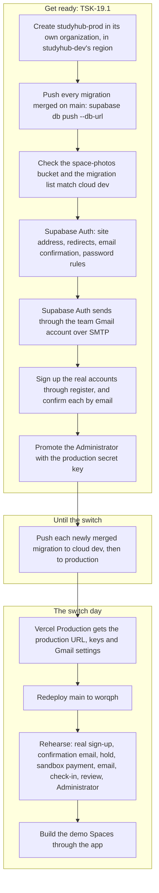

# STORY-19: Final hardening

**Status:** draft · **Owner:** @dreeyanzz (production and the Definition of Done),
@lukedongque (accessibility, speed and the journeys) · **Story:** #337 · **FR:** FR-2.5,
SRS §3.2.2, §3.4 · **Depends on:** every Sprint 3 story, for the final checks ·
**Flows:** [Host setup journey](../flows/host-setup-journey.md),
[Seeker journey](../flows/seeker-journey.md) · **Decisions:** D-005, D-013, D-014, D-017,
D-028, D-029, D-061, D-063, D-073, D-074, D-089 to D-093

Worq is built as a product, not a classroom demo: the team wants to present and pitch it
as close to the real thing as possible. So this story makes a production Supabase project
ready to run the app on any day Adrian chooses, with real email and real accounts. It
checks every page against WCAG 2.1 AA on every pull request, so the restyle can't quietly
break it. It measures speed against SRS §3.4, and runs the Definition of Done check
before the last merge. Adrian builds production and the Definition of Done check, and
Luke the accessibility sweep, the speed measures and any missing journey.

## 0. Scope

**In:**

- **A production project ready for the switch (Adrian, D-090):** every merged migration
  applied, Supabase Auth set up for production with email confirmation and the team
  Gmail account as its sender, the Vercel settings it needs written down, real accounts
  for each role (D-091), and a checklist for the day Worq moves onto it.
- **#218, decided here (D-092):** whatever deletes a Space or its owner's account empties
  the Space's photo folder first. This PR adds the rule to D-063's notes and the manual
  step to `DEVELOPMENT.md`, and closes #218.
- **The accessibility sweep (Luke, D-093):** every route, signed out and as each role,
  checked with axe's WCAG 2.1 A and AA rules and the checks axe can't make, in CI on
  every pull request. `e2e` becomes a required check once it lands.
- **The journeys for every role (Luke):** a table of which Playwright test walks each
  role's journey, and a test for any gap left once STORY-13, STORY-14, STORY-16 and
  STORY-20 add theirs.
- **Speed (Luke):** First Contentful Paint and Largest Contentful Paint on the landing,
  search and profile pages, and search time, measured on worqph and recorded in §9.
- **The Definition of Done check (Adrian),** of every Sprint 3 story before the last
  merge, recorded in §9.
- **`npm run db:race` in CI:** already done. The `db` job has run it since #262 (9 Nov),
  so its acceptance criterion only needs checking off.

**Out:**

- **The day Worq moves onto production.** Adrian decides it when the project is ready
  (D-090). This design makes any day possible.
- **Live payments.** Payments stay in Stripe's sandbox (D-005, SRS §1.2).
- **Paid services:** a custom domain, Supabase's paid backups, a paid email sender.
- **The restyle itself** (STORY-17). The sweep checks whatever Maria and James build
  (D-074, D-093).
- **Features.** Every page this story checks belongs to another story.

## 1. Flow

### Shared flows (D-044)

No shared flow changes. The [Host setup journey](../flows/host-setup-journey.md) and the
[Seeker journey](../flows/seeker-journey.md) are already walked by
`e2e/host-setup.spec.ts` and `e2e/seeker-journey.spec.ts`. They are part of the coverage
table in §3, and the accessibility sweep visits every page they reach.

### This story's own part

Getting production ready, then the switch on the day Adrian chooses. Every step is
Adrian's, on Adrian's own machine or in the services' dashboards: agents never push to or
link a cloud database (AGENTS.md).



Previews stay on cloud dev the whole time. Before any pitch, Adrian opens the app the day
before, because the free plan pauses a project after about a week without use.

## 2. Data and state

No table, policy or function changes. This story is settings, accounts, tests and
records.

### The production project (D-090)

| Setting                  | Value                                                                                                                       |
| ------------------------ | --------------------------------------------------------------------------------------------------------------------------- |
| Name and place           | `studyhub-prod`, in a Supabase organization of its own with Adrian as its only member, in the same region as `studyhub-dev` |
| Who can reach it         | Adrian only: the dashboard, the database password, the keys and the secret key (D-029)                                      |
| Migrations               | `npx supabase db push --db-url "$PRODUCTION_DB_URL"`, from merged `main` only, after cloud dev                              |
| Checking it              | `npx supabase migration list --db-url "$PRODUCTION_DB_URL"`, which must match cloud dev's                                   |
| Auth: site address       | `https://worqph.vercel.app`                                                                                                 |
| Auth: redirect addresses | `https://worqph.vercel.app/**`, so STORY-03's callback at `/api/auth/callback` is accepted                                  |
| Auth: email confirmation | On: a new account confirms its address before it can sign in                                                                |
| Auth: password rules     | The same as STORY-03's form: at least 8 characters, with a number and a symbol                                              |
| Auth: email sender       | Custom SMTP: `smtp.gmail.com`, port 465, the team Gmail account and its app password, sender name "Worq" (D-089)            |
| Payments                 | Stripe's sandbox, unchanged: the same test keys and webhook endpoint (D-005, D-070)                                         |
| Keeping it awake         | Open the app the day before any pitch                                                                                       |

**Why its own organization:** on the Free plan, a role in an organization covers every
project in it, and `lamph-org` gives Luke, Maria and James roles for cloud dev (D-065).
A project there would be theirs too. The free plan's two active projects are cloud dev
and this one: the projects in `vesper-org` are paused, and must stay paused.

`PRODUCTION_DB_URL` is the production database's connection string, in Adrian's
`.env.local` only. Pushing with `--db-url` never re-links the CLI, so a push meant for
cloud dev can't land on production, or the other way round. Supabase's built-in email
sender sends only a few emails an hour and isn't meant for production, so Auth's
confirmation and password emails go through the same team account as STORY-16's email.

### Vercel, on the day of the switch

Vercel's **Production** environment gets the production project's
`NEXT_PUBLIC_SUPABASE_URL`, `NEXT_PUBLIC_SUPABASE_PUBLISHABLE_KEY` and
`SUPABASE_SECRET_KEY`, plus `GMAIL_USER` and `GMAIL_APP_PASSWORD` (D-089). The Stripe
values stay as they are. **Preview** keeps cloud dev's values. An environment change
takes effect on the next deployment, so the switch is the settings change plus a redeploy
of `main`.

### Production accounts (D-091)

| Role          | Address                           | How it is made                                                                 |
| ------------- | --------------------------------- | ------------------------------------------------------------------------------ |
| Host          | `<team address>+host@gmail.com`   | Signs up on `/register` as a Host, and confirms by email                       |
| Seeker        | `<team address>+seeker@gmail.com` | Signs up on `/register` as a Seeker, and confirms by email                     |
| Administrator | `<team address>+admin@gmail.com`  | Signs up as a Seeker and confirms, then `npm run db:promote-admin` promotes it |

- Gmail delivers every `+` address to the one team inbox, and Supabase treats each as its
  own account, so the accounts are real without anyone's personal address.
- Adrian chooses their passwords, keeps them out of the repository and chat, and gives
  them privately to teammates for rehearsals (D-029).
- `npm run db:promote-admin -- <email>` (TSK-19.1) sets that account's role to `admin`
  with the secret key, as `npm run db:accounts` does on cloud dev (D-061). It reads the
  project's URL and secret key from the environment it runs in, so Adrian runs it with
  production's values, on Adrian's machine only.
- `seed.sql` never runs on production: it holds a public password (D-028). Demo Spaces,
  seat maps, photos and approvals are made through the app, which rehearses it too.
- Anyone else who signs up on production, at a pitch for example, is an ordinary Seeker
  or Host.

### #218: a Space's photos when it is deleted outside `deleteSpace` (D-092)

Whatever deletes a Space, or the account that owns it, empties `space-photos/<space_id>`
first. In Sprint 3 nothing in the app deletes an account or a listing: STORY-14 moderates
reviews, and STORY-20's take-down hides a Space without deleting it. So the only gap is
deleting an account in the Supabase dashboard, and `DEVELOPMENT.md` now says to delete
that Host's Spaces in the app first, or empty each one's folder on the dashboard's Storage
page. A later story that adds deleting accounts or listings empties the folders first.

## 3. UI and files

### Screens

This story adds no screens. The sweep checks every screen the other stories build, and
Maria and James's restyle of them (D-074).

### The accessibility sweep (D-093, Luke)

- **`e2e/support/routes.ts`** lists every route, with the role that opens it and how to
  reach any route with a parameter. Each story that adds a route adds it here, so the
  sweep grows with the app.
- **`e2e/accessibility.spec.ts`** visits each route as its role, signed out where the
  route is public:
  - axe's WCAG 2.1 A and AA rules (`wcag2a`, `wcag2aa`, `wcag21a`, `wcag21aa`), through
    `@axe-core/playwright`, a new development dependency. Any violation fails the test,
    with its rule and the element it found.
  - The checks axe can't make, as `e2e/discovery-a11y.spec.ts` already does for
    discovery: every control at least 48 × 48 px, no horizontal scrolling at 360, 768 and
    1024 px, nothing clipped with text at 200%, and a keyboard path that reaches every
    control with visible focus.
  - It finds things by their role and label, never by class names or layout, so it
    keeps working as the restyle changes the look.
- **When it fails on a restyled screen,** whoever restyled it fixes it, as a STORY-17
  fix: their built UI wins on look (D-074), and WCAG 2.1 AA still binds it (SRS §3.2.2).
- **The final manual pass** runs after Maria and James's last restyle lands, before the
  last merge: every route with the keyboard alone, and a screen-reader spot check of the
  hold, check-in, review and refund steps.

### The journeys for every role (Luke)

Each role's journey has a Playwright test. The ones on `main` today:

| Role               | Its journey                                          | Test                                                                           |
| ------------------ | ---------------------------------------------------- | ------------------------------------------------------------------------------ |
| Signed-out visitor | Search, a profile, and the sign-in prompt for a hold | `e2e/seeker-journey.spec.ts`, `e2e/discovery-a11y.spec.ts`                     |
| Seeker             | Search, hold, sandbox payment, and the booking token | `e2e/seeker-journey.spec.ts`                                                   |
| Host               | A new Space to a public one, occupancy, and check-in | `e2e/host-setup.spec.ts`, `e2e/host-occupancy.spec.ts`, `e2e/check-in.spec.ts` |
| Administrator      | Approving and rejecting a Space                      | `e2e/space-verification.spec.ts`, `e2e/host-setup.spec.ts`                     |

STORY-13, STORY-14, STORY-16 and STORY-20 each add their own: reviews, moderation and
refunds, the history, and the verification follow-ups. TSK-19.4 adds this table to §9
once they have merged, and writes a test for any journey still without one.

### Speed (Luke)

- **First Contentful Paint and Largest Contentful Paint:** `npx lighthouse <url>
--preset=desktop`, three runs each on worqph's landing page, `/spaces` and one Space's
  profile, recording the median. The first run after a quiet spell is a serverless cold
  start, which SRS §3.4 allows for, so it is recorded on its own.
- **Search time:** `scripts/measure-search.mjs <url>` drives the repo's Playwright in a
  headless browser through 10 searches on `/spaces`, and prints the median and the
  slowest time from submitting to the results showing. It only reads.
- **Where:** on worqph, on production once Adrian has switched, otherwise on cloud dev,
  and §9 says which. The results go in §9 against SRS §3.4's targets: about 1 second for
  search, and under about 2 and 3 seconds for the two paints.

### Where the files go

```
e2e/accessibility.spec.ts
e2e/support/routes.ts
scripts/measure-search.mjs
scripts/promote-admin.mjs
docs/DEVELOPMENT.md
package.json (@axe-core/playwright, db:promote-admin)
AGENTS.md (the Commands block, and the required checks once e2e is required)
```

## 4. Security and test matrix

| Layer      | Case                                                                                                                                                                               | Expected                                        |
| ---------- | ---------------------------------------------------------------------------------------------------------------------------------------------------------------------------------- | ----------------------------------------------- |
| Playwright | `e2e/accessibility.spec.ts`: every route in `routes.ts`, as its role, against axe's WCAG 2.1 A and AA rules                                                                        | No violations                                   |
| Playwright | `e2e/accessibility.spec.ts`: every route's controls at 48 × 48 px, no horizontal scroll at three widths, nothing clipped at 200% text, and a full keyboard path                    | As described                                    |
| CI         | The `db` job runs `npm run db:race` on every pull request (since #262)                                                                                                             | Green                                           |
| CI         | The `e2e` job is a required check once TSK-19.3 lands (D-093)                                                                                                                      | Listed in the ruleset and in `AGENTS.md`        |
| Manual     | Production's migration list matches cloud dev's after every push                                                                                                                   | The same list                                   |
| Manual     | A real account signs up on production, gets the confirmation email from Worq, and signs in only after confirming                                                                   | As described                                    |
| Manual     | The rehearsal on the switch day: a hold paid in the sandbox sends STORY-16's email, the Host checks the Seeker in, the Seeker reviews, and the Administrator moderates and refunds | Every step works on worqph                      |
| Manual     | A Seeker or a Host on production can't open `/admin`, and the promoted Administrator can                                                                                           | As described                                    |
| Manual     | Lighthouse and `scripts/measure-search.mjs` against SRS §3.4, recorded in §9                                                                                                       | Within the targets, or recorded with the reason |
| Manual     | The final keyboard and screen-reader pass, after the last restyle                                                                                                                  | Recorded in §9                                  |
| Manual     | The Definition of Done check of every Sprint 3 story                                                                                                                               | Recorded in §9                                  |

No table, policy or function changes, so no pgTAP tests are added. The production
project runs the same migrations and the same policies that `npm run db:test` proves on
every pull request.

## 5. Tasks and estimates

These rows become the story's TSK sub-issues once this doc is merged. The story moves
from 5 to **6 points and 3 days**, 3 for Adrian and 3 for Luke. The plan's
`db:race` task was already done in #262, and #218 is settled in this PR, but the
production-level setup Adrian chose on 22 Nov is more than the plan assumed.

| Task     | What                                                                                                                                                              | Owner        | Points (1–10) | Days | Depends on                                         |
| -------- | ----------------------------------------------------------------------------------------------------------------------------------------------------------------- | ------------ | ------------- | ---- | -------------------------------------------------- |
| TSK-19.1 | The production project made ready (§1's first two lanes): migrations, Auth settings and SMTP, the real accounts, `npm run db:promote-admin`, and `DEVELOPMENT.md` | @dreeyanzz   | 2             | 1    | This design merged; the team Gmail account (D-089) |
| TSK-19.2 | The Definition of Done check of every Sprint 3 story, recorded in §9; `e2e` added to the required checks and to `AGENTS.md`; `db:race`'s criterion checked off    | @dreeyanzz   | 1             | 0.5  | TSK-19.3, and every other story's last PR          |
| TSK-19.3 | The accessibility sweep: `@axe-core/playwright`, `e2e/support/routes.ts`, `e2e/accessibility.spec.ts`, and the final manual pass recorded in §9                   | @lukedongque | 1             | 0.5  | This design merged                                 |
| TSK-19.4 | The journeys table in §9, and a test for any journey still without one                                                                                            | @lukedongque | 1             | 0.5  | STORY-13, STORY-14, STORY-16 and STORY-20's tests  |
| TSK-19.5 | Speed: Lighthouse and `scripts/measure-search.mjs`, recorded in §9                                                                                                | @lukedongque | 1             | 0.5  | This design merged                                 |

TSK-19.3 goes early, so every later pull request, the restyle's included, is checked.
The switch itself has no task: it is Adrian's call, on the day Adrian chooses (D-090).

## 6. Build order

One PR per row, and every PR targets `main`.

| #   | Branch                                | PR title                                              | Contains                                        |
| --- | ------------------------------------- | ----------------------------------------------------- | ----------------------------------------------- |
| 1   | `feature/STORY-19-design`             | `docs(STORY-19): design final hardening`              | This doc, D-090 to D-093, #218's step, the plan |
| 2   | `feature/STORY-19-accessibility`      | `test(STORY-19): sweep every route for accessibility` | TSK-19.3 (Luke)                                 |
| 3   | `feature/STORY-19-production`         | `chore(STORY-19): get the production project ready`   | TSK-19.1 (Adrian)                               |
| 4   | `feature/STORY-19-speed`              | `test(STORY-19): measure page and search speed`       | TSK-19.5 (Luke)                                 |
| 5   | `feature/STORY-19-journeys`           | `test(STORY-19): cover every role's journey`          | TSK-19.4 (Luke)                                 |
| 6   | `feature/STORY-19-definition-of-done` | `docs(STORY-19): record the definition of done check` | TSK-19.2 (Adrian), before the last merge        |

## 7. Rejected alternatives

- **Switching to production on a fixed date,** whether now or on 5 December. Adrian
  wants it ready on any day, and decides when (D-090).
- **A production seed script with demo Spaces,** or running `seed.sql` there: the seed
  holds a public password (D-028), and building the demo through the app rehearses it.
- **The team, as on cloud dev, reaching production** (D-065): the Final and every pitch
  run there, and one wrong change in a dashboard can break it (D-090).
- **Invented `@example.test` addresses on production,** **teammates' personal addresses,**
  and **a Gmail account for each role** (D-091).
- **Supabase's built-in email sender on production:** a few emails an hour, and not meant
  for production use.
- **Re-linking the CLI to production to push** (`supabase link`): a push meant for one
  project could land on the other.
- **A daily sweep of orphaned photo folders, or a trigger on `spaces`** (#218's options 2
  and 3, D-092).
- **An accessibility sweep only at the end, or by hand:** problems would surface far from
  the pull request that caused them (D-093).
- **Measuring speed in DevTools by hand:** it can't be repeated the same way.

## 8. Open questions

None. The switch day is Adrian's to choose (D-090), and the team Gmail account comes
first, for STORY-16 too (D-089).

## 9. After the build

Filled in when the story is done: the journeys table, the speed results against SRS
§3.4, the final accessibility pass, and the Definition of Done check of every Sprint 3
story.
