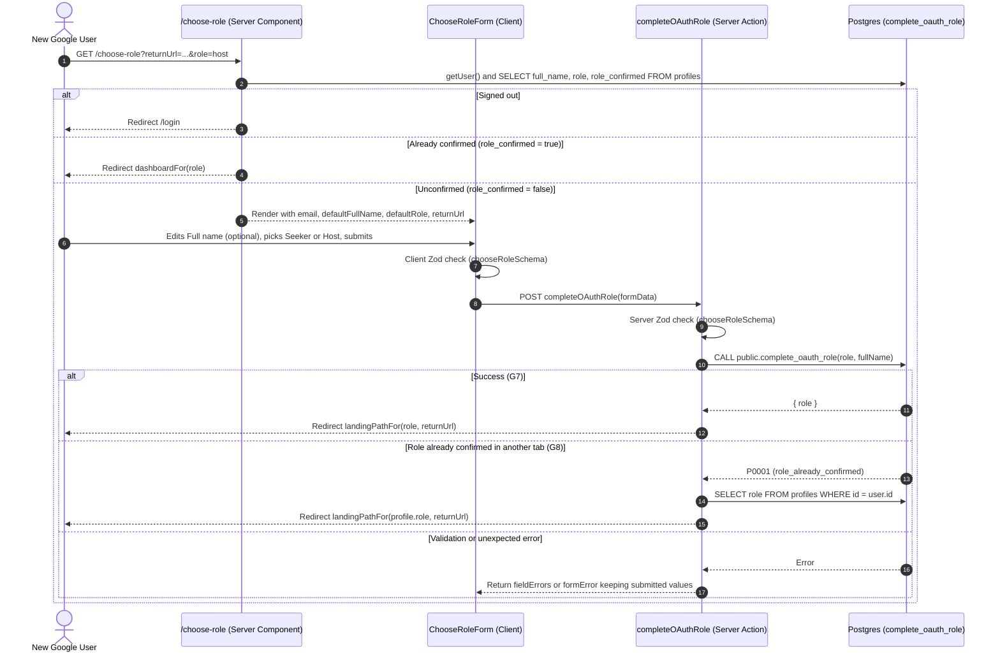

# STORY-21: Google OAuth sign-in and sign-up

**Status:** approved 2026-11-24 · **Owner:** @dreeyanzz · **Story:** #392 · **FR:** SRS §3.5.1 ·
**Depends on:** STORY-01, STORY-03, STORY-09, STORY-17 (PR #371 for `AuthShell` on `/login`, `/register` and `/choose-role`) ·
**Flows:** [Google OAuth](../flows/google-oauth.md) ·
**Decisions:** D-007, D-010, D-013, D-016, D-031, D-032, D-042, D-044, D-058, D-073, D-074, D-090, D-091, D-093, D-095

Visitors can sign in or sign up on Worq with a Google account from `/login` and `/register`.
Returning Google users and existing email/password users with the same verified email go
straight to their dashboard or `returnUrl`; brand-new Google users confirm their **Full name**
and choose **Seeker** or **Host** once on `/choose-role` (never **Administrator**, D-013, D-095).
Postgres Row-Level Security blocks every Seeker, Host and Administrator action until role
confirmation completes (D-007).

## 0. Scope

**In:**

- **Database & RLS (`TSK-21.1`):**
  - Migration adding `public.profiles.role_confirmed boolean not null default true` (no
    `UPDATE` grant), updating `private.has_role()` to require `role_confirmed = true`,
    updating `private.handle_new_user()` for OAuth sign-ups (`role = 'seeker'`,
    `role_confirmed = false`, 100-character safe `full_name` truncation), and adding
    `public.complete_oauth_role(p_role public.user_role, p_full_name text)`.
  - Positive and negative pgTAP tests in `supabase/tests/13-google-oauth.sql` (`G6`–`G8`,
    `O-N1`–`O-N6`, `O-N10`, `O-N11`).
  - Regenerated `lib/supabase/database.types.ts` and local callback URLs in
    `supabase/config.toml` (`[auth.external.google]` stays disabled by default for CI).
- **Guard, callback & Hold viewer (`TSK-21.2`):**
  - `chooseRoleSchema`, `sanitizeAuthSource` and `parseRegistrationRole` in
    `lib/validation/auth.ts`.
  - `roleConfirmed` handling and `/choose-role` area rules in `lib/auth/role-guard.ts`,
    `lib/supabase/proxy.ts` and `proxy.ts`.
  - OAuth error handling (`error=access_denied`, other `?error=`) and `role_confirmed`
    branching in `app/api/auth/callback/route.ts`.
  - Treating `role_confirmed = false` as unconfirmed (`role: null`) in
    `lib/data/reservations.ts` (`getHoldViewer`).
- **Auth UI & Server Actions (`TSK-21.3`):**
  - `signInWithGoogle` (Server Action PKCE with `prompt: 'select_account'`) and
    `completeOAuthRole` in `app/(auth)/actions.ts`, plus `role_confirmed` check in `login`.
  - Accessible **Continue with Google** button component (`app/(auth)/_components/google-auth-button.tsx`)
    mounted on `/login` and `/register`, plus OAuth error alerts.
  - `/choose-role` Server Component (`app/(auth)/choose-role/page.tsx`) and form
    (`app/(auth)/choose-role/_components/choose-role-form.tsx`) with pre-filled editable
    **Full name**, Seeker/Host `radiogroup`, **Continue to Worq** submit, and **Log out and
    use a different account** escape.
- **E2E, WCAG sweep & docs (`TSK-21.4`):**
  - Playwright tests in `e2e/google-oauth.spec.ts` using the local Supabase Admin API
    (no Google credentials needed in CI).
  - Adding `/choose-role` to `e2e/support/routes.ts` and `e2e/accessibility.spec.ts`
    (D-093).
  - Documenting Google Cloud OAuth 2.0 & Supabase Dashboard setup in `docs/DEVELOPMENT.md`,
    updating `AGENTS.md` layout notes, and marking `docs/flows/google-oauth.md`
    `implemented`.

**Out:**

- **Apple Sign In:** Rejected in D-095 (paid Apple Developer Program membership).
- **Role switching after confirmation:** Roles remain immutable once `role_confirmed = true`.
- **Visual redesign of `/login`, `/register` and `/choose-role`:** Follows `AuthShell`
  (PR #371) and design tokens (D-031); Maria and James review and restyle as needed in
  STORY-17 (D-073, D-074).
- **Google Cloud / Supabase Dashboard credential entry:** Performed manually by Adrian on
  `studyhub-dev` and `studyhub-prod`; no OAuth secrets ever enter the repository or CI.

## 1. Flow

**Shared flows (D-044):**

- **[Google OAuth](../flows/google-oauth.md)** (#379, approved 2026-11-24): defines the
  complete primary OAuth PKCE sequence (`G1`–`G10`), abandoned `/choose-role` and direct
  API bypass edge cases (`G11`–`G13`), negative security matrix (`O-N1`–`O-N11`), SQL
  contracts, and route access matrix. This story implements every branch of that flow.
- **[Seeker journey](../flows/seeker-journey.md)** (#178): a signed-out visitor trying to
  hold a unit reaches `/register?role=seeker&returnUrl=/spaces/<id>` (D-058); choosing
  **Continue with Google** carries both `returnUrl` and `role=seeker` through
  `/api/auth/callback` and `/choose-role` back to that Space profile.

**This story's own part:** how the `/choose-role` form validates, submits, and recovers from
a stale second tab without leaving the user stranded.



## 2. Data and state

- **Database schema, functions, RLS policies and GRANTs:** Exact DDL and function contracts
  are defined in [Google OAuth §4](../flows/google-oauth.md#4-database-contracts-and-row-level-security):
  - `public.profiles.role_confirmed boolean not null default true` — no `UPDATE` grant to
    `anon` or `authenticated`.
  - `private.has_role(wanted public.user_role)` — adds `and role_confirmed = true`.
  - `private.handle_new_user()` — branches on `coalesce(new.raw_app_meta_data ->> 'provider', 'email') <> 'email'`, sets `role = 'seeker', role_confirmed = false` for OAuth, and applies `nullif(left(btrim(coalesce(full_name, name, '')), 100), '')`.
  - `public.complete_oauth_role(p_role public.user_role, p_full_name text)` — `security definer set search_path = ''`, revoked from `public` and `anon`, granted to `authenticated` only; locks own `profiles` row `FOR UPDATE`, accepts only `'seeker'` or `'host'`, trims and bounds `p_full_name` (1–100 chars), and refuses once `role_confirmed` is `true` (`P0001`, hint `role_already_confirmed`).
- **State transition:** One-way `role_confirmed: false` → `true` (with `role` finalized to
  `'seeker'` or `'host'`), made exclusively by `public.complete_oauth_role` for the signed-in
  account owner (`G7`). No move returns `role_confirmed` to `false` or changes `role` after
  confirmation (`O-N2`).
- **Zod schemas and helpers (`lib/validation/auth.ts`):**
  - `chooseRoleSchema`:
    - `fullName`: trimmed string, min 1 (`"Full name is required"`), max 100 (`"Full name must not exceed 100 characters"`).
    - `role`: `z.enum(['seeker', 'host'], { error: 'Please select whether you are a Seeker or a Host' })`.
    - `returnUrl`: optional string transformed through `sanitizeReturnUrl` (unsafe paths dropped).
  - `parseRegistrationRole(value)`: returns `'seeker' | 'host' | undefined` (drops `'admin'` or any other string).
  - `sanitizeAuthSource(value)`: returns `'/login'` or `'/register'` (defaults to `'/login'`).
- **Route access matrix (`lib/auth/role-guard.ts` & `lib/supabase/proxy.ts`):** Follows
  [Google OAuth §5](../flows/google-oauth.md#5-route-access-matrix-and-hold-panel-behavior).
  `evaluateRouteAccess(pathname, role, search, method, roleConfirmed = true)` keeps
  default `roleConfirmed = true` so every existing caller and test remains backwards-compatible.
- **Local Supabase config (`supabase/config.toml`):** Add
  `http://localhost:3000/api/auth/callback` and `http://127.0.0.1:3000/api/auth/callback`
  to `[auth].additional_redirect_urls`. Keep `[auth.external.google]` disabled by default so
  local Docker and CI never require Google credentials.

## 3. UI and files

### User experience (D-042, D-073, D-074)

- **`/login` and `/register`:**
  - Show a full-width secondary **"Continue with Google"** button (`variant="outline"`,
    `h-auto min-h-12 py-3`, decorative Google G icon `aria-hidden="true"`) above an
    `"or continue with email"` horizontal divider and the existing email/password form.
  - Display a status `Alert` (`role="status"`) on `?error=oauth-cancelled` (_"Google sign-in
    was cancelled. Try again, or use your email and password."_) and a destructive `Alert`
    (`role="alert"`) on `?error=oauth` (_"We could not sign you in with Google. Try again,
    or use your email and password."_).
  - Preserve `returnUrl` (and `defaultRole` on `/register`) across the Google button and
    between `/login` ↔ `/register` links.
- **`/choose-role`:**
  - Uses `AuthShell` (from PR #371 once merged; otherwise `Card` matching `main`) so it
    matches `/login` and `/register`.
  - Heading: **"Finish setting up your account"**; subheading displays the signed-in Google
    email so the person knows which account is active.
  - Editable **Full name** input (`FormField`, pre-filled from `profiles.full_name`,
    1–100 chars).
  - Accessible `<fieldset role="radiogroup">` for **Seeker** (_"Find and hold open seats at
    verified study spaces."_) and **Host** (_"List your space, manage seat maps, and handle
    check-ins."_), preselected if `?role=seeker` or `?role=host` was carried from `/register`.
  - Primary submit button: **"Continue to Worq"** (`h-auto min-h-12 py-3`,
    `focusableWhenDisabled`).
  - Secondary escape form below: **"Log out and use a different account"** calling
    `signOut()` (`scope: 'local'`).
  - Maria and James review final visual polish under STORY-17 once built (D-073, D-074).

### Routes and components

- `app/(auth)/_components/google-auth-button.tsx` — **Client Component** (`useActionState`
  posting to `signInWithGoogle`, pending state, inline error `Alert`, works without JS).
- `app/(auth)/login/page.tsx` — **Server Component** (reads `?error=` & `returnUrl`, mounts
  `GoogleAuthButton` + `LoginForm`).
- `app/(auth)/register/page.tsx` — **Server Component** (reads `?error=`, `returnUrl` &
  `defaultRole`, mounts `GoogleAuthButton` + `RegisterForm`).
- `app/(auth)/choose-role/page.tsx` — **Server Component** (verifies session and
  `role_confirmed = false`, loads `email` and `profiles.full_name`, passes props to
  `ChooseRoleForm`).
- `app/(auth)/choose-role/_components/choose-role-form.tsx` — **Client Component** (uses
  `useAuthForm(chooseRoleSchema, completeOAuthRole)`, `FormField`, Seeker/Host `radiogroup`,
  and separate `signOut` escape form).

### Where the files go

```
supabase/
  config.toml                                   add local /api/auth/callback redirect URLs
  migrations/20261124..._google_oauth.sql       role_confirmed, has_role, handle_new_user, complete_oauth_role
  tests/13-google-oauth.sql                     pgTAP positive + negative tests (O-N1..O-N6, O-N10..O-N11)
lib/
  supabase/
    database.types.ts                           regenerated via npm run db:types
    proxy.ts + proxy.test.ts                    read role + role_confirmed
  auth/
    role-guard.ts + role-guard.test.ts          /choose-role area + roleConfirmed rules
  validation/
    auth.ts + auth.test.ts                      chooseRoleSchema, parseRegistrationRole, sanitizeAuthSource
  data/
    reservations.ts + reservations.test.ts      getHoldViewer ignores unconfirmed profiles
proxy.ts                                        pass session.roleConfirmed to evaluateRouteAccess
app/
  api/auth/callback/
    route.ts + route.test.ts                    OAuth error codes + role_confirmed redirect
  (auth)/
    actions.ts + actions.test.ts                signInWithGoogle, completeOAuthRole, login role_confirmed check
    _components/google-auth-button.tsx          reusable Continue with Google form button
    login/page.tsx                              Google button + OAuth error banners
    register/page.tsx + page.test.tsx           Google button + OAuth error banners
    choose-role/
      page.tsx + page.test.tsx                  role confirmation page
      _components/choose-role-form.tsx          Full name + Seeker/Host form + sign-out button
e2e/
  google-oauth.spec.ts                          Playwright onboarding + guard + sign-out journey
  support/routes.ts                             add /choose-role to WCAG sweep
  accessibility.spec.ts                         fixture session for unconfirmed OAuth user on /choose-role
docs/
  DEVELOPMENT.md                                Google Cloud + Supabase Dashboard OAuth setup guide
  flows/google-oauth.md                         flip status to implemented once last test lands
```

### Accessibility (WCAG 2.1 AA, SRS §3.2.2, D-031)

- Every button, input, and radio card is at least 48 × 48 px (`min-h-12`) with wrapping
  labels (`h-auto min-h-12 whitespace-normal`) so 360 px viewports at 200% text size never
  clip or scroll horizontally.
- Google G logo inside **Continue with Google** uses `aria-hidden="true"` so screen readers
  announce only `"Continue with Google"`.
- Seeker/Host choice on `/choose-role` reuses the `<fieldset role="radiogroup">` pattern
  from `RegisterForm` with `aria-invalid`, `aria-describedby`, and `focusableWhenDisabled`.
- `/choose-role` is covered by `e2e/accessibility.spec.ts` at 360, 768 and 1024 px, 200%
  text, and keyboard-only focus (D-093).

## 4. Security and test matrix

| Layer          | Case                                                                                                 | Expected                                                                                                                                               |
| -------------- | ---------------------------------------------------------------------------------------------------- | ------------------------------------------------------------------------------------------------------------------------------------------------------ |
| **pgTAP**      | OAuth insert (`provider='google'`) with normal name and >100-char name                               | `role='seeker'`, `role_confirmed=false`, `full_name` truncated to 100 chars                                                                            |
| **pgTAP**      | OAuth insert with tampered `raw_user_meta_data.role = 'admin'`                                       | Metadata role ignored; `role='seeker'`, `role_confirmed=false` (O-N1)                                                                                  |
| **pgTAP**      | Unconfirmed OAuth user calls `hold_unit()` or inserts into `spaces`                                  | Rejected (`42501` / RLS denied, O-N5, O-N6)                                                                                                            |
| **pgTAP**      | Unconfirmed user directly `UPDATE public.profiles SET role_confirmed = true`                         | Rejected with `42501` (O-N3)                                                                                                                           |
| **pgTAP**      | `anon` calls `complete_oauth_role('seeker', 'Test')`                                                 | Rejected with `42501` (O-N4)                                                                                                                           |
| **pgTAP**      | Unconfirmed user calls `complete_oauth_role('admin', ...)` or blank / >100-char name                 | Rejected with `P0001` (`invalid_role` / `invalid_full_name`, O-N1, O-N11)                                                                              |
| **pgTAP**      | Unconfirmed user calls `complete_oauth_role('host', 'Mika Tan')`                                     | Succeeds; `role='host'`, `role_confirmed=true`, `private.has_role('host')` true (G7)                                                                   |
| **pgTAP**      | Confirmed Seeker, Host, or Administrator calls `complete_oauth_role`                                 | Rejected with `P0001` (`role_already_confirmed`, G8, O-N2)                                                                                             |
| **Vitest**     | `chooseRoleSchema`, `parseRegistrationRole`, `sanitizeAuthSource`                                    | Accepts valid values; drops `role=admin`, bad `returnUrl`, bad `source` (O-N8, O-N9)                                                                   |
| **Vitest**     | `evaluateRouteAccess` & `updateSession` with `roleConfirmed = false` vs `true`                       | Routes portals & auth pages to `/choose-role`; blocks anon from `/choose-role` (G11, G13)                                                              |
| **Vitest**     | `/api/auth/callback` (`access_denied`, other error, bad code, confirmed, unconfirmed)                | Exact redirect for G2, G3, G4, G5, G6, G9                                                                                                              |
| **Vitest**     | `signInWithGoogle`, `completeOAuthRole` (incl. `role_already_confirmed`), `getHoldViewer`            | Safe `redirectTo`, `prompt: 'select_account'`, graceful race redirect, `role: null` when unconfirmed                                                   |
| **Playwright** | Unconfirmed OAuth user visits `/seeker`, `/host`, `/spaces/[id]`, confirms Host/Seeker, or signs out | Portal redirects to `/choose-role`; `returnUrl` preserved; revisiting `/choose-role` redirects to dashboard; sign-out returns `/`                      |
| **Playwright** | `e2e/accessibility.spec.ts` on `/choose-role`                                                        | 0 axe violations, ≥ 48 px targets, no overflow at 360/768/1024 px or 200% text                                                                         |
| **Manual**     | Live Google OAuth on `studyhub-dev` / `worqph.vercel.app`                                            | New Seeker, new Host from `/register?role=host`, returning Google user, consent cancel, and linked existing email/password account all behave per flow |

## 5. Tasks and estimates

These rows become STORY-21's TSK sub-issues once this design merges:

| Task     | What                                                                                                                 | Owner      | Points (1–10) | Days | Depends on                    |
| -------- | -------------------------------------------------------------------------------------------------------------------- | ---------- | ------------- | ---- | ----------------------------- |
| TSK-21.1 | Add `role_confirmed`, `complete_oauth_role`, pgTAP tests (`13-google-oauth.sql`), `db:types` and local callback URLs | @dreeyanzz | 2             | 0.5  | None                          |
| TSK-21.2 | Add `chooseRoleSchema`, `roleConfirmed` route guard/proxy, OAuth callback handling and `getHoldViewer` guard         | @dreeyanzz | 2             | 0.5  | TSK-21.1                      |
| TSK-21.3 | Add Google OAuth Server Actions, Continue with Google buttons and `/choose-role` screen                              | @dreeyanzz | 2             | 0.5  | TSK-21.2 (best after PR #371) |
| TSK-21.4 | Add Google OAuth Playwright journey, `/choose-role` WCAG sweep and `DEVELOPMENT.md` setup guide                      | @dreeyanzz | 1             | 0.25 | TSK-21.3                      |

## 6. Build order

One PR per row, and every PR targets `main`:

| #   | Branch                         | PR title                                                                      | Contains                                                                                                                                                              |
| --- | ------------------------------ | ----------------------------------------------------------------------------- | --------------------------------------------------------------------------------------------------------------------------------------------------------------------- |
| 1   | `feature/STORY-21-oauth-db`    | `feat(STORY-21): add role confirmation and complete_oauth_role`               | `supabase/migrations/*_google_oauth.sql`, `supabase/tests/13-google-oauth.sql`, `lib/supabase/database.types.ts`, `supabase/config.toml` (TSK-21.1)                   |
| 2   | `feature/STORY-21-oauth-guard` | `feat(STORY-21): route unconfirmed oauth accounts and handle google callback` | `lib/validation/auth.*`, `lib/auth/role-guard.*`, `lib/supabase/proxy.*`, `proxy.ts`, `app/api/auth/callback/*`, `lib/data/reservations.*` (TSK-21.2)                 |
| 3   | `feature/STORY-21-oauth-ui`    | `feat(STORY-21): add continue with google and role confirmation page`         | `app/(auth)/actions.*`, `app/(auth)/_components/google-auth-button.tsx`, `app/(auth)/login/page.tsx`, `app/(auth)/register/*`, `app/(auth)/choose-role/**` (TSK-21.3) |
| 4   | `feature/STORY-21-oauth-e2e`   | `test(STORY-21): cover google oauth onboarding and accessibility`             | `e2e/google-oauth.spec.ts`, `e2e/support/routes.ts`, `e2e/accessibility.spec.ts`, `docs/DEVELOPMENT.md`, `AGENTS.md`, `docs/flows/google-oauth.md` (TSK-21.4)         |

> **Sequencing note on PR #371:** `TSK-21.1` and `TSK-21.2` touch zero files from PR #371 (`feat(STORY-17): refresh login and sign up pages`), so both can land right away. Landing PR #371 before `TSK-21.3` lets `/choose-role` reuse `AuthShell` directly and avoids merge conflicts on `/login` and `/register`.

## 7. Rejected alternatives

Recorded in [D-095](../DECISIONS.md#d-095--sign-in-and-sign-up-with-google-oauth-only-with-one-time-role-confirmation):

- **Apple Sign In:** Paid USD 99/year Apple Developer Program requirement.
- **Nullable `profiles.role`:** Ripples across generated types and every query/component in the app; `role_confirmed boolean not null default true` keeps existing types intact.
- **Client-side `createBrowserClient().auth.signInWithOAuth`:** Breaks progressive enhancement without JS (`#146`) and moves redirect URL sanitization to the browser; Server Action PKCE keeps it server-side (D-010).
- **Skipping `TSK-21.3` editable Full name:** Leaves empty or truncated Google display names uneditable before Host Spaces appear in `/admin`.

## 8. Open questions

- None blocking. Google Cloud OAuth consent screen publishing ("Testing" → "In production") must be completed by Adrian before the Final demo so graders can test with any Google account.

## 9. After the build

_(To be filled in once TSK-21.1 through TSK-21.4 are merged and manually verified.)_
