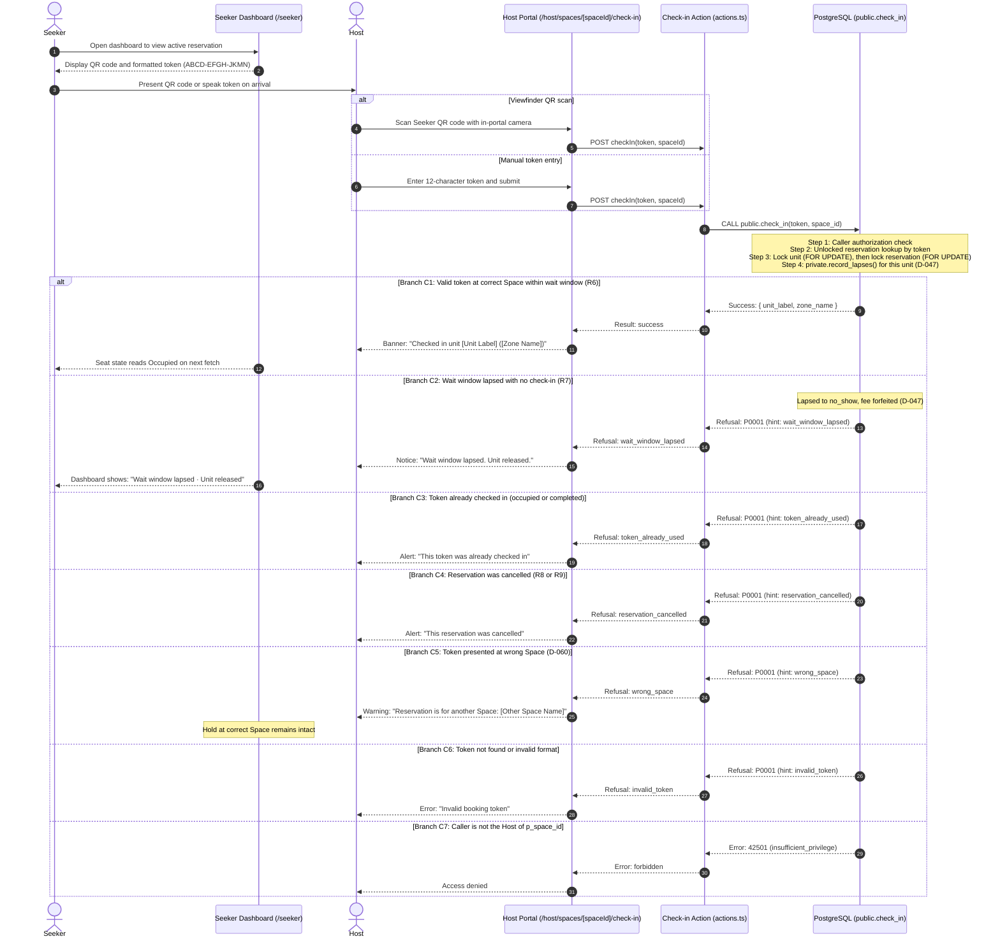

# Check-in

**Status:** draft · **Owner:** @lukedongque · **Approved by:** @dreeyanzz, @fayeye-09 ·
**Stories:** STORY-09, STORY-10 · **Decisions:** D-004, D-009, D-010, D-011, D-046, D-047, D-050, D-059, D-060

This flow follows a reservation from the moment a Seeker arrives at a Space and presents
their booking token until the unit transitions to Occupied (R6). It defines what the
booking token holds, how the QR code is formatted, how the Host scans or enters it, why it
works only once, what happens at the wrong Space or after the wait window lapses, and what
the Host and Seeker are told.

## What this flow covers

- What the booking token contains, its Crockford base32 format, entropy, and QR representation (FR-2.3, D-059).
- Check-in methods: in-portal camera scan and manual token entry, both submitting via Next.js Server Action (`actions.ts`, D-010).
- The check-in sequence and its branches: success (C1, R6), lapsed wait window / no-show (C2, R7),
  already-used token (C3), cancelled reservation (C4), wrong Space (C5, D-060), invalid token (C6),
  and unauthorized caller (C7).
- Race cases: clock synchronization, double check-in from two staff devices, counter cancellation during scan,
  stale Host overrides, and countdown computation.
- Every branch and negative case, and the pgTAP, Vitest, and Playwright tests that prove it.
- The `public.check_in` database function: signature, lock order, error contract (SQLSTATE `P0001` with error hints), and security grants.
- What the Host and the Seeker are told for each outcome (D-042).

It leaves these to others:

- **The [reservation lifecycle](reservation-lifecycle.md)** (#173): how a hold starts (R1),
  confirmed sandbox payment (R2), payment window lapses (R3), cancellations (R4, R8), Host
  overrides (R5, R9, R11), and how a unit's seat state is worked out (D-046). It defines
  the R6 move (`reserved` → `occupied`) and R7 (`reserved` → `no_show`).
- **The [Seeker journey](seeker-journey.md)** (#178): the Seeker's path from search to hold, and navigating to
  their `/seeker` dashboard to display their token (D-042).
- **The Host setup journey** (#177): the Host's onboarding and managing their Space.
- **STORY-10's design:** the visual layout of the Seeker's QR code card on `/seeker`, the
  Host's camera viewfinder interface on `/host/spaces/[spaceId]/check-in`, the manual token entry dialog, and the live wait-window
  countdown timers on the Host's seat map (FR-3.3).
- **STORY-12's design:** Host one-tap seat controls and walk-in occupancy.
- **STORY-13's design** (Sprint 3): writing a review, which requires a completed visit record
  created by a successful check-in (D-009, FR-4.1).

## The booking token and QR code

When a Seeker's sandbox payment is confirmed (R2 in STORY-09), the system issues a single-use
**booking token** stored in `reservations.booking_token` (FR-2.3):

1. **Alphabet and Entropy (D-059):**
   - The token uses Douglas Crockford's uppercase base32 alphabet: `0123456789ABCDEFGHJKMNPQRSTVWXYZ`.
   - It omits easily confused letters: `I`, `L`, `O`, and `U` (to prevent accidental obscenity).
   - Input normalization: reading and manual typing are case-insensitive. Input normalization maps lowercase to uppercase, and maps easily misread characters: `O` and `o` → `0`, and `I`, `i`, `L`, `l` → `1`.
   - Length: 12 characters. At 5 bits per character ($32 = 2^5$), 12 characters provide exactly 60 bits of cryptographic entropy.
   - Generation: generated in PostgreSQL during R2 using cryptographically secure random bytes (`gen_random_bytes(8)`).
   - Uniqueness: enforced by a `UNIQUE` index on `reservations(booking_token)`.
   - The token contains no sensitive user data, PII, payment info, Space identifiers, or database primary keys.
2. **Visual Presentation and QR Encoding:**
   - Displayed cleanly grouped in 4-character blocks separated by hyphens (e.g. `ABCD-EFGH-JKMN`) on `/seeker` directly underneath the QR code for spoken or manual entry.
   - The QR code encodes _only_ the raw 12-character booking token (or a URL containing only the token, e.g. `https://<domain>/check-in?token=ABCDEFGHJKMN`).
   - Crucially, the QR code does **not** contain the `space_id`. The target Space is always supplied by the Host's authenticated portal context (see D-060).

## Check-in methods

Hosts check in Seekers from within the authenticated Host portal (`/host/spaces/[spaceId]/check-in`), ensuring the target Space is always established by the Host's station (D-060):

1. **In-Portal Camera Viewfinder Scan:**
   - The Host opens `/host/spaces/[spaceId]/check-in` on their device and points the camera at the Seeker's QR code.
   - The client-side scanner decodes the 12-character token from the QR code.
   - The Host portal executes a Next.js Server Action (`checkIn(token, spaceId)`) via HTTP POST with automatic CSRF origin verification (`actions.ts`, D-010).
2. **Manual Token Entry:**
   - On the same check-in page (`/host/spaces/[spaceId]/check-in`), the Host types or pastes the 12-character token.
   - Submits the same Next.js Server Action (`checkIn(token, spaceId)`).
3. **External Camera Scan (Native Device Camera):**
   - If a Host scans the QR code using a native camera app instead of the web viewfinder, the encoded URL navigates the Host's browser to `/check-in?token=ABCDEFGHJKMN`.
   - The GET route only performs navigation: it verifies the Host's session, presents the Host's active Space (or prompts if the Host manages multiple Spaces), and presents a "Confirm Check-in" button.
   - Pressing "Confirm Check-in" submits the Server Action via POST. No mutation occurs on GET (D-010).

Both methods call the database function `public.check_in(p_token, p_space_id)`.

## The sequence



## Concurrency and race cases

These cases resolve race conditions across multiple actors and devices:

1. **Whose clock decides and grace periods:**
   - The database server's `clock_timestamp()` at transaction execution strictly decides whether `wait_window_ends_at` has lapsed (N10). Device clocks never decide validity.
   - _Grace period:_ By default, no database grace period is applied; the wait window chosen by the Seeker is exact. If a check-in arrives seconds after the window due to network latency, `record_lapses()` has marked the hold `no_show` and forfeited the fee. (See Open Questions if a configurable network grace period is needed).
2. **Two staff devices scanning the same token at once:**
   - Handled cleanly by strict database locking order: `check_in` locks the unit row `FOR UPDATE`, then locks the reservation row `FOR UPDATE`.
   - The first transaction commits R6 (`occupied`). The second transaction unblocks, re-evaluates `reservation.status`, finds `occupied`, and raises `P0001 (token_already_used)` (Branch C3).
3. **Seeker cancels at the counter during Host scan:**
   - A Seeker cancelling their hold calls `cancel_hold` (R8), which locks the unit then the reservation.
   - If `cancel_hold` commits first: `check_in` reads `cancelled` and raises `P0001 (reservation_cancelled)` (Branch C4). The Host is informed the reservation was cancelled.
   - If `check_in` commits first: `cancel_hold` unblocks, sees status is `occupied` (not `reserved`), and refuses the cancellation with `P0001 (hold_not_active)` per lifecycle N21. The Seeker is informed the hold is already checked in.
4. **Stale Host override tap just after check-in:**
   - A Host tapping an out-of-date screen to override a unit (`set_unit_state`, R9/R11) must pass the `reservation_id` and seat state it saw (D-050).
   - If the seat state changed from `reserved` to `occupied` via check-in, `set_unit_state` compares the expected state, rejects the stale override with `P0001 (hold_changed)` per lifecycle N21, and refreshes the Host screen with the new Occupied state.
5. **Countdown timers:**
   - The Host's remaining wait window displays (FR-3.3) and Seeker countdowns compute remaining time from `reservations.wait_window_ends_at` (returned by `unit_states`), never from a client device timer alone.

## Every branch, and its test

Tests verify the database function (`supabase/tests/20-check-in-release.sql`), the token logic (`lib/check-in/`), and Playwright journeys (`e2e/check-in.spec.ts`).

| #   | Branch                | Condition                                                                          | Database state move                                                                                                                       | Error code & hint                  | Test                                                                                                                                                                                                              |
| --- | --------------------- | ---------------------------------------------------------------------------------- | ----------------------------------------------------------------------------------------------------------------------------------------- | ---------------------------------- | ----------------------------------------------------------------------------------------------------------------------------------------------------------------------------------------------------------------- |
| C1  | Valid check-in        | Active `reserved` hold, valid token, matching `space_id`, within wait window       | R6: `reservations.status` → `occupied`, `checked_in_at = clock_timestamp()`. Payment stays `paid`. Unit seat state reads Occupied (D-046) | None (Success)                     | `check-in-release`: "a Host checks in a Reserved unit, which reads Occupied"; `e2e/check-in`: "Host scans valid QR code and unit becomes Occupied"                                                                |
| C2  | Lapsed wait window    | Status is `no_show` after lapse step, or `wait_window_ends_at < clock_timestamp()` | R7: `reservations.status` → `no_show`, `payments.status` → `forfeited`. Unit reads Available                                              | `P0001` (`wait_window_lapsed`)     | `check-in-release`: "a booking token cannot check in once its wait window has lapsed"; `check-in-release`: "a no-show releases the unit and forfeits the fee"                                                     |
| C3  | Token already used    | `reservations.status` is `occupied` or `completed`                                 | None. Reservation remains in its existing state                                                                                           | `P0001` (`token_already_used`)     | `check-in-release`: "a token cannot be checked in twice"; `check-in-release`: "two staff devices scanning the same token result in exactly one check-in"; `lib/check-in`: "rejects used token"                    |
| C4  | Reservation cancelled | `reservations.status` is `cancelled` (R8 or R9)                                    | None. Reservation remains `cancelled`                                                                                                     | `P0001` (`reservation_cancelled`)  | `check-in-release`: "a cancelled reservation cannot be checked in"; `check-in-release`: "cancelling at counter before scan refuses check-in"                                                                      |
| C5  | Wrong Space (D-060)   | Token exists and is `reserved`, but unit belongs to another Space                  | None. Hold remains `reserved` at its original Space                                                                                       | `P0001` (`wrong_space`)            | `check-in-release`: "a Host cannot check in a token for another Space"; `e2e/check-in`: "scanning token at wrong space preserves hold and shows informative error"                                                |
| C6  | Invalid token         | Token format invalid or not found in `reservations`                                | None. No row matches                                                                                                                      | `P0001` (`invalid_token`)          | `check-in-release`: "an invalid token string is rejected"; `lib/check-in`: "validates Crockford base32 alphabet and length"                                                                                       |
| C7  | Unauthorized caller   | Authenticated user is not the owning Host of `p_space_id`, or caller is signed out | None. Database raises error `42501`                                                                                                       | `42501` (`insufficient_privilege`) | `check-in-release`: "a Seeker cannot check in their own reservation"; `check-in-release`: "another Host cannot check in a Space they do not own"; `check-in-release`: "a signed-out visitor cannot call check_in" |

## Moves nobody may make

The lifecycle defines the global rules for holds, payments, and caller roles:

- **Direct table writes:** Lifecycle N6 blocks direct writes to `reservations` and `payments`.
- **Checkout permissions:** Lifecycle N8 blocks checking out another Seeker's visit.
- **Check-in permissions:** Lifecycle N9 blocks checking in unless the caller is the Space's Host.
- **Expired wait windows:** Lifecycle N10 blocks checking in once the wait window has lapsed.
- **Grant boundaries:** Lifecycle N24 blocks callers from invoking functions they are not granted.

The check-in flow defines these additional moves specific to tokens and venue boundaries:

| #    | Nobody may                                                  | Stopped by                                                                        | Test                                                                                |
| ---- | ----------------------------------------------------------- | --------------------------------------------------------------------------------- | ----------------------------------------------------------------------------------- |
| C-N1 | Check in a token at another Space                           | `public.check_in` verifies `unit.space_id = p_space_id` (D-060)                   | `check-in-release`: "a Host cannot check in a token for another Space"              |
| C-N2 | Check in a token twice                                      | `public.check_in` checks `status = 'reserved'` after acquiring unit lock          | `check-in-release`: "a token cannot be checked in twice"                            |
| C-N3 | Check in an unpaid hold (`pending_payment`)                 | Tokens are generated only upon confirmed payment (R2); lookup requires `reserved` | `check-in-release`: "a pending_payment hold cannot be checked in"                   |
| C-N4 | Learn the Seeker's identity or profile from check-in return | `public.check_in` returns only unit and zone labels, never Seeker name or id      | `check-in-release`: "check_in returns unit and zone labels without Seeker identity" |

## The database function

`public.check_in(p_token text, p_space_id uuid)` (STORY-10, written by Adrian):

```sql
create or replace function public.check_in(
  p_token text,
  p_space_id uuid
)
returns jsonb
language plpgsql
security definer
set search_path = ''
as $$
declare
  v_res record;
  v_unit record;
begin
  -- 1. Caller check: Caller must be the Host of p_space_id
  if auth.uid() is null or not exists (
    select 1 from public.spaces where id = p_space_id and host_id = auth.uid()
  ) then
    raise exception 'Unauthorized' using errcode = '42501';
  end if;

  -- 2. Lookup reservation by normalized token (unlocked initial probe)
  select r.id, r.unit_id, r.status, r.space_id, r.wait_window_ends_at
  into v_res
  from public.reservations r
  where r.booking_token = upper(trim(p_token));

  if not found then
    raise exception 'Invalid booking token'
      using errcode = 'P0001', hint = 'invalid_token';
  end if;

  -- 3. Wrong Space check (D-060): fail early if token belongs to another Space
  if v_res.space_id != p_space_id then
    raise exception 'Booking belongs to another Space'
      using errcode = 'P0001', hint = 'wrong_space';
  end if;

  -- 4. Lock in strict lifecycle order: unit row first, then reservation row
  select u.id, u.label, u.zone_id, z.name as zone_name
  into v_unit
  from public.units u
  join public.zones z on z.id = u.zone_id
  where u.id = v_res.unit_id
  for update;

  select r.* into v_res
  from public.reservations r
  where r.id = v_res.id
  for update;

  -- 5. Record lapses for this unit first (D-047)
  perform private.record_lapses(v_unit.id);

  -- Re-read status after lapse processing
  select r.status into v_res.status
  from public.reservations r
  where r.id = v_res.id;

  -- 6. Evaluate status branches
  if v_res.status = 'no_show' or v_res.wait_window_ends_at < clock_timestamp() then
    raise exception 'Wait window lapsed'
      using errcode = 'P0001', hint = 'wait_window_lapsed';
  elsif v_res.status = 'cancelled' then
    raise exception 'Reservation was cancelled'
      using errcode = 'P0001', hint = 'reservation_cancelled';
  elsif v_res.status in ('occupied', 'completed') then
    raise exception 'Token already used'
      using errcode = 'P0001', hint = 'token_already_used';
  elsif v_res.status != 'reserved' then
    raise exception 'Reservation is not in reserved state'
      using errcode = 'P0001', hint = 'invalid_state';
  end if;

  -- 7. Transition to occupied (R6)
  update public.reservations
  set status = 'occupied',
      checked_in_at = clock_timestamp()
  where id = v_res.id;

  -- 8. Return unit metadata for Host confirmation (no Seeker identity exposed)
  return jsonb_build_object(
    'unit_id', v_unit.id,
    'unit_label', v_unit.label,
    'zone_name', v_unit.zone_name
  );
end;
$$;
```

- **Grants (D-047, N24):** The function first revokes execute from `public`, `anon`, and `authenticated`. Execute is granted strictly to `authenticated`.
- **Lock order:** Strictly locks the unit row first `FOR UPDATE`, then locks the reservation row `FOR UPDATE`. This prevents deadlocks with `set_unit_state` and serializes concurrent scans.
- **Privacy (D-057):** Returns only the unit label and zone name. It does not return the Seeker's full name or profile metadata.

## What Host and Seeker are told

Maria decides exact UX wording and component presentation (D-042):

| Event                     | What the Host sees                                                                                     | What the Seeker sees                                                                                                              |
| ------------------------- | ------------------------------------------------------------------------------------------------------ | --------------------------------------------------------------------------------------------------------------------------------- |
| **C1 Success**            | Success banner: "Checked in unit [Unit Label] ([Zone Name])". Unit highlights as Occupied on seat map. | Dashboard card transitions from "Reserved" (with QR code) to "Checked In · Unit [Unit Label]". Displays button for self-checkout. |
| **C2 Lapsed wait window** | Notice: "Wait window lapsed. Seat has been released and reservation fee forfeited."                    | Dashboard shows "Wait window lapsed · Unit released".                                                                             |
| **C3 Already used**       | Alert: "This token was already checked in. Unit is currently Occupied."                                | "Already checked in."                                                                                                             |
| **C4 Cancelled**          | Warning: "This reservation was cancelled."                                                             | Dashboard shows "Reservation cancelled".                                                                                          |
| **C5 Wrong Space**        | Warning: "This reservation is for another Space: [Other Space Name]. No changes were made."            | Status remains "Reserved · Ready for check-in at [Correct Space Name]".                                                           |
| **C6 Invalid token**      | Error: "Invalid booking token. Please verify the code or ask the Seeker to refresh their dashboard."   | Displays QR code with option to view alphanumeric code.                                                                           |
| **C7 Unauthorized**       | Error: "You must be signed in as the Host of this Space to perform check-in."                          | N/A                                                                                                                               |

## Choices made

Each choice has its entry in [DECISIONS](../DECISIONS.md):

- **D-059: Booking token format and QR encoding.** The booking token is an unguessable 12-character uppercase string using Douglas Crockford's base32 alphabet (`0123456789ABCDEFGHJKMNPQRSTVWXYZ`, omitting `I`, `L`, `O`, `U`). Input normalization maps lowercase letters to uppercase, `O`/`o` to `0`, and `I`/`i`/`L`/`l` to `1`. The QR code encodes only the 12-character token (or a URL containing only the token), with no Space ID or personal data. The token is generated at confirmed payment (R2) via `gen_random_bytes(8)` and protected with a `UNIQUE` index on `reservations(booking_token)`.
  _Why:_ Gives exactly 60 bits of entropy without case-sensitivity typing friction. Camera viewfinder and manual entry both work reliably without leaking sensitive PII.
  _Rejected:_ Mixed-case alphabets (confusing when read aloud), raw UUIDs (too long to type), embedding `space_id` in the QR code (bypasses cross-space verification).
  _Revisit if:_ A physical scanner hardware integration requires barcodes or alternative encodings.
- **D-060: Space-scoped check-in and mutation safety.** Check-in requires `space_id` established by the Host's portal context (`/host/spaces/[spaceId]/check-in`), not from the Seeker's QR code. All check-in mutations are executed via HTTP POST Server Actions with origin verification (D-010). If a token is presented at the wrong Space, the check-in fails with SQLSTATE `P0001` hint `wrong_space`, leaving the Seeker's hold intact at their reserved Space.
  _Why:_ Completely eliminates GET-based CSRF attacks that could prematurely consume holds, and ensures cross-venue scans at multi-branch locations correctly detect mismatched Spaces.
  _Rejected:_ Unscoped global check-in, GET-based check-in route handlers, and taking the Space from the Seeker's QR payload.
  _Revisit if:_ Host check-in kiosks require dedicated hardware terminals without browser sessions.

## Open questions

- **Network latency grace period:** Should the database check-in function provide a small grace period (e.g., 60 seconds) past `wait_window_ends_at` to tolerate network delays at venue entry? If so, this will be tracked as a `decision-needed` issue before STORY-10's implementation.
