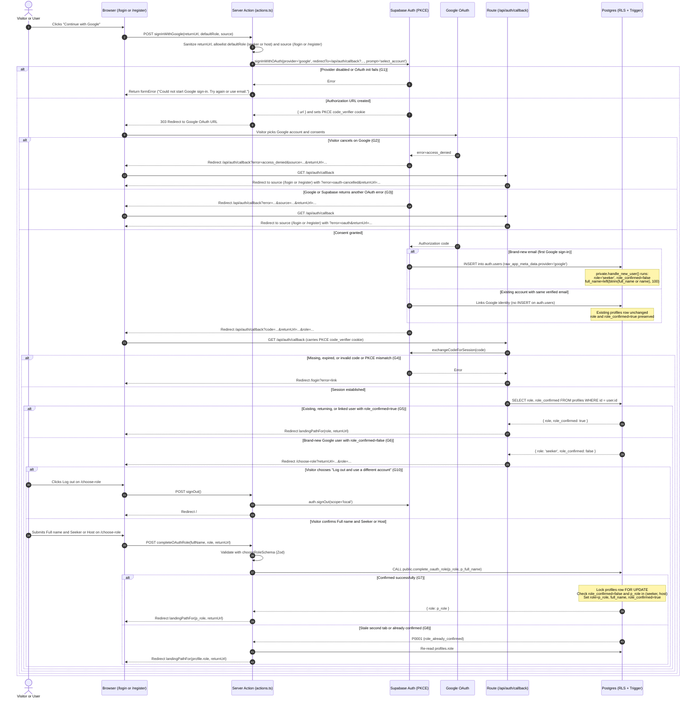
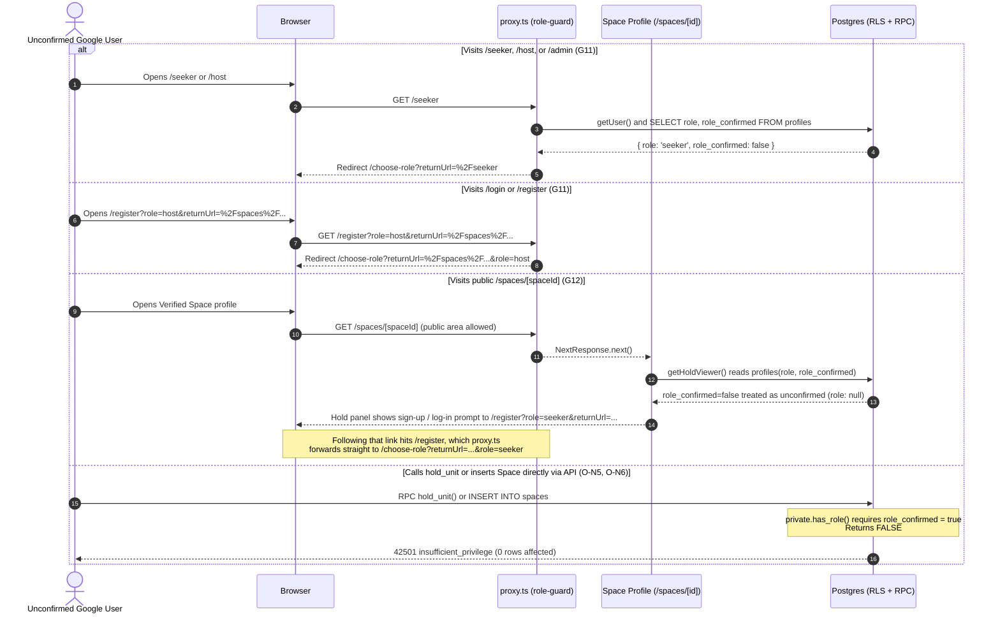

# Google OAuth

**Status:** implemented 2026-11-24 · **Owner:** @dreeyanzz · **Approved by:** @dreeyanzz ·
**Stories:** STORY-01, STORY-03, STORY-09, STORY-17, STORY-19, STORY-21 (#392) ·
**Decisions:** D-007, D-010, D-013, D-031, D-032, D-042, D-044, D-058, D-074, D-090, D-091, D-093, D-095

This flow follows a visitor signing in or signing up with Google on Worq: starting the
OAuth redirect from `/login` or `/register`, exchanging the authorization code in
`app/api/auth/callback/route.ts`, linking an existing verified email automatically,
or sending a brand-new Google user through one-time **Seeker** or **Host** role
confirmation on `/choose-role` (D-095). It defines the sequence and every failure branch,
the database and Row-Level Security contract, the route guard rules while a role is
unconfirmed, and how the flow is tested in CI without Google credentials.

## What this flow covers

- **Initiating Google OAuth (`signInWithGoogle`):** A Server Action in `app/(auth)/actions.ts`
  (D-010) that starts Supabase Auth's PKCE OAuth flow (`provider: 'google'`,
  `queryParams: { prompt: 'select_account' }`), sets the PKCE `code_verifier` cookie, and
  redirects to Google while preserving sanitized `returnUrl` (D-058), optional `role` hint
  (`seeker` or `host`), and allowlisted `source` (`/login` or `/register`).
- **OAuth callback (`app/api/auth/callback/route.ts`):** Handling `?error=access_denied`
  (user cancelled), other OAuth errors, missing or expired `?code=`, and successful PKCE
  code exchange (D-010).
- **First-time Google sign-up (`private.handle_new_user`):** Detecting OAuth sign-ups via
  server-owned `raw_app_meta_data ->> 'provider'`, creating the profile with
  `role = 'seeker'` and `role_confirmed = false`, and safely truncating Google display
  names to 100 characters.
- **Returning and linked accounts:** Allowing Supabase Auth's default automatic identity
  linking for verified Google emails so existing confirmed Seekers, Hosts and
  Administrators keep their existing `profiles` row (`role_confirmed = true`) and skip
  `/choose-role`.
- **One-time role confirmation (`/choose-role`, `public.complete_oauth_role`):** Confirming
  the user's **Full name** (pre-filled from Google, editable, 1–100 characters) and picking
  **Seeker** or **Host** once (never **Administrator**, D-013), plus a **Log out** escape
  (`scope: 'local'`) to switch accounts.
- **Database security boundary (`D-007`):** Adding `profiles.role_confirmed` with no
  `UPDATE` grant and gating `private.has_role()` on `role_confirmed = true` so an
  unconfirmed OAuth account cannot hold a unit or create a Space even if `proxy.ts` is
  bypassed.
- **Route guard and Space profile behavior:** Updating `lib/auth/role-guard.ts`,
  `lib/supabase/proxy.ts`, `app/(auth)/actions.ts` (`login`), and
  `lib/data/reservations.ts` (`getHoldViewer`) so an unconfirmed user is routed to
  `/choose-role`.
- **External configuration and testing:** Google Cloud OAuth 2.0 Web Client and Supabase
  Auth URL configuration for `studyhub-dev` and `studyhub-prod`, keeping
  `supabase/config.toml` runnable in CI without Google secrets, and the test matrix across
  pgTAP, Vitest, Playwright and manual live verification.

It leaves these to others:

- **[STORY-03's design](../design/STORY-03-auth-rbac.md):** Email and password sign-up,
  login, password complexity rules, and the base route guard for confirmed accounts.
- **[Seeker journey](seeker-journey.md)** (#178) and **[STORY-09's design](../design/STORY-09-reserve-now-holds.md):**
  The hold panel, checkout and confirmation flow after a Seeker returns to a Space profile
  via `returnUrl` (D-058).
- **[STORY-17's design](../design/STORY-17-ui-ux-refresh.md):** Visual styling and final
  copy of `/login`, `/register` and `/choose-role` (D-042, D-074), within WCAG 2.1 AA and
  48 × 48 px control sizes (SRS §3.2.2, D-031).
- **[STORY-19's design](../design/STORY-19-final-hardening.md):** Creating the production
  Supabase project (D-090), real production accounts (D-091), and running the route-wide
  accessibility sweep (D-093).
- **The Google OAuth build story design:** Concrete tasks, file list and build order
  written after this flow merges (D-016, D-044).

---

## 1. Sequence Diagrams

### 1.1 Primary Sequence: Google Sign-In, Callback, and First-Time Role Confirmation



### 1.2 Edge Case: Abandoned `/choose-role` and Direct API Bypass Attempts

A brand-new Google user closes the tab on `/choose-role` and returns later while their
session cookie is still valid (`role_confirmed = false`).



---

## 2. Every Branch, Event, and Test

Tests live in `supabase/tests/NN-google-oauth.sql` (numbered when created, extending
`01-profiles.sql` coverage), colocated Vitest files (`app/(auth)/actions.test.ts`,
`app/api/auth/callback/route.test.ts`, `lib/auth/role-guard.test.ts`,
`lib/supabase/proxy.test.ts`, `lib/data/reservations.test.ts`), and Playwright
(`e2e/google-oauth.spec.ts` plus `e2e/support/routes.ts` for `e2e/accessibility.spec.ts`).

| #   | Branch / Event                                                                                | Who initiates           | Made by                                                              | Resulting state / redirect                                                                                            | Test                                                                                                                                                                                 |
| --- | --------------------------------------------------------------------------------------------- | ----------------------- | -------------------------------------------------------------------- | --------------------------------------------------------------------------------------------------------------------- | ------------------------------------------------------------------------------------------------------------------------------------------------------------------------------------ |
| G1  | Google provider disabled or `signInWithOAuth` fails                                           | Visitor                 | `signInWithGoogle` Server Action                                     | Stays on `/login` or `/register` with error alert                                                                     | `vitest/actions`: "returns a formError when signInWithOAuth fails"                                                                                                                   |
| G2  | Visitor cancels on Google consent screen (`?error=access_denied`)                             | Visitor / Google        | `app/api/auth/callback/route.ts`                                     | Redirects to `source` (`/login` or `/register`) with `?error=oauth-cancelled`                                         | `vitest/callback`: "returns a cancelled Google sign-in to its source page with returnUrl"                                                                                            |
| G3  | Google or Supabase returns another `?error=...`                                               | Google / Supabase       | `app/api/auth/callback/route.ts`                                     | Redirects to `source` with `?error=oauth`                                                                             | `vitest/callback`: "returns an OAuth failure to its source page with error=oauth"                                                                                                    |
| G4  | Missing, expired, or invalid `?code=` or PKCE verifier mismatch                               | Visitor / Replay        | `app/api/auth/callback/route.ts`                                     | Redirects to `/login?error=link`                                                                                      | `vitest/callback`: "sends a missing or failed code to log in"                                                                                                                        |
| G5  | Returning Google user or linked existing email/password account (`role_confirmed=true`)       | Existing user           | `app/api/auth/callback/route.ts`                                     | Skips `/choose-role`; redirects to `landingPathFor(role, returnUrl)`                                                  | `vitest/callback`: "sends a confirmed account straight to its dashboard or returnUrl"; Manual §7: "linked email/password Host keeps host role and skips /choose-role"                |
| G6  | Brand-new Google user finishes Google consent (`role_confirmed=false`)                        | New visitor             | `private.handle_new_user()` + `app/api/auth/callback/route.ts`       | Profile created (`role='seeker'`, `role_confirmed=false`); redirects to `/choose-role`                                | `google-oauth` (pgTAP): "a Google sign-up creates a profile with role_confirmed false and truncated full_name"; `vitest/callback`: "sends an unconfirmed OAuth user to /choose-role" |
| G7  | New Google user confirms Full name and picks Seeker or Host                                   | New Google user         | `completeOAuthRole` Server Action + `public.complete_oauth_role`     | Profile updates (`role=p_role`, `full_name`, `role_confirmed=true`); redirects to `landingPathFor(p_role, returnUrl)` | `google-oauth` (pgTAP): "complete_oauth_role confirms a Seeker or Host once and unlocks private.has_role"; `e2e/google-oauth`: "unconfirmed user picks Host and lands on /host"      |
| G8  | Second tab or double submit after role is already confirmed                                   | Confirmed user          | `public.complete_oauth_role` (`P0001: role_already_confirmed`) + SA  | Database unchanged; Server Action re-reads role and redirects to dashboard                                            | `google-oauth` (pgTAP): "complete_oauth_role refuses once role_confirmed is already true"; `vitest/actions`: "redirects to the confirmed role's dashboard on role_already_confirmed" |
| G9  | Started from `/register?role=host` or a Space hold prompt (`D-058`)                           | Visitor                 | `signInWithGoogle` → callback → `/choose-role`                       | Preselects `host` or `seeker` on `/choose-role` and returns to `returnUrl`                                            | `vitest/actions`: "keeps sanitized returnUrl and role hint in Google redirectTo"; `e2e/google-oauth`: "preserves returnUrl back to Space profile after confirming Seeker"            |
| G10 | Visitor clicks "Log out and use a different account" on `/choose-role`                        | Unconfirmed Google user | `signOut()` (`scope: 'local'`)                                       | Local session cleared; redirects to `/`                                                                               | `e2e/google-oauth`: "unconfirmed user can sign out from /choose-role"                                                                                                                |
| G11 | Unconfirmed user returns later and visits `/seeker`, `/host`, `/admin`, `/login`, `/register` | Unconfirmed Google user | `proxy.ts` (`updateSession` + `evaluateRouteAccess`)                 | Redirects to `/choose-role` (preserving `returnUrl` and any valid `role`)                                             | `vitest/role-guard` + `vitest/proxy`: "routes an unconfirmed signed-in user to /choose-role"; `e2e/google-oauth`: "blocks portal routes until role is confirmed"                     |
| G12 | Unconfirmed user opens `/spaces/[spaceId]`                                                    | Unconfirmed Google user | `getHoldViewer()` in `lib/data/reservations.ts`                      | Treated as unconfirmed (`role: null`); Hold panel routes through `/choose-role`                                       | `vitest/reservations`: "getHoldViewer treats an unconfirmed profile as role null"                                                                                                    |
| G13 | Confirmed user or signed-out visitor opens `/choose-role`                                     | Confirmed user or anon  | `proxy.ts` (`evaluateRouteAccess`) + `/choose-role` Server Component | Signed-out → `/login`; confirmed → `dashboardFor(role)`                                                               | `vitest/role-guard`: "redirects anon from /choose-role to /login and confirmed users to their dashboard"                                                                             |

---

## 3. Moves Nobody May Make

Each move has a negative test (AGENTS.md rule 5). The [testing guide](../guides/testing.md)
explains the error codes (`42501` for missing grants or role checks; `P0001` with a hint
for business-rule refusals).

| #     | Nobody may                                                                                                      | Stopped by                                                                                                                                 | Test                                                                                                                                              |
| ----- | --------------------------------------------------------------------------------------------------------------- | ------------------------------------------------------------------------------------------------------------------------------------------ | ------------------------------------------------------------------------------------------------------------------------------------------------- |
| O-N1  | Self-register or confirm as an Administrator (`admin`) via Google OAuth                                         | `private.handle_new_user()` ignores OAuth metadata role; `complete_oauth_role()` accepts `'seeker'`, `'host'` only (`P0001: invalid_role`) | `google-oauth` (pgTAP): "complete_oauth_role refuses admin and unknown roles"; "Google sign-up ignores raw_user_meta_data role"                   |
| O-N2  | Switch roles after confirmation (e.g. Seeker → Host, Host → Seeker, or Admin → anything)                        | `public.complete_oauth_role` locks the row and raises `P0001: role_already_confirmed` when `role_confirmed` is `true`                      | `google-oauth` (pgTAP): "a confirmed Seeker, Host, or Administrator cannot change role through complete_oauth_role"                               |
| O-N3  | Directly `UPDATE public.profiles SET role = ...` or `SET role_confirmed = true`                                 | No `UPDATE` grant on `role` or `role_confirmed` (only `full_name, phone_number` granted to `authenticated`)                                | `google-oauth` (pgTAP): "an authenticated user cannot update role_confirmed directly (42501)"                                                     |
| O-N4  | Run `public.complete_oauth_role` while signed out (`anon`)                                                      | Execute revoked from `public` and `anon`; granted only to `authenticated` (`42501`)                                                        | `google-oauth` (pgTAP): "a signed-out visitor cannot call complete_oauth_role (42501)"                                                            |
| O-N5  | Call `hold_unit()` while `role_confirmed = false` (even with `proxy.ts` bypassed)                               | `private.has_role('seeker')` requires `role_confirmed = true`, so `hold_unit` raises `42501`                                               | `google-oauth` (pgTAP): "an unconfirmed Google user cannot hold a unit (42501)"                                                                   |
| O-N6  | Insert a Space, zone, unit or tag while `role_confirmed = false`                                                | `private.has_role('host')` requires `role_confirmed = true`, so RLS refuses the insert                                                     | `google-oauth` (pgTAP): "an unconfirmed Google user cannot create a Space"                                                                        |
| O-N7  | Forge `role` or `role_confirmed` via `auth.updateUser({ data: ... })` (`user_metadata`)                         | `proxy.ts`, `/api/auth/callback`, `getHoldViewer`, and RLS read `public.profiles` only, never `user_metadata`                              | `vitest/proxy` + `vitest/callback`: "reads role and role_confirmed from profiles, never user_metadata"                                            |
| O-N8  | Redirect off-site via `returnUrl` (`//evil.example`, `/.//evil.example`, `https://...`) or tamper with `source` | `sanitizeReturnUrl()` drops unsafe paths; `source` allowlisted strictly to `'/login'` or `'/register'`                                     | `vitest/actions` + `vitest/callback`: "drops unsafe returnUrl and invalid source values"                                                          |
| O-N9  | Preselect or submit `role=admin` via `?role=admin` query param                                                  | Only `'seeker'` and `'host'` pass allowlist; Zod and `complete_oauth_role` reject anything else                                            | `vitest/callback` + `vitest/actions`: "drops role=admin from callback query and rejects role=admin on submit"                                     |
| O-N10 | Break Google sign-up with a display name over 100 characters                                                    | `private.handle_new_user()` trims and truncates with `left(..., 100)` before inserting into `profiles`                                     | `google-oauth` (pgTAP): "a Google display name over 100 characters is truncated to 100 characters on sign-up"                                     |
| O-N11 | Confirm an empty, whitespace-only, or >100-character `full_name` on `/choose-role`                              | `chooseRoleSchema` (Zod) and `public.complete_oauth_role` (`P0001: invalid_full_name`) reject it                                           | `google-oauth` (pgTAP): "complete_oauth_role refuses blank or over-100-character full_name"; `vitest/auth`: "chooseRoleSchema validates fullName" |

---

## 4. Database Contracts and Row-Level Security

The migration is owned by Adrian (database owner, `docs/DEVELOPMENT.md`), and regenerates
`lib/supabase/database.types.ts` in the same PR.

### 4.1 Schema change on `public.profiles`

```sql
alter table public.profiles
  add column role_confirmed boolean not null default true;

comment on column public.profiles.role_confirmed is
  'False for a brand-new OAuth account until public.complete_oauth_role confirms Seeker or Host once (D-095). No update grant.';
```

- **Column grants stay unchanged** from `20260926032341_profiles.sql`: `select` for `anon, authenticated`; `update (full_name, phone_number)` for `authenticated` only. Neither `role` nor `role_confirmed` is granted for direct update (O-N3).
- **Backwards compatibility:** Every existing profile, `supabase/seed.sql`, `npm run db:accounts`, and every email/password sign-up defaults to `role_confirmed = true`.

### 4.2 `private.has_role(wanted public.user_role)`

```sql
create or replace function private.has_role(wanted public.user_role)
returns boolean
language sql
stable
security definer
set search_path = ''
as $$
  select exists (
    select 1
    from public.profiles
    where id = (select auth.uid())
      and role = wanted
      and role_confirmed = true
  );
$$;
```

Every existing RLS policy and database function that checks `private.has_role('seeker')`,
`private.has_role('host')`, or `private.has_role('admin')` automatically rejects an
unconfirmed Google account until `/choose-role` completes (O-N5, O-N6).

### 4.3 `private.handle_new_user()`

```sql
create or replace function private.handle_new_user()
returns trigger
language plpgsql
security definer
set search_path = ''
as $$
declare
  v_provider text := coalesce(new.raw_app_meta_data ->> 'provider', 'email');
  v_requested text;
  v_full_name text := nullif(
    left(
      btrim(
        coalesce(
          new.raw_user_meta_data ->> 'full_name',
          new.raw_user_meta_data ->> 'name',
          ''
        )
      ),
      100
    ),
    ''
  );
begin
  if v_provider <> 'email' then
    -- OAuth sign-ups always start unconfirmed; the user picks Seeker or Host once on /choose-role (D-095).
    insert into public.profiles (id, role, role_confirmed, full_name)
    values (new.id, 'seeker'::public.user_role, false, v_full_name);
    return new;
  end if;

  v_requested := coalesce(new.raw_user_meta_data ->> 'role', 'seeker');
  if v_requested not in ('seeker', 'host') then
    raise exception 'invalid sign-up role: %', v_requested
      using hint = 'Sign up as seeker or host.';
  end if;

  insert into public.profiles (id, role, role_confirmed, full_name)
  values (new.id, v_requested::public.user_role, true, v_full_name);

  return new;
end;
$$;
```

- **Why `raw_app_meta_data ->> 'provider'`:** Only Supabase Auth writes `raw_app_meta_data`; a client calling `signUp()` can only populate `raw_user_meta_data`. Direct SQL inserts in `01-profiles.sql` that omit `raw_app_meta_data` default to `'email'` and keep passing unchanged.
- **Automatic identity linking:** When an existing confirmed email/password account signs in with Google using the same verified email, Supabase Auth links the identity in `auth.identities` without inserting into `auth.users`. `on_auth_user_created` does not fire, so their existing `profiles` row (`role` and `role_confirmed = true`) is untouched.

### 4.4 `public.complete_oauth_role(p_role public.user_role, p_full_name text)`

```sql
create or replace function public.complete_oauth_role(
  p_role public.user_role,
  p_full_name text
)
returns jsonb
language plpgsql
security definer
set search_path = ''
as $$
declare
  v_uid uuid := (select auth.uid());
  v_trimmed_name text := nullif(btrim(coalesce(p_full_name, '')), '');
  v_profile record;
begin
  if v_uid is null then
    raise exception 'Unauthorized' using errcode = '42501';
  end if;

  if p_role is null or p_role not in ('seeker', 'host') then
    raise exception 'Invalid role'
      using errcode = 'P0001', hint = 'invalid_role';
  end if;

  if v_trimmed_name is null or char_length(v_trimmed_name) > 100 then
    raise exception 'Invalid full name'
      using errcode = 'P0001', hint = 'invalid_full_name';
  end if;

  select id, role, role_confirmed
  into v_profile
  from public.profiles
  where id = v_uid
  for update;

  if not found then
    raise exception 'Profile not found'
      using errcode = 'P0001', hint = 'profile_not_found';
  end if;

  if v_profile.role_confirmed then
    raise exception 'Role already confirmed'
      using errcode = 'P0001', hint = 'role_already_confirmed';
  end if;

  update public.profiles
  set role = p_role,
      full_name = v_trimmed_name,
      role_confirmed = true
  where id = v_uid;

  return jsonb_build_object('role', p_role);
end;
$$;

revoke all on function public.complete_oauth_role(public.user_role, text) from public, anon, authenticated;
grant execute on function public.complete_oauth_role(public.user_role, text) to authenticated;
```

---

## 5. Route Access Matrix and Hold Panel Behavior

`lib/supabase/proxy.ts` selects `role, role_confirmed` from `profiles` and passes
`roleConfirmed` to `evaluateRouteAccess()` in `lib/auth/role-guard.ts`. As in STORY-03,
only `GET` and `HEAD` requests are routed; `POST` requests (Server Actions) pass through
to their own session check (`#137`).

| Route Category | Paths                              | Signed out (`role = null`)    | Signed in, unconfirmed (`roleConfirmed = false`)                            | Signed in, confirmed (`roleConfirmed = true`) |
| -------------- | ---------------------------------- | ----------------------------- | --------------------------------------------------------------------------- | --------------------------------------------- |
| **Public**     | `/`, `/spaces`, `/spaces/*`        | Allow                         | Allow                                                                       | Allow                                         |
| **Auth**       | `/login`, `/register`              | Allow                         | Redirect `/choose-role` (preserving sanitized `returnUrl` and valid `role`) | Redirect `dashboardFor(role)`                 |
| **Onboarding** | `/choose-role`                     | Redirect `/login`             | Allow                                                                       | Redirect `dashboardFor(role)`                 |
| **Portals**    | `/seeker/*`, `/host/*`, `/admin/*` | Redirect `/login?returnUrl=…` | Redirect `/choose-role?returnUrl=…`                                         | Existing STORY-03 / D-032 rules               |
| **System**     | `/api/auth/callback`               | Allow                         | Allow                                                                       | Allow                                         |

- **`lib/data/reservations.ts` (`getHoldViewer`):** Selects `role, role_confirmed`. When `role_confirmed` is `false`, returns `{ role: null, currentHold: null }` so the Space profile's Hold panel never renders an active "Hold & Pay" form for an unconfirmed user; clicking the prompt to sign up or log in hits `/register?role=seeker&returnUrl=...`, which `proxy.ts` immediately forwards to `/choose-role?returnUrl=...&role=seeker` (G12).
- **`app/(auth)/actions.ts` (`login`):** Selects `role, role_confirmed`; if `role_confirmed` is `false`, redirects to `/choose-role` (preserving `returnUrl`) instead of a dashboard.

---

## 6. What Visitors and Users Are Told

Maria and James decide final styling and wording in STORY-17 (D-042, D-074), bound by
WCAG 2.1 AA contrast and 48 × 48 px touch targets (SRS §3.2.2, D-031).

| Screen / Event                       | Default behavior and copy                                                                                                                                                                                                                                                                                                                                                    |
| ------------------------------------ | ---------------------------------------------------------------------------------------------------------------------------------------------------------------------------------------------------------------------------------------------------------------------------------------------------------------------------------------------------------------------------- |
| **`/login` and `/register`**         | Full-width secondary **"Continue with Google"** button (≥ 48 px height, wrappable text, decorative Google SVG with `aria-hidden="true"`), separated from email fields by an `"or continue with email"` divider.                                                                                                                                                              |
| **G1 (OAuth init fails)**            | Destructive `Alert`: `"We could not start Google sign-in. Try again, or use your email and password."`                                                                                                                                                                                                                                                                       |
| **G2 (Cancelled on Google)**         | Status `Alert`: `"Google sign-in was cancelled. Try again, or use your email and password."`                                                                                                                                                                                                                                                                                 |
| **G3 (Other Google/Supabase error)** | Destructive `Alert`: `"We could not sign you in with Google. Try again, or use your email and password."`                                                                                                                                                                                                                                                                    |
| **G4 (Invalid or expired code)**     | Existing `Alert` on `/login`: `"That link is invalid or has expired. Log in, or sign up again."`                                                                                                                                                                                                                                                                             |
| **`/choose-role`**                   | Rendered inside `AuthShell`. Heading: `"Finish setting up your account"`. Displays signed-in email, pre-filled editable **Full name** (`FormField`, 1–100 chars), accessible `fieldset` (`role="radiogroup"`) for **Seeker** vs **Host** (preselected from `?role=`), primary **"Continue to Worq"** button, and secondary **"Log out and use a different account"** button. |

---

## 7. External Configuration and Local/CI Testing

### 7.1 Google Cloud Console and Supabase Auth

- **Google Cloud OAuth 2.0 Web Client** (owned by Adrian):
  - Authorized redirect URIs:
    - `https://<studyhub-dev-ref>.supabase.co/auth/v1/callback`
    - `https://<studyhub-prod-ref>.supabase.co/auth/v1/callback` (once `TSK-19.1` creates the production project, D-090)
  - Publish the OAuth consent screen before the Final demo (while in "Testing" mode, Google restricts sign-in to listed test users; moving to "In production" lets any Google account sign in during the demo without restricted scopes, since Worq requests only `openid`, `email`, and `profile`).
- **Supabase Dashboard (Authentication → Providers → Google & URL Configuration):**
  - Enabled on `studyhub-dev` and `studyhub-prod` using the Google Client ID and Client Secret (stored in Supabase Auth only — never committed or exposed to Next.js env vars).
  - Redirect URL allow-list includes `http://localhost:3000/api/auth/callback`, `http://127.0.0.1:3000/api/auth/callback`, `https://worqph.vercel.app/api/auth/callback`, and Adrian's project-scoped Vercel preview pattern (never an unscoped `https://*.vercel.app/**` wildcard).
- **Local `supabase/config.toml`:**
  - Keep `[auth.external.google]` `enabled = false` by default so CI (`db` and `e2e`) and teammates without Google credentials can always run `npm run db:start` without missing-env errors.
  - Add `http://localhost:3000/api/auth/callback` and `http://127.0.0.1:3000/api/auth/callback` to `additional_redirect_urls` so local callback redirects preserve paths and query parameters.

### 7.2 Verification Without Real Google Secrets in CI

- **pgTAP (`supabase/tests/NN-google-oauth.sql`):** Inserts synthetic `@example.test` rows into `auth.users` with `raw_app_meta_data = '{"provider": "google", "providers": ["google"]}'` to test `handle_new_user`, `has_role`, `complete_oauth_role`, and every negative case `O-N1` through `O-N6`, `O-N10`, and `O-N11`.
- **Vitest:** Covers `signInWithGoogle`, `completeOAuthRole`, `app/api/auth/callback/route.ts`, `lib/auth/role-guard.ts`, `lib/supabase/proxy.ts`, `lib/validation/auth.ts`, and `getHoldViewer()`.
- **Playwright (`e2e/google-oauth.spec.ts` + `e2e/support/routes.ts`):** Uses the local Supabase Admin API (same pattern as existing E2E fixtures) to create a local synthetic user with `role_confirmed = false` and walk `/choose-role`, portal blocking, `returnUrl` preservation, sign-out, and WCAG 2.1 AA checks on `/choose-role` (D-093).
- **Manual live check (build story §4):** End-to-end verification with a real Google account against `studyhub-dev` and `worqph.vercel.app` covering new Seeker sign-up, new Host sign-up from `/register?role=host`, returning Google sign-in, Google consent cancellation, and automatic linking with an existing email/password account.

---

## 8. Choices Made

Each choice is recorded in **[D-095](../DECISIONS.md#d-095--sign-in-and-sign-up-with-google-oauth-only-with-one-time-role-confirmation)** (settling [#379](https://github.com/dreeyanzz/studyhub/issues/379)):

- **Google OAuth only (no Apple Sign In):** Avoids Apple's paid USD 99/year Developer Program requirement while covering Worq's user base.
- **One-time `/choose-role` confirmation backed by `profiles.role_confirmed` and `public.complete_oauth_role`:** Keeps `profiles.role` `NOT NULL` and immutable via direct grants while letting new Google users choose Seeker or Host once (never Administrator), and pre-fills an editable **Full name**.
- **Gating `private.has_role()` on `role_confirmed = true`:** Enforces the onboarding gate at the Postgres RLS layer (`D-007`), not just in `proxy.ts`.
- **Server Action PKCE initiation (`signInWithGoogle`) with `prompt=select_account`:** Keeps mutations server-side (`D-010`), works without JavaScript (`#146`), and lets users and demo testers pick between Google accounts cleanly.
- **Keep Supabase's automatic identity linking for verified emails:** Existing confirmed Seekers, Hosts and Administrators who later click "Continue with Google" keep their existing role and skip `/choose-role`.

---

## 9. Open Questions

- **None blocking this flow.**
- **Build story ownership:** Once this flow merges, open a short design doc (`STORY-21` or a `STORY-03` addendum) splitting the work cleanly: Adrian builds the migration, pgTAP tests, and Google Cloud / Supabase Dashboard setup; Luke (or Adrian) builds the callback, route guard, Server Actions, `/choose-role`, and Playwright tests; Maria and James review final visual polish under STORY-17 (D-073, D-074).
