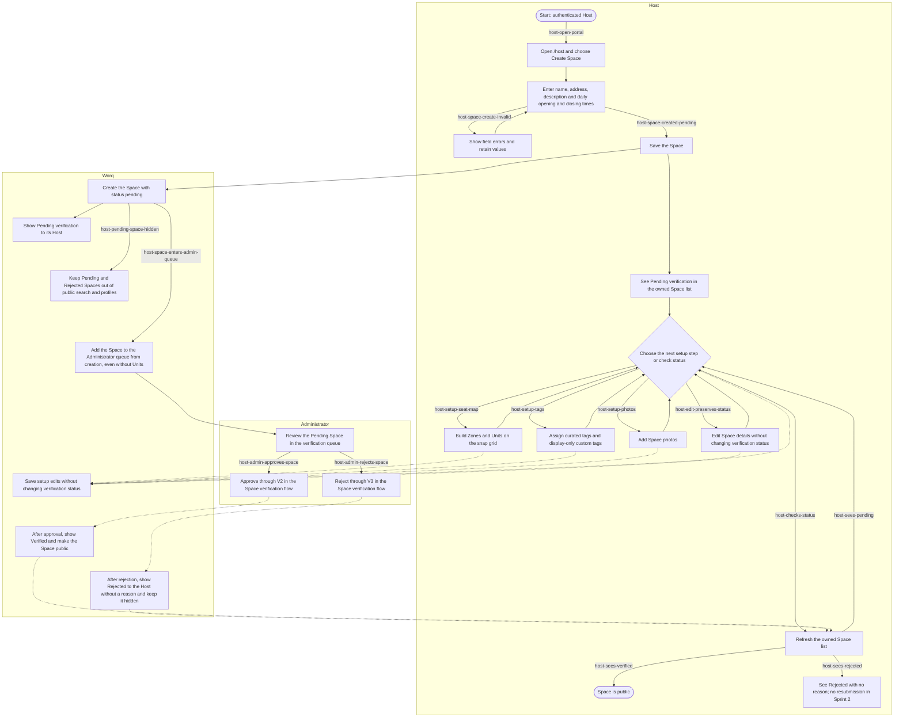

# Host setup journey

**Status:** draft · **Owner:** @fayeye-09 · **Approved by:** @dreeyanzz ·
**Stories:** STORY-05, STORY-07, STORY-08, STORY-11, STORY-15 ·
**Decisions:** D-003, D-006, D-027, D-028, D-032, D-037, D-042, D-044, D-053, D-054, D-055

This journey follows an authenticated Host from creating a Space to an Administrator's
verification decision. While it is Pending, the Host can continue setting up the seat map,
tags and photos. Approval makes the Space public; rejection keeps it hidden. The
[Space verification flow](space-verification.md) (#174) owns the detailed status
transitions. Maria (@fayeye-09) owns the steps and messages the Host sees (D-042).

## What this flow covers

- Creating a Space with its name, address, description and daily opening and closing
  times (STORY-05, D-027).
- Setting up zones and Units on a snap-grid seat map (STORY-07, D-003).
- Assigning curated tags and Host custom tags. Custom tags are for display and never
  become filters (STORY-08, D-006).
- Adding Space photos (STORY-11).
- Seeing the Space's Pending, Verified or Rejected status and understanding whether it is
  public (STORY-05, STORY-08, STORY-11, D-055).
- The Administrator reviewing the Pending Space and approving or rejecting it (STORY-15,
  D-037, D-053, D-054).

The Host must be authenticated with the Host role to start. Registration and role
assignment belong to STORY-03. This flow ends at the verification outcome. What Seekers
do after a Space becomes public belongs to the [Seeker journey](seeker-journey.md).

The [Space verification flow](space-verification.md) defines V1–V5, who can change
`spaces.status`, visibility by status, and what edits or deletion do. This journey shows
the Host's steps and the user-facing result without redrawing those rules. Only an
Administrator may open `/admin` (D-032); STORY-15's design owns the queue UI.

## Journey

The seat map, tags and photos can be set up in any order while the Space is Pending.
Creating the Space puts it in the Administrator's queue; the Host does not submit it
through a separate approval action. D-054 allows the Administrator to decide from
creation, with or without Units.

## Paths and test coverage

These are planned paths, not claims that the tests already exist. James writes the
Playwright tests under `e2e/` as the stories land. Each ID below appears in the diagram.
The V2 and V3 tests run against the local stack while the Administrator account remains
unavailable on cloud development (#182; see the [Space verification flow](space-verification.md)).

| Path ID                       | Expected Host or Seeker experience                                                                                  | Test that proves it                                                                                                                              |
| ----------------------------- | ------------------------------------------------------------------------------------------------------------------- | ------------------------------------------------------------------------------------------------------------------------------------------------ |
| host-open-portal              | An authenticated Host opens `/host` and starts a new Space.                                                         | Playwright `e2e/host-setup.spec.ts`: a signed-in Host can open the owned Space list and create form.                                             |
| host-space-create-invalid     | Invalid details show field errors, keep entered values and let the Host correct the form.                           | Playwright `e2e/host-setup.spec.ts`: invalid Space details show errors and retain the form values.                                               |
| host-space-created-pending    | A valid create saves the Host's Space as Pending verification and shows it in the Host's list.                      | Playwright `e2e/host-setup.spec.ts`: creating a Space shows Pending verification in the owned list.                                              |
| host-space-enters-admin-queue | The new Space enters the Administrator queue at creation, including before it has Units.                            | Playwright `e2e/host-setup.spec.ts` on the local stack: a new Space appears in the Pending queue before a seat map exists.                       |
| host-pending-space-hidden     | Seekers and signed-out visitors cannot find a Pending Space in public search or open its profile.                   | Playwright `e2e/host-setup.spec.ts`: a Pending Space is absent from public results and its direct profile link reads as not found.               |
| host-setup-seat-map           | The Host can build Zones and seat, standing-desk or whole-room Units; the accessible list offers the map's actions. | Playwright `e2e/host-setup.spec.ts`: saved seat-map Units are available in the keyboard-accessible list.                                         |
| host-setup-tags               | Curated tags can be assigned; custom tags remain display-only and are not offered as filters.                       | Playwright `e2e/host-setup.spec.ts`: curated tags filter results while Host custom tags do not.                                                  |
| host-setup-photos             | The Host can add Space photos during setup; they appear publicly once the Space is Verified.                        | Playwright `e2e/host-setup.spec.ts`: a Host-uploaded photo is retained while Pending and appears on the verified public profile.                 |
| host-edit-preserves-status    | Editing Space details does not change Pending, Verified or Rejected status.                                         | Playwright `e2e/host-setup.spec.ts`: editing a Space leaves its verification status unchanged (D-027).                                           |
| host-checks-status            | Refreshing the Host list shows the current verification status.                                                     | Playwright `e2e/host-setup.spec.ts`: the Host sees a status change after refreshing the owned Space list.                                        |
| host-sees-pending             | While no Administrator decision has been made, the Host sees Pending verification and the public view stays hidden. | Playwright `e2e/host-setup.spec.ts`: a Pending Space remains private while the Host can continue setup.                                          |
| host-sees-verified            | After V2, the Host sees Verified and the Space appears in public discovery and its profile.                         | Playwright `e2e/host-setup.spec.ts` on the local stack: approving a Pending Space makes it visible to a Seeker.                                  |
| host-sees-rejected            | After V3, the Host sees Rejected without a reason; the Space remains hidden and cannot be resubmitted in Sprint 2.  | Playwright `e2e/host-setup.spec.ts` on the local stack: a rejected Space stays hidden and its Host receives no rejection reason or retry action. |
| host-admin-approves-space     | An Administrator approves a Pending Space through V2; the Host sees Verified and Seekers can find it.               | Playwright `e2e/host-setup.spec.ts` on the local stack: Administrator approves a Space and a Seeker can see it after refresh.                    |
| host-admin-rejects-space      | An Administrator rejects a Pending Space through V3; the Host sees Rejected and the Space stays hidden.             | Playwright `e2e/host-setup.spec.ts` on the local stack: Administrator rejects a Space and a Seeker still cannot find it.                         |

The Space verification flow's pgTAP tests remain the authority for status changes,
public visibility and forbidden writes. This journey's Playwright cases cover what the
Host and Seeker see; they do not replace those database tests.

## Choices and boundaries

- **A new Space starts Pending and enters the queue at creation (D-037, D-054).** There
  is no Host-set `draft` status or separate submission step. This rejects delaying the
  Administrator queue until the seat map exists; the Administrator may decide with or
  without Units.
- **Only Verified Spaces are public (D-055).** Pending and Rejected Spaces stay hidden
  from Seekers and signed-out visitors, and a direct link reads as not found. This rejects
  a public “not approved yet” page that reveals a hidden Space.
- **The Administrator owns verification status (D-053).** The Host can edit setup
  details, but an edit does not change status (D-027). This rejects Host-controlled
  approval or an automatic reset to Pending after an edit.
- **Rejection is final for Sprint 2 (D-054).** The Host sees Rejected without a reason;
  there is no second review, rejection explanation or resubmission path in this sprint
  (D-037, D-054). STORY-14 may revisit those behaviors through a change to the Space
  verification flow.
- **The flow joins the setup stories without taking over their decisions (D-044).**
  Seat-map structure follows D-003; curated and custom tags follow D-006; photos follow
  STORY-11. This rejects duplicating their detailed design rules in this journey.

## Open questions

This draft introduces no new product decision. D-028 keeps an Administrator account off
cloud development; the question is tracked separately in
[issue #182](https://github.com/dreeyanzz/studyhub/issues/182). Until it is settled, V2
and V3 are exercised on the local stack as the [Space verification flow](space-verification.md) specifies.

