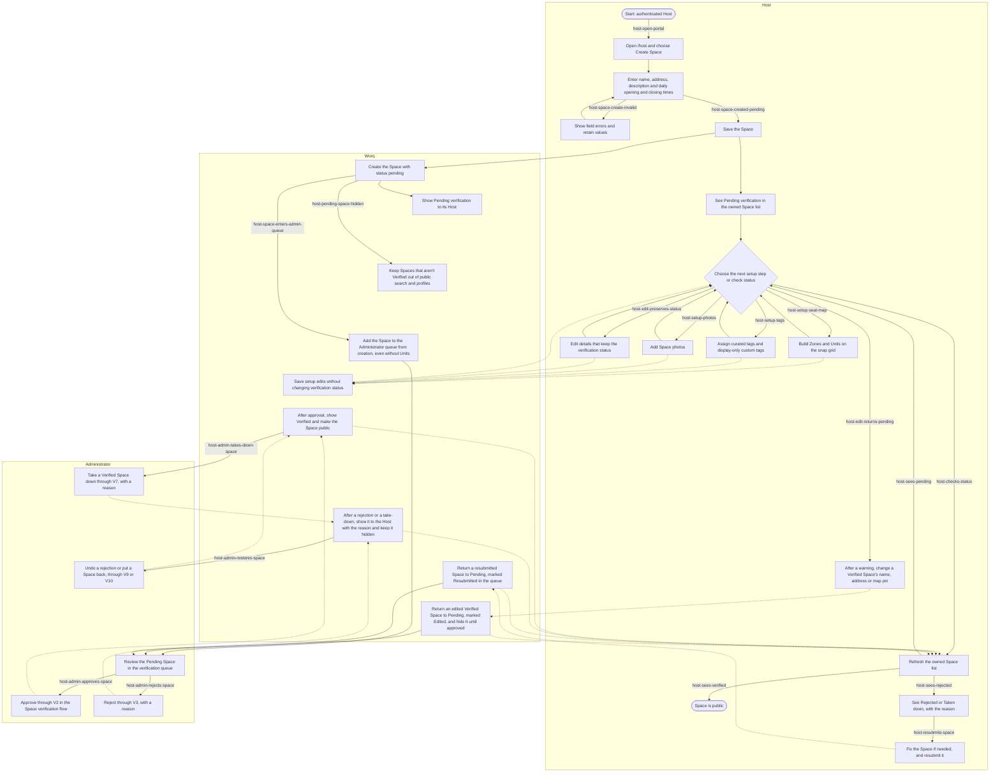

# Host setup journey

**Status:** implemented 2026-11-15 · **Sprint 3 change (#340):** draft · **Owner:**
@fayeye-09 · **Approved by:** @dreeyanzz · **Stories:** STORY-05, STORY-07, STORY-08,
STORY-11, STORY-15, STORY-20 · **Decisions:** D-003, D-006, D-027, D-028, D-032, D-037,
D-042, D-044, D-053, D-054, D-055, D-079, D-084

This journey follows an authenticated Host from creating a Space to an Administrator's
verification decision. While it is Pending, the Host can continue setting up the seat map,
tags and photos. Approval makes the Space public; rejection keeps it hidden. From Sprint 3,
a rejected or taken-down Space shows its Host the reason, and the Host can resubmit it. The
[Space verification flow](space-verification.md) (#174) owns the detailed status
transitions. Maria (@fayeye-09) owns the steps and messages the Host sees (D-042).

## What this flow covers

- Creating a Space with its name, address, description and daily opening and closing
  times (STORY-05, D-027).
- Setting up zones and Units on a snap-grid seat map (STORY-07, D-003).
- Assigning curated tags and Host custom tags. Custom tags are for display and never
  become filters (STORY-08, D-006).
- Adding Space photos (STORY-11).
- Seeing the Space's Pending, Verified, Rejected or Taken down status, with the reason for
  the last two, and understanding whether it is public (STORY-05, STORY-08, STORY-11,
  STORY-20, D-055, D-079).
- Resubmitting a Rejected or Taken down Space, and the warning before a change to a
  Verified Space's name, address or map pin sends it back to Pending (STORY-20, D-079).
- The Administrator reviewing the Pending Space and approving or rejecting it, taking a
  Verified Space down, and undoing either (STORY-15, STORY-20, D-037, D-053, D-054,
  D-084).

The Host must be authenticated with the Host role to start. Registration and role
assignment belong to STORY-03. This flow ends at the verification outcome. What Seekers
do after a Space becomes public belongs to the [Seeker journey](seeker-journey.md).

It leaves these to others:

- **STORY-09's design** (#58): where the Host sets each Space's maximum wait window
  and how the system limits are shown to them (D-049). The value is Host-set; this
  journey leaves the control's placement and wording to that design.

The [Space verification flow](space-verification.md) defines V1–V5, who can change
`spaces.status`, visibility by status, and what edits or deletion do. This journey shows
the Host's steps and the user-facing result without redrawing those rules. Only an
Administrator may open `/admin` (D-032); STORY-15's design owns the queue UI.

## Journey

The seat map, tags and photos can be set up in any order while the Space is Pending.
Creating the Space puts it in the Administrator's queue; the Host does not submit it
through a separate approval action. D-054 allows the Administrator to decide from
creation, with or without Units.

## Paths and test coverage

Every path is walked by `e2e/host-setup.spec.ts`, whose test titles start with the path
IDs they prove. Each ID below appears in the diagram. The tests marked STORY-20 are named
before they exist: STORY-20 writes them, and renames the rejection test, when it builds
the Sprint 3 change.
The V2 and V3 tests run against the local stack while the Administrator account remains
unavailable on cloud development (#182; see the [Space verification flow](space-verification.md)).

| Path ID                       | Expected Host or Seeker experience                                                                                  | Test that proves it                                                                                                                                                                                                                                                                                               |
| ----------------------------- | ------------------------------------------------------------------------------------------------------------------- | ----------------------------------------------------------------------------------------------------------------------------------------------------------------------------------------------------------------------------------------------------------------------------------------------------------------- |
| host-open-portal              | An authenticated Host opens `/host` and starts a new Space.                                                         | `e2e/host-setup.spec.ts`: "host-open-portal, host-space-create-invalid, host-space-created-pending: a Host opens the portal, fixes invalid details, and creates a Pending Space"                                                                                                                                  |
| host-space-create-invalid     | Invalid details show field errors, keep entered values and let the Host correct the form.                           | `e2e/host-setup.spec.ts`: "host-open-portal, host-space-create-invalid, host-space-created-pending: a Host opens the portal, fixes invalid details, and creates a Pending Space"                                                                                                                                  |
| host-space-created-pending    | A valid create saves the Host's Space as Pending verification and shows it in the Host's list.                      | `e2e/host-setup.spec.ts`: "host-open-portal, host-space-create-invalid, host-space-created-pending: a Host opens the portal, fixes invalid details, and creates a Pending Space"                                                                                                                                  |
| host-space-enters-admin-queue | The new Space enters the Administrator queue at creation, including before it has Units.                            | `e2e/host-setup.spec.ts`: "host-space-enters-admin-queue, host-pending-space-hidden, host-sees-pending: a new Space waits in the Administrator queue before it has units, hidden from Seekers, while its Host keeps setting it up"                                                                                |
| host-pending-space-hidden     | Seekers and signed-out visitors cannot find a Pending Space in public search or open its profile.                   | `e2e/host-setup.spec.ts`: "host-space-enters-admin-queue, host-pending-space-hidden, host-sees-pending: a new Space waits in the Administrator queue before it has units, hidden from Seekers, while its Host keeps setting it up"                                                                                |
| host-setup-seat-map           | The Host can build Zones and seat, standing-desk or whole-room Units; the accessible list offers the map's actions. | `e2e/host-setup.spec.ts`: "host-setup-seat-map: zones and units saved on the seat map are in the keyboard-accessible list"                                                                                                                                                                                        |
| host-setup-tags               | Curated tags can be assigned; custom tags remain display-only and are not offered as filters.                       | `e2e/host-setup.spec.ts`: "host-setup-tags, host-setup-photos, host-edit-preserves-status, host-admin-approves-space, host-sees-verified, host-checks-status: a Host tags, photographs and edits a Pending Space; once an Administrator approves it, the Host sees Verified after refreshing and Seekers find it" |
| host-setup-photos             | The Host can add Space photos during setup; they appear publicly once the Space is Verified.                        | `e2e/host-setup.spec.ts`: "host-setup-tags, host-setup-photos, host-edit-preserves-status, host-admin-approves-space, host-sees-verified, host-checks-status: a Host tags, photographs and edits a Pending Space; once an Administrator approves it, the Host sees Verified after refreshing and Seekers find it" |
| host-edit-preserves-status    | Editing details other than a Verified Space's name, address or map pin keeps its status.                            | `e2e/host-setup.spec.ts`: "host-setup-tags, host-setup-photos, host-edit-preserves-status, host-admin-approves-space, host-sees-verified, host-checks-status: a Host tags, photographs and edits a Pending Space; once an Administrator approves it, the Host sees Verified after refreshing and Seekers find it" |
| host-edit-returns-pending     | After a warning, a Verified Space whose name, address or pin changes returns to Pending, marked Edited, and hides.  | `e2e/host-setup.spec.ts`: "host-edit-returns-pending: a Host renames a Verified Space after a warning, and it waits in the queue marked Edited, hidden from Seekers" (STORY-20)                                                                                                                                   |
| host-checks-status            | Refreshing the Host list shows the current verification status.                                                     | `e2e/host-setup.spec.ts`: "host-setup-tags, host-setup-photos, host-edit-preserves-status, host-admin-approves-space, host-sees-verified, host-checks-status: a Host tags, photographs and edits a Pending Space; once an Administrator approves it, the Host sees Verified after refreshing and Seekers find it" |
| host-sees-pending             | While no Administrator decision has been made, the Host sees Pending verification and the public view stays hidden. | `e2e/host-setup.spec.ts`: "host-space-enters-admin-queue, host-pending-space-hidden, host-sees-pending: a new Space waits in the Administrator queue before it has units, hidden from Seekers, while its Host keeps setting it up"                                                                                |
| host-sees-verified            | After V2, the Host sees Verified and the Space appears in public discovery and its profile.                         | `e2e/host-setup.spec.ts`: "host-setup-tags, host-setup-photos, host-edit-preserves-status, host-admin-approves-space, host-sees-verified, host-checks-status: a Host tags, photographs and edits a Pending Space; once an Administrator approves it, the Host sees Verified after refreshing and Seekers find it" |
| host-sees-rejected            | After V3 or V7, the Host sees Rejected or Taken down with the reason, and the Space stays hidden.                   | `e2e/host-setup.spec.ts`: "host-admin-rejects-space, host-sees-rejected: an Administrator rejects a Space with a reason; its Host sees the reason, and Seekers still cannot find it", which STORY-20 renames from Sprint 2's "without a reason"                                                                   |
| host-resubmits-space          | The Host resubmits a Rejected or Taken down Space, and it waits in the queue marked Resubmitted.                    | `e2e/host-setup.spec.ts`: "host-resubmits-space: a Host resubmits a Rejected Space, and it waits in the queue marked Resubmitted, with its reason" (STORY-20)                                                                                                                                                     |
| host-admin-approves-space     | An Administrator approves a Pending Space through V2; the Host sees Verified and Seekers can find it.               | `e2e/host-setup.spec.ts`: "host-setup-tags, host-setup-photos, host-edit-preserves-status, host-admin-approves-space, host-sees-verified, host-checks-status: a Host tags, photographs and edits a Pending Space; once an Administrator approves it, the Host sees Verified after refreshing and Seekers find it" |
| host-admin-rejects-space      | An Administrator rejects a Pending Space through V3, with a reason; the Host sees it, and the Space stays hidden.   | `e2e/host-setup.spec.ts`: "host-admin-rejects-space, host-sees-rejected: an Administrator rejects a Space with a reason; its Host sees the reason, and Seekers still cannot find it", which STORY-20 renames from Sprint 2's "without a reason"                                                                   |
| host-admin-takes-down-space   | An Administrator takes a Verified Space down through V7, with a reason; Seekers can no longer find it.              | `e2e/host-setup.spec.ts`: "host-admin-takes-down-space: an Administrator takes a Verified Space down; Seekers can no longer find it, and its Host sees the reason" (STORY-20)                                                                                                                                     |
| host-admin-restores-space     | An Administrator undoes a rejection or puts a Space back (V9, V10); Seekers can find it again.                      | `e2e/host-setup.spec.ts`: "host-admin-restores-space: an Administrator puts a Taken down Space back, and Seekers find it again" (STORY-20)                                                                                                                                                                        |

The Space verification flow's pgTAP tests remain the authority for status changes,
public visibility and forbidden writes. This journey's Playwright cases cover what the
Host and Seeker see; they do not replace those database tests.

## Choices and boundaries

- **A new Space starts Pending and enters the queue at creation (D-037, D-054).** There
  is no Host-set `draft` status or separate submission step. This rejects delaying the
  Administrator queue until the seat map exists; the Administrator may decide with or
  without Units.
- **Only Verified Spaces are public (D-055).** Spaces that aren't Verified stay hidden
  from Seekers and signed-out visitors, and a direct link reads as not found. This rejects
  a public “not approved yet” page that reveals a hidden Space.
- **Only an Administrator makes a Space Verified, Rejected or Taken down (D-053,
  D-084).** A Host's resubmission, or their change to a Verified Space's name, address or
  map pin, can only make it Pending, and any other edit keeps its status (D-027, D-079).
  This rejects Host-controlled approval, and sending a Space back to Pending on every
  edit.
- **A rejection has a reason, and can be resubmitted (D-079).** The Host sees why it was
  rejected or taken down, and resubmits it when it is fixed. In Sprint 2 a rejection was
  final, with no reason (D-054).
- **The flow joins the setup stories without taking over their decisions (D-044).**
  Seat-map structure follows D-003; curated and custom tags follow D-006; photos follow
  STORY-11. This rejects duplicating their detailed design rules in this journey.

## Open questions

This draft introduces no new product decision. D-028 keeps an Administrator account off
cloud development; the question is tracked separately in
[issue #182](https://github.com/dreeyanzz/studyhub/issues/182). Until it is settled, V2
and V3 are exercised on the local stack as the [Space verification flow](space-verification.md) specifies.
