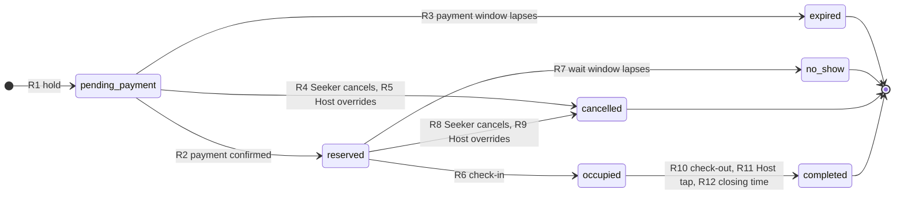
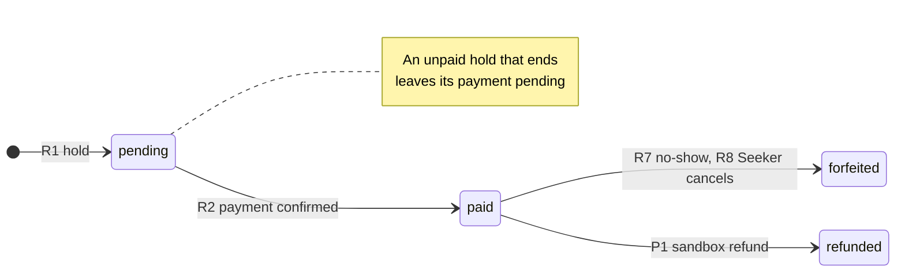
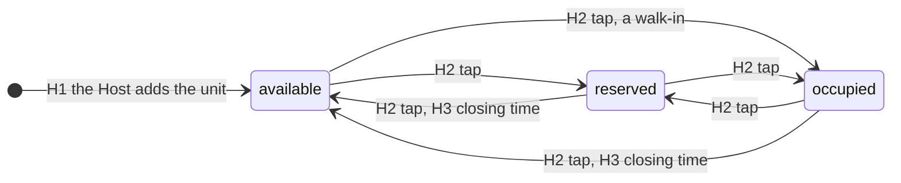

# Reservation lifecycle

**Status:** draft · **Owner:** @dreeyanzz · **Approved by:** @fayeye-09 ·
**Stories:** STORY-07, STORY-09, STORY-10, STORY-11, STORY-12, STORY-13, STORY-14 ·
**Decisions:** D-002, D-004, D-005, D-008, D-009, D-010, D-011, D-027, D-046 to D-052,
D-056

This flow follows a hold from the moment a Seeker holds a unit until the unit is Available
again, and says what makes each move. Three records take part: the unit's Host-set state,
the reservation, and its payment. A unit's seat state (D-004) is worked out from them
(D-046).

## What this flow covers

- The reservation's statuses, the payment's statuses and the Host-set state, and every
  move between them: who or what makes each one, and the pgTAP test that proves it.
- How a unit's seat state is worked out from them.
- How a lapse takes effect with no scheduled job (D-011), and what closing time does
  (D-027).
- Where the payment window, the wait window's bounds and the reservation fee are kept.
- What moves the Host-updated time (D-002), what deleting or changing a held unit does,
  and the record of a visit that a review needs (D-009).
- Who may call each function, and what stops a stale screen, a double tap or a Host's edit
  from breaking a hold.

It leaves these to others:

- **The sandbox payment confirmation flow** (#175): how PayMongo's message reaches R2, the
  signature check, a message that comes twice or late, a failed payment, and the Seeker's
  return from the checkout. A PayMongo checkout stays open until it is paid or expired, so
  a payment after the payment window has lapsed (P2) is a real case there (D-056).
- **The check-in flow** (#176): what the booking token holds, how the Host scans or types
  it, why it works once, and what happens at the wrong Space. It makes R6.
- **The Host setup and Seeker journeys** (#177, #178): the screens and steps around these
  moves, and what users are told (D-042).
- **STORY-09's design:** the length of the payment window, the wait window's system
  limits, the fee, the tables' other columns, and the concurrency test (D-049). The gateway
  is PayMongo (D-056).
- **STORY-14's design** (Sprint 3): sandbox refunds (P1).

## The records

| Record         | Where                                            | Its states                                                                                                                  | Changed by                                                               |
| -------------- | ------------------------------------------------ | --------------------------------------------------------------------------------------------------------------------------- | ------------------------------------------------------------------------ |
| Host-set state | `units.host_state`, with `units.host_updated_at` | `available`, `reserved`, `occupied`                                                                                         | The Host's tap (H2) and closing time (H3)                                |
| Reservation    | `reservations.status`                            | While it is a hold: `pending_payment`, `reserved`, `occupied`. Once it ends: `expired`, `no_show`, `completed`, `cancelled` | The functions in [every move](#every-move-and-its-test)                  |
| Payment        | `payments.status`, one payment per reservation   | `pending`, `paid`, `forfeited`, `refunded` (SRS §3.8)                                                                       | The same functions, in the same transaction as the reservation they move |

A unit's **seat state** is stored nowhere (D-046). It is worked out each time it is read:

| The unit has           | Its seat state                                                 |
| ---------------------- | -------------------------------------------------------------- |
| an active hold (D-008) | the hold's status: `pending_payment`, `reserved` or `occupied` |
| no active hold         | its Host-set state: `available`, `reserved` or `occupied`      |

A hold never writes the unit's row. Only the Host's tap and closing time change a unit's
Host-set state, and only a new unit or a tap sets its Host-updated time (D-051).

## The reservation

An ended reservation never moves again (N11).

## The payment

A hold that ends before it is paid (R3, R4, R5) leaves its payment `pending`: no money
moved, and the SRS lists no other status for it (D-046). A payment the gateway confirms
after its hold ended is P2.

## The Host-set state

While the unit has an active hold, a tap first ends that hold, and only when the call names
the hold the Host saw and confirmed (R5, R9, R11, D-050).

## Every move, and its test

Each move names who may make it, what makes it, and the pgTAP test that proves it. A test
is named by its file and its description. Each file gets its number when its story creates
it (`supabase/tests/NN-name.sql`, [testing guide](../guides/testing.md)): `seat-map`
(STORY-07), `holds` (STORY-09), `check-in-release` (STORY-10) and `occupancy` (STORY-12).

A move changes a reservation and its payment in one transaction.

### The reservation and its payment

| #   | Move                                   | Event                                                                | Who may make it                                                       | Made by                                                                             | Payment                                | Test                                                                                   |
| --- | -------------------------------------- | -------------------------------------------------------------------- | --------------------------------------------------------------------- | ----------------------------------------------------------------------------------- | -------------------------------------- | -------------------------------------------------------------------------------------- |
| R1  | → `pending_payment`                    | A Seeker holds an Available unit                                     | A Seeker with no active hold, while the unit's Verified Space is open | `public.hold_unit` (STORY-09)                                                       | Created `pending`, with the fee copied | `holds`: "a Seeker holds an Available unit, which reads Pending Payment"               |
| R2  | `pending_payment` → `reserved`         | The gateway confirms the sandbox payment, and the wait window starts | The payment webhook only (D-010)                                      | `public.confirm_payment` (STORY-09), as the sandbox payment confirmation flow draws | `pending` → `paid`                     | `holds`: "a confirmed payment reserves the unit and gives it one booking token"        |
| R3  | `pending_payment` → `expired`          | The payment window lapses                                            | Time: the lapse step                                                  | `private.record_lapses` (STORY-09)                                                  | Stays `pending`                        | `holds`: "a hold whose payment window lapsed is expired, and its unit reads Available" |
| R4  | `pending_payment` → `cancelled`        | The Seeker cancels before paying                                     | The hold's Seeker, naming the status they saw                         | `public.cancel_hold` (STORY-09)                                                     | Stays `pending`                        | `holds`: "a Seeker cancels their unpaid hold, and the unit reads Available"            |
| R5  | `pending_payment` → `cancelled`        | The Host overrides the hold                                          | The Space's Host, naming the hold they saw                            | `public.set_unit_state` (STORY-12)                                                  | Stays `pending`                        | `occupancy`: "a Host's override cancels an unpaid hold"                                |
| R6  | `reserved` → `occupied`                | The Host checks the Seeker in                                        | The Space's Host                                                      | `public.check_in` (STORY-10), as the check-in flow draws                            | Stays `paid`                           | `check-in-release`: "a Host checks in a Reserved unit, which reads Occupied"           |
| R7  | `reserved` → `no_show`                 | The wait window lapses with no check-in                              | Time: the lapse step                                                  | `private.record_lapses` (STORY-10)                                                  | `paid` → `forfeited`                   | `check-in-release`: "a no-show releases the unit and forfeits the fee"                 |
| R8  | `reserved` → `cancelled`               | The Seeker cancels after paying                                      | The hold's Seeker, naming the status they saw                         | `public.cancel_hold` (STORY-09)                                                     | `paid` → `forfeited`                   | `holds`: "a Seeker who cancels a paid hold forfeits the fee"                           |
| R9  | `reserved` → `cancelled`               | The Host overrides the hold                                          | The Space's Host, naming the hold they saw                            | `public.set_unit_state` (STORY-12)                                                  | Stays `paid`, until P1                 | `occupancy`: "a Host's override cancels a paid hold and leaves the fee paid"           |
| R10 | `occupied` → `completed`               | The Seeker checks out                                                | The hold's Seeker                                                     | `public.check_out` (STORY-10)                                                       | Stays `paid`                           | `check-in-release`: "a Seeker checks out, and the unit reads Available"                |
| R11 | `occupied` → `completed`               | The Host sets the unit's state                                       | The Space's Host, naming the hold they saw                            | `public.set_unit_state` (STORY-12)                                                  | Stays `paid`                           | `occupancy`: "a Host's override on an occupied unit completes the visit"               |
| R12 | `occupied` → `completed`               | The Space's closing time passes                                      | Time: the lapse step                                                  | `private.record_lapses` (STORY-10)                                                  | Stays `paid`                           | `check-in-release`: "closing time completes a visit, and the unit reads Available"     |
| P1  | payment `paid` → `refunded`            | An Administrator issues a sandbox refund (FR-5.3)                    | An Administrator                                                      | STORY-14's design (Sprint 3)                                                        |                                        | Named by STORY-14's design                                                             |
| P2  | payment `pending` → `paid`, hold ended | The gateway confirms a payment after its hold ended                  | The payment webhook only                                              | `public.confirm_payment`; the sandbox payment confirmation flow draws what follows  |                                        | Named by that flow                                                                     |

**A call names what the person saw** (D-050). `cancel_hold`, and a `set_unit_state` that
ends a hold, take the reservation and the status the person saw, and refuse if either has
changed since (N21). So a Seeker who cancels just as their payment is confirmed is asked
again, instead of losing the fee to R8 when they meant R4. And a Host's override can't
cancel a hold that was paid, or end a visit that began, after they looked.

**A double tap makes one hold.** When a Seeker asks again for the unit they already hold,
`hold_unit` returns that hold unchanged. When two calls race to the unique index, the
loser gets N2's refusal, not an error (`holds`: "a Seeker asking again for the unit they
hold gets the same hold back").

### The Host-set state

| #   | Move                                        | Event                                                                                                      | Who may make it      | Made by                                          | Host-updated time | Test                                                                                            |
| --- | ------------------------------------------- | ---------------------------------------------------------------------------------------------------------- | -------------------- | ------------------------------------------------ | ----------------- | ----------------------------------------------------------------------------------------------- |
| H1  | → `available`                               | The Host adds a unit                                                                                       | The Space's Host     | STORY-07's insert, through the columns' defaults | Set               | `seat-map`: "a new unit reads Available, Host-updated when it was added"                        |
| H2  | any → `available`, `reserved` or `occupied` | The Host taps the unit, walk-ins included. With an active hold, only when the call names the hold they saw | The Space's Host     | `public.set_unit_state` (STORY-12)               | Set               | `occupancy`: "a Host sets their unit's state, and the Host-updated time moves"                  |
| H3  | `reserved` or `occupied` → `available`      | The Space's closing time passes                                                                            | Time: the lapse step | `private.record_lapses` (STORY-10)               | Unchanged         | `check-in-release`: "closing time resets a Host-set state without moving the Host-updated time" |

## Moves nobody may make

Each has its negative test (AGENTS.md rule 5). The [testing guide](../guides/testing.md)
says what each kind of denial looks like.

| #   | Nobody may                                                                                                      | Stopped by                                                                           | Test                                                                                                                                                                                                                  |
| --- | --------------------------------------------------------------------------------------------------------------- | ------------------------------------------------------------------------------------ | --------------------------------------------------------------------------------------------------------------------------------------------------------------------------------------------------------------------- |
| N1  | Hold a unit that isn't Available                                                                                | `hold_unit`                                                                          | `holds`: "a Seeker cannot hold a unit that is not Available"                                                                                                                                                          |
| N2  | Hold a second unit while their first hold is active (D-008)                                                     | `hold_unit`, and a unique index on one active hold per Seeker                        | `holds`: "a Seeker with an active hold cannot hold a second unit"                                                                                                                                                     |
| N3  | Give one unit two active holds (D-008, FR-2.5)                                                                  | `hold_unit` locks the unit, and a unique index on one active hold per unit           | `holds`: "a unit cannot have two active holds, whatever inserts them". Also STORY-09's concurrency test: two holds at the same moment, exactly one success. It needs two connections, not pgTAP's one.                |
| N4  | Hold in a Space that isn't Verified or is closed, or with a wait window outside its bounds or past closing time | `hold_unit`                                                                          | `holds`: "a Seeker cannot hold a unit in a Space that is not Verified", "a Seeker cannot hold a unit while its Space is closed" and "a Seeker cannot hold with a wait window outside its bounds or past closing time" |
| N5  | Hold a unit as a Host or an Administrator                                                                       | `hold_unit`                                                                          | `holds`: "a Host and an Administrator cannot hold a unit"                                                                                                                                                             |
| N6  | Write to `reservations` or `payments` directly, their own rows included                                         | No grant (D-047)                                                                     | `holds`: "a Seeker cannot change their own reservation's or payment's status"                                                                                                                                         |
| N7  | Confirm a payment, unless they are the payment webhook                                                          | Only the secret key may run `confirm_payment`                                        | `holds`: "a signed-out visitor, a Seeker and a Host cannot confirm a payment"                                                                                                                                         |
| N8  | Cancel or check out another Seeker's hold                                                                       | `cancel_hold`, `check_out`                                                           | `holds`: "a Seeker cannot cancel another Seeker's hold"; `check-in-release`: "a Seeker cannot check out another Seeker's visit"                                                                                       |
| N9  | Check in, unless they are the Space's Host                                                                      | `check_in`                                                                           | `check-in-release`: "a Seeker cannot check in their own reservation"                                                                                                                                                  |
| N10 | Check in once the wait window has lapsed                                                                        | The lapse step runs first, so the hold is already `no_show`                          | `check-in-release`: "a booking token cannot check in once its wait window has lapsed"                                                                                                                                 |
| N11 | Move an ended reservation again                                                                                 | Every function moves active holds only                                               | `holds`: "an ended reservation cannot move again"                                                                                                                                                                     |
| N12 | Set a unit to Pending Payment by hand (D-004)                                                                   | A check on `units.host_state`                                                        | `occupancy`: "a Host cannot set a unit to Pending Payment"                                                                                                                                                            |
| N13 | Set the state of another Host's unit                                                                            | `set_unit_state`                                                                     | `occupancy`: "a Host cannot change another Host's unit"                                                                                                                                                               |
| N14 | End a hold with a tap that doesn't name it                                                                      | `set_unit_state`                                                                     | `occupancy`: "a Host's tap on a held unit changes nothing unless it names the hold"                                                                                                                                   |
| N15 | Write a unit's Host-set state or Host-updated time directly                                                     | No grant on either column                                                            | `seat-map`: "a Host cannot write a unit's state or Host-updated time directly"                                                                                                                                        |
| N16 | Move the Host-updated time with anything but a new unit or a tap (D-051)                                        | Only `set_unit_state` writes it                                                      | `holds`: "a hold and its lapse leave the Host-updated time alone"; `check-in-release`: "a check-in, a check-out and closing time leave the Host-updated time alone"                                                   |
| N17 | Delete a unit, a zone or a Space that has an active hold (D-052)                                                | `before delete` triggers on `units`, `zones` and `spaces`                            | `holds`: "a Host cannot delete a unit, a zone or a Space with an active hold"                                                                                                                                         |
| N18 | Learn from `unit_states` who holds a unit, or its booking token                                                 | `unit_states` returns states only                                                    | `holds`: "unit_states shows another Seeker's hold as a state, without the Seeker or the token"                                                                                                                        |
| N19 | See the units of a Space they may not see                                                                       | `unit_states` checks the Space first                                                 | `seat-map`: "unit_states returns 0 rows for a Pending Space, except to its Host and Administrators"                                                                                                                   |
| N20 | See when a wait window ends, unless they are the Space's Host                                                   | `unit_states`                                                                        | `check-in-release`: "only the Space's Host sees when a wait window ends"                                                                                                                                              |
| N21 | Cancel or override a hold that has changed since they saw it (D-050)                                            | `cancel_hold` and `set_unit_state` compare the reservation and status the call names | `holds`: "a Seeker's cancel is refused once their hold has changed"; `occupancy`: "a Host's override is refused once the hold has changed"                                                                            |
| N22 | Change a Space's hours so that an active hold ends early or is cut short (D-048)                                | A `before update` trigger on `spaces`, which locks the Space's units first           | `holds`: "a Host cannot change a Space's hours to cut into a pending or reserved hold"; `check-in-release`: "a Host cannot change a Space's hours to end a visit early"                                               |
| N23 | Change the label, type, capacity or place of a unit with an active hold (D-052)                                 | A `before update` trigger on `units`                                                 | `holds`: "a Host cannot change a held unit's label, type, capacity or place"                                                                                                                                          |
| N24 | Call a function they aren't granted (D-047)                                                                     | The grants in [who may call each function](#who-may-call-each-function)              | Each story's file, for its own functions: "a signed-out visitor cannot call (the function)"                                                                                                                           |

## Reading a state

Every read records lapses first (D-047), so nobody reads a hold, a payment or a seat state
straight from the tables:

- **`public.unit_states(space_id)`** returns each unit's seat state and Host-updated time
  to anyone who may see the Space: everyone, signed-out visitors included, for a Verified
  Space, and only its Host and Administrators for a Pending or Rejected one. Anyone else
  gets zero rows. Only the Space's Host also gets each Reserved unit's
  `wait_window_ends_at` (FR-3.3). Nobody gets the Seeker or the booking token behind a
  hold. STORY-07 creates it with Host-set states only, STORY-09 adds holds, and STORY-10
  adds the wait windows. STORY-11 and STORY-12 read it.
- **A Seeker's own reservation**, with its payment status and booking token, comes from a
  function that STORY-09's design names. STORY-09's confirmation and STORY-10's dashboard
  read it.
- **No grant** lets `anon` or `authenticated` read or write `reservations` or `payments`,
  or read or write `units.host_state` and `units.host_updated_at`. Everything goes through
  these functions.

## Who may call each function

Supabase grants every new function in `public` to `anon` and `authenticated` by default.
So each function first revokes execute from `public`, `anon` and `authenticated`, then
grants exactly what this table says (D-047, N7, N24). Each is `security definer` with
`set search_path = ''`, as `private.has_role` is (STORY-01).

| Function                                                 | Built by                             | Who may call it                                               |
| -------------------------------------------------------- | ------------------------------------ | ------------------------------------------------------------- |
| `public.unit_states`                                     | STORY-07, then STORY-09 and STORY-10 | `anon` and `authenticated`                                    |
| `public.hold_unit`                                       | STORY-09                             | `authenticated`; it checks the caller is a Seeker             |
| `public.cancel_hold`                                     | STORY-09                             | `authenticated`; the hold's Seeker only                       |
| The Seeker's own reservation, named by STORY-09's design | STORY-09                             | `authenticated`; the caller's own only                        |
| `public.confirm_payment`                                 | STORY-09                             | `service_role` only: the payment webhook, with the secret key |
| `public.check_in`                                        | STORY-10                             | `authenticated`; the Space's Host only                        |
| `public.check_out`                                       | STORY-10                             | `authenticated`; the hold's Seeker only                       |
| `public.set_unit_state`                                  | STORY-12                             | `authenticated`; the Space's Host only                        |
| `private.record_lapses`                                  | STORY-09, then STORY-10              | Nobody directly: only the functions above call it             |

## Time: lapses and closing

**The lapse step** (D-047). Every function in this flow, the reads included, starts by
recording these, for the units it touches:

1. each `pending_payment` hold whose `payment_window_ends_at` has passed: `expired` (R3);
2. each `reserved` hold whose `wait_window_ends_at` has passed: `no_show`, with its
   payment `forfeited` (R7);
3. each `occupied` hold checked in before its Space's last closing time: `completed`
   (R12);
4. each unit its Host set to Reserved or Occupied before its Space's last closing time:
   `available`, with the Host-updated time unchanged (H3).

STORY-09 creates `private.record_lapses` with the first; STORY-10 adds the other three. It
looks for lapses without taking any lock. Only when it finds some does it lock those units,
in id order, and check again before recording, because another call may have recorded them
first. So a read with nothing to record takes no lock, and calling `unit_states` in a loop
can't hold up anyone's hold (D-047).

Every function that changes a hold locks rows in one order: units (by id), then
reservations, then payments. So two calls can't deadlock, or record the same lapse twice.

**Closing time** (D-048). A Space's `opens_at` and `closes_at` (D-027) are read in
Asia/Manila time, UTC+8 with no daylight saving:

| Hours                         | Open                                           | Last closing time                                             |
| ----------------------------- | ---------------------------------------------- | ------------------------------------------------------------- |
| `opens_at` before `closes_at` | From `opens_at` until `closes_at`              | Today's `closes_at` once it has passed, otherwise yesterday's |
| `closes_at` before `opens_at` | From `opens_at`, past midnight, to `closes_at` | The same                                                      |
| Equal, so open 24 hours       | Always                                         | None                                                          |

R1 needs the Space open, with time before its next closing time for the whole payment
window and then the whole chosen wait window. So no hold is still pending or reserved at
closing time. A 24-hour Space releases nothing on its own: check-out or the Host's tap
does.

A Host can't change a Space's hours in a way that would end an active hold early or cut it
short: the database refuses (N22, D-048), so a Seeker who has paid never travels to a Space
that has closed. The refusal is a `before update` trigger on `spaces` that locks the Space's
units in id order before it checks, because making a hold doesn't otherwise wait for an
hours change. STORY-09 adds it with the reservations table, STORY-10 extends it to visits,
and STORY-05's edit form gets a message for it. Any other change counts from the next read,
because the lapse step always uses the current hours.

**Testing time.** Tests move the stored times, never the clock: they set a hold's
`payment_window_ends_at` in the past, or a Space's hours around the current time.

## Where the timers and the fee are kept

| Value                    | Kept                                                                                | Set by                                                           |
| ------------------------ | ----------------------------------------------------------------------------------- | ---------------------------------------------------------------- |
| Payment window           | Once for the whole system, in the database                                          | STORY-09's design: Maria proposes, Adrian confirms (D-042)       |
| Reservation fee          | Once for the whole system, in the database. R1 copies it to `payments.fee_amount`   | STORY-09's design                                                |
| Wait window's bounds     | System limits in the database, and each Space's maximum in `spaces.max_wait_window` | The limits by STORY-09's design, the maximum by the Space's Host |
| The Seeker's wait window | `reservations.wait_window`, from the system minimum to the Space's maximum          | The Seeker, at R1                                                |

The payment window starts at R1: `payment_window_ends_at` is the hold's time plus the
payment window. The wait window starts at R2: `wait_window_ends_at` is the confirmation's
time plus the Seeker's wait window (D-004).

A whole room is one unit: one Seeker, one hold and one fee. Its capacity is shown, not
enforced (FR-2.1, D-049).

## The Host-updated time

`units.host_updated_at` is the time behind "Host-updated · X min ago" (D-002, D-051). It is
set when the Host adds a unit (H1), and moves on every tap (H2), overrides included. A tap
that keeps the state moves it too, because the Host has just vouched for it.

Nothing else moves it: not a hold, a payment, a lapse, a cancel, a check-in, a check-out,
closing time (H3), or the Host editing a unit's label, type or place on the grid. No trigger
sets it; `set_unit_state` does. STORY-11 decides how availability views show it (D-042).

## Deleting or changing a held unit

- The database refuses to delete a unit with an active hold, or a zone or a Space that has
  one, after the lapse step (D-052). The Host ends the hold first, with an override (R5,
  R9, R11).
- It also refuses to change a held unit's label, type, capacity or place on the grid
  (N23), so the unit a Seeker travels to is the one they held.
- An ended reservation outlives its unit: `reservations.unit_id` is cleared, and
  `reservations.space_id` stays.
- Deleting a Space deletes its ended reservations and their payments.

Both refusals are `before` row triggers. On `units`, the trigger runs once the unit's row
is locked, so a hold being made at the same moment either commits first, and the delete or
change is refused, or waits for the delete or change to finish. On `zones` and `spaces`,
the delete trigger locks their units in id order before it checks. A check in a policy, or
on the zone row alone, could miss a hold that is committing (D-052).

STORY-09 adds both refusals along with the reservations table. It also gives STORY-05's
delete Space, and STORY-07's delete unit, delete zone and unit edits, an error message for
them.

## A visit, for reviews

A visit is a reservation with a check-in: `checked_in_at` is set, and its status is
`occupied` or `completed`. Each visit allows one review (D-009, FR-4.1, STORY-13 in Sprint
3). A walk-in the Host marks Occupied (H2) leaves no reservation, so it allows no review. A
visit keeps its Space even when its unit is deleted (D-052).

## How SRS Figure 2 maps to these moves

SRS Figure 2 draws the seat state. Each of its arrows is one or more moves here:

| Figure 2                     | This flow                                                                                                                             |
| ---------------------------- | ------------------------------------------------------------------------------------------------------------------------------------- |
| Claim                        | R1                                                                                                                                    |
| Paid                         | R2                                                                                                                                    |
| Payment failed               | R3, R4 or R5. A failed attempt doesn't end a hold by itself; the sandbox payment confirmation flow draws what the Seeker can do next. |
| Check-in                     | R6                                                                                                                                    |
| No-show                      | R7                                                                                                                                    |
| Check-out                    | R10, R11 or R12                                                                                                                       |
| Hosts move any seat directly | H2, after R5, R9 or R11 when the unit has an active hold                                                                              |

R8, a Seeker cancelling after paying, is new (D-050).

## Accepted risk

**Hold cycling** (D-050). A Seeker can hold a unit, cancel it for free before paying, and
hold it again, all day. With throwaway accounts, a few people could keep a whole Space in
Pending Payment. In sandbox even paying costs nothing, so no fee rule would stop it during
the course. Sprint 2 accepts the risk. Revisit if real payments come in, or if a test or the
demo shows it happening.

## Choices made

Each choice has its entry in [DECISIONS](../DECISIONS.md), with what it rejected:

- **D-046:** a unit's seat state is worked out from its hold and its Host-set state, and
  never stored. The payment keeps the SRS's four statuses.
- **D-047:** every database function records lapses first, reads included, and nothing
  reads the tables directly. The lapse step locks only what it records, and every
  function's execute grant is stated.
- **D-048:** closing time, read in Asia/Manila, ends every visit and Host-set state. A
  Seeker holds only while a Space is open, and a Host can't change the hours to cut into an
  active hold.
- **D-049:** one hold per unit, rooms included; one payment window and one fee for the
  whole system; a maximum wait window set by each Host.
- **D-050:** a Host may override a hold after a warning, and a Seeker may cancel, free
  before paying and forfeited after. Each call names the hold the person saw, and hold
  cycling is an accepted risk.
- **D-051:** only the Host's taps, and adding a unit, move the Host-updated time.
- **D-052:** a unit with an active hold can't be deleted or changed, nor can its zone or
  Space be deleted, and a visit outlives its unit.
- **D-056:** the sandbox gateway is PayMongo's hosted checkout.

## Open questions

None. The lengths and the fee are STORY-09's to settle (D-049), the gateway is PayMongo
(D-056), and the rest belongs to the flows and designs listed in
[what this flow covers](#what-this-flow-covers).
