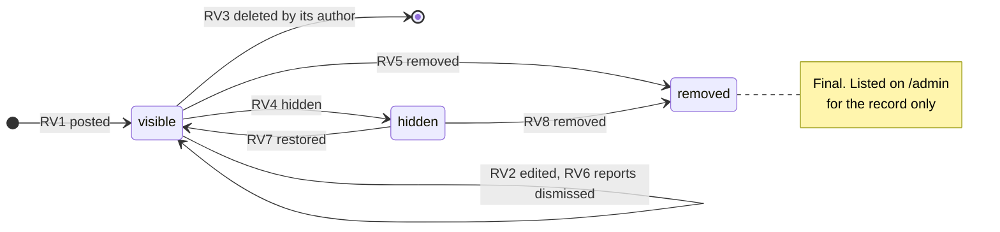
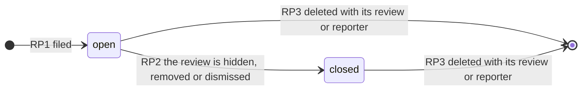

# Review lifecycle

**Status:** approved 2026-11-19 · **Owner:** @dreeyanzz · **Approved by:** @JamesNino-Mandawe ·
**Stories:** STORY-13, STORY-14, STORY-16 · **Decisions:** D-009, D-052, D-055, D-073,
D-076, D-079, D-080, D-081

This flow follows a review from the moment a Seeker posts it about a visit to the end of
its life: edited or deleted by its author, reported by other users, and hidden, restored
or removed by an Administrator (FR-4.1, FR-4.2, FR-5.2). It says who may make each move,
what makes it, what each status shows to whom, and which reviews count in a Space's
averages.

## What this flow covers

- A review's three statuses, `visible`, `hidden` and `removed`, and every move between
  them: who may make it, what makes it, and the pgTAP test that proves it.
- A report: who may file one, on what, how often, and how it closes.
- The moves nobody may make, each with its negative test.
- What each status shows signed-out visitors, Seekers, Hosts, its author and
  Administrators, including on a Space that isn't Verified.
- Which reviews the averages count, how a reviewer's name is shown, and the moderation
  history that is kept.

It leaves these to others:

- **The [reservation lifecycle](reservation-lifecycle.md)** (#173): what a visit is. A
  visit is a reservation with a check-in, `checked_in_at` set, so its status is
  `occupied` or `completed`, and it keeps its Space when its unit is deleted (D-052).
- **The [Space verification flow](space-verification.md)** (#174) and its Sprint 3 change
  (#340): a Space's status, which decides whether others can read its reviews (D-055,
  D-079).
- **STORY-13's design:** the review form, how reviews and averages appear on the Space
  profile and the Space card, and the report dialog.
- **STORY-14's design:** the Reported, Hidden and Removed lists on `/admin`, and the
  moderation log's screen.
- **STORY-16's design:** "Leave a review" in the Seeker's reservation history, which is
  where a Seeker writes about a visit to a Space that isn't Verified.
- **STORY-17:** how all of it looks. Once Maria or James restyle a screen, what they
  built wins on what users see (D-074).

## A review's status

A review's status is `reviews.status`, of type `review_status` (STORY-13). Only an
Administrator moves it, through `public.moderate_review` (STORY-14). The table and type
names here are the ones to use; STORY-13's design confirms them (Glossary).

A review in any status is also deleted with its Space, its reservation or its author's
account (RV9).

## A report

A report is a row in `review_reports` (STORY-13). It says who reported which review, about
which version of it, why, and, once it is closed, how, by whom and when. A review stays
visible while it is reported. Nothing hides a review automatically, however many reports
it gets: an Administrator decides (FR-5.2, D-080).

**Versions.** A review's `version` is 1 when it is posted and goes up by 1 on each edit.
A report records the version it was about, and a user may report each version once. So
when an author changes their text, everyone, earlier reporters included, can report the
new text, and nobody but the author can make a review reportable again (D-080). Users
never see a version number: they see "edited". An Administrator sees "edited after this
report" when a report's version is lower than the review's.

## Every move, and its test

Each move names who may make it, what makes it, and the pgTAP test that proves it. A test
is named by its file and its description. STORY-13 creates `reviews` and STORY-14 creates
`review-moderation`, each numbered when created (`supabase/tests/NN-name.sql`,
[testing guide](../guides/testing.md)).

### The review

| #   | Move                  | Event                                               | Who may make it                                                                     | Made by                                                                                                                          | Test                                                                                                                                                        |
| --- | --------------------- | --------------------------------------------------- | ----------------------------------------------------------------------------------- | -------------------------------------------------------------------------------------------------------------------------------- | ----------------------------------------------------------------------------------------------------------------------------------------------------------- |
| RV1 | → `visible`           | A Seeker posts a review of a visit                  | The visit's Seeker, if the visit has no review, whatever its Space's status (D-081) | The insert policy on `reviews`. `version` starts at 1                                                                            | `reviews`: "a Seeker with a visit posts a review, and it is visible at version 1"; "a Seeker reviews a visit to a Pending Space, and only they can read it" |
| RV2 | `visible` → `visible` | Its author edits the ratings or the comment         | Its author                                                                          | The update policy, and the column grants on the four ratings and `comment`. A trigger raises `version` by 1 and sets `edited_at` | `reviews`: "an author edits their review: its version goes up and edited_at is set"                                                                         |
| RV3 | `visible` → deleted   | Its author deletes it                               | Its author                                                                          | The delete policy. Its reports go with it, and the visit can be reviewed again (RV1)                                             | `reviews`: "an author deletes their visible review and posts a new one for the same visit"                                                                  |
| RV4 | `visible` → `hidden`  | An Administrator hides it, from the Reported list   | An Administrator                                                                    | `public.moderate_review`. Its open reports close as `hidden`                                                                     | `review-moderation`: "an Administrator hides a reported review: it leaves the averages, and its reports close as hidden"                                    |
| RV5 | `visible` → `removed` | An Administrator removes it, from the Reported list | An Administrator                                                                    | `public.moderate_review`. Its open reports close as `removed`                                                                    | `review-moderation`: "an Administrator removes a reported review, and its reports close as removed"                                                         |
| RV6 | `visible`, unchanged  | An Administrator dismisses its reports              | An Administrator                                                                    | `public.moderate_review`. Its open reports close as `dismissed`, and it leaves the Reported list                                 | `review-moderation`: "an Administrator dismisses a review's reports: it stays visible and leaves the Reported list"                                         |
| RV7 | `hidden` → `visible`  | An Administrator restores it, from the Hidden list  | An Administrator                                                                    | `public.moderate_review`. Its reports stay closed                                                                                | `review-moderation`: "an Administrator restores a hidden review, and it counts in the averages again"                                                       |
| RV8 | `hidden` → `removed`  | An Administrator removes it, from the Hidden list   | An Administrator                                                                    | `public.moderate_review`                                                                                                         | `review-moderation`: "an Administrator removes a hidden review"                                                                                             |
| RV9 | Any → deleted         | Its Space, its reservation or its author is deleted | The database                                                                        | `on delete cascade` from `spaces`, `reservations` and `profiles`, as reservations already do (D-052)                             | `reviews`: "deleting a Space deletes its reviews and their reports"                                                                                         |

### The report

| #   | Move          | Event                                                                | Who may make it                                                                                       | Made by                                                                                                                               | Test                                                                                                             |
| --- | ------------- | -------------------------------------------------------------------- | ----------------------------------------------------------------------------------------------------- | ------------------------------------------------------------------------------------------------------------------------------------- | ---------------------------------------------------------------------------------------------------------------- |
| RP1 | → open        | A user reports a review, with a reason and an optional note          | A signed-in user who isn't its author, on a visible review of a Verified Space, once for each version | The insert policy on `review_reports`, which records the review's current `version`, and a unique key on review, reporter and version | `reviews`: "a Seeker reports another Seeker's review"; "a user reports a review again after its author edits it" |
| RP2 | open → closed | An Administrator hides, removes or dismisses the review (RV4 to RV6) | An Administrator                                                                                      | `public.moderate_review`, which sets `outcome`, `closed_by` and `closed_at`                                                           | The tests of RV4, RV5 and RV6                                                                                    |
| RP3 | Any → deleted | Its review or its reporter's account is deleted                      | The database                                                                                          | `on delete cascade` from `reviews` and `profiles`                                                                                     | `reviews`: "deleting a review deletes its reports"                                                               |

A report's reason is one of `spam`, `offensive`, `not_about_space` and `other`, of type
`review_report_reason`, and its optional note holds up to 300 characters (D-080).

## Moves nobody may make

Each has its negative test (AGENTS.md rule 5). The [testing guide](../guides/testing.md)
says what each kind of denial looks like.

| #   | Nobody may                                                                                                                    | Stopped by                                                                                       | Test                                                                                                                                                                                        |
| --- | ----------------------------------------------------------------------------------------------------------------------------- | ------------------------------------------------------------------------------------------------ | ------------------------------------------------------------------------------------------------------------------------------------------------------------------------------------------- |
| N1  | Review a reservation that isn't their visit: one with no check-in, another Seeker's, or under a different Space               | The insert policy on `reviews`                                                                   | `reviews`: "a Seeker cannot review a reservation with no check-in"; "a Seeker cannot review another Seeker's visit"; "a Seeker cannot review a visit under another Space"                   |
| N2  | Post a second review on a visit that has one, whether visible, hidden or removed                                              | A unique key on `reviews.reservation_id`                                                         | `reviews`: "a Seeker cannot post a second review on one visit"; "an author cannot post again on a visit whose review was hidden or removed"                                                 |
| N3  | Post a review as a Host, an Administrator or signed out                                                                       | The insert policy, which needs the Seeker role and their own visit. `anon` has no grant          | `reviews`: "a Host and an Administrator cannot post a review"; "a signed-out visitor cannot post a review"                                                                                  |
| N4  | Edit or delete someone else's review                                                                                          | The update and delete policies, which match the author                                           | `reviews`: "another Seeker editing or deleting a review affects 0 rows"                                                                                                                     |
| N5  | Edit or delete a hidden or removed review, as its author                                                                      | The update and delete policies, which match `status = 'visible'`                                 | `reviews`: "an author cannot edit or delete a hidden or removed review"                                                                                                                     |
| N6  | Write a review's status, version, reservation, Space, author or moderation columns, Administrators included                   | The column grants: only the four ratings and `comment` can be updated                            | `reviews`: "an author cannot change their review's status or version"; "an Administrator cannot write a review's status directly"                                                           |
| N7  | Hide, remove, restore or dismiss, unless they are an Administrator                                                            | `public.moderate_review` checks the caller's role (`42501`). `anon` may not run it               | `review-moderation`: "a Seeker and a Host cannot moderate a review"; "a signed-out visitor cannot run moderate_review"                                                                      |
| N8  | Change a removed review, restore a visible one, or dismiss a review with no open reports                                      | `public.moderate_review` allows only the moves RV4 to RV8                                        | `review-moderation`: "an Administrator cannot restore or change a removed review"; "an Administrator cannot dismiss a review with no open reports"                                          |
| N9  | Moderate a review that its author edited after the Administrator read it                                                      | `public.moderate_review` compares the version the Administrator saw                              | `review-moderation`: "an Administrator cannot moderate a review edited since they read it"                                                                                                  |
| N10 | Read a hidden or removed review, or any review of a Space that isn't Verified, unless they are its author or an Administrator | The select policy on `reviews`                                                                   | `reviews`: "a signed-out visitor, a Seeker and the Space's Host cannot read a hidden or removed review"; "only its author and Administrators read a review of a Pending Space"              |
| N11 | Report their own review, the same version twice, a review others can't read, or while signed out                              | The insert policy on `review_reports`, and its unique key                                        | `reviews`: "an author cannot report their own review"; "a user cannot report the same version twice"; "a user cannot report a hidden review"; "a signed-out visitor cannot report a review" |
| N12 | Read someone else's report                                                                                                    | The select policy on `review_reports`: the reporter's own, and Administrators                    | `reviews`: "a review's author and the Space's Host read 0 of its reports"                                                                                                                   |
| N13 | Edit or delete a report, or write to the moderation log                                                                       | No update or delete grant on `review_reports`, and no grant at all on `review_moderation_events` | `review-moderation`: "nobody can edit or delete a report"; "nobody can write to the moderation log directly"                                                                                |
| N14 | Read the moderation log, unless they are an Administrator                                                                     | The select policy on `review_moderation_events`                                                  | `review-moderation`: "a Seeker and a Host read 0 rows of the moderation log"                                                                                                                |
| N15 | Give a rating outside 1 to 5, a comment over 500 characters, or a report note over 300                                        | Check constraints on `reviews` and `review_reports`                                              | `reviews`: "a rating of 0 or 6 is refused"; "a comment over 500 characters is refused"; "a report note over 300 characters is refused"                                                      |
| N16 | Count anything but visible reviews of a Verified Space in the averages                                                        | `public.space_review_summary`                                                                    | `reviews`: "the averages leave out hidden and removed reviews"; "a Pending Space's averages read as none"                                                                                   |
| N17 | Read a reviewer's full name through their review                                                                              | Reviews are read through a function that returns only the short name (D-081)                     | `reviews`: "a review read returns the reviewer's short name, never their full name"                                                                                                         |

## How the database enforces it

Adrian writes this part (D-075). The author's own rows are policies and column grants, the
way Spaces work. Moderation is a function, the way `set_space_status` works (D-053),
because only moderation changes a status.

- **`reviews`:** one row per review, with its visit (`reservation_id`, unique), its Space,
  its author, the four ratings (noise, Wi-Fi reliability, cleanliness, comfort, each 1 to
  5), an optional `comment` of up to 500 characters, `status`, `version`, `edited_at`, and
  who last changed its status and when (`status_changed_by`, `status_changed_at`).
  - Insert (RV1): the author is the caller, who has the Seeker role, and the reservation
    is theirs, has `checked_in_at` set, and belongs to the same Space. The Space's status
    doesn't matter (D-081).
  - Update (RV2) and delete (RV3): the author's own rows while `status = 'visible'`. Only
    the four ratings and `comment` are granted for update. A `before update` trigger
    raises `version` and sets `edited_at`.
  - Select: visible reviews of a Verified Space for everyone, signed-out visitors
    included; the author's own reviews in any status; every review for Administrators.
- **`review_reports`:** one row per report, with its review, its reporter, the
  `review_version` it was about, a `reason`, an optional `note`, and, once closed,
  `outcome` (`dismissed`, `hidden` or `removed`), `closed_by` and `closed_at`.
  - Insert (RP1): the reporter is the caller and isn't the review's author, the review is
    visible and its Space Verified, and `review_version` is the review's current version.
    It is unique on review, reporter and version.
  - Select: the reporter's own reports, and every report for Administrators. No role is
    granted update or delete.
- **`review_moderation_events`:** the moderation log. One row per Administrator action,
  with the review, the action (`hide`, `remove`, `restore` or `dismiss`), who took it,
  and when. Only Administrators can read it, and only `moderate_review` writes it.
- **`public.moderate_review`** (STORY-14):
  - It takes a review's id, the action, and the version the Administrator saw. It runs as
    `security definer` with an empty `search_path`. `authenticated` may run it, and `anon`
    may not.
  - It refuses anyone who isn't an Administrator with `42501`, the same error a missing
    grant gives, so every denial looks alike.
  - It locks the review's row, then refuses if its version has changed since the
    Administrator read it (N9), so a decision covers the text they saw, as
    `set_space_status` does for a Space (D-053).
  - It allows only RV4 to RV8, and refuses anything else (N8). Hide, remove and dismiss
    close every open report on the review, whatever version it was about. Hide, remove and
    restore set `status_changed_by` and `status_changed_at`.
  - Every action it takes adds a row to the moderation log.
- **`public.space_review_summary`** (STORY-13): a Space's count of visible reviews, the
  average of each rating, and the overall average, counting visible reviews of a Verified
  Space only. Anyone, signed-out visitors included, may run it.
- **Reading reviews with their author's name** (STORY-13): profiles are private, so a
  `security definer` read returns each review with its author's short name only (N17).
  STORY-13's design names it.

## What each status shows

Seekers, signed-out visitors and the Space's Host all see the same thing. Hosts can't
reply to reviews in Sprint 3. Maria and James word what each person is told (D-042, D-074).

| Status                                    | Signed-out visitors, Seekers, the Space's Host        | Its author                                                                    | Administrators                                                             |
| ----------------------------------------- | ----------------------------------------------------- | ----------------------------------------------------------------------------- | -------------------------------------------------------------------------- |
| `visible`, on a Verified Space            | On the Space profile, and in its averages             | The same, with Edit and Delete. "Edited" shows once it has been edited        | The same. In the Reported list while it has open reports                   |
| `visible`, on a Space that isn't Verified | Nothing, because the Space reads as not found (D-055) | Their review, from their reservation history (STORY-16), with Edit and Delete | Readable, and moderated as usual                                           |
| `hidden`                                  | Nothing                                               | Their review, labelled "Hidden by an Administrator", with no Edit or Delete   | In the Hidden list, with Restore and Remove                                |
| `removed`                                 | Nothing                                               | Their review, labelled "Removed by an Administrator", with no Edit or Delete  | In the Removed list, read-only, with who removed it, when, and its reports |

A reporter is told an Administrator will look at it, and sees the review marked "You
reported this". Neither the author nor the reporter is told anything more: no reason and
no notification (D-080).

## The averages and the reviewer's name

- **The averages** count visible reviews of a Verified Space only, and show from the first
  review, always with the count, for example "4.3 · 2 reviews" (D-076). The overall
  average is the average of the four ratings. How the numbers look is Maria and James's
  call.
- **The reviewer's name** is worked out from `profiles.full_name` when it is read: the
  first word, then the first letter of the last word and a full stop. "Juan dela Cruz"
  reads "Juan C.", a one-word name reads as it is, and an empty name reads "Worq Seeker"
  (D-081). The read never returns the full name (N17).

## The moderation history

Two layers, for different questions (D-080):

- **Who acted last, on each record.** A review keeps who last changed its status and when,
  and each report keeps how it was closed, by whom and when. The Reported, Hidden and
  Removed lists show these.
- **Every action, in the moderation log.** `review_moderation_events` keeps each hide,
  remove, restore and dismiss, in order, so an Administrator can open a review's whole
  history, for example hidden, restored, then hidden again.

The text of a review isn't versioned: the log records actions, and a removed review keeps
its last text.

## Choices made

Each choice has its entry in [DECISIONS](../DECISIONS.md), with what it rejected:

- **D-080:** how reviews are moderated. Reports are separate records, each version can be
  reported once by each user, hiding can be undone and removing can't, an Administrator
  can dismiss reports or restore a hidden review, nothing hides automatically, only
  Administrators read reports, and the history is kept in two layers.
- **D-081:** when a review can be posted, edited and deleted, and who sees it. A Seeker can
  review a visit whatever its Space's status, but only Verified Spaces' reviews are
  public; an author can delete only a visible review, and may then post again; refunds
  don't matter; reviews go with their Space, visit or author; and reviewers show by a
  short name.

D-076 already settled what a review holds, from when it can be posted, and that it is
public.

## Open questions

None in this flow. The confirmation email (D-089) belongs to STORY-16's design.
