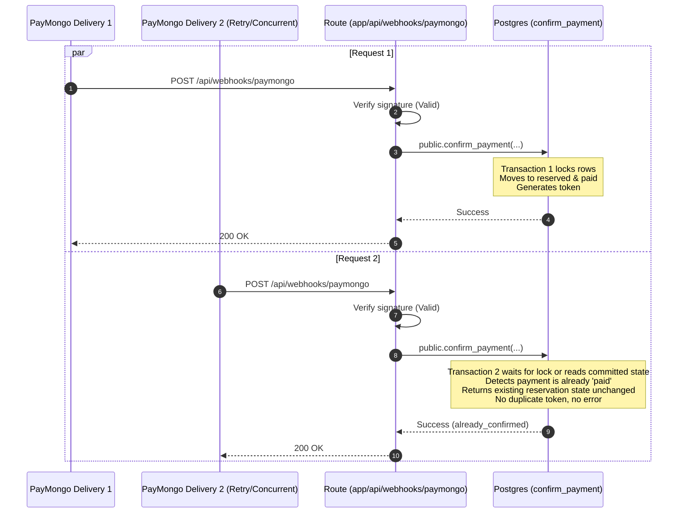
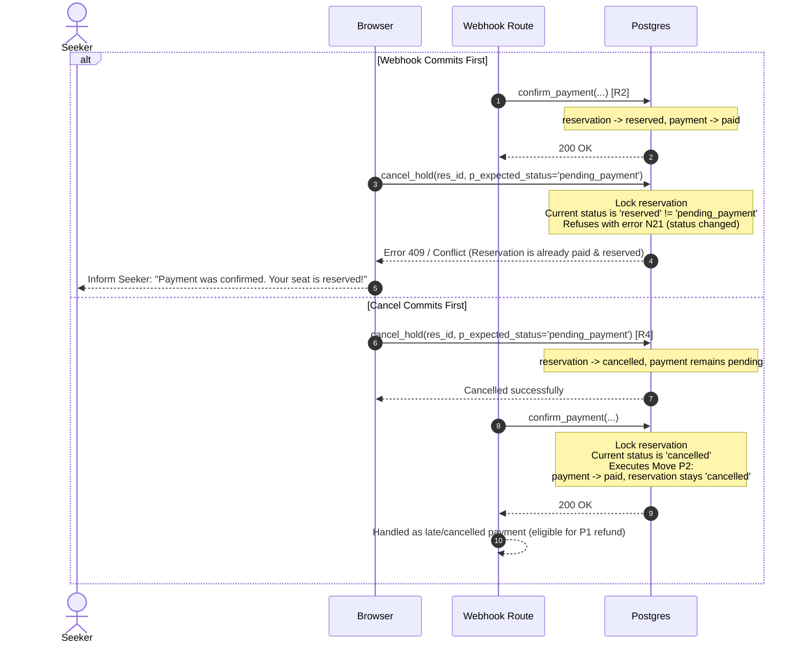

# Sandbox payment confirmation

**Status:** draft · **Owner:** @dreeyanzz · **Approved by:** @lukedongque, @fayeye-09 ·
**Stories:** STORY-09, STORY-10, STORY-14 ·
**Decisions:** D-004, D-005, D-008, D-010, D-011, D-044, D-046, D-047, D-049, D-050, D-056

This flow follows a sandbox reservation payment from the moment a Seeker initiates checkout
for an Available unit until the unit transitions to Reserved with a booking token, or until
a late or duplicate delivery is handled. It details the integration with PayMongo Checkout
Sessions in test mode (D-005, D-056), signature verification (D-010), the database transition
functions, concurrency races, and what the Seeker sees upon returning to Worq.

## What this flow covers

- **Checkout session creation:** How a Seeker holding an Available unit (`hold_unit`, R1)
  receives a PayMongo Checkout Session URL in test mode (D-056).
- **Session reuse (one hold, one checkout):** Reusing an existing active session URL or
  expiring a previous session to prevent multiple active checkouts for one hold.
- **Fixed fee integrity:** The fee amount charged is derived exclusively from
  `payments.fee_amount` stored during the hold (D-049), never from browser state or query parameters.
- **Webhook entry point:** The route handler at `app/api/webhooks/paymongo/route.ts`
  (D-010), which receives `checkout_session.payment.paid` events.
- **Webhook signature verification:** Luke's security perimeter: validating the
  `paymongo-signature` header (`t=<timestamp>,te=<signature>` in test mode, or `li=<signature>`
  in live mode) via HMAC-SHA256 and constant-time comparison before database operations occur.
- **Atomic payment confirmation (`public.confirm_payment`):** Invoked exclusively by the
  secret key (`service_role`, N7) to transition the reservation and payment in one transaction
  with strict lock ordering (units → reservations → payments, D-047).
- **Successful confirmation (Move R2):** Transitioning `pending_payment` → `reserved` and
  `pending` → `paid`, generating a single booking token, and starting the wait window countdown
  (`wait_window_ends_at = now() + wait_window_minutes`).
- **Late payment after expiry (Move P2):** Handling a payment that succeeds at the gateway
  after the hold's payment window has lapsed into `expired` (or was `cancelled`). Recording the
  payment as `paid` while keeping the reservation `expired` (or `cancelled`), without
  resurrecting the hold, and leaving the record for an Administrator sandbox refund in Sprint 3 (P1, STORY-14).
- **Duplicate webhook idempotency:** Ensuring multiple deliveries or concurrent webhook
  requests yield exactly one Reserved unit and one booking token, returning HTTP 200 OK without errors.
- **Webhook vs return URL race:** Handling the Seeker returning to the confirmation URL before
  the webhook arrives, providing a "Waiting for confirmation" state with automatic polling/revalidation.
- **Webhook vs Seeker cancel race:** Handling a Seeker cancellation that races with payment confirmation,
  resolved deterministically by state-matching (D-050, N21).
- **Seeker return states:** What the Seeker sees on `/dashboard/seeker/reservations/[id]/confirmation`:
  Confirmed / Reserved, Waiting for confirmation, Expired / Late payment (P2), and Cancelled / Failed.

It leaves these to other flows:

- **The [reservation lifecycle](reservation-lifecycle.md)** (#173): The complete state model
  for units, reservations, and payments; lapse rules (D-011, D-047); and moves R1, R3–R12.
- **The [Space verification flow](space-verification.md)** (#174): Space verification status
  enforcing that holds can only be created in Verified Spaces (R1, N4).
- **The check-in flow** (#176): The booking token payload, QR presentation, Host scanning,
  and check-in transition (R6).
- **The [Seeker journey](seeker-journey.md)** (#178): High-level discovery, seat selection,
  and authentication before checkout.
- **STORY-09's design:** The concrete length of the payment window, maximum wait window bounds,
  fee amount, and environment variables (`PAYMONGO_SECRET_KEY`, `PAYMONGO_WEBHOOK_SECRET`).
- **STORY-14's design** (Sprint 3): Administrator sandbox refunds for late payments (P1, FR-5.3).

---

## 1. Sequence Diagrams

### 1.1 Primary Sequence: Successful Checkout and Webhook Confirmation (R2)

This sequence illustrates the happy path where a Seeker creates a hold, completes payment on PayMongo's
hosted checkout, the webhook arrives, verifies, confirms the hold, and the Seeker lands on the confirmed reservation page.

```mermaid
sequenceDiagram
    autonumber
    actor S as Seeker
    participant B as Browser
    participant SA as Server Action (createCheckout)
    participant DB as Postgres (confirm_payment)
    participant PM as PayMongo Checkout
    participant WH as Route (app/api/webhooks/paymongo)

    S->>B: Taps "Hold & Pay" on Space profile
    B->>SA: createCheckoutSession(spaceId, unitId, waitWindowMinutes)
    SA->>DB: hold_unit(...) [Move R1]
    Note over DB: reservation: pending_payment<br/>payment: pending (fee copied)<br/>payment_window_ends_at set
    SA->>PM: POST /v1/checkout_sessions (amount=fee_amount, success_url, cancel_url, metadata={reservation_id})
    PM-->>SA: 200 OK (checkout_url, checkout_session_id)
    SA->>DB: attach_checkout_session(reservation_id, checkout_session_id, checkout_url)
    Note over DB: payments: saves session ID & URL for session reuse (W2)
    SA-->>B: Redirect to checkout_url
    B->>PM: Seeker visits PayMongo hosted checkout

    alt Seeker Completes Payment
        S->>PM: Completes test payment (card/GCash/Maya)
        PM->>PM: Processes payment successfully

        par Webhook Notification
            PM->>WH: POST /api/webhooks/paymongo (checkout_session.payment.paid, signature header)
            WH->>WH: Verify paymongo-signature (HMAC-SHA256, timestamp skew <= 300s)
            alt Signature Invalid
                WH-->>PM: 400 Bad Request / 401 Unauthorized
            else Signature Valid
                WH->>DB: public.confirm_payment(p_reservation_id, p_checkout_session_id, p_payment_id) [Secret Key]
                Note over DB: Lock units -> reservations -> payments<br/>Check status: pending_payment<br/>reservation -> reserved<br/>payment -> paid<br/>Generate 1 booking token<br/>wait_window_ends_at = now() + wait_window
                DB-->>WH: Success (reservation_id, status='reserved')
                WH-->>PM: 200 OK
            end
        and Seeker Return to App
            PM-->>B: Redirects to success_url (?reservation_id=...)
            B->>SA: GET /dashboard/seeker/reservations/[id]/confirmation
            SA->>DB: unit_states(space_id) / getReservation(reservation_id)
            alt Webhook already committed
                DB-->>SA: status: reserved, booking_token, wait_window_ends_at
                SA-->>B: Render "Confirmed / Reserved" with booking token & timer
            else Webhook pending / racing
                DB-->>SA: status: pending_payment
                SA-->>B: Render "Waiting for payment confirmation..." (polls / revalidates)
                Note over B: Client revalidates after 2s; sees 'reserved' once webhook commits
            end
        end
    else Seeker Exits or Cancels Checkout
        S->>PM: Clicks "Cancel" or "Return to merchant"
        PM-->>B: Redirects to cancel_url (?status=cancelled)
        B->>SA: GET /dashboard/seeker/reservations/[id]/confirmation?status=cancelled
        SA-->>B: Render "Cancelled / Exit" (State 5) with option to release hold (Move R4)
    end
```

---

### 1.2 Webhook Races and Edge Cases

#### Case A: Late Payment After Payment Window Has Lapsed (Move P2)

A Seeker pays slowly or leaves the checkout tab open. Before PayMongo confirms the payment,
the database lapse step records the reservation as `expired` (R3). When the webhook arrives,
the unit cannot be reserved because another Seeker may hold it (N3), or the Seeker may have held
another unit (D-008).

```mermaid
sequenceDiagram
    autonumber
    participant PM as PayMongo Gateway
    participant WH as Route (app/api/webhooks/paymongo)
    participant DB as Postgres (confirm_payment)
    actor S as Seeker
    participant B as Browser

    Note over DB: Time passes: now() > payment_window_ends_at<br/>Lapse step runs: reservation -> expired [Move R3]<br/>unit reads Available; payment remains pending

    PM->>WH: POST /api/webhooks/paymongo (checkout_session.payment.paid)
    WH->>WH: Verify signature (Valid)
    WH->>DB: public.confirm_payment(p_reservation_id, ...) [Secret Key]
    Note over DB: Lock rows<br/>Current reservation status: 'expired'<br/>Move P2 executes:<br/>payment: pending -> paid<br/>reservation remains 'expired' (no resurrection)<br/>Flagged for admin refund (Sprint 3 STORY-14)
    DB-->>WH: Result: (status='expired', payment_status='paid', outcome='late_payment_recorded')
    WH-->>PM: 200 OK

    S->>B: Returns to confirmation URL
    B->>DB: getReservation(reservation_id)
    DB-->>B: status='expired', payment='paid'
    B-->>S: Displays "Payment window expired. Your payment of ₱X was received late. Please contact support or request an Administrator refund."
```

#### Case B: Duplicate or Concurrent Webhook Deliveries

PayMongo may retry webhook delivery or fire concurrent requests. `confirm_payment` is idempotent.



#### Case C: Seeker Cancellation Races With Webhook Confirmation

A Seeker cancels their unpaid hold (`cancel_hold`) at the exact moment the webhook arrives.



#### Case D: Declined Card or Uncompleted Payment on Gateway

A Seeker's payment method is declined or rejected on PayMongo's hosted checkout page. PayMongo allows
the user to re-enter details or choose a different payment method.

```mermaid
sequenceDiagram
    autonumber
    actor S as Seeker
    participant PM as PayMongo Checkout
    participant DB as Postgres (confirm_payment)

    S->>PM: Submits declined card or insufficient funds
    PM-->>S: Prompts retry on hosted checkout page (session remains active)
    alt Seeker Abandons Checkout
        Note over DB: Time passes: now() > payment_window_ends_at<br/>Lapse step moves reservation -> expired [Move R3]<br/>payment remains pending
    else Seeker Returns via Cancel Link
        PM-->>S: Redirects to cancel_url
        Note over S: Lands on confirmation page (State 5); releases hold via cancel_hold [Move R4]
    end
```

---

## 2. Every Branch, Event, and Test

The table below catalogs every path through the checkout and webhook lifecycle, who initiates it,
the mechanism making the change, the resulting state, and the test verifying it.

| #   | Branch / Event                                        | Who makes it                    | Made by                                                               | Reservation status                                     | Payment status     | Test                                                                                          |
| --- | ----------------------------------------------------- | ------------------------------- | --------------------------------------------------------------------- | ------------------------------------------------------ | ------------------ | --------------------------------------------------------------------------------------------- |
| W1  | Seeker initiates hold and checkout session            | Seeker                          | `hold_unit` (STORY-09 Server Action) + PayMongo API call              | `pending_payment`                                      | `pending`          | `holds`: "a Seeker holds an Available unit, which reads Pending Payment"                      |
| W2  | Duplicate checkout request for same hold              | Seeker (double click/tab)       | Server Action checks existing checkout session for active reservation | `pending_payment`                                      | `pending`          | `vitest/payments`: "returns existing active checkout URL instead of creating second"          |
| W3  | Webhook arrives with invalid signature                | PayMongo / Attacker             | `app/api/webhooks/paymongo/route.ts`                                  | Unchanged                                              | Unchanged          | `vitest/webhooks`: "rejects payload with invalid or missing signature with 401"               |
| W4  | Webhook arrives with expired timestamp (> 300s)       | PayMongo / Replay               | `app/api/webhooks/paymongo/route.ts`                                  | Unchanged                                              | Unchanged          | `vitest/webhooks`: "rejects payload with timestamp exceeding tolerance with 400"              |
| W5  | Webhook confirms payment within window (Move R2)      | PayMongo webhook via Secret Key | `public.confirm_payment`                                              | `pending_payment` → `reserved`                         | `pending` → `paid` | `holds`: "a confirmed payment reserves the unit and gives it one booking token"               |
| W6  | Duplicate webhook delivery after confirmation         | PayMongo retry                  | `public.confirm_payment`                                              | Stays `reserved`                                       | Stays `paid`       | `holds`: "duplicate confirm_payment calls are idempotent and return success"                  |
| W7  | Late payment after payment window lapsed (Move P2)    | PayMongo webhook via Secret Key | `public.confirm_payment`                                              | Stays `expired`                                        | `pending` → `paid` | `holds`: "confirming a payment on an expired hold moves payment to paid and stays expired"    |
| W8  | Late payment after hold cancelled by Seeker (Move P2) | PayMongo webhook via Secret Key | `public.confirm_payment`                                              | Stays `cancelled`                                      | `pending` → `paid` | `holds`: "confirming a payment on a cancelled hold moves payment to paid and stays cancelled" |
| W9  | Seeker return arrives before webhook commits          | Seeker                          | Seeker return page query                                              | `pending_payment` (reads pending)                      | `pending`          | `playwright/seeker`: "confirmation page shows waiting state until webhook completes"          |
| W10 | Webhook arrives after Seeker cancel commits           | Seeker & Webhook                | `cancel_hold` followed by `confirm_payment`                           | `cancelled` (N21 prevents hold)                        | `pending` → `paid` | `holds`: "cancel racing before confirm_payment preserves cancelled reservation state"         |
| W11 | Seeker cancel arrives after Webhook commits           | Seeker & Webhook                | `confirm_payment` followed by `cancel_hold`                           | `reserved` (N21 refuses cancel)                        | Stays `paid`       | `holds`: "cancel with pending_payment expected status fails once payment is confirmed"        |
| W12 | Payment attempt declined or uncompleted on gateway    | PayMongo / Seeker               | Gateway hosted retry; hold expires if timer ends                      | Stays `pending_payment` until lapse (R3) / cancel (R4) | Stays `pending`    | `holds`: "uncompleted gateway payment leaves reservation pending_payment until lapse"         |
| W13 | Seeker exits checkout and returns via cancel_url      | Seeker                          | `cancel_url` return page action                                       | `pending_payment` → `cancelled` (if Seeker confirms)   | Stays `pending`    | `holds`: "Seeker cancel from return page releases hold"                                       |

---

## 3. Webhook Specification and Security Rules

### 3.1 Signature Header Verification

PayMongo signs webhook payloads using HMAC-SHA256. The incoming `POST` request to `app/api/webhooks/paymongo`
contains the `paymongo-signature` header:

```
paymongo-signature: t=1730473200,te=abcdef0123456789...,li=...
```

1. **Extraction:**
   - Parse the header into its components: timestamp `t`, test mode signature `te`, and live mode signature `li`.
   - In test mode (`process.env.PAYMONGO_ENV === 'test'`), verify against `te`. In live mode, verify against `li`.
2. **Timestamp Validation:**
   - Compute `skew = abs(current_unix_timestamp - t)`.
   - If `skew > 300` seconds (5 minutes), reject with HTTP 400 Bad Request to prevent replay attacks.
3. **HMAC Calculation:**
   - Construct the signed payload string: `${t}.${rawRequestBody}`.
   - Compute `HMAC-SHA256(signedPayload, PAYMONGO_WEBHOOK_SECRET)`.
   - Compare the computed digest with the header's signature using `crypto.timingSafeEqual` to eliminate timing attacks.
4. **Execution Authority:**
   - Only the route handler in `app/api/` with access to `SUPABASE_SECRET_KEY` (admin client) can execute `public.confirm_payment`.
   - Direct execution of `confirm_payment` by `anon` or `authenticated` roles is explicitly revoked (N7, N24).

---

## 4. Database Function Contract: `public.confirm_payment`

The database transition is encapsulated in `public.confirm_payment`:

```sql
public.confirm_payment(
  p_reservation_id uuid,
  p_checkout_session_id text,
  p_external_payment_id text
) returns jsonb
```

### Behavioral Guarantees:

1. **Security Definer & Search Path:**
   - Declared `security definer set search_path = ''`.
   - Revoked from `public`, `anon`, and `authenticated`. Granted solely to `service_role`.
2. **Deterministic Locking Order (D-047):**
   - Locks the associated unit row first (`SELECT id FROM public.units WHERE id = ... FOR UPDATE`).
   - Locks the reservation row second (`SELECT id, status FROM public.reservations WHERE id = ... FOR UPDATE`).
   - Locks the payment row third (`SELECT id, status FROM public.payments WHERE reservation_id = ... FOR UPDATE`).
3. **Idempotency Check:**
   - If `payments.status = 'paid'`, the payment was already processed.
   - The function immediately returns `{"status": "already_paid", "reservation_status": reservations.status}` with HTTP 200 OK semantics.
4. **State Transition Logic:**
   - **If `reservations.status = 'pending_payment'` (Move R2):**
     - Update `reservations`:
       - `status = 'reserved'`
       - `wait_window_ends_at = clock_timestamp() + (wait_window_minutes || ' minutes')::interval`
     - Generate a cryptographically random booking token (`booking_token = encode(gen_random_bytes(16), 'hex')`).
     - Update `payments`:
       - `status = 'paid'`
       - `external_payment_id = p_external_payment_id`
       - `paid_at = clock_timestamp()`
     - Return `{"status": "confirmed", "reservation_status": "reserved"}`.
   - **If `reservations.status IN ('expired', 'cancelled')` (Move P2):**
     - The hold has ended and its seat cannot be claimed.
     - Update `payments`:
       - `status = 'paid'`
       - `external_payment_id = p_external_payment_id`
       - `paid_at = clock_timestamp()`
     - Reservation status remains unchanged (`expired` or `cancelled`).
     - Return `{"status": "late_payment", "reservation_status": reservations.status}`.

---

## 5. Seeker Return URL and Polling States

When the Seeker completes or exits checkout on PayMongo, they are redirected back to Worq at:
`/dashboard/seeker/reservations/[id]/confirmation`

Because network routing may cause the Seeker's browser redirect to arrive before PayMongo's webhook
delivers the payment event, the return page supports four distinct display states:

1. **State: Confirmed (`reservations.status = 'reserved'` and `payments.status = 'paid'`):**
   - Renders a prominent confirmation banner ("Seat Reserved").
   - Displays the single booking token with QR code component (STORY-10).
   - Displays the countdown timer to `wait_window_ends_at`.
   - Displays space address and check-in instructions.
2. **State: Waiting for Confirmation (`reservations.status = 'pending_payment'` and `now() <= payment_window_ends_at`):**
   - Renders an animated loading indicator ("Verifying payment with gateway...").
   - Client executes short exponential polling (e.g., 1.5s, 3s, 5s) or revalidates via Server Action.
   - Once webhook commits, UI transitions immediately to **Confirmed**.
3. **State: Expired / Late Payment (`reservations.status = 'expired'` and `payments.status = 'paid'`):**
   - Renders an amber alert notice: "Payment Window Expired".
   - Informs the Seeker that the checkout took longer than the allotted payment window and the unit was released.
   - Explains that the fee was recorded as paid and is queued for an Administrator refund (FR-5.3, P1 in Sprint 3).
   - Provides a direct link to return to Space discovery.
4. **State: Lapsed / Unpaid (`reservations.status = 'expired'` and `payments.status = 'pending'`):**
   - Renders an error notice: "Payment window lapsed with no payment received".
   - Unit is available for new holds; offers link to try again.
5. **State: Cancelled (`reservations.status = 'cancelled'` or returned via `cancel_url`):**
   - If the reservation was cancelled by the Seeker, renders confirmation that the hold was released.
   - If the Seeker navigated back via `cancel_url` while the hold is still `pending_payment`, gives the Seeker an immediate action to release the hold (Move R4) so they or another student can select a seat without waiting for the timer to expire, or return to PayMongo if they wish to resume.

---

## 6. Choices made and rejected

- **Hosted checkout vs custom form:** D-005 and D-056 chose PayMongo Checkout Sessions (hosted checkout).
  _Rejected:_ Collecting card credentials or embedding payment inputs directly in Worq, which expands PCI DSS scope and operational security risk.
- **Secret-key webhook route vs client-triggered confirmation:** D-010 chose a route handler at `app/api/webhooks/paymongo/route.ts` with secret key authority (`service_role`, N7) calling `public.confirm_payment`.
  _Rejected:_ Client-side confirmation triggered from browser redirects or query parameters, which would allow spoofing paid reservations without gateway verification.
- **Handling late payment after payment window lapsed (Move P2):** Chose Move P2: record the payment as `paid` and keep the reservation `expired` (or `cancelled`) without resurrecting the hold or reassigning the seat, leaving the payment record for an Administrator sandbox refund in Sprint 3 (STORY-14, D-056).
  _Rejected:_ Resurrecting the reservation or assigning an arbitrary open seat, which risks double-booking another Seeker who held the unit after expiry (N3, D-008).
- **Payment failure semantics:** Chose leaving the reservation `pending_payment` until lapse (Move R3) or Seeker cancellation (Move R4), because `payments.status` strictly follows SRS §3.8 (`pending`, `paid`, `forfeited`, `refunded`) with no `failed` status.
  _Rejected:_ Adding a `failed` database status or deleting the hold prematurely on checkout retry.
- **PayMongo webhook replay tolerance:** Chose 300 seconds (5 minutes) skew limit and constant-time signature comparison (`crypto.timingSafeEqual`).
  _Rejected:_ Indefinite timestamp tolerance (vulnerable to replay attacks) and standard string equality `===` (vulnerable to timing attacks).
- **Deterministic transaction lock ordering (D-047):** Chose ordering locks units → reservations → payments.
  _Rejected:_ Unordered or reverse row locking, which causes Postgres deadlocks during concurrent webhook and cancellation transactions.
- **Return URL polling over server push:** Chose client-side short polling and Server Action revalidation on `/dashboard/seeker/reservations/[id]/confirmation`.
  _Rejected:_ WebSocket or SSE connections, which require persistent server state not suited for Vercel serverless.

---

## 7. Open questions

None. The architectural questions regarding gateway selection, hosted checkout sessions, signature verification, webhook races, and late payments were settled by D-005, D-010, D-047, D-050, and D-056. STORY-09 implements the concrete fee amount and timer limits, and STORY-14 (Sprint 3) implements the Administrator refund UI (P1). Webhooks in PayMongo test mode deliver within 1–3 seconds, so the return URL polling state (Section 5, State 2) is verified under the Vitest and Playwright test matrices.
