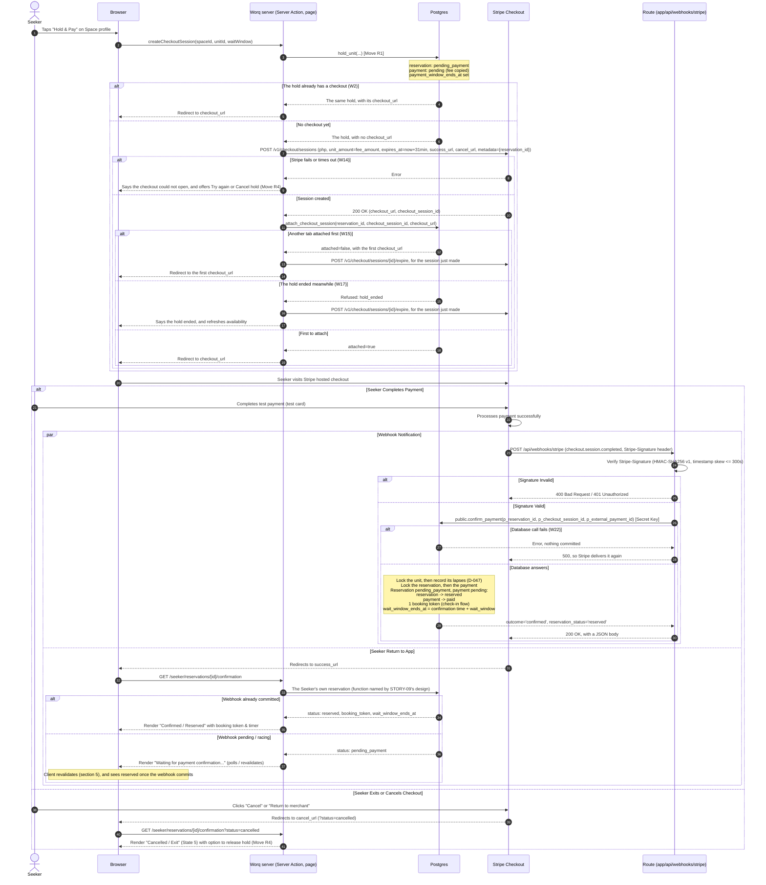
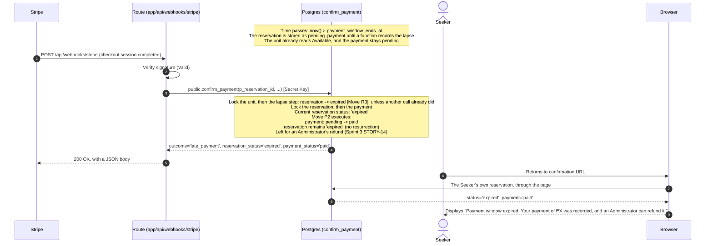
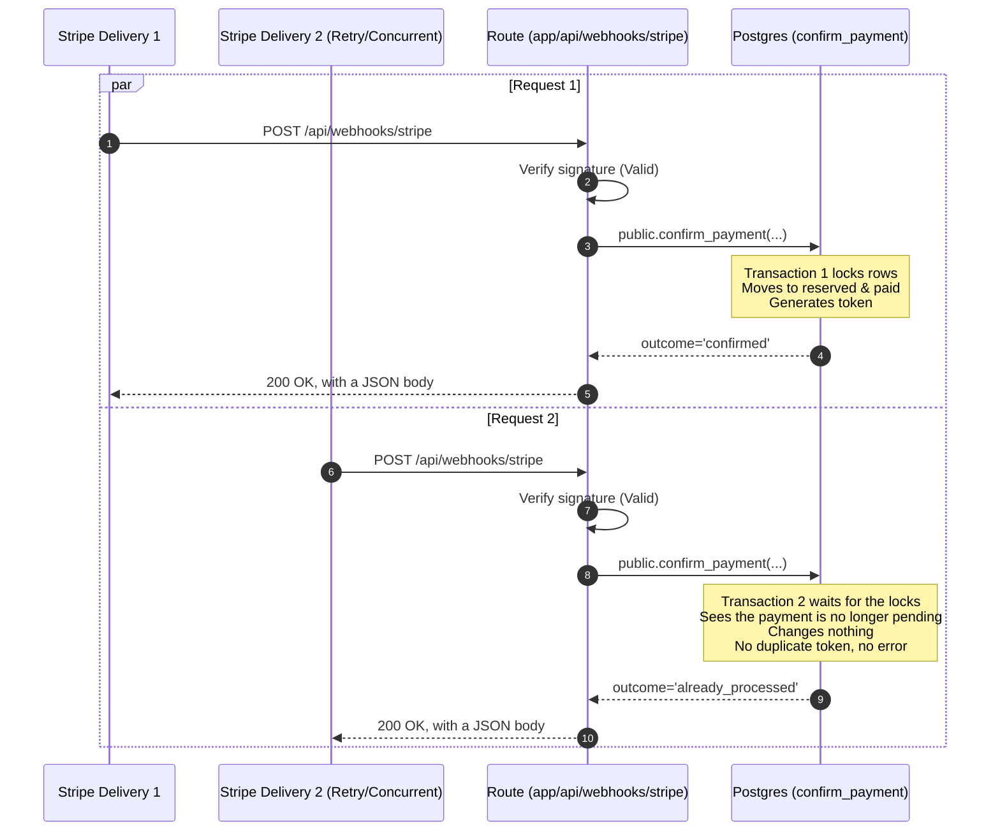
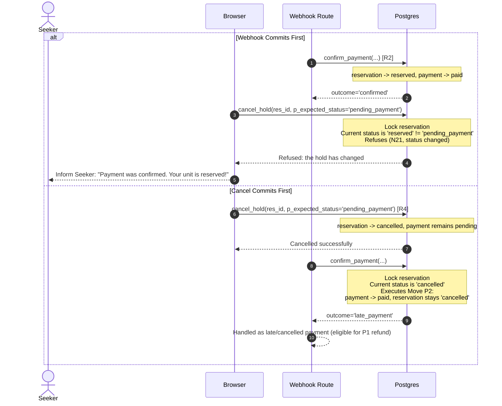
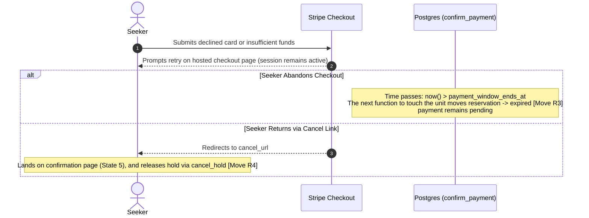

# Sandbox payment confirmation

**Status:** approved 2026-11-02 · **Owner:** @dreeyanzz · **Approved by:** @lukedongque, @fayeye-09 ·
**Stories:** STORY-09, STORY-10, STORY-14 ·
**Decisions:** D-004, D-005, D-008, D-010, D-011, D-044, D-046, D-047, D-049, D-050, D-064, D-069

This flow follows a sandbox reservation payment from the moment a Seeker initiates checkout
for an Available unit until the unit transitions to Reserved with a booking token, or until
a late or duplicate delivery is handled. It details the integration with Stripe Checkout
Sessions in a Stripe sandbox (D-005, D-069), signature verification (D-010), the database transition
functions, concurrency races, and what the Seeker sees upon returning to Worq.

## What this flow covers

- **Checkout session creation:** How a Seeker holding an Available unit (`hold_unit`, R1)
  receives a Stripe Checkout Session URL in a Stripe sandbox (D-069).
- **One checkout per hold:** `public.attach_checkout_session` keeps one checkout per
  reservation. A second tab reuses it, and a checkout that loses the race is expired at once,
  so a Seeker can't pay twice.
- **Fixed fee integrity:** The fee amount charged is derived exclusively from
  `payments.fee_amount` stored during the hold (D-049), never from browser state or query parameters.
- **Webhook entry point:** The route handler at `app/api/webhooks/stripe/route.ts`
  (D-010), which receives `checkout.session.completed` events, and `checkout.session.async_payment_succeeded`
  for a delayed payment method (D-069).
- **Webhook signature verification:** Luke's security perimeter: validating a `v1` signature
  in the `Stripe-Signature` header via HMAC-SHA256 and constant-time comparison before
  database operations occur.
- **Atomic payment confirmation (`public.confirm_payment`):** Invoked exclusively by the
  secret key (`service_role`, N7) to transition the reservation and payment in one transaction.
  It locks the unit, records its lapses, then locks the reservation and the payment, in strict order
  (units → reservations → payments, D-047).
- **Successful confirmation (Move R2):** Transitioning `pending_payment` → `reserved` and
  `pending` → `paid`, generating a single booking token in the check-in flow's format, and
  starting the wait window (`wait_window_ends_at` is the confirmation's time plus `reservations.wait_window`).
- **Late payment after expiry (Move P2, D-064):** Handling a payment that succeeds at the gateway
  after the hold's payment window has lapsed into `expired` (or was `cancelled`). Recording the
  payment as `paid` while keeping the reservation `expired` (or `cancelled`), without
  resurrecting the hold, and leaving the record for an Administrator sandbox refund in Sprint 3 (P1, STORY-14).
- **Duplicate webhook idempotency:** Ensuring multiple deliveries or concurrent webhook
  requests yield exactly one Reserved unit and one booking token, returning HTTP 200 OK without
  errors, and never changing a payment that is no longer `pending`.
- **Webhook vs return URL race:** Handling the Seeker returning to the confirmation URL before
  the webhook arrives, providing a "Waiting for confirmation" state with automatic polling/revalidation.
- **Webhook vs Seeker cancel race:** Handling a Seeker cancellation that races with payment confirmation,
  resolved deterministically by state-matching (D-050, N21).
- **Seeker return states:** What the Seeker sees on `/seeker/reservations/[id]/confirmation`:
  Confirmed, Waiting for confirmation, Expired with a late payment (P2), Lapsed and unpaid, and Cancelled.

It leaves these to other flows:

- **The [reservation lifecycle](reservation-lifecycle.md)** (#173): The complete state model
  for units, reservations, and payments; lapse rules (D-011, D-047); and moves R1, R3–R12.
- **The [Space verification flow](space-verification.md)** (#174): Space verification status
  enforcing that holds can only be created in Verified Spaces (R1, N4).
- **The [check-in flow](check-in.md)** (#176): What the booking token holds and its format, QR presentation,
  Host scanning, and check-in transition (R6).
- **The [Seeker journey](seeker-journey.md)** (#178): High-level discovery, seat selection,
  and authentication before checkout.
- **STORY-09's design:** The concrete length of the payment window, maximum wait window bounds,
  fee amount, the tables' other columns, the function that returns a Seeker's own reservation,
  and environment variables (`STRIPE_SECRET_KEY`, `STRIPE_WEBHOOK_SECRET`).
- **STORY-14's design** (Sprint 3): Administrator sandbox refunds for late payments (P1, FR-5.3).

---

## 1. Sequence Diagrams

### 1.1 Primary Sequence: Successful Checkout and Webhook Confirmation (R2)

This sequence illustrates the happy path where a Seeker creates a hold, completes payment on Stripe's
hosted checkout, the webhook arrives, verifies, confirms the hold, and the Seeker lands on the confirmed reservation page,
with the branches that can fail on the way.



---

### 1.2 Webhook Races and Edge Cases

#### Case A: Late Payment After Payment Window Has Lapsed (Move P2)

A Seeker pays slowly or leaves the checkout tab open. The payment window passes before Stripe
confirms the payment. No scheduled job ends the hold (D-011): whichever function touches the unit
next records the lapse, as `expired` (R3), and `confirm_payment` is one of them (D-047). So the
webhook can't reserve the unit. Another Seeker may hold it by now (N3), or the Seeker may have held
another unit (D-008).



#### Case B: Duplicate or Concurrent Webhook Deliveries

Stripe may retry webhook delivery or send concurrent requests. `confirm_payment` is idempotent.



A later repeat works the same way, even after the fee was forfeited or refunded: only a `pending`
payment moves (W19).

#### Case C: Seeker Cancellation Races With Webhook Confirmation

A Seeker cancels their unpaid hold (`cancel_hold`) at the exact moment the webhook arrives.



#### Case D: Declined Card or Uncompleted Payment on Gateway

A Seeker's card is declined on Stripe's hosted checkout page. Stripe lets the Seeker
re-enter the details or try another card.



---

## 2. Every Branch, Event, and Test

The table below catalogs every path through the checkout and webhook lifecycle, who initiates it,
the mechanism making the change, the resulting state, and the test verifying it.

| #   | Branch / Event                                                                     | Who makes it                  | Made by                                                                               | Reservation status                                             | Payment status                  | Test                                                                                                                                                                                                 |
| --- | ---------------------------------------------------------------------------------- | ----------------------------- | ------------------------------------------------------------------------------------- | -------------------------------------------------------------- | ------------------------------- | ---------------------------------------------------------------------------------------------------------------------------------------------------------------------------------------------------- |
| W1  | Seeker initiates hold and checkout session                                         | Seeker                        | `hold_unit` (STORY-09 Server Action) + Stripe API call                                | `pending_payment`                                              | `pending`                       | `holds`: "a Seeker holds an Available unit, which reads Pending Payment"                                                                                                                             |
| W2  | Duplicate checkout request for same hold                                           | Seeker (double click/tab)     | `hold_unit` returns the hold with its `checkout_url`, and the Server Action reuses it | `pending_payment`                                              | `pending`                       | `vitest/payments`: "returns existing active checkout URL instead of creating second"                                                                                                                 |
| W3  | Webhook arrives with invalid signature                                             | Stripe / Attacker             | `app/api/webhooks/stripe/route.ts`                                                    | Unchanged                                                      | Unchanged                       | `vitest/webhooks`: "rejects payload with invalid or missing signature with 401"                                                                                                                      |
| W4  | Webhook arrives with expired timestamp (> 300s)                                    | Stripe / Replay               | `app/api/webhooks/stripe/route.ts`                                                    | Unchanged                                                      | Unchanged                       | `vitest/webhooks`: "rejects payload with timestamp exceeding tolerance with 400"                                                                                                                     |
| W5  | Webhook confirms payment within window (Move R2)                                   | Stripe webhook via Secret Key | `public.confirm_payment`                                                              | `pending_payment` → `reserved`                                 | `pending` → `paid`              | `holds`: "a confirmed payment reserves the unit and gives it one booking token"; `vitest/webhooks`: "answers 200 with a JSON body for every confirm_payment outcome"                                 |
| W6  | Duplicate webhook delivery after confirmation                                      | Stripe retry                  | `public.confirm_payment`                                                              | Stays `reserved`                                               | Stays `paid`                    | `holds`: "duplicate confirm_payment calls are idempotent and return success". Also STORY-09's concurrency test: two deliveries at once, one booking token. It needs two connections, not pgTAP's one |
| W7  | Late payment after payment window lapsed (Move P2)                                 | Stripe webhook via Secret Key | `public.confirm_payment`                                                              | Stays `expired`                                                | `pending` → `paid`              | `holds`: "confirming a payment on an expired hold moves payment to paid and stays expired"                                                                                                           |
| W8  | Late payment after hold cancelled by Seeker (Move P2)                              | Stripe webhook via Secret Key | `public.confirm_payment`                                                              | Stays `cancelled`                                              | `pending` → `paid`              | `holds`: "confirming a payment on a cancelled hold moves payment to paid and stays cancelled"                                                                                                        |
| W9  | Seeker return arrives before webhook commits                                       | Seeker                        | Seeker return page query                                                              | `pending_payment` (reads pending)                              | `pending`                       | `playwright/seeker`: "confirmation page shows waiting state until webhook completes"                                                                                                                 |
| W10 | Webhook arrives after Seeker cancel commits                                        | Seeker & Webhook              | `cancel_hold` followed by `confirm_payment`                                           | `cancelled`                                                    | `pending` → `paid`              | `holds`: "cancel racing before confirm_payment preserves cancelled reservation state"                                                                                                                |
| W11 | Seeker cancel arrives after Webhook commits                                        | Seeker & Webhook              | `confirm_payment` followed by `cancel_hold`                                           | `reserved` (N21 refuses cancel)                                | Stays `paid`                    | `holds`: "cancel with pending_payment expected status fails once payment is confirmed"                                                                                                               |
| W12 | Payment attempt declined or uncompleted on gateway                                 | Stripe / Seeker               | Gateway hosted retry; hold expires if timer ends                                      | Stays `pending_payment` until lapse (R3) / cancel (R4)         | Stays `pending`                 | `holds`: "uncompleted gateway payment leaves reservation pending_payment until lapse"                                                                                                                |
| W13 | Seeker exits checkout and returns via cancel_url                                   | Seeker                        | `cancel_url` return page action                                                       | `pending_payment` → `cancelled` (if Seeker confirms)           | Stays `pending`                 | `holds`: "Seeker cancel from return page releases hold"                                                                                                                                              |
| W14 | Creating the checkout fails (Stripe error or timeout)                              | Stripe                        | Server Action                                                                         | Stays `pending_payment` until retry, lapse (R3) or cancel (R4) | Stays `pending`                 | `vitest/payments`: "a failed checkout creation keeps the hold and offers a retry"                                                                                                                    |
| W15 | Two tabs attach a checkout at the same moment                                      | Seeker                        | `public.attach_checkout_session`; the Server Action expires the loser                 | `pending_payment`                                              | `pending`                       | `holds`: "a second attach_checkout_session keeps the first checkout"; `vitest/payments`: "expires the checkout that lost the race"                                                                   |
| W16 | Another Seeker, or a signed-out visitor, attaches a checkout                       | Anyone but the hold's Seeker  | `public.attach_checkout_session`                                                      | Unchanged                                                      | Unchanged                       | `holds`: "a Seeker cannot attach a checkout to another Seeker's hold" and "a signed-out visitor cannot call attach_checkout_session"                                                                 |
| W17 | A checkout is attached after the hold ended                                        | Seeker                        | `public.attach_checkout_session`; the Server Action expires the session               | Unchanged                                                      | Unchanged                       | `holds`: "attach_checkout_session refuses a hold that has ended"; `vitest/payments`: "expires the checkout when its hold has ended"                                                                  |
| W18 | Webhook arrives after the window passed, with the lapse not yet recorded (Move P2) | Stripe webhook via Secret Key | `public.confirm_payment`, which records lapses first                                  | `pending_payment` → `expired` (R3)                             | `pending` → `paid`              | `holds`: "confirm_payment records the lapse first, so a late payment never reserves"                                                                                                                 |
| W19 | Repeated delivery after the fee was forfeited or refunded                          | Stripe retry                  | `public.confirm_payment`                                                              | Unchanged                                                      | Stays `forfeited` or `refunded` | `holds`: "a repeated confirm_payment leaves a forfeited or refunded payment alone"                                                                                                                   |
| W20 | Late payment on a hold whose unit was since deleted (D-052)                        | Stripe webhook via Secret Key | `public.confirm_payment`                                                              | Stays `expired` or `cancelled`, with `unit_id` null            | `pending` → `paid`              | `holds`: "a late payment is recorded even when its unit was deleted"                                                                                                                                 |
| W21 | Webhook names a reservation that doesn't exist                                     | Stripe webhook via Secret Key | `public.confirm_payment`; the route logs it and answers 200                           | None                                                           | None                            | `holds`: "confirm_payment for an unknown reservation changes nothing"; `vitest/webhooks`: "logs an unknown reservation and answers 200"                                                              |
| W22 | The database call fails                                                            | Database                      | The route answers 500, so Stripe delivers it again                                    | Unchanged                                                      | Unchanged                       | `vitest/webhooks`: "answers 500 when confirm_payment fails"                                                                                                                                          |

---

## 3. Webhook Specification and Security Rules

### 3.1 Signature Header Verification

Stripe signs each webhook delivery using HMAC-SHA256. The incoming `POST` request to `app/api/webhooks/stripe`
contains the `Stripe-Signature` header, on one line:

```
Stripe-Signature: t=1794629220,v1=5257a869e7ecebeda32affa62cdca3fa51cad7e77a0e56ff536d0ce8e108d8bd,v0=6ffbb59b2300aae6...
```

Stripe's docs, read on 2026-11-14, give this format. A sandbox delivery also carries a `v0` entry, which is not a
valid signature, and Stripe may add unsigned debugging entries (`secret`, `destination`, `payload`). While a
signing secret is being rolled, a delivery carries one `v1` per active secret. STORY-09's §4 manual checks confirm
the format, and where the event carries `metadata` and `payment_intent`, against one real sandbox delivery.

1. **Extraction:**
   - Read the raw request body before parsing it as JSON, because the signature covers the exact bytes.
   - Split the header on `,`, then each entry at its first `=`. Keep the timestamp `t` and every `v1`.
   - Ignore every other entry, in any order: `v0`, the debugging entries and any unknown one, as Stripe's docs require. A header with no `t` or no `v1` is rejected like a bad signature.
2. **Timestamp Validation:**
   - Compute `skew = abs(current_unix_timestamp - t)`.
   - If `skew > 300` seconds (5 minutes), reject with HTTP 400 Bad Request to prevent replay attacks.
3. **HMAC Calculation:**
   - Construct the signed payload string: `${t}.${rawRequestBody}`.
   - Compute `HMAC-SHA256(signedPayload, STRIPE_WEBHOOK_SECRET)` as lowercase hex.
   - Compare the computed digest with each `v1` using `crypto.timingSafeEqual` to eliminate timing attacks, after checking the two have the same length, because it throws otherwise. One match is enough. With none, reject with HTTP 401.
4. **Sandbox Only:**
   - Worq runs in a Stripe sandbox only (D-005, D-069). After the signature checks out, an event whose `livemode` is `true` is refused, so a live key or endpoint can never reserve a unit.
5. **Execution Authority:**
   - Only the route handler in `app/api/` with access to `SUPABASE_SECRET_KEY` (admin client) can execute `public.confirm_payment`.
   - Direct execution of `confirm_payment` by `anon` or `authenticated` roles is explicitly revoked (N7, N24).

### 3.2 What the Route Answers

Stripe counts a delivery as received on any 2xx status, and a redirect as a failure. It retries a failed sandbox
delivery three times over a few hours (a live one for up to three days), with a new timestamp and signature each
time, and doesn't send it again after that. So:

- Every outcome of `confirm_payment` gets 200 with a JSON body, `not_found` included, because a retry can't help. Stripe ignores the body, but the route's tests read it.
- Only a failed database call gets 500, so Stripe delivers the message again.
- A wrong `STRIPE_WEBHOOK_SECRET` fails every delivery. Fix the secret, then resend the failed events from the endpoint's event deliveries in Stripe's Workbench. The secret that `stripe listen` prints locally is not the deployed endpoint's.

---

## 4. Database Function Contracts

### 4.1 `public.confirm_payment`

The database transition is encapsulated in `public.confirm_payment`:

```sql
public.confirm_payment(
  p_reservation_id uuid,
  p_checkout_session_id text,
  p_external_payment_id text
) returns jsonb
```

Behavioral guarantees:

1. **Security Definer & Search Path:**
   - Declared `security definer set search_path = ''`.
   - Revoked from `public`, `anon`, and `authenticated`. Granted solely to `service_role`.
2. **Unknown Reservation:**
   - If no reservation has that id, it changes nothing and returns `{"outcome": "not_found"}`.
3. **Records Lapses Under the Unit's Lock (D-047):**
   - It reads the reservation's `unit_id` without a lock, locks that unit, then calls `private.record_lapses` for it, so a payment window that has passed reads `expired`, not `pending_payment` (W18). That holds for a window that passed while the call waited for the unit's lock, as behind a Host's tap, so a late payment never reserves. The check-in flow's `check_in` locks and records in the same order.
   - An ended reservation whose unit was deleted has a null `unit_id` (D-052), so there is nothing to record and no unit to lock (W20).
4. **Deterministic Locking Order (D-047):**
   - Locks the associated unit row first (`SELECT id FROM public.units WHERE id = ... FOR UPDATE`), before step 3 records its lapses.
   - Locks the reservation row second (`SELECT id, status FROM public.reservations WHERE id = ... FOR UPDATE`).
   - Locks the payment row third (`SELECT id, status FROM public.payments WHERE reservation_id = ... FOR UPDATE`).
5. **Only a Pending Payment Moves:**
   - If `payments.status <> 'pending'`, the payment was already processed: `paid`, `forfeited` or `refunded`. The function changes nothing (W6, W19).
   - It returns `{"outcome": "already_processed", "reservation_status": ..., "payment_status": ...}`.
6. **State Transition Logic, for a `pending` payment:**
   - **If `reservations.status = 'pending_payment'` (Move R2):**
     - Update `reservations`:
       - `status = 'reserved'`
       - `wait_window_ends_at = clock_timestamp() + wait_window`
     - Give the reservation its booking token, as the check-in flow specifies. This flow doesn't set its format.
     - Update `payments`:
       - `status = 'paid'`
       - `external_payment_id = p_external_payment_id`
       - `paid_at = clock_timestamp()`
       - `checkout_session_id = coalesce(checkout_session_id, p_checkout_session_id)`, in case the Seeker's tab closed before the attach
     - Return `{"outcome": "confirmed", "reservation_status": "reserved", "payment_status": "paid"}`.
   - **If `reservations.status IN ('expired', 'cancelled')` (Move P2, D-064):**
     - The hold has ended and its unit cannot be claimed.
     - Update `payments` the same way.
     - Reservation status remains unchanged (`expired` or `cancelled`).
     - Return `{"outcome": "late_payment", "reservation_status": ..., "payment_status": "paid"}`.
   - **Any other status** with a `pending` payment can't arise through the moves, so it raises an exception, and the route answers 500.

### 4.2 `public.attach_checkout_session`

The Server Action runs as the Seeker, who has no grant on `payments` (N6), so it stores the checkout through this function:

```sql
public.attach_checkout_session(
  p_reservation_id uuid,
  p_checkout_session_id text,
  p_checkout_url text
) returns jsonb
```

1. **Security Definer & Search Path:**
   - Declared `security definer set search_path = ''`.
   - Revoked from `public`, `anon`, and `authenticated`. Granted to `authenticated` only (N24).
   - Refuses with `42501` unless the caller is the hold's Seeker (W16). A Seeker calling it directly can only change the checkout of their own unpaid hold.
2. **Lapses and Locks:** Like `confirm_payment`, it locks the unit, records its lapses, then locks the reservation and the payment (D-047).
3. **Hold Ended:** Unless the reservation is `pending_payment` and its payment `pending`, it refuses with `P0001`, hint `hold_ended` (W17). The Server Action then expires the session it just made, and tells the Seeker the hold ended.
4. **First Attach Wins:**
   - If `payments.checkout_session_id` is null, it stores the session id and URL, and returns `{"attached": true, "checkout_url": ...}`.
   - Otherwise it changes nothing, and returns `{"attached": false, "checkout_url": ...}` with the first checkout's URL (W15). The Server Action expires the session it just made, and redirects to the first.
5. **Reuse:** `public.hold_unit` returns the hold's `checkout_url` once it has one, so a second tab skips Stripe altogether (W2).

This flow needs `payments.checkout_session_id`, `payments.checkout_url`, `payments.external_payment_id` and `payments.paid_at`. STORY-09 adds them with the table.

---

## 5. Seeker Return URL and Polling States

When the Seeker completes or exits checkout on Stripe, they are redirected back to Worq at:
`/seeker/reservations/[id]/confirmation`

Because network routing may cause the Seeker's browser redirect to arrive before Stripe's webhook
delivers the payment event, the return page supports five distinct display states. It reads the reservation
through the function STORY-09's design names, which records lapses first (D-047), so a payment window that
has passed reads `expired`. `?status=cancelled` only chooses the wording of State 5, and is never trusted for a status.

1. **State: Confirmed (`reservations.status = 'reserved'` and `payments.status = 'paid'`):**
   - Renders a prominent confirmation banner naming the unit ("Reserved: S4").
   - Displays the single booking token with QR code component (STORY-10).
   - Displays the countdown timer to `wait_window_ends_at`.
   - Displays space address and check-in instructions.
2. **State: Waiting for Confirmation (`reservations.status = 'pending_payment'`):**
   - Renders an animated loading indicator ("Verifying payment with gateway...").
   - Client executes short exponential polling (e.g., 1.5s, 3s, 5s) or revalidates via Server Action.
   - If the polls run out, it stops, offers a Refresh button, and says not to pay again (`seeker-payment-confirming-waits-for-webhook`).
   - Once webhook commits, UI transitions immediately to **Confirmed**.
3. **State: Expired / Late Payment (`reservations.status = 'expired'` and `payments.status = 'paid'`):**
   - Renders an amber alert notice: "Payment Window Expired".
   - Informs the Seeker that the checkout took longer than the allotted payment window and the unit was released.
   - Explains that the fee was recorded as paid and that an Administrator can refund it (FR-5.3, P1 in Sprint 3). It doesn't imply an automatic refund.
   - Provides a direct link to return to Space discovery.
4. **State: Lapsed / Unpaid (`reservations.status = 'expired'` and `payments.status = 'pending'`):**
   - Renders an error notice: "Payment window lapsed with no payment received".
   - Unit is available for new holds; offers link to try again.
5. **State: Cancelled (`reservations.status = 'cancelled'` or returned via `cancel_url`):**
   - If the reservation is `cancelled`, renders that the hold has ended, and what happened to the fee: nothing was charged (`pending`), it was forfeited (`forfeited`, R8), or it was recorded and an Administrator can refund it (`paid`, P2 or R9).
   - If the Seeker navigated back via `cancel_url` while the hold is still `pending_payment`, gives the Seeker an immediate action to release the hold (Move R4) so that they or another Seeker can hold a unit without waiting for the timer to expire, or return to Stripe's checkout if they wish to resume.

Any other status (`occupied`, `completed`, `no_show`) redirects to `/seeker`, where STORY-10 shows it.

---

## 6. Choices made and rejected

- **Hosted checkout vs custom form:** D-005 and D-069 chose Stripe Checkout Sessions (hosted checkout), as D-056 had chosen PayMongo's.
  _Rejected:_ Collecting card credentials or embedding payment inputs directly in Worq, which expands PCI DSS scope and operational security risk.
- **Secret-key webhook route vs client-triggered confirmation:** D-010 chose a route handler at `app/api/webhooks/stripe/route.ts` with secret key authority (`service_role`, N7) calling `public.confirm_payment`.
  _Rejected:_ Client-side confirmation triggered from browser redirects or query parameters, which would allow spoofing paid reservations without gateway verification.
- **Handling late payment after payment window lapsed (Move P2):** D-064 chose Move P2: record the payment as `paid` and keep the reservation `expired` (or `cancelled`) without resurrecting the hold or reassigning the unit, leaving the payment record for an Administrator sandbox refund in Sprint 3 (STORY-14). D-056 left this rule to this flow.
  _Rejected:_ Resurrecting the reservation or assigning an arbitrary open unit, which risks double-booking another Seeker who held the unit after expiry (N3, D-008).
- **One checkout per hold, first attach wins:** Chose keeping the first checkout and expiring any later one at once.
  _Rejected:_ Keeping the latest and expiring the first, because the Seeker may already be paying in the first tab.
- **A checkout expires 31 minutes after it is made** (D-069): Chose Stripe's shortest `expires_at`, 30 minutes, plus a minute for clock drift, so a checkout left open can't be paid hours after its hold lapsed, and one whose `expire` call failed still ends on its own.
  _Rejected:_ Stripe's default of 24 hours, which leaves a late payment (P2) possible for a day.
- **Payment failure semantics:** Chose leaving the reservation `pending_payment` until lapse (Move R3) or Seeker cancellation (Move R4), because `payments.status` strictly follows SRS §3.8 (`pending`, `paid`, `forfeited`, `refunded`) with no `failed` status.
  _Rejected:_ Adding a `failed` database status or deleting the hold prematurely on checkout retry.
- **Webhook replay tolerance:** Chose a 300-second (5-minute) skew limit, the default in Stripe's libraries, and constant-time signature comparison (`crypto.timingSafeEqual`).
  _Rejected:_ Indefinite timestamp tolerance (vulnerable to replay attacks) and standard string equality `===` (vulnerable to timing attacks).
- **Deterministic transaction lock ordering (D-047):** Chose ordering locks units → reservations → payments.
  _Rejected:_ Unordered or reverse row locking, which causes Postgres deadlocks during concurrent webhook and cancellation transactions.
- **Recording lapses under the unit's lock:** Chose to lock the unit before `private.record_lapses` runs in `confirm_payment` and `attach_checkout_session`, as `check_in` does, so a payment window that passes while the call waits for the lock still counts (W18). STORY-09's race test proves it: its webhook waits behind another lock on the unit until the window has passed, and the payment stays late.
  _Rejected:_ Recording lapses before taking the lock, as this flow first had it: a webhook waiting behind a Host's tap would then reserve a hold whose window had passed. Recording lapses again after the locks would also work, but it runs the lapse step twice.
- **Return URL polling over server push:** Chose client-side short polling and Server Action revalidation on `/seeker/reservations/[id]/confirmation`.
  _Rejected:_ WebSocket or SSE connections, which require persistent server state not suited for Vercel serverless.

**Accepted risk:** If Stripe's `expire` call itself fails, the losing checkout stays open until its 31 minutes pass, and a Seeker who pays both gets one payment recorded. Sprint 2 accepts this: it is a sandbox, so no money moves (D-005). Revisit if real payments come in.

---

## 7. Open questions

None. The architectural questions regarding gateway selection, hosted checkout sessions, signature verification, webhook races, and late payments were settled by D-005, D-010, D-047, D-050, D-064 and D-069, which replaced D-056's gateway. STORY-09 implements the concrete fee amount and timer limits, and STORY-14 (Sprint 3) implements the Administrator refund UI (P1).
