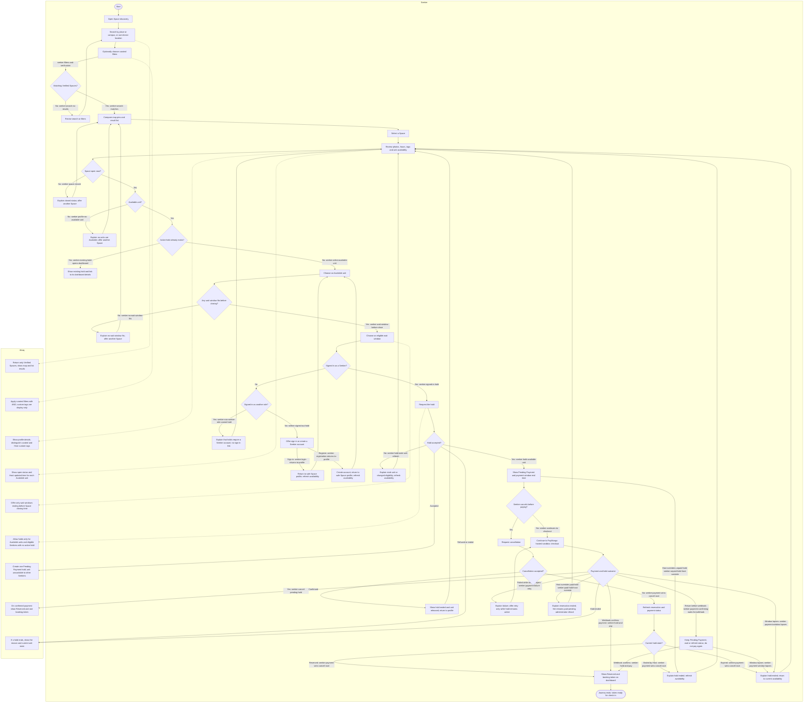

# Seeker journey

**Status:** draft · **Owner:** @fayeye-09 · **Approved by:** @dreeyanzz, @lukedongque ·
**Stories:** STORY-08, STORY-09, STORY-10, STORY-11 · **Decisions:** D-001, D-002, D-003, D-006, D-008, D-010, D-012, D-026, D-044, D-048, D-049, D-050, D-055, D-056, D-058

This journey follows a Seeker from discovery to a paid hold and booking token. It says what the Seeker sees, does and is told across search, the Space profile, authentication, the hold, sandbox checkout and dashboard. The named Playwright tests are planned; they do not yet exist.

## What this flow covers

- Search by a typed place or campus name or device location; map and list results; curated filters; and opening a Space profile (STORY-08).
- Reviewing a Space’s photos, hours, curated and Host custom tags, open status, and Available units per zone with Host-updated times; choosing a unit from the seat map or accessible list (STORY-11).
- Choosing an eligible wait window, authenticating as a Seeker when needed, making or cancelling a hold, and seeing a clear outcome when a unit cannot be held (STORY-09).
- PayMongo hosted sandbox checkout and the return to Worq. The sandbox payment confirmation flow (#175) owns callback handling and exact messages for duplicate, late and failed payments; its issue is open and its flow document is not written.
- The Reserved unit and booking token on the Seeker dashboard (STORY-10).
- What signed-out visitors and signed-in non-Seeker roles see when they try to hold a unit.

This flow links, but does not redraw, the merged [reservation lifecycle](reservation-lifecycle.md) or [Space verification flow](space-verification.md). The sandbox payment confirmation (#175) and check-in (#176) are separate flows whose issues are open and documents are not written. They own gateway callback details and check-in rules; later flow PRs should link the documents once both exist. This journey ends when the Seeker has the booking token. Cancellation of a paid Reserved hold after that point follows R8 in the reservation lifecycle; the fee is forfeited.

## Journey

Per D-058, after either sign-in or registration Worq returns the Seeker to the safe Space profile, rereads availability and requires a fresh unit selection. Login already supports a safe return target; STORY-09 must carry a validated, same-site Space-profile target through registration, which currently redirects to the Seeker dashboard. Authentication never reserves the unit. The decision is recorded in [issue #186](https://github.com/dreeyanzz/studyhub/issues/186).

## Paths and test coverage

These are planned cases, not a claim that tests already exist. James writes the journey tests under e2e as the stories land. Each ID below appears verbatim in the diagram.

| Path ID                                     | Expected Seeker experience                                                                                                                                           | Test that proves it                                                                                                                      |
| ------------------------------------------- | -------------------------------------------------------------------------------------------------------------------------------------------------------------------- | ---------------------------------------------------------------------------------------------------------------------------------------- |
| seeker-search-no-results                    | Explain there are no matching Spaces and let the Seeker revise search or filters.                                                                                    | Playwright e2e/seeker-journey.spec.ts: no-results search lets the Seeker revise the query.                                               |
| seeker-search-matches                       | Show Verified Spaces in map and list; selecting either opens that Space profile.                                                                                     | Playwright e2e/seeker-journey.spec.ts: search results open the selected profile.                                                         |
| seeker-filters-and-verification             | Curated filters combine with AND; custom tags are not filters; only Verified Spaces appear.                                                                          | Playwright e2e/seeker-journey.spec.ts: filters combine with AND and exclude custom tags and non-Verified Spaces.                         |
| seeker-space-closed                         | Show that the Space is closed now and offer no hold action.                                                                                                          | Playwright e2e/seeker-journey.spec.ts: a closed Space offers no hold action.                                                             |
| seeker-profile-no-available-unit            | Show that no units are Available; offer another Space or the results list.                                                                                           | Playwright e2e/seeker-journey.spec.ts: a profile with no Available units offers no hold action.                                          |
| seeker-existing-hold-opens-dashboard        | Explain the one-active-hold rule and link to the Seeker’s current hold instead of looping through another profile.                                                   | Playwright e2e/seeker-journey.spec.ts: an active hold directs the Seeker to its dashboard details.                                       |
| seeker-select-available-unit                | Allow selection from the seat map or keyboard-accessible list.                                                                                                       | Playwright e2e/seeker-journey.spec.ts: selecting a unit opens the wait-window step.                                                      |
| seeker-wait-window-before-close             | Offer only wait windows that end before closing time.                                                                                                                | Playwright e2e/seeker-journey.spec.ts: wait-window options fit before closing.                                                           |
| seeker-no-wait-window-fits                  | If none fit before closing, explain why and do not offer a hold.                                                                                                     | Playwright e2e/seeker-journey.spec.ts: no wait window fits before closing.                                                               |
| seeker-signed-in-hold                       | A signed-in Seeker can request a hold after choosing a unit and eligible wait window.                                                                                | Playwright e2e/seeker-journey.spec.ts: a signed-in Seeker can request a hold.                                                            |
| seeker-non-seeker-role-cannot-hold          | A signed-in Host or Administrator is told holds require a Seeker account, without a misleading sign-in link.                                                         | Playwright e2e/seeker-journey.spec.ts: a signed-in non-Seeker cannot place a hold.                                                       |
| seeker-signed-out-hold                      | A signed-out visitor is offered sign-in or Seeker registration before a hold request.                                                                                | Playwright e2e/seeker-journey.spec.ts: signed-out visitor is prompted to authenticate before holding.                                    |
| seeker-login-returns-to-profile             | Sign-in returns to the safe Space profile, rereads availability and requires a fresh unit selection.                                                                 | Playwright e2e/seeker-journey.spec.ts: login returns to profile and requires unit reselection.                                           |
| seeker-registration-returns-to-profile      | Registration returns to the safe Space profile, rereads availability and requires a fresh unit selection. STORY-09 updates registration to preserve the safe target. | Playwright e2e/seeker-journey.spec.ts: registration returns to profile and requires unit reselection.                                    |
| seeker-hold-stale-unit-refresh              | If the unit or eligibility changed after the profile read, explain the refusal and refresh availability.                                                             | Playwright e2e/seeker-journey.spec.ts: stale or ineligible hold request explains why it cannot proceed.                                  |
| seeker-hold-available-unit                  | Show Pending Payment and the payment-window end time; the hold prevents another Seeker from taking the unit.                                                         | Playwright e2e/seeker-journey.spec.ts: Seeker holds an Available unit and sees Pending Payment.                                          |
| seeker-cancel-pending-hold                  | A Seeker can cancel before payment without forfeiting a fee; the unit becomes Available again.                                                                       | Playwright e2e/seeker-journey.spec.ts: Seeker cancels an unpaid hold and sees the unit released.                                         |
| seeker-continues-to-checkout                | If the Seeker keeps the hold, continue to hosted checkout while the payment window is active.                                                                        | Playwright e2e/seeker-journey.spec.ts: Seeker continues an active hold to sandbox checkout.                                              |
| seeker-unpaid-hold-host-override            | If the Host ends an unpaid hold (R5), explain it ended and refresh availability.                                                                                     | Playwright e2e/seeker-journey.spec.ts: Host override ends the unpaid hold and refreshes availability.                                    |
| seeker-hold-and-pay                         | Once the webhook confirms payment (R2), show Reserved and one booking token.                                                                                         | Playwright e2e/seeker-journey.spec.ts: confirmed sandbox payment shows Reserved and one booking token.                                   |
| seeker-payment-confirming-waits-for-webhook | If checkout returns before the webhook, keep Pending Payment visible and wait or refresh; never send the Seeker back to pay again while confirmation is pending.     | Playwright e2e/seeker-journey.spec.ts: pending confirmation does not restart checkout.                                                   |
| seeker-payment-failure-retry                | For a failed payment while the window remains open, follow #175’s outcome and offer retry only if that flow allows it.                                               | Playwright e2e/seeker-journey.spec.ts: failed checkout shows its outcome and allowed next step; exact gateway messaging belongs to #175. |
| seeker-payment-window-lapses                | If the payment window expires before confirmation, explain that the hold ended and refresh availability.                                                             | Playwright e2e/seeker-journey.spec.ts: expired payment window releases the unit and returns to availability.                             |
| seeker-paid-hold-host-override              | If the Host overrides a paid Reserved hold (R9), explain the reservation ended and payment remains paid pending a sandbox refund; do not imply an automatic refund.  | Playwright e2e/seeker-journey.spec.ts: paid hold override explains reservation and payment outcomes.                                     |
| seeker-payment-wins-cancel-race             | If payment confirmation wins while cancellation is in flight (N21), do not claim cancellation succeeded; refresh and show the resulting status.                      | Manual check in STORY-09 design §4: confirm payment during cancellation and verify the refreshed status.                                 |

The lifecycle’s pgTAP tests prove reservation and payment rules, including the one-active-hold rule, lapse expiry, cancellation race protection (N21), Host override outcomes (R5 and R9), and payment transitions. The journey’s Playwright tests prove what the Seeker sees across screens; they do not replace database tests.

## Choices

- **Use map and list as equal discovery and selection paths.** A Seeker can open a Space from either a map pin or a list result, and choose a unit from the seat map or accessible list (D-003). This rejects a map-only flow that blocks keyboard users.
- **Keep curated and Host custom tags distinct.** Curated tags are the only filters; custom tags are display-only (D-006).
- **Use Leaflet with OpenStreetMap tiles.** Map search follows the project map decision (D-012).
- **Label availability Host-updated, not live or real-time.** The status is Host-maintained and may be stale until refreshed (D-002).
- **Authenticate at the hold boundary.** Search and profiles remain open to signed-out visitors; authentication happens when they request a hold. This rejects requiring an account before browsing. Only a signed-in Seeker may hold (FR-2.1 and lifecycle N5); D-008 covers one-active-hold limits.
- **Return to the profile after authentication and reselect (D-058).** Availability may change while a visitor authenticates. Login uses a safe return target; STORY-09 adds the same validated, same-site return behavior to registration. This rejects carrying a selection forward as if it were still available.
- **Keep gateway detail in the payment flow.** This journey shows the handoff and return; #175 owns signatures, duplicate/late callbacks and exact failure messages (D-010, D-056).
- **Link rather than redraw reservation state transitions.** R4, R5, R8, R9, R11, N21 and payment rules remain defined by the [reservation lifecycle](reservation-lifecycle.md), preserving one source of truth (D-044, D-050).

## Delegated behavior

- **Payment confirmation:** #175 owns PayMongo signatures, duplicate or late callbacks, failed-payment messaging and recovery (D-010, D-056). A browser return is not proof of payment; the webhook confirms R2.
- **Check-in:** this journey ends at the booking token. QR use, check-in and wrong-Space handling belong to #176.
- **Cancellation after payment:** a Seeker cancelling a paid Reserved hold from the dashboard follows R8 in the reservation lifecycle; the fee is forfeited. This happens after the journey endpoint.
- **Race outcomes:** if a cancel races with payment confirmation or a Host override, N21’s expected-status check decides which operation succeeds. STORY-09’s screen design names the refreshed outcome and its check.

