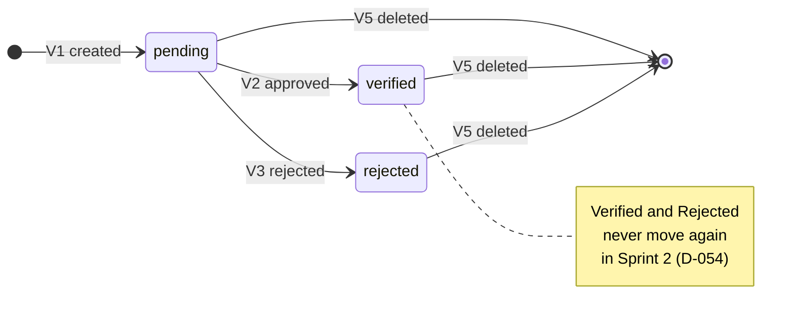

# Space verification

**Status:** draft · **Owner:** @dreeyanzz · **Approved by:** @fayeye-09 ·
**Stories:** STORY-01, STORY-05, STORY-08, STORY-11, STORY-14, STORY-15 ·
**Decisions:** D-027, D-037, D-052, D-053 to D-055

This flow follows a Space's verification status from the moment its Host creates it,
Pending, to an Administrator's decision: Verified, which makes it public, or Rejected,
which keeps it hidden (FR-5.1). It says who may make each move, what makes it, and what
each status shows signed-out visitors, Seekers, Hosts and Administrators.

## What this flow covers

- The three statuses, `pending`, `verified` and `rejected` (FR-5.1), and every move
  between them: who may make it, what makes it, and the pgTAP test that proves it.
- The moves nobody may make, each with its negative test.
- What each status shows signed-out visitors, Seekers, Hosts and Administrators.
- What a Host's edit and a Host's delete do to a Space's status (D-027).

It leaves these to others:

- **The [reservation lifecycle](reservation-lifecycle.md)** (#173): holds. A Seeker can
  hold a unit only in a Verified Space (its R1 and N4), and only its Host and
  Administrators see the units of a Pending or Rejected Space (its N19).
- **The [Host setup journey](host-setup-journey.md)** (#177): the Host's steps from a
  new Space to a public one, and what they are told on the way (D-042).
- **STORY-15's design:** the `/admin` page: what the verification queue shows for each
  Space, its order, and the Approve and Reject controls.
- **STORY-08's and STORY-11's designs:** how search and the Space profile show a Verified
  Space.
- **STORY-14's design** (Sprint 3): rejection reasons, a second review, taking a Verified
  Space down, and sending an edited Space back to Pending (D-037, D-054). Each one changes
  this flow by a pull request (D-044).

## The status

A Space's verification status is `spaces.status`, of type `space_status` (STORY-01). Only
an Administrator's decision moves it.

A Host's edit (V4) leaves every status as it was.

No Space leaves Verified in Sprint 2, so every Space with an active hold is Verified. This
flow never ends a hold, and refusing to delete a Space that has one is the reservation
lifecycle's job (D-052).

## Every move, and its test

Each move names who may make it, what makes it, and the pgTAP test that proves it. A test
is named by its file and its description. STORY-01's tests are in
`supabase/tests/02-spaces.sql`. STORY-15 creates `space-verification`, which gets its
number then (`supabase/tests/NN-name.sql`, [testing guide](../guides/testing.md)).

| #   | Move                   | Event                                    | Who may make it                                | Made by                                                                             | Test                                                                                                                                                              |
| --- | ---------------------- | ---------------------------------------- | ---------------------------------------------- | ----------------------------------------------------------------------------------- | ----------------------------------------------------------------------------------------------------------------------------------------------------------------- |
| V1  | → `pending`            | A Host creates a Space                   | A Host                                         | STORY-05's insert. `status` takes its default, and no role may insert it (STORY-01) | `02-spaces`: "a Host creates a space: it is pending and belongs to them"                                                                                          |
| V2  | `pending` → `verified` | An Administrator approves it on `/admin` | An Administrator                               | `public.set_space_status` (STORY-15)                                                | `space-verification`: "an Administrator approves a Pending Space, and a signed-out visitor can read it"                                                           |
| V3  | `pending` → `rejected` | An Administrator rejects it on `/admin`  | An Administrator                               | `public.set_space_status` (STORY-15)                                                | `space-verification`: "an Administrator rejects a Pending Space, and a Seeker still cannot read it"                                                               |
| V4  | Any, unchanged         | The Host edits its details               | The Space's Host                               | STORY-05's update, which can't send `status` (STORY-01)                             | `02-spaces`: "a Host edits their own verified space, and it stays verified"; `space-verification`: "a Host's edit leaves a Pending or a Rejected Space as it was" |
| V5  | Any → deleted          | The Host deletes the Space               | The Space's Host, unless it has an active hold | STORY-05's delete, and the reservation lifecycle's refusal for a held Space (D-052) | `02-spaces`: "a Host deletes their own space"; the reservation lifecycle's N17 for a Space with an active hold                                                    |

## Moves nobody may make

Each has its negative test (AGENTS.md rule 5). The [testing guide](../guides/testing.md)
says what each kind of denial looks like.

| #   | Nobody may                                                                                   | Stopped by                                                    | Test                                                                                                                                                                                                                                                                          |
| --- | -------------------------------------------------------------------------------------------- | ------------------------------------------------------------- | ----------------------------------------------------------------------------------------------------------------------------------------------------------------------------------------------------------------------------------------------------------------------------- |
| N1  | Set a Space's status when creating it                                                        | No role may insert `status` (STORY-01)                        | `02-spaces`: "a Host cannot set status when creating a space"                                                                                                                                                                                                                 |
| N2  | Write `status` directly, Administrators included                                             | No role may update `status` (STORY-01, D-053)                 | `02-spaces`: "a Host cannot verify their own space"; `space-verification`: "an Administrator cannot write status directly"                                                                                                                                                    |
| N3  | Approve or reject a Space, unless they are an Administrator                                  | `set_space_status` checks the caller's role                   | `space-verification`: "a Host cannot approve or reject a Space, their own included" and "a Seeker cannot approve or reject a Space"                                                                                                                                           |
| N4  | Run `set_space_status` signed out                                                            | `anon` may not run it                                         | `space-verification`: "a signed-out visitor cannot run set_space_status"                                                                                                                                                                                                      |
| N5  | Move a Space that isn't Pending, in Sprint 2 (D-054)                                         | `set_space_status` moves Pending Spaces only                  | `space-verification`: "an Administrator cannot move a Verified or a Rejected Space"                                                                                                                                                                                           |
| N6  | Edit a Host's Space as an Administrator (D-053)                                              | STORY-01's update policy matches the Space's Host only        | `space-verification`: "an Administrator updating a Host's space affects 0 rows"                                                                                                                                                                                               |
| N7  | Read a Pending or Rejected Space, unless they are its Host or an Administrator (D-055)       | STORY-01's select policy                                      | `02-spaces`: "an anonymous visitor lists verified spaces only", "a Seeker lists verified spaces only" and "another Host sees neither the first Host's pending spaces nor the new one"; `space-verification`: "a Seeker and a signed-out visitor cannot read a Rejected Space" |
| N8  | Find a Pending or Rejected Space in search, its own Host and Administrators included (D-055) | STORY-08's search, which filters `status = 'verified'` itself | Named by STORY-08's design: "search returns only Verified Spaces, even to their Host and to an Administrator"                                                                                                                                                                 |
| N9  | Decide a Space that changed after the Administrator read it (D-053)                          | `set_space_status` compares the `updated_at` they saw         | `space-verification`: "an Administrator cannot decide a Space that changed since they read it"                                                                                                                                                                                |

The [reservation lifecycle](reservation-lifecycle.md#moves-nobody-may-make) stops three
more: holding a unit in a Space that isn't Verified (its N4), seeing the units of a
Pending or Rejected Space (its N19), and deleting a Space with an active hold (its N17).

## The function

`public.set_space_status` (D-053), which Adrian writes for STORY-15 (D-036):

- It takes a Space's id, the status to give it, and the `updated_at` the Administrator
  saw. It runs as `security definer` with an empty `search_path`. `authenticated` may run
  it, and `anon` may not.
- It refuses anyone who isn't an Administrator with `42501`, the same error a missing
  grant gives, so every denial looks alike.
- It refuses if the Space has changed since the Administrator read it, so an approval
  covers the version they saw (D-053). A Host's edit after the decision still keeps the
  status (D-027). STORY-15's page passes `updated_at` on exactly as the database returned
  it: a JavaScript `Date` drops its microseconds, and the comparison would always fail.
- It moves a Space only from `pending`, to `verified` or `rejected` (D-054). It refuses
  anything else: a Space that isn't Pending or doesn't exist, or `pending` as the new
  status. Its update matches Pending rows only, so when two Administrators decide one
  Space at once, the second is refused instead of overwriting the first.
- Like any change to the row, it moves `spaces.updated_at`, through STORY-01's trigger.
  So the "Last updated" time on the Host's card (STORY-05) shows when the decision was
  made. Nothing records who made it in Sprint 2.
- STORY-15's migration also rewrites the comment on `spaces.status`, which still says
  STORY-14 changes it.

STORY-15's Server Actions call it (D-010). STORY-14's design can widen the moves it
allows, by a pull request to this flow.

## What each status shows

Seekers and signed-out visitors see the same thing, and so does a Host looking at another
Host's Space. Maria words what each person is told (D-042): the
[Host setup journey](host-setup-journey.md) draws the Host's side, and STORY-15's design
the queue.

| Status     | Seekers and signed-out visitors                                                                                           | The Space's Host                                                                                                                           | Administrators                                                                                                                          |
| ---------- | ------------------------------------------------------------------------------------------------------------------------- | ------------------------------------------------------------------------------------------------------------------------------------------ | --------------------------------------------------------------------------------------------------------------------------------------- |
| `pending`  | Nothing. Search leaves it out (STORY-08), and its profile reads as not found (STORY-11, D-055)                            | Listed on `/host` as "Pending verification" (STORY-05). Nothing in this flow stops them setting up its seat map, tags and photos meanwhile | Listed in the verification queue on `/admin` (STORY-15), with Approve and Reject. They can read the Space and its units before deciding |
| `verified` | In search and on its profile, with its units (STORY-08, STORY-11). Its units can be held (the reservation lifecycle's R1) | Listed on `/host` as "Verified", and public like any Verified Space                                                                        | Out of the queue, and readable like any Space                                                                                           |
| `rejected` | Nothing, as for `pending`                                                                                                 | Listed on `/host` as "Rejected", with no reason (D-037). They can still edit it (V4) or delete it (V5)                                     | Out of the queue, and readable, but no screen lists it in Sprint 2                                                                      |

## A Host's edit, and deleting a Space

- **Editing** never changes the status, whatever it is (D-027, D-037). STORY-05's update
  can't send `status`, and nothing else changes it on an edit. The risk we accept: a Host
  can rename a Verified Space to anything until STORY-14's moderation (FR-5.2).
- **Deleting:** STORY-05 lets a Host delete their own Space in any status. The reservation
  lifecycle refuses it while the Space has an active hold (D-052), and in Sprint 2 only a
  Verified Space can have one.

## Choices made

Each choice has its entry in [DECISIONS](../DECISIONS.md), with what it rejected:

- **D-053:** a Space's status changes only through `public.set_space_status`, no role is
  granted the column, and an Administrator decides only the version they read. It replaces
  D-037's policy and grant, which would have let a Host verify their own Space.
- **D-054:** an Administrator decides a Space from the moment it's created, with or
  without units, and in Sprint 2 the decision is final.
- **D-055:** only a Verified Space is public. Search filters `status = 'verified'` itself,
  and a hidden Space's link reads as not found.

Two choices stay as they were: a Host's edit never changes the status (D-027, D-037), and
the Host sees no rejection reason (D-037). STORY-14's design revisits both.

## Open questions

None in this flow. One limit outside it: D-013 and D-028 keep the Administrator account
off the cloud dev project and production, and the sign-up trigger refuses `admin`
(STORY-01). So V2 and V3 can be made only on the local stack until that changes.
