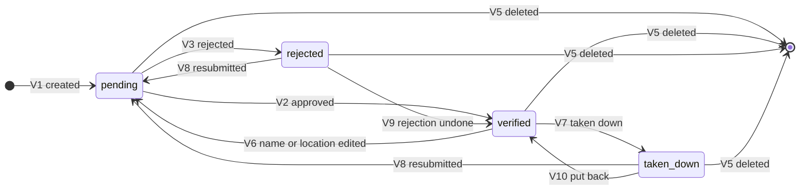

# Space verification

**Status:** implemented 2026-11-15 · **Sprint 3 change (#340):** approved 2026-11-22 ·
**Owner:** @dreeyanzz · **Approved by:** @fayeye-09; the Sprint 3 change, @dreeyanzz, who
merged it · **Stories:** STORY-01, STORY-05, STORY-08, STORY-11, STORY-14, STORY-15,
STORY-20 · **Decisions:** D-027, D-037, D-052, D-053 to D-055, D-079, D-084 to D-086

This flow follows a Space's verification status from the moment its Host creates it,
Pending, to an Administrator's decision: Verified, which makes it public, or Rejected,
which keeps it hidden (FR-5.1). Sprint 3 adds what comes after a decision (D-079): a
reason for each rejection, the Host resubmitting, a Verified Space going back to Pending
when its name or location changes, an Administrator taking a Verified Space down, and
undoing either decision. It says who may make each move, what makes it, what happens to a
Space's holds when it stops being public, and what each status shows signed-out visitors,
Seekers, Hosts and Administrators.

## What this flow covers

- The four statuses, `pending`, `verified`, `rejected` and `taken_down`, and every move
  between them: who may make it, what makes it, and the pgTAP test that proves it.
- The moves nobody may make, each with its negative test.
- What a Host's edit, resubmission and delete do to a Space's status (D-027, D-079).
- What happens to a Space's holds when it leaves Verified (D-085).
- The reason an Administrator gives, the list of changes, and the live notice an
  Administrator gets when a Host edits the Space they are looking at (D-086).
- What each status shows signed-out visitors, Seekers, Hosts and Administrators.

It leaves these to others:

- **The [reservation lifecycle](reservation-lifecycle.md)** (#173): holds. A Seeker can
  hold a unit only in a Verified Space (its R1 and N4), and only its Host and
  Administrators see the units of a Space that isn't Verified (its N19). It draws the two
  moves this flow causes, R13 and R14, a take-down cancelling a hold.
- **The [sandbox payment confirmation flow](sandbox-payment-confirmation.md)** (#175): a
  payment Stripe confirms after its hold was cancelled (its P2).
- **The [Host setup journey](host-setup-journey.md)** (#177): the Host's steps from a new
  Space to a public one, and what they are told on the way (D-042).
- **STORY-14's design:** the sandbox refund (the reservation lifecycle's P1), which a
  take-down calls, and the payments page, where a refund that failed waits.
- **STORY-15's design:** the `/admin` queue as Sprint 2 built it.
- **STORY-20's design:** the screens for everything here: the reason field, the "Edited"
  and "Resubmitted" marks, the Rejected and Taken down lists, the list of changes, the
  live notice, Take down, Undo, Put back, Resubmit, and the Host's warning before an edit.
  It also confirms the table and column names below.
- **STORY-08's and STORY-11's designs:** how search and the Space profile show a Verified
  Space.
- **STORY-17:** how all of it looks. Once Maria or James restyle a screen, what they built
  wins on what users see (D-074).

## The status

A Space's verification status is `spaces.status`, of type `space_status` (STORY-01). Only
an Administrator's decision makes a Space Verified, Rejected or Taken down. A Host's
resubmission, or their edit to a Verified Space's name or location, can make it Pending,
never anything else (D-037, D-079, D-084).

A Host's other edits (V4) leave every status as it was.

**Leaving Verified.** A Space stops being public in two ways: its Host edits its name or
location (V6), or an Administrator takes it down (V7). An Administrator may also reject it
once V6 has made it Pending again (V3). New holds stop at once in every case, because a
Seeker can hold only in a Verified Space (the reservation lifecycle's R1 and N4). What
happens to the holds it already has is in
[Leaving Verified, and its holds](#leaving-verified-and-its-holds). So, from Sprint 3, a
Space with an active hold isn't always Verified, which D-054 assumed in Sprint 2.

## Every move, and its test

Each move names who may make it, what makes it, and the pgTAP test that proves it. A test
is named by its file and its description. STORY-01's tests are in
`supabase/tests/02-spaces.sql`, and STORY-15's in `supabase/tests/05-space-verification.sql`,
which STORY-20 extends ([testing guide](../guides/testing.md)).

| #   | Move                                   | Event                                                                                                      | Who may make it                                | Made by                                                                             | Test                                                                                                                                                                                                                                                                                                       |
| --- | -------------------------------------- | ---------------------------------------------------------------------------------------------------------- | ---------------------------------------------- | ----------------------------------------------------------------------------------- | ---------------------------------------------------------------------------------------------------------------------------------------------------------------------------------------------------------------------------------------------------------------------------------------------------------- |
| V1  | → `pending`                            | A Host creates a Space                                                                                     | A Host                                         | STORY-05's insert. `status` takes its default, and no role may insert it (STORY-01) | `02-spaces`: "a Host creates a space: it is pending and belongs to them"                                                                                                                                                                                                                                   |
| V2  | `pending` → `verified`                 | An Administrator approves it on `/admin`                                                                   | An Administrator                               | `public.set_space_status`                                                           | `space-verification`: "an Administrator approves a Pending Space, and a signed-out visitor can read it"; "approving a Space clears its reason and adds it to the list of changes"                                                                                                                          |
| V3  | `pending` → `rejected`                 | An Administrator rejects it on `/admin`, with a reason                                                     | An Administrator                               | `public.set_space_status`. If V6 made it Pending, it also cancels holds (R13, R14)  | `space-verification`: "an Administrator rejects a Pending Space, and a Seeker still cannot read it"; "an Administrator rejects a Pending Space with a reason, and its Host reads it"; "rejecting an edited Space cancels its unpaid and paid holds"                                                        |
| V4  | Any, unchanged                         | The Host edits anything but a Verified Space's name, address or map pin                                    | The Space's Host                               | STORY-05's update, which can't send `status` (STORY-01)                             | `02-spaces`: "a Host edits their own verified space, and it stays verified", which STORY-20 changes to edit the description, because it renames the Space today; `space-verification`: "a Host's edit leaves a Pending or a Rejected Space as it was"; "a Host's edit leaves a Taken down Space as it was" |
| V5  | Any → deleted                          | The Host deletes the Space                                                                                 | The Space's Host, unless it has an active hold | STORY-05's delete, and the reservation lifecycle's refusal for a held Space (D-052) | `02-spaces`: "a Host deletes their own space"; the reservation lifecycle's N17 for a Space with an active hold                                                                                                                                                                                             |
| V6  | `verified` → `pending`                 | The Host changes a Verified Space's name, address or map pin, after a warning. The queue marks it "Edited" | The Space's Host                               | A `before update` trigger on `spaces` (STORY-20). Its holds keep running (D-079)    | `space-verification`: "a Host's change to a Verified Space's name, address or pin sends it back to Pending, marked Edited"; "saving a Verified Space with the same name, address and pin keeps it Verified"; "a Verified Space sent back to Pending by an edit keeps its holds running"                    |
| V7  | `verified` → `taken_down`              | An Administrator takes it down, with a reason                                                              | An Administrator                               | `public.set_space_status`, which also cancels holds (R13, R14)                      | `space-verification`: "an Administrator takes a Verified Space down with a reason, and a Seeker cannot read it"; "a take-down cancels the Space's unpaid and paid holds"; "a visit under way keeps running after a take-down"                                                                              |
| V8  | `rejected` or `taken_down` → `pending` | The Host resubmits it. The queue marks it "Resubmitted", with the last reason                              | The Space's Host                               | `public.resubmit_space` (STORY-20)                                                  | `space-verification`: "a Host resubmits their Rejected Space, and it returns to Pending, marked Resubmitted, with its reason"; "a Host resubmits their Taken down Space"                                                                                                                                   |
| V9  | `rejected` → `verified`                | An Administrator undoes a rejection                                                                        | An Administrator                               | `public.set_space_status`                                                           | `space-verification`: "an Administrator undoes a rejection, and a signed-out visitor can read the Space"                                                                                                                                                                                                   |
| V10 | `taken_down` → `verified`              | An Administrator puts a Space back                                                                         | An Administrator                               | `public.set_space_status`. The holds V7 cancelled stay cancelled                    | `space-verification`: "an Administrator puts a Taken down Space back, and the holds its take-down cancelled stay cancelled"                                                                                                                                                                                |

Every Administrator move (V2, V3, V7, V9 and V10) applies only to the version of the Space
the Administrator saw (N9), and every move but V1, V4 and V5 adds an entry to the
[list of changes](#the-reason-and-the-list-of-changes). So does each change to a Space's
name, address or map pin, whatever its status.

## Moves nobody may make

Each has its negative test (AGENTS.md rule 5). The [testing guide](../guides/testing.md)
says what each kind of denial looks like.

| #   | Nobody may                                                                                                                                                             | Stopped by                                                                                                                   | Test                                                                                                                                                                                                                                                                                                                                                                                           |
| --- | ---------------------------------------------------------------------------------------------------------------------------------------------------------------------- | ---------------------------------------------------------------------------------------------------------------------------- | ---------------------------------------------------------------------------------------------------------------------------------------------------------------------------------------------------------------------------------------------------------------------------------------------------------------------------------------------------------------------------------------------- |
| N1  | Set a Space's status when creating it                                                                                                                                  | No role may insert `status` (STORY-01)                                                                                       | `02-spaces`: "a Host cannot set status when creating a space"                                                                                                                                                                                                                                                                                                                                  |
| N2  | Write `status` directly, Administrators included                                                                                                                       | No role may update `status` (STORY-01, D-053)                                                                                | `02-spaces`: "a Host cannot verify their own space"; `space-verification`: "an Administrator cannot write status directly"                                                                                                                                                                                                                                                                     |
| N3  | Approve, reject, take down, undo or put back a Space, unless they are an Administrator                                                                                 | `set_space_status` checks the caller's role                                                                                  | `space-verification`: "a Host cannot approve or reject a Space, their own included", "a Seeker cannot approve or reject a Space" and "a Host cannot take down, undo or put back a Space, their own included"                                                                                                                                                                                   |
| N4  | Run `set_space_status` or `resubmit_space` signed out                                                                                                                  | `anon` may run neither                                                                                                       | `space-verification`: "a signed-out visitor cannot run set_space_status"; "a signed-out visitor cannot run resubmit_space"                                                                                                                                                                                                                                                                     |
| N5  | Make a move `set_space_status` doesn't allow: send a Space to Pending, reject a Space that isn't Pending, take down one that isn't Verified, or approve a Verified one | `set_space_status` allows only V2, V3, V7, V9 and V10                                                                        | `space-verification`: "an Administrator cannot send a Space to Pending"; "an Administrator cannot reject a Verified Space"; "an Administrator cannot take down a Pending, Rejected or Taken down Space". STORY-20 replaces Sprint 2's "an Administrator cannot move a Verified or a Rejected Space" and "an Administrator cannot move a Rejected Space to verified", which V7 and V9 now allow |
| N6  | Edit a Host's Space as an Administrator (D-053)                                                                                                                        | STORY-01's update policy matches the Space's Host only                                                                       | `space-verification`: "an Administrator updating a Host's space affects 0 rows"                                                                                                                                                                                                                                                                                                                |
| N7  | Read a Space that isn't Verified, unless they are its Host or an Administrator (D-055)                                                                                 | STORY-01's select policy                                                                                                     | `02-spaces`: "an anonymous visitor lists verified spaces only", "a Seeker lists verified spaces only" and "another Host sees neither the first Host's pending spaces nor the new one"; `space-verification`: "a Seeker and a signed-out visitor cannot read a Rejected Space"; "a Seeker and a signed-out visitor cannot read a Taken down Space"                                              |
| N8  | Find a Space that isn't Verified in search, its own Host and Administrators included (D-055)                                                                           | STORY-08's search, which filters `status = 'verified'` itself                                                                | `lib/data/spaces.test.ts`: "enforces status = verified invariant (D-055)", which checks that the search filters on `status = 'verified'` whoever asks                                                                                                                                                                                                                                          |
| N9  | Decide a Space that changed after the Administrator read it (D-053)                                                                                                    | `set_space_status` compares the `updated_at` they saw                                                                        | `space-verification`: "an Administrator cannot decide a Space that changed since they read it"                                                                                                                                                                                                                                                                                                 |
| N10 | Reject or take down a Space without a reason, or with one longer than 500 characters                                                                                   | `set_space_status`, and a check on `spaces.status_reason`                                                                    | `space-verification`: "an Administrator cannot reject or take down a Space without a reason"; "a reason longer than 500 characters is refused"                                                                                                                                                                                                                                                 |
| N11 | Resubmit a Space they don't own, or one that isn't Rejected or Taken down                                                                                              | `resubmit_space` checks the caller is the Space's Host, and its status                                                       | `space-verification`: "a Host cannot resubmit another Host's Space"; "a Host cannot resubmit a Pending or a Verified Space"; "a Seeker and an Administrator cannot resubmit a Space"                                                                                                                                                                                                           |
| N12 | Read a rejection or take-down reason, unless they are the Space's Host or an Administrator                                                                             | N7's policy, and V2, V9 and V10 clearing the reason, so a Verified Space never has one                                       | `space-verification`: "a Space's reason is cleared when it becomes Verified"                                                                                                                                                                                                                                                                                                                   |
| N13 | Read a Space's list of changes, unless they are an Administrator                                                                                                       | The select policy on `space_events`                                                                                          | `space-verification`: "a Host and a Seeker read 0 rows of the list of changes, their own Space's included"                                                                                                                                                                                                                                                                                     |
| N14 | Write to the list of changes directly                                                                                                                                  | No grant on `space_events`: only the functions and the trigger write it                                                      | `space-verification`: "nobody can write to the list of changes directly"                                                                                                                                                                                                                                                                                                                       |
| N15 | See a Taken down Space's units or hold terms, unless they are its Host or an Administrator                                                                             | `unit_states` and `hold_terms`, which from STORY-20 hide every Space that isn't Verified, not only Pending and Rejected ones | `space-verification`: "unit_states returns 0 rows for a Taken down Space, except to its Host and Administrators"; "hold_terms returns nothing for a Taken down Space"                                                                                                                                                                                                                          |

The [reservation lifecycle](reservation-lifecycle.md#moves-nobody-may-make) stops three
more: holding a unit in a Space that isn't Verified (its N4), seeing the units of a Space
one may not see (its N19), and deleting a Space with an active hold (its N17).

## Leaving Verified, and its holds

New holds stop the moment a Space leaves Verified (R1, N4). What happens to the holds it
already has depends on who made it leave (D-079, D-085):

| How it left Verified                            | Pending Payment holds                             | Reserved holds                                                       | Occupied holds                                                          |
| ----------------------------------------------- | ------------------------------------------------- | -------------------------------------------------------------------- | ----------------------------------------------------------------------- |
| The Host's name or location edit (V6)           | Keep running                                      | Keep running                                                         | Keep running                                                            |
| A take-down (V7), or rejecting it after V6 (V3) | Cancelled (R13), and their Stripe checkout closed | Cancelled (R14), and the fee refunded through STORY-14's refund (P1) | Keep running, to check-out or closing time (R10 to R12), with no refund |

- **Why Occupied holds keep running:** the Seeker is already there, so the Host has
  honoured the hold, and D-005 refunds only a hold the Host can't honour.
- **The order of work:** the database can't call Stripe. So `set_space_status` cancels the
  holds in the same transaction as the move, and returns the holds it cancelled, with each
  one's payment status and Stripe checkout. STORY-20's Server Action then closes each open
  checkout and asks for each paid fee's refund, through STORY-14's refund code.
- **When something fails:** a refund that fails leaves its payment `paid`, and it waits on
  STORY-14's payments page for an Administrator to retry. A payment that gets through
  before its checkout closes is the payment flow's P2: it is recorded as `paid` on a
  cancelled hold, and refunded from the same page.
- **What the Seeker sees:** a hold that keeps running still works. The Seeker's own
  reservation is read through a function that reads the Space whatever its status, so they
  keep their booking token, and the Host can still check them in (R6), which doesn't check
  the status either. A cancelled hold's page says the Space was taken down and the fee is
  refunded. R13 and R14 record that a take-down ended the hold, so the page can say so;
  STORY-20's design names the column. Nothing is emailed: the only email is the hold
  confirmation (D-083, D-089).
- **Putting it back:** V9 and V10 don't bring cancelled holds back. They have ended (the
  reservation lifecycle's N11).

## The reason, and the list of changes

**The reason** (D-079, D-084). An Administrator types one for every rejection (V3) and
take-down (V7). It is required, trimmed, and at most 500 characters (N10). It is kept on
the Space, and only its Host and Administrators can read it (N12). A resubmission (V8)
keeps it, so the queue can show it next to "Resubmitted". Becoming Verified (V2, V9, V10)
clears it.

**The list of changes** (D-086). Each Space has one, which only Administrators read
(N13), and only the database writes (N14). It holds:

- every status move but V1 and V5: who made it, when, and its reason if it had one;
- every change to the Space's name, address or map pin, as old → new, whatever the
  Space's status, with who made it and when.

On `/admin` it reads newest first. Everything since the Space was last Verified stands
out, and the newest entry stands out most. It is deleted with its Space. Edits to the
description, hours and price tier aren't listed.

**The queue** (STORY-15's page, which STORY-20 changes):

- It lists Pending Spaces by how long they have waited, oldest first: from when each one
  last became Pending, not from when it was created.
- It marks each by the move that made it Pending: no mark after V1, "Edited" after V6, and
  "Resubmitted", with the last reason, after V8.
- Separate lists hold Rejected and Taken down Spaces, for Undo (V9) and Put back (V10).
  STORY-20's design places Take down (V7) for a Verified Space.

## The live notice

While an Administrator has a Space open on `/admin`, a change to that Space reaches their
screen at once (D-086). They see that the Host has just changed it, and its newest entry in
the list of changes stands out. Approve, Reject, Take down, Undo and Put back wait until
the latest version has loaded.

- It uses Supabase Realtime: `spaces` joins the `supabase_realtime` publication, and the
  page listens for updates to the Space it shows. Realtime applies each listener's row
  level security, so a listener hears only about Spaces they may read.
- It watches the Space's own row, which is what N9's version check covers. Photos, tags
  and the seat map are other tables, so they aren't watched, and N9 doesn't cover them
  either.
- If the notice never arrives, for example on a dropped connection, N9 still refuses the
  decision, and the page loads the latest version and says why.
- Its test is a Playwright one, as it needs a browser: `e2e/space-verification.spec.ts`:
  "an Administrator looking at a Space sees the Host's edit at once, and decides the
  latest version".

## How the database enforces it

Adrian writes this part (D-075). The names here are the ones to use, and STORY-20's design
confirms them (Glossary). STORY-20's migrations:

- **`space_status` gains `taken_down`.** A new enum value can't be used in the
  transaction that adds it, so it gets a migration of its own, before any migration that
  uses it.
- **`spaces` gains** `status_reason` (the reason, 1 to 500 characters after trimming,
  otherwise null), `status_changed_at` and `status_changed_by` (who moved the status last,
  and when). No role is granted any of them. The queue's order comes from
  `status_changed_at`.
- **`space_events`, the list of changes:** one row per entry, with its Space (deleted with
  it), the status before and after (both null for an edit that didn't move it), the
  reason, the old and new value of each of the name, address and map pin that changed,
  who made it (kept as null if their account is deleted), and when. Administrators may
  read it, and no role may write it.
- **`public.set_space_status`** takes the reason as a fourth argument, and replaces
  STORY-15's three-argument version:
  - It refuses anyone who isn't an Administrator with `42501` (N3), and a Space that
    changed since they read it (N9).
  - It allows only V2, V3, V7, V9 and V10 (N5). It needs a reason for V3 and V7 (N10), and
    clears it for V2, V9 and V10.
  - It sets `status_changed_at` and `status_changed_by`, and adds the entry to the list of
    changes.
  - For V3 and V7, it records lapses first (D-047), then cancels the Space's
    `pending_payment` and `reserved` holds (R13, R14). Only a Space V6 made Pending can
    still have any when it is rejected. It locks units, then reservations, then payments,
    the reservation lifecycle's order. It returns the holds it cancelled, with each one's
    payment status and Stripe checkout.
- **`public.resubmit_space`** (V8) takes a Space's id. Only the Space's Host may run it, on
  a Rejected or Taken down Space (N11), and `anon` may not (N4). It keeps the reason, and
  sets `status_changed_at` and `status_changed_by`.
- **A `before update` trigger on `spaces`** (V6): when a Verified Space's `name`,
  `address`, `latitude` or `longitude` changes to a different value, it makes the Space
  Pending. A Verified Space with no map pin that gets one counts as a change.
- **An `after update` trigger on `spaces`** adds each change to the name, address or map
  pin to the list of changes, and V6's move with it.
- **`public.unit_states` and `public.hold_terms`** hide every Space that isn't Verified
  from all but its Host and Administrators (N15). Today they check for `pending` or
  `rejected`, so `taken_down` would slip past both.

Every function runs as `security definer` with an empty `search_path`, and grants
`authenticated` only. Like any change to the row, each move also moves `spaces.updated_at`,
through STORY-01's trigger, which is what N9 compares.

## What each status shows

Seekers and signed-out visitors see the same thing, and so does a Host looking at another
Host's Space. Adrian and Luke build the Sprint 3 screens, and Maria and James restyle them
once built (D-073, D-074).

| Status       | Seekers and signed-out visitors                                                                                           | The Space's Host                                                                                                                                                         | Administrators                                                                                                                                                    |
| ------------ | ------------------------------------------------------------------------------------------------------------------------- | ------------------------------------------------------------------------------------------------------------------------------------------------------------------------ | ----------------------------------------------------------------------------------------------------------------------------------------------------------------- |
| `pending`    | Nothing. Search leaves it out (STORY-08), and its profile reads as not found (STORY-11, D-055)                            | Listed on `/host` as "Pending verification" (STORY-05), with the last reason after a resubmission. Nothing stops them setting up its seat map, tags and photos meanwhile | In the queue, marked "Edited" or "Resubmitted" when that is how it got there, with Approve and Reject. They can read the Space, its units and its list of changes |
| `verified`   | In search and on its profile, with its units (STORY-08, STORY-11). Its units can be held (the reservation lifecycle's R1) | Listed on `/host` as "Verified", and public like any Verified Space. Warned before saving a change to its name, address or map pin that it will go back to Pending       | Readable like any Space, with Take down                                                                                                                           |
| `rejected`   | Nothing, as for `pending`                                                                                                 | Listed on `/host` as "Rejected", with the reason. They can edit it (V4), resubmit it (V8) or delete it (V5)                                                              | In the Rejected list, with the reason and Undo                                                                                                                    |
| `taken_down` | Nothing, as for `pending`. A Seeker whose hold the take-down cancelled sees that on the hold's page                       | Listed on `/host` as "Taken down", with the reason. They can edit it (V4), resubmit it (V8) or delete it once no visit there is under way (V5)                           | In the Taken down list, with the reason and Put back                                                                                                              |

## A Host's edit, resubmitting, and deleting

- **Editing** a Verified Space's name, address or map pin sends it back to Pending (V6),
  after a warning, and only when the value really changes, so saving the form unchanged
  doesn't. Every other edit, and any edit to a Space that isn't Verified, leaves the
  status as it was (V4, D-027, D-079).
- **Resubmitting** (V8) needs no edit first, and has no limit. Each one costs an
  Administrator one more look, and they can reject again.
- **Deleting:** STORY-05 lets a Host delete their own Space in any status. The reservation
  lifecycle refuses while it has an active hold (D-052), so a visit a take-down left
  running blocks the delete until it ends.

## Choices made

Each choice has its entry in [DECISIONS](../DECISIONS.md), with what it rejected:

- **D-053, amended by D-084:** a Space's status changes only through
  `public.set_space_status`, `public.resubmit_space` and the V6 trigger, no role is
  granted the column, and an Administrator decides only the version they read.
- **D-054, amended by D-079 and D-084:** an Administrator decides a Space from the moment
  it's created, with or without units. From Sprint 3, a decision can be undone.
- **D-055:** only a Verified Space is public. Search filters `status = 'verified'` itself,
  and a hidden Space's link reads as not found.
- **D-079:** a rejection has a reason the Host sees, a Host can resubmit, a name or
  location edit sends a Verified Space back to Pending, and an Administrator can take a
  Verified Space down.
- **D-084:** a taken-down Space has a status of its own, `taken_down`, and an
  Administrator can undo a rejection or put a taken-down Space back.
- **D-085:** a take-down, or rejecting an edited Space, cancels the holds whose visit
  hasn't started and refunds the paid ones, and visits under way finish.
- **D-086:** the list of changes, and the live notice through Supabase Realtime.

## Open questions

None in this flow. STORY-20's design confirms the names and draws the screens, and
STORY-14's design settles how a refund is recorded (P1).
